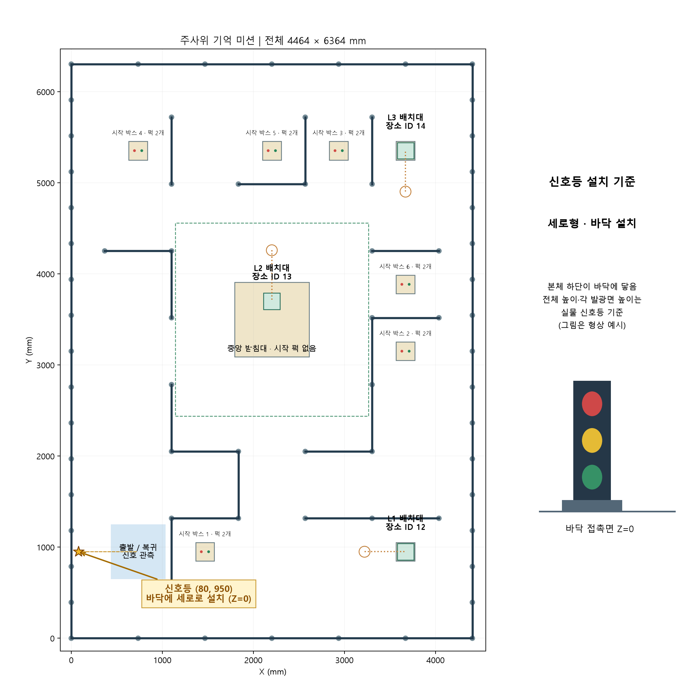
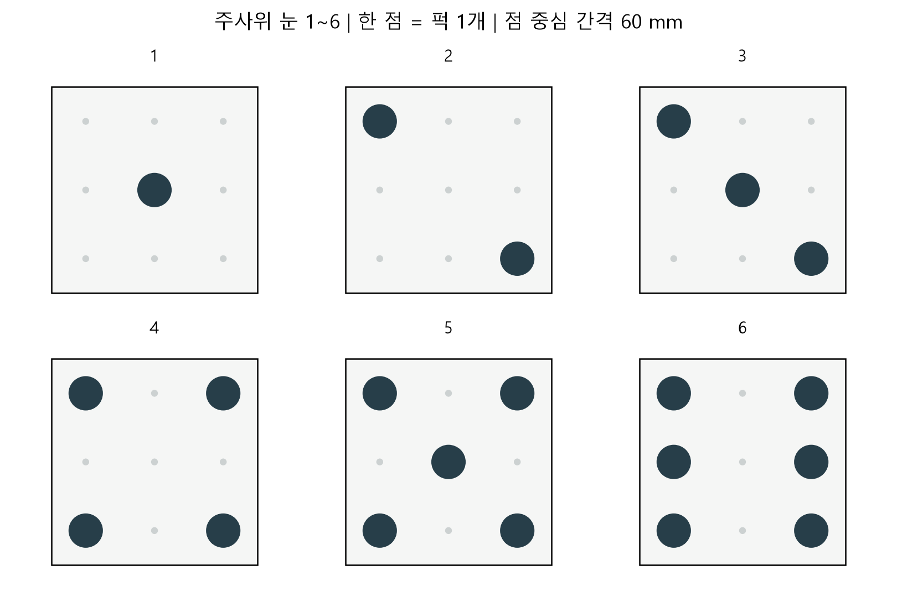

# MISSION — 🎲 주사위 기억 로봇 (최종 확정 문제 · 발제 2026-11-04)

> 원문: [dice-mission.pdf](dice-mission.pdf) (11쪽 — 본문 8쪽 + 도전 과제 3쪽). 아래는 정리본이고, 다르면 **PDF가 맞다**.

**한 줄 요약** — 출발 구역에서 신호등 **12회 점멸**의 색 순서와 R·Y·G 횟수를 기억하고, **바코드**로 세 횟수의 정렬 방향을 정해
L1·L2·L3에 그 횟수만큼 퍽으로 **주사위 눈**을 만든 뒤, 카메라로 다시 확인하고 **출발 구역으로 복귀**한다.

---

## 1. 고정 조건

| 항목 | 조건 |
| --- | --- |
| 경기장 | 4464 × 6364 mm · 기존 벽·기둥·박스 위치 유지 (맵 추첨 완료 — 주사위 맵) |
| 원점 | 왼쪽 아래 기둥 중심 = X/Y 0, 바닥 = Z 0 · 지도 위쪽 = +Y |
| 퍽 | 총 **12개** · 빨강·초록 수량은 문제마다 랜덤 · **파랑·노랑 퍽 없음** |
| 퍽 모양 | Ø30×60 원기둥 또는 30×30×60 직육면체 · 색상별 모양 수량 고정 없음 (실제 12개 목록으로 출제) |
| 퍽 높이 | 퍽 바닥 Z=70 · 윗면 Z=130 mm (70mm 박스 위) |
| 장소 | L1~L3 세 곳 (시작 때 비어 있음) · 신호등 1개 · 점멸 총 12회 |
| 시작 배치 | 시작 박스 6곳 × 퍽 2개 |
| 완료 | 퍽 12개를 세 장소에 **동시에** 놓음 · 한 퍽은 한 장소만 (중복 불가) |
| 시간·회차 | 시간 제한 없음 · 공식 2회 중 **높은 회차 전체 점수** (회차끼리 합치지 않음) |

### 그룹의 뜻 (R · Y · G)

| 그룹 | 쓰는 퍽 | 개수 |
| --- | --- | --- |
| **R** | 빨간 퍽만 (모양 섞여도 됨) | R 점멸 횟수 |
| **G** | 초록 퍽만 (모양 섞여도 됨) | G 점멸 횟수 |
| **Y** | 색은 섞여도 되지만 **모양은 하나로 통일** (전부 원기둥 또는 전부 직육면체) — 노란 퍽은 없음 | Y 점멸 횟수 |

---

## 2. 맵과 좌표



| 위치 | 좌표 (mm) | 비고 |
| --- | --- | --- |
| 출발 / 복귀 · 신호 관측 | 로봇 중심 **(734, 950)**, **-X 방향**을 보고 관측 | 복귀 = 차체 전체가 출발 구역 안에서 3초 정지 |
| 신호등 | 본체 하단 **(80, 950, 0)**, 바닥에 세로로 세움, +X를 향함 | 발광면 높이는 실물 기준 |
| 바코드 | 중심 **(80, 650, 450)**, +X 방향 | Code 128 |
| **L1** (장소 태그 ID **12**) | **(3670, 950)** | 기존 205×205×70 박스 |
| **L2** (장소 태그 ID **13**) | **(2202, 3700)** | 중앙 820×820 받침대(410×410×70 박스 4개)의 북쪽 · 중앙엔 시작 퍽 없음 |
| **L3** (장소 태그 ID **14**) | **(3670, 5354)** | 기존 205×205×70 박스 |
| 시작 박스 1~6 | (1468,950) · (3670,3152) · (2936,5354) · (734,5354) · (2202,5354) · (3670,3886) | 205×205×70 박스 위에 퍽 2개: 중심 **X±40, Y=0** · ID 배정은 placement.csv |

- 장소 태그는 접근 방향에 수직인 면에, 중심 높이 35 mm.
- 박스: 큰 410 규격 4개(중앙) · 작은 205 규격 8개(시작 6 + 목적지 2) = 12개.

---

## 3. 신호와 바코드 (모든 팀 같은 운영 기준)

| 항목 | 규칙 |
| --- | --- |
| 시작 | 로봇 준비 완료 후 운영자가 신호 시퀀스 시작 |
| 1회 점멸 | 한 색 **1초 켜짐 + 1초 소등** — 같은 색 연속도 소등으로 구별 |
| 종료 | 12번째 점멸 뒤 **3초 연속 소등** (별도 초록 출발 신호 없음) |
| 출발 | 12개 기록 완료 · 종료 확인 · 바코드 해독 **후** 이동 |
| 횟수 | R·Y·G 각 1~6회, 합 12 · 풀 수 있는 조합만 출제 |
| 소등·누락 | 소등은 횟수에 안 셈 · 누락·불명 색을 **추정 금지** (→ 오류 기록 후 안전 정지) |
| 동률 | 횟수가 같으면 **R → Y → G** 순서 유지 |

| 바코드 (Code 128) | 정렬 → L1 · L2 · L3 순서로 배정 |
| --- | --- |
| **P2-01 · P2-03** | **오름차순** — 적은 횟수부터 |
| **P2-02 · P2-04** | **내림차순** — 많은 횟수부터 |

정렬 대상은 **R·Y·G 그룹의 횟수**다 (퍽 ID·장소 번호가 아님). 기록 로그에는 색 순서 12개와 각 횟수를 모두 저장한다.

---

## 4. 주사위 눈 (장소마다)



| 항목 | 기준 |
| --- | --- |
| 격자 | 장소 중심 기준 X, Y 각각 **-60 · 0 · +60 mm** (3×3) · 배치 영역 180×180 mm |
| 성공 | 정해진 점마다 퍽 1개 · **중심 오차 10 mm 이내** · **2초 안정** |
| 높이 | 모든 퍽 바닥 Z=70 — 쌓기·바닥 임시 보관 금지 |
| 방향 | 모든 장소 같은 방향 (지도 위쪽 +Y) · 2·3의 대각선, 6의 좌우 두 열은 그림 그대로 — **회전 대체 불가** |
| 실패 | 빈 격자에 퍽이 더 있으면 그 장소 실패 |

눈 좌표 (장소 중심 기준, mm — 그림에서 읽음):

| 눈 | 점 (ΔX, ΔY) |
| --- | --- |
| 1 | (0, 0) |
| 2 | (-60, +60) · (+60, -60) |
| 3 | (-60, +60) · (0, 0) · (+60, -60) |
| 4 | (-60, +60) · (+60, +60) · (-60, -60) · (+60, -60) |
| 5 | 4의 네 점 + (0, 0) |
| 6 | (-60, +60) · (-60, 0) · (-60, -60) · (+60, +60) · (+60, 0) · (+60, -60) |

집는 순서는 자유. 다만 **R/G를 먼저 가져가다 Y(같은 모양)를 못 만들게 되지 않도록 12개 전체 할당을 먼저 계획**해야 한다.

---

## 5. 출제·할당 조건

- 빨강 수 + 초록 수 = 12 · 색·모양별 수량은 고정 아님.
- 12개를 **중복·누락 없이** 한 번씩 사용: R 그룹 = 빨강 R개, G 그룹 = 초록 G개, Y 그룹 = 남은 퍽 Y개가 **한 모양**.
- ID 0~11은 퍽 식별자일 뿐 색을 영구 지정하지 않는다 → 회차마다 등록표(색·모양·시작 좌표) 확인.
- 운영자 검증: ① 실제 12개 ID·색·모양 등록 → ② 합 12인 신호 후보 → ③ Y를 한 모양으로 고르고 남은 퍽이 R/G에 정확히 맞는지 → ④ 유효 할당이 하나 이상인 후보만 추첨.
- 예: 빨강 8 · 초록 4, 같은 모양 빨강 3개 → R5·Y3·G4 가능 (그 빨강 3개 = Y, 나머지 빨강 5 = R, 초록 4 = G).
- 공개 예제(Q1 그림 · placement.csv · mission.json · example-combinations.csv)는 **빨강 6 · 초록 6** 설명용 — 경기 고정 비율 아님.
- 같은 회차는 전 팀이 같은 퍽 구성·배치·신호.

---

## 6. 공개 연습 문제 Q1 (풀이)

신호 `R G R R G R G G Y G Y G` · 바코드 **P2-01 (오름차순)**

```text
횟수      R 4 · Y 2 · G 6   (합 12)
오름차순  Y 2 → R 4 → G 6
배정      L1 = Y 눈 2 · L2 = R 눈 4 · L3 = G 눈 6
퍽 (예제 빨강6·초록6)  G는 초록 6개 전부 → Y 2개는 빨강 중 같은 모양 2개 → 남은 빨강 4개 = R
```

수행 순서: ① 출발 구역에서 바코드 읽기 → ② 12회 점멸 관측 → ③ 횟수 계산·유효성 확인 → ④ 세 장소에 그룹 배정 →
⑤ 시작 박스 퍽 탐색·인식, 전체 할당 → ⑥ 주행·집기·놓기 → ⑦ 세 장소 재검증 → ⑧ 복귀.
기록: `signal.json`, `allocation.json`, 이동 전후 이미지·영상.

**오류·종료**: 12회 미만/초과 · 불명 색 · 미등록 바코드 · ID 중복/누락 → 오류 기록 후 **안전 정지**.
팀 오류로 신호 재시연·수동 수정 후 이어가기 없음 (운영 장비 오류만 같은 조건 재시도). 비상정지·포기·고장 시 그때까지 유효 점수.

---

## 7. 채점 (경기 원점수 100)

| 항목 | 배점 | 판정 |
| --- | --- | --- |
| 신호 순서 기억 | 12 | 12개 시점별 색 일치 각 1 |
| 색상별 횟수 | 9 | R·Y·G 정답 각 3 |
| 바코드 해석 | 4 | 실물 코드 + 정렬 방향 모두 일치 |
| 장소 그룹 배정 | 9 | L1~L3 각 3 |
| 색상·모양 선택 | 18 | 장소별 개수 + R/G 색 또는 Y 모양 모두 충족, 각 6 |
| 주사위 눈 배치 | 30 | 장소별 눈·위치·안정 모두 충족, 각 10 |
| 이동 후 검증 | 8 | **새 관측** 기반 장소별 ID·위치 기록 각 2 (6) + 전체 중복/누락 판정 2 |
| 복귀 | 10 | 차체 전체가 출발 구역 안에서 3초 정지 |

- 목표 상태를 복사한 로그는 재검증으로 인정 안 함. 순서·횟수·바코드는 **실제 센서 관측 기록**으로 평가.
- 감점·시간 가산점 없음.
- 프로젝트 통합 경기 항목 25점 = 원점수 × 0.20 + 자율 완주 5점 (신호·정렬·세 장소 정답·재검증·복귀 **전부** 성공 시).
  기존 구조 유지: 팀 문제 검토 10 · 기본 20 · 결합 15 · 통합 25 · 재현/문서 10 · 개인 20.

---

## 8. 제출물

| 단계 | 제출물 |
| --- | --- |
| 발제 후 검토 | problem.md, signals.json, placement.csv, 할당 정답표, 검증 기록 (팀마다 실제 퍽 12개 속성·시작 좌표, 12회 신호 순서, 바코드, 유효 할당 정답·검증 결과) |
| 중간 | 노드·토픽·상태도, 신호·바코드·집기 시험 결과, 미완료 Issue |
| 최종 | main 코드·설정·README, 전체 영상, 센서/할당/재검증 로그 |
| 개인 | 병합 PR·리뷰·시험·전체 동작 설명 근거 (각 5점) |

4인 1조, 기술 역할 고정 없음 · Issue마다 구현자·검토자 지정. 중간·최종 제출일은 별도 공지.
기존 경로 검토는 같은 평면 조건 참고일 뿐 — 새 집기 동작의 도달 거리·운반 간섭·태그 시야는 따로 입증해야 한다.

---

## 9. 도전 과제 (선택 · 추가 배점 없음)

| 과제 | 목표 | 방법 · 완료 기준 | 제출 (`challenge/<A·B·C>/`) |
| --- | --- | --- | --- |
| **A. 인식 안정화** | 조명·관측 거리 변화에서 신호 인식 오류 줄이기 | 기존 vs 개선 설정 × 한 변수 3조건 × 같은 12회 시퀀스 5회 = 30회(360 점멸). 순서 정확도·횟수 완전 일치율·오류 정지·지연 비교 | report.md, results.csv, 설정 2개, 원본 영상·로그 |
| **B. 퍽 할당 알고리즘** | 먼저 집은 퍽 때문에 Y를 못 만드는 문제 예방 | 고정 6건(유효 4 · 불가능 2) — 순차 선택 vs 전체 탐색. 개선 방식은 유효 4건 모두 12개 할당, 불가능 2건은 명시적 오류 | cases.json, expected.json, results.csv, 코드·report.md |
| **C. 이동 경로 개선** | 정답 유지하며 왕복 줄이기 | 같은 문제·배치·속도 제한에서 기존 vs 개선 방문 순서 각 3회(총 6). 실제 통과 가능 경로·접근점 사용. 이동거리·시간·완주·정지/충돌 비교 | routes.csv, results.csv, 경로 그림, 영상·report.md |

