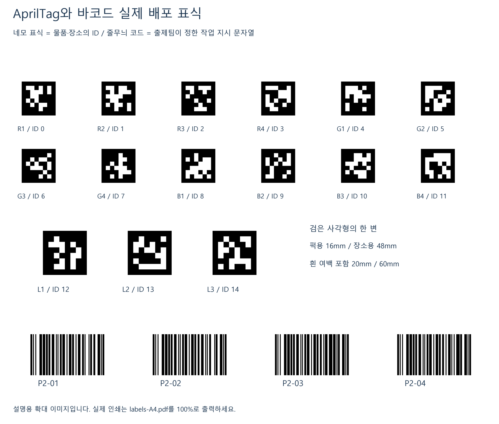
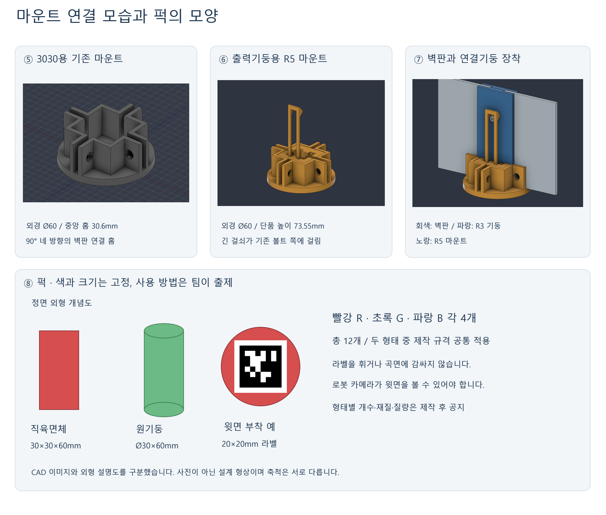
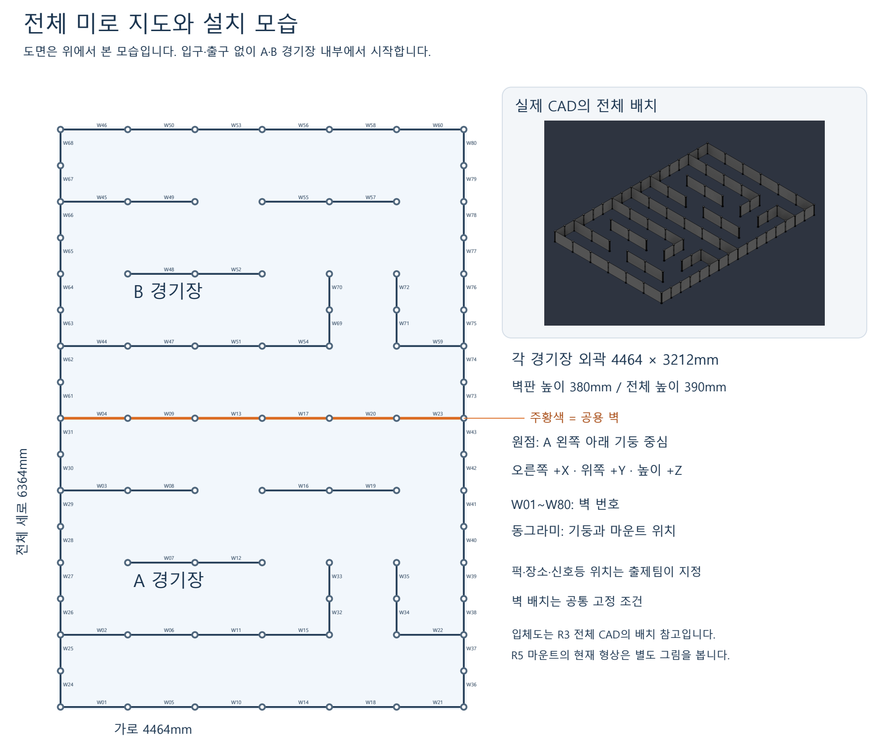
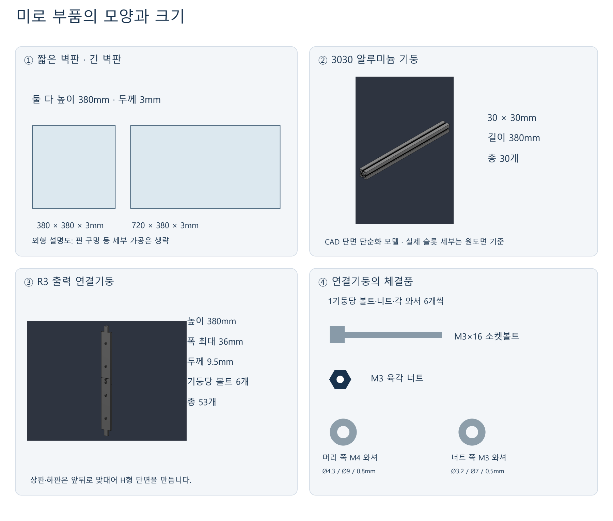

# MISSION — 🚦 신호등 암호 미션 (퍽 고르기 · 번호 합 · 목적지)

> 원문: 팀 노션 「신호등 암호 미션 — 퍽 고르기 · 번호 합 · 목적지」
> https://app.notion.com/p/teamsparta/4022dc3ef514804b924ad28d6a5fad94
> 신호등이 깜빡이는 횟수와 색으로 "어떤 색 퍽을 몇 개, 태그 번호 합이 얼마가 되게, 어느 목적지에" 옮길지 알려 주는 미션.
> 로봇은 신호를 세고 → 계산하고 → 퍽 윗면 태그를 읽어 맞는 조합을 찾아 → 옮겨야 한다.

---

## 1. 사용하는 규격

| 물체 | 내용 |
| --- | --- |
| 퍽 | 빨강 R · 초록 G · 파랑 B 각 4개, 총 12개 (원문 미션은 "파랑은 빠질 예정" — 배포 그림엔 B1~B4 태그가 있음) · 사각기둥 30×30×60mm / 원기둥 Ø30×60mm (두 형태 중 제작 규격 공통 적용) |
| 퍽 태그 (윗면) | AprilTag tag36h11 · 검은 사각형 한 변 16mm (흰 여백 포함 20mm 라벨) · R1~R4 = 0~3 · G1~G4 = 4~7 · B1~B4 = 8~11 |
| 장소 태그 | tag36h11 · 48mm (흰 여백 포함 60mm) · L1~L3 = 12 · 13 · 14 · 장소(도착 박스)에 부착 |
| 바코드 (줄무늬) | P2-01 ~ P2-04 — 출제팀이 정한 **작업 지시 문자열**, 장소(space)에 붙음 (예: 오름차순 주사위 모양으로 놓기 · 눕혀 놓기) |
| 신호등 | 빨강 · 노랑 · 초록 |

네모 표식 = 물품·장소의 ID / 줄무늬 코드 = 작업 지시. 라벨은 휘거나 곡면에 감싸지 않고, 로봇 카메라가 퍽 윗면을 볼 수 있어야 한다.
형태별 개수·재질·질량은 제작 후 공지. 실제 인쇄는 labels-A4.pdf를 100%로.





### 경기장

| 항목 | 내용 |
| --- | --- |
| 크기 | A · B 두 경기장, 각 외곽 4464 × 3212mm (전체 가로 4464 × 세로 6364mm), 가운데 주황 벽이 A·B 공용 벽 |
| 시작 | 입구·출구 없이 A·B 경기장 **안에서** 시작 |
| 좌표 | 원점 = A 왼쪽 아래 기둥 중심 · 오른쪽 +X · 위쪽 +Y · 높이 +Z |
| 벽 | W01~W80 (벽 번호), 동그라미 = 기둥과 마운트 위치. 벽판 높이 380mm · 전체 높이 390mm. 벽 배치는 공통 고정 조건 |
| 배치 | 퍽·장소·신호등 위치는 출제팀이 지정 |
| 벽판 | 짧은 벽판 380 × 380 × 3mm · 긴 벽판 720 × 380 × 3mm |
| 기둥 | 3030 알루미늄 기둥 30 × 30mm · 길이 380mm · 30개 / R3 출력 연결기둥 높이 380mm · 폭 최대 36mm · 두께 9.5mm · 기둥당 볼트 6개 · 53개 |
| 마운트 | 3030용 기존 마운트 외경 Ø60 · 중앙 홈 30.6mm (90° 네 방향 벽판 홈) / 출력기둥용 R5 마운트 외경 Ø60 · 단품 높이 73.55mm |





---

## 2. 신호 읽는 법 — 3단계

### 1단계 · 무슨 색 퍽을 몇 개

- 한 가지 색이 N번 깜빡임 → 그 색 퍽 N개 사용
- 예: 빨강 2번 깜빡 → 빨간 퍽 2개

### 2단계 · 태그 번호의 합

- 색마다 점수를 미리 정해 둠 (모두 1 / 모두 다른 수, 예: 빨강 1 · 노랑 2 · 초록 3)
- 세 색이 무작위 순서로 깜빡임 → 깜빡인 색의 점수를 모두 더한 값 = 고를 퍽들의 태그 번호 합
- 예: 점수 모두 1 · 빨강·노랑·초록·초록·빨강 (5번) → 합 5

### 3단계 · 목적지

| 노랑 깜빡임 | 목적지 |
| --- | --- |
| 1번 | 12번 태그 |
| 2번 | 13번 태그 |
| 3번 | 14번 태그 |

---

## 3. 전체 예시

```text
1단계  빨강 ●● (2번)                  → 빨간 퍽 2개
2단계  빨 노 초 초 빨 (점수 모두 1)    → 합 5
3단계  노랑 ●● (2번)                  → 13번 목적지
정답: 빨간 퍽(0~3) 중 번호 합 5인 2개 = 2 + 3 (R3 · R4)을 13번 박스로
```

---

## 4. 만들 수 있는 합 (출제할 때 꼭 확인)

| 개수 | 빨간 퍽 (0~3) | 초록 퍽 (4~7) | 파란 퍽 (8~11) |
| --- | --- | --- | --- |
| 1개 | 0 ~ 3 | 4 ~ 7 | 8 ~ 11 |
| 2개 | 1 ~ 5 | 9 ~ 13 | 17 ~ 21 |
| 3개 | 3 ~ 6 | 15 ~ 18 | 27 ~ 30 |
| 4개 | 6 | 22 | 38 |

> ⚠️ 빨간 퍽 2개에 "세 색 2번씩 = 합 6"은 불가능 (최대 2 + 3 = 5). 초록 퍽이면 점수를 크게 줘야 9 이상이 나옴.

---

## 5. 왜 재미있고 어려운가

- 시간 신호를 세야 함 — 한 장 사진으로는 못 풂. 깜빡임을 놓치거나 두 번 세면 실패
- 계산이 들어감 — 점수를 더해 목표 합을 만들고, 그 합이 되는 퍽 조합을 찾아야 함
- 퍽 번호는 윗면 16mm 태그에만 — 같은 색 퍽은 겉모습이 같아서 가까이서 위에서 봐야 앎
- 본 번호를 기억해야 함 — 여러 퍽 번호를 기억해 둬야 맞는 조합을 고름
- 규칙만 알면 사람도 쉽게 답을 확인할 수 있어 공정함

---

## 6. 정해야 할 것

- 단계 구분 신호 (제안: 세 색 동시에 3초 켜짐)
- 깜빡임 속도 (제안: 0.5초 켜짐 · 0.5초 꺼짐)
- 2단계 색 점수 — 모두 1 / 다르게 · 다르면 공지 방법
- 답이 여러 개일 때 인정 범위 (예: 빨강 2개 합 3 = 0+3 또는 1+2)
- 신호 반복 여부 (한 번 / 반복)
- 신호등 위치·높이

---

## 7. 로봇 구현 (beebot 스택)

그림은 §1 (표식 · 퍽 · 경기장 · 미로 부품).

표식: 퍽 윗면 AprilTag tag36h11 16mm(흰 여백 포함 20mm) R1~R4 = 0~3 · G1~G4 = 4~7 · B1~B4 = 8~11 /
장소 태그 48mm(60mm) L1~L3 = 12~14 / 줄무늬 바코드 P2-xx = 장소(space)에 붙은 작업 지시 문자열 (예: 오름차순 주사위 모양으로 놓기 · 눕혀 놓기).
퍽: 빨강·초록·파랑 각 4개, 30×30×60mm 사각기둥 / Ø30×60mm 원기둥. 경기장 A·B 각 4464×3212mm, 벽 0.38m, 원점 = A 왼쪽 아래 기둥.

| 할 일 | 맡은 곳 | 상태 |
| --- | --- | --- |
| 신호등 상태 (빨·노·초·꺼짐 · 두 색 이상 동시 = `all`) | perception `classify_color` | 구현 |
| 깜빡임 시퀀스 → 1·2·3단계 답 `/mission/signal` {color, count, sum, dest_tag} | **signal_decoder** (plan) — 단계 구분 = `all` 2초 · 꺼짐 3초, 점수·목적지 태그·확정 횟수는 plan.yaml | 구현 (§6 확정되면 파라미터만) |
| 퍽 윗면 태그 → 그 퍽의 `details tag` (한 번 읽으면 기억 · 색도 태그 번호대로) | perception (OpenCV aruco — 새 라이브러리 없음, OpenCV 4.6·4.7+ 둘 다) | 구현 |
| 16mm 태그 읽기 동작 — pole_front_cam(640×360)은 한 칸 1~2px라 못 읽음 | coordinator **`inspect <퍽 id>`** — 손끝을 퍽 윗면 위 0.15m로 (gripper_cam 한 칸 약 6px) | 구현 |
| 장소 태그 → class `location` 물체 (`tag`) | perception | 구현 |
| 바코드 → class `barcode` 물체 (`content`) + `/mission/qr` | perception (**zxing-cpp** — 발제 바코드는 Code128이라 OpenCV barcode(EAN·UPC만)로는 못 읽음) → planner → VLM이 해석 · 사람이 계획(ai-service backend human) | 구현 |
| 조합 계산 · 계획 | vlm_task_planner 규칙 (VLM 안 씀): 번호 아는 그 색 퍽 중 합이 맞는 조합(가까운 것 우선) → 적재함에 싣고 목적지 장소로 · 없으면 번호 모르는 퍽 inspect → 다시 판단 · 목적지 태그 못 봤으면 대기 · 끝내 없으면 say | 구현 |
| 수납 확인 (옮긴 퍽이 목적지에 그대로 있는지) | vlm_task_planner 규칙: 옮긴 직후 한 번 + `verify_period_s`(60초)마다 (AUTO · 하던 계획 없을 때) 목적지로 가서 근처 번호 모르는 퍽 inspect → 옮긴 번호가 `verify_radius_m`(0.2m) 안에 다 있으면 끝 · 다른 곳에 보이면 다시 옮김 · 안 보이면 say. 새 명령·신호가 오면 그만 | 구현 (실기 미확인) |
| 퍽 크기 30×60mm | perception 크기 기본값 · coordinator 적재함 높이 | 반영 |
| 바코드 지시의 놓는 방식 (주사위 모양 배치 · 눕히기) | — | **없음** — 지금 skill로는 표현 못 함 (VLM은 say로 알림) |
| 시뮬레이터 (깜빡임 신호등 · 퍽/장소 태그 · 바코드 판) | simulator | **없음** |

데이터 흐름:

```text
신호등 깜빡임 → perception (traffic_light color) → signal_decoder → /mission/signal
퍽 윗면 태그 → (inspect: gripper_cam이 내려다봄) → perception details tag (기억)
장소 태그 → perception location (tag) · 장소 바코드 → perception barcode (content) · /mission/qr → VLM
vlm_task_planner: 합이 맞는 조합 → /task/sub_goals [navigate → pick → place tray] × N → navigate(장소) → [pick tray → place 장소] × N
  → 수납 확인: navigate(장소) → [inspect 근처 퍽] → 옮긴 번호가 다 있나 (없으면 다시 옮김 · say) — 그 뒤 주기마다 반복
```
