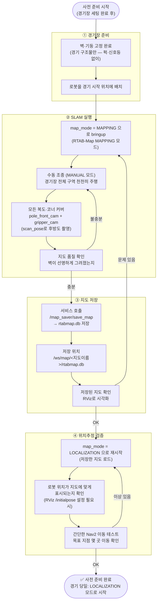
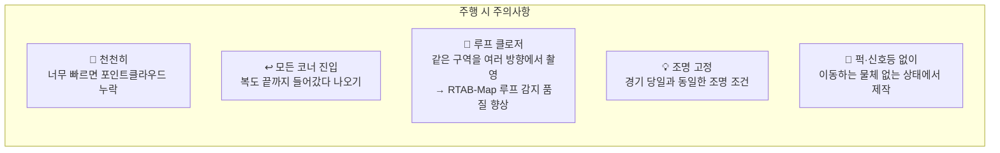
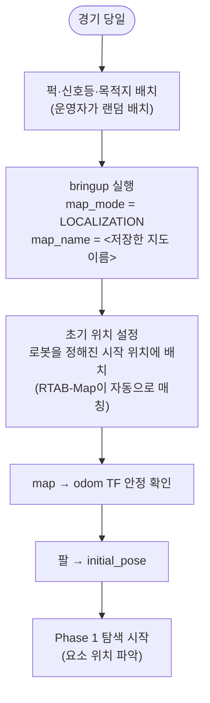

# 사전 준비 — 경기 전 지도 제작 (SLAM)

> 경기 당일 전에 **딱 한 번** 수행. 경기장 구조(벽)가 바뀌지 않는 한 재사용 가능.
> 퍽·신호등·목적지는 경기마다 랜덤 배치되므로 **지도에 포함하지 않는다.**

---

## 전체 흐름

---

## SLAM 주행 요령

---

## 경기 당일 준비

---

## 지도 관련 명령 참고

| 작업 | 방법 |
|------|------|
| SLAM 시작 | `map_mode = MAPPING` 으로 bringup |
| 지도 저장 | `/map_saver/save_map` 서비스 호출 |
| 지도 전환 | `/cmd/map_name <이름>` 토픽 발행 → state_manager가 RTAB-Map에 로드 |
| LOCALIZATION 전환 | `/cmd/map_mode LOCALIZATION` 토픽 발행 |
| 지도 목록 확인 | `/state/map_list` 토픽 구독 |
| 현재 지도 확인 | `/state/map_name` 토픽 구독 |
