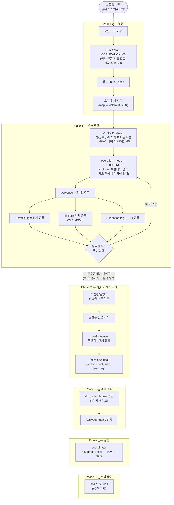
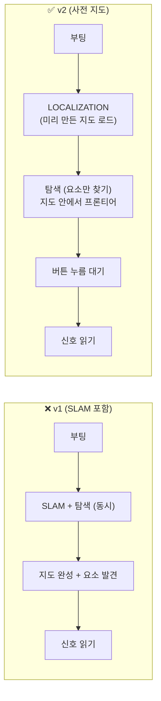
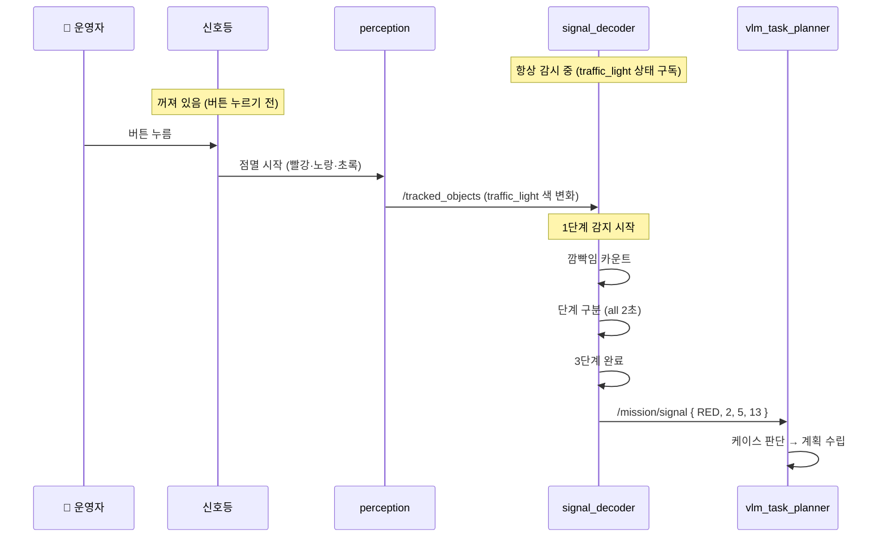
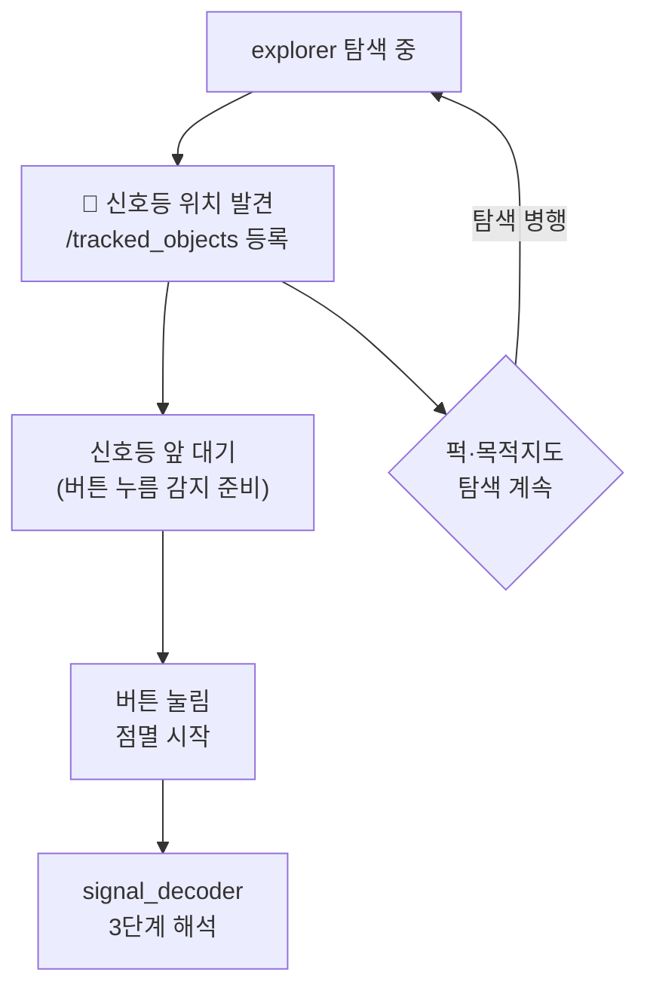

# 전체 흐름 다이어그램 (v2 — 사전 지도 + 버튼 신호)

> **전제 변경 (v2)**
> - 지도(map)는 **경기 전 미리 SLAM 완료** → 경기 시작 시 LOCALIZATION 모드로 시작
> - 퍽·신호등·목적지 위치는 **경기마다 랜덤 배치** → 탐색으로 발견해야 함
> - 신호등은 **사람이 버튼을 눌러야 점멸 시작** → 버튼 누르기 전엔 감시할 필요 없음

---

## 5단계 전체 흐름

---

## 핵심 차이: v1 vs v2

**달라지는 점:**
- SLAM 없음 → `map_mode = LOCALIZATION`으로 시작, `RTAB-Map`은 위치추정만
- explorer는 여전히 필요 — **지도는 있어도 퍽/목적지 위치는 카메라로 찾아야 함**
- 신호등 점멸은 **버튼 트리거** → signal_decoder는 항상 감시 상태이지만, 버튼 누르기 전엔 아무것도 깜빡이지 않음

---

## 신호 대기 상세

---

## 탐색 중 신호등 발견 → 대기 진입

> **구현 포인트:**
> signal_decoder는 `traffic_light`가 `off` 상태에서 갑자기 점멸 시작되는 것을 감지.
> 버튼 누르는 이벤트를 별도로 구독할 필요 없이, 점멸 자체가 트리거.
