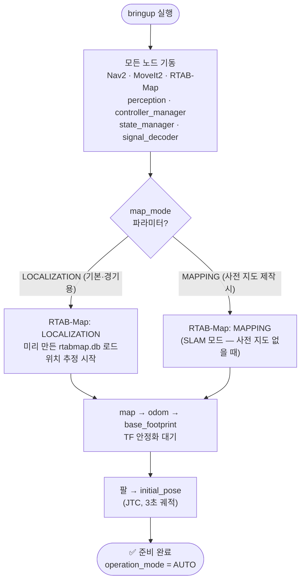
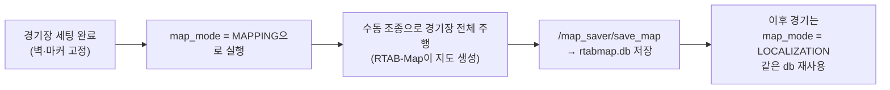
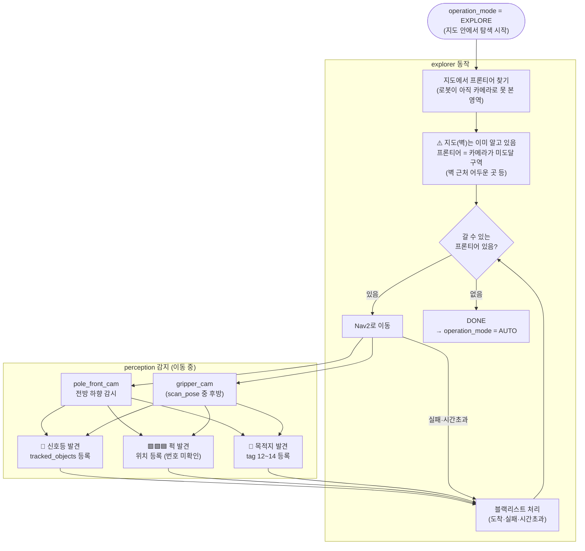
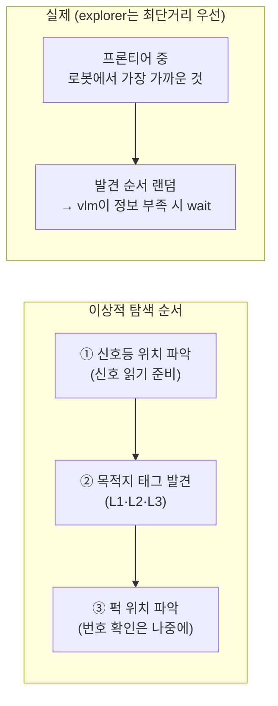
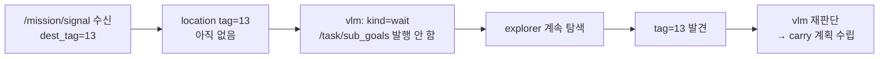

# Phase 0 — 부팅 & Phase 1 — 요소 탐색 (v2)

> v2 핵심: 지도는 미리 있음. SLAM 없이 LOCALIZATION 모드로 시작.
> 퍽·신호등·목적지 위치만 카메라로 찾으면 됨.

---

## Phase 0 — 부팅



### 경기 전 사전 작업 (한 번만)



> ⚠️ 퍽·신호등·목적지는 **경기마다 위치가 바뀌므로 지도에 포함시키지 않음**.
> 지도에는 벽·구조물만 담기고, 요소들은 매 경기 perception이 새로 발견.

---

## Phase 1 — 요소 탐색



### 탐색 우선순위 전략



### 신호등 발견 후 동작

신호등 위치가 `tracked_objects`에 등록되면:
- **signal_decoder가 자동으로 감시 시작** (별도 명령 불필요)
- 버튼이 눌리기 전이므로 신호등은 꺼져 있음 → signal_decoder는 대기 상태
- 탐색은 계속 진행 (퍽·목적지 찾기)

### 목적지 미발견 상태에서 신호가 먼저 오면



---

## Phase 0~1 타임라인 (예상)

```
T+0s   bringup 실행
T+3s   RTAB-Map 지도 로드 완료 · TF 안정
T+6s   팔 initial_pose 완료
T+7s   EXPLORE 시작
T+10s  신호등 발견 → signal_decoder 대기 진입
T+30s  퍽 4개 발견, 목적지 L2 발견
T+50s  나머지 퍽 발견 · 프론티어 소진 → AUTO 복귀
         (또는 충분히 발견 시 수동으로 AUTO 전환)
T+51s  버튼 누름 대기 중...
```
