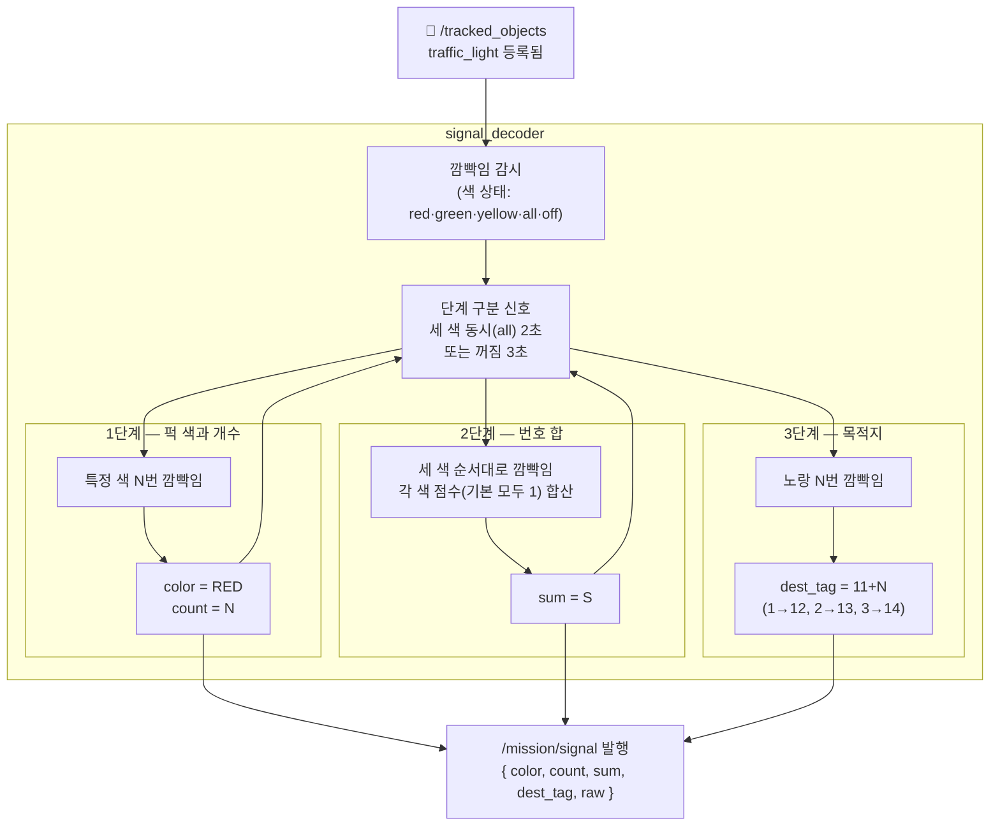

# Phase 2 — 신호 읽기

> 목적: 신호등 깜빡임 3단계를 해석해 "어떤 색 퍽 몇 개를, 번호 합 얼마로, 어느 목적지로" 를 확정.

## 흐름



## 깜빡임 예시

```
신호등 시퀀스:
  [all 켜짐 2초]  ← 1단계 시작 신호
  빨강 ● 꺼짐 ● 꺼짐   → RED 2번
  [all 켜짐 2초]  ← 2단계 시작 신호
  빨강 ● 노랑 ● 초록 ● 초록 ● 빨강 ●  → 점수 합 5 (모두 1점)
  [all 켜짐 2초]  ← 3단계 시작 신호
  노랑 ● 노랑 ●   → 목적지 tag=13

결과: /mission/signal
  color    = "red"
  count    = 2
  sum      = 5
  dest_tag = 13
  raw      = "R R | R Y G G R | Y Y"
```

## 잡음 처리

| 파라미터 | 값 | 의미 |
|----------|-----|------|
| `min_on_s` | 0.15s | 이보다 짧은 켜짐은 잡음으로 무시 |
| `separator_s` | 2.0s | all 신호가 이 이상 이어지면 단계 구분 |
| `gap_s` | 3.0s | 꺼짐이 이 이상이면 단계 끝 |
| `score_red` | 1 | 빨강 점수 (공지 후 변경 가능) |

## 신호를 못 읽으면?


