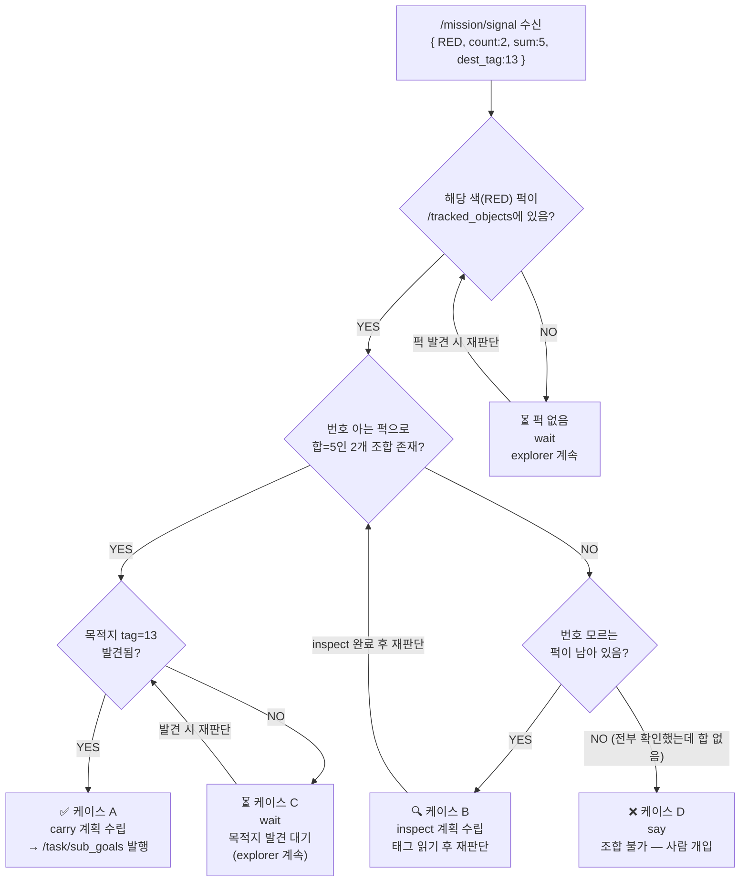
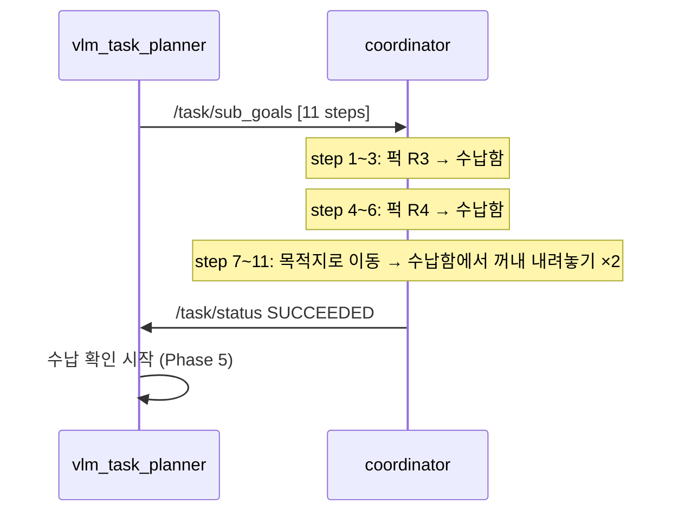
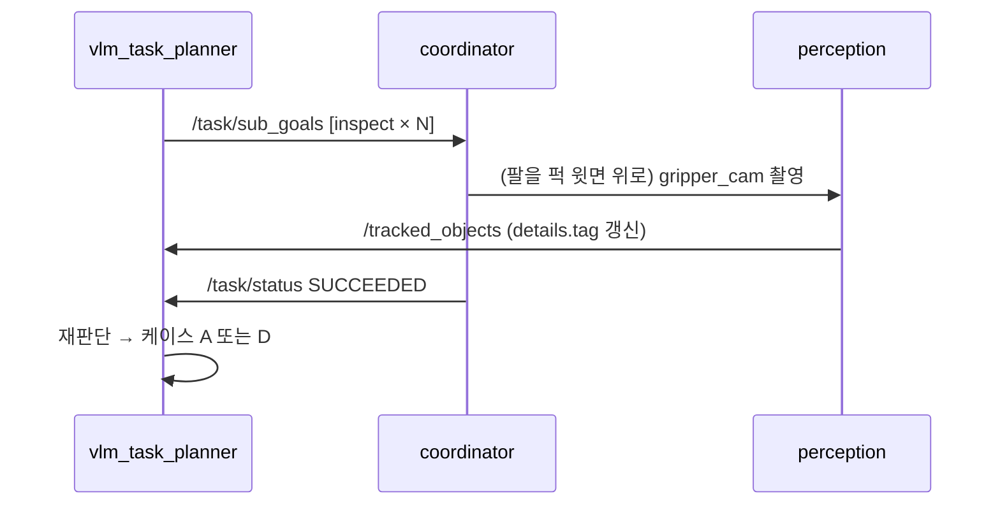
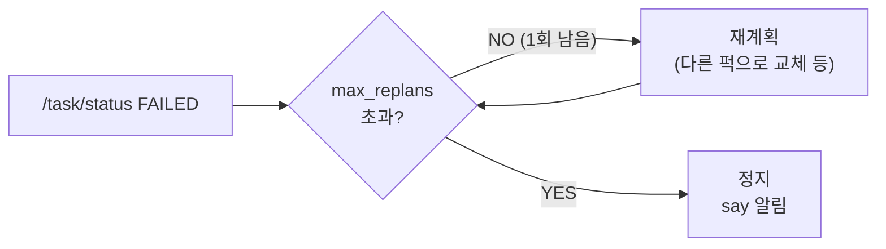

# Phase 3 — vlm_task_planner 판단

> 목적: `/mission/signal`을 받아 `/tracked_objects` 상태를 보고 실행 계획(`/task/sub_goals`)을 수립.

## 전체 판단 트리



---

## 케이스 A — carry 계획

조합을 즉시 찾은 경우. 예: R3(tag=2) + R4(tag=3) = 5

```
/task/sub_goals:
  step 1:  navigate  R3_id          ← 퍽 R3 앞으로 이동
  step 2:  pick      R3_id          ← 집기
  step 3:  place     tray           ← 수납함 칸1에 싣기
  step 4:  navigate  R4_id          ← 퍽 R4 앞으로 이동
  step 5:  pick      R4_id          ← 집기
  step 6:  place     tray           ← 수납함 칸2에 싣기
  step 7:  navigate  dest_id        ← 목적지(tag=13) 앞으로 이동
  step 8:  pick      tray           ← 수납함에서 꺼내기 (마지막 것부터)
  step 9:  place     dest_id        ← 목적지에 내려놓기
  step 10: pick      tray           ← 다음 것 꺼내기
  step 11: place     dest_id        ← 목적지에 내려놓기
```



---

## 케이스 B — inspect 계획

퍽은 보이지만 tag 번호를 아직 모르는 경우.

```
/task/sub_goals:
  step 1:  navigate  puck_A_id
  step 2:  inspect   puck_A_id   ← 팔을 퍽 윗면 0.15m 위 → gripper_cam이 16mm 태그 읽기
  step 3:  navigate  puck_B_id
  step 4:  inspect   puck_B_id
  ...
```



> **왜 inspect가 필요한가?**
> 퍽 윗면 AprilTag는 16mm — pole_front_cam(640×360)으로는 한 칸 1~2px라 읽을 수 없음.
> gripper_cam을 퍽 바로 위 0.15m에 위치시키면 한 칸 약 6px → 읽힘.

---

## 케이스 C — wait (목적지 미발견)


---

## 케이스 D — 조합 불가

```
번호 아는 RED 퍽: tag = [0, 1, 2]  (R1, R2, R3만 확인됨)
필요: count=2, sum=5
가능한 조합: 0+1=1, 0+2=2, 1+2=3 → 합 5 없음

→ say("조합을 찾을 수 없어요") → 사람 확인
```

---

## 재계획 (FAILED 시)


