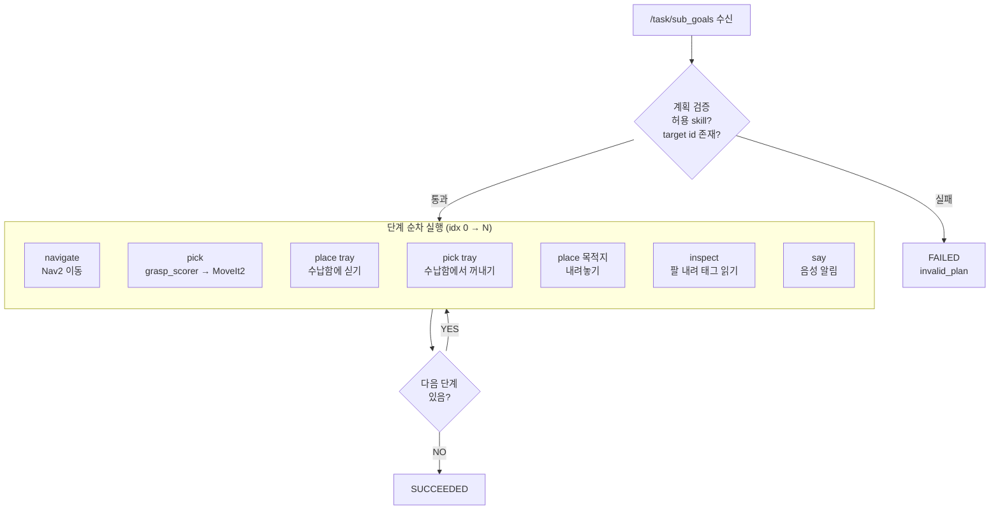
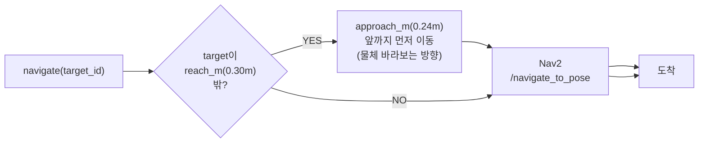
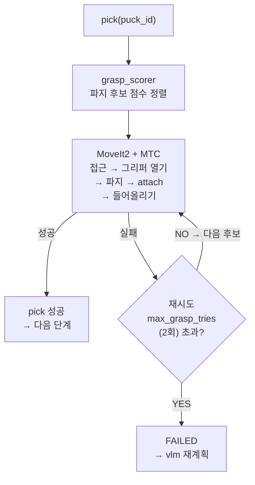
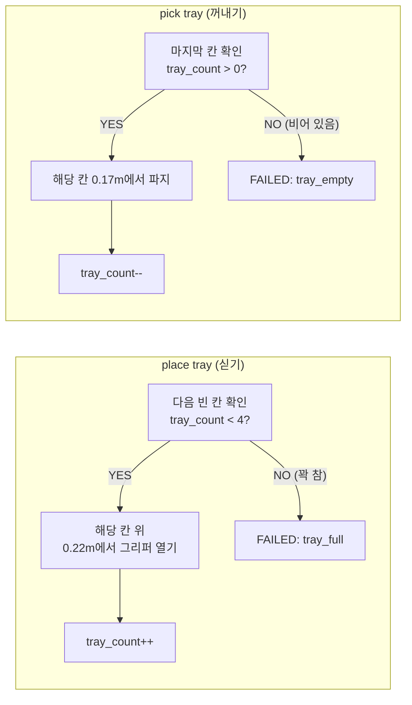
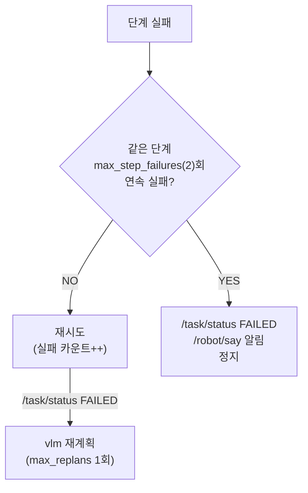

# Phase 4 — coordinator 실행

> 목적: `/task/sub_goals`를 받아 navigate → pick → tray → place 순서로 물리적으로 실행.

## 단계별 실행 흐름



---

## navigate 상세



---

## pick 상세



---

## 수납함(tray) 상세

```
수납함 슬롯 (base_footprint 기준):
  칸1: x=-0.135, y=+0.05  ← 뒷줄 왼쪽 (첫 번째 적재)
  칸2: x=-0.135, y=-0.05  ← 뒷줄 오른쪽
  칸3: x=-0.095, y=+0.05  ← 앞줄 왼쪽
  칸4: x=-0.095, y=-0.05  ← 앞줄 오른쪽 (네 번째 적재)

싣기 높이:  tray_release_z = 0.22m (손끝 기준)
꺼내기 높이: tray_grasp_z  = 0.17m
```



---

## 실패 처리



---

## 모드 전환 시 동작

| 전환 | 동작 |
|------|------|
| AUTO → MANUAL | 진행 중 goal 전부 취소 · `manual_override` 실패 |
| AUTO → EXPLORE | 진행 중 goal 전부 취소 · `explore_override` 실패 |
| MANUAL → AUTO | 새 명령(`/cmd/user_command`) 대기 |
| 비상정지 ON | 즉시 모든 goal 취소 · 재개 대기 |
