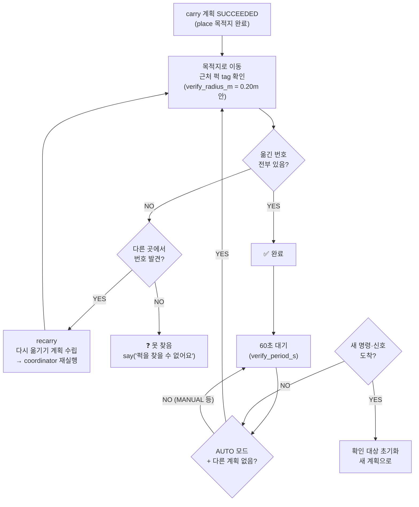

# Phase 5 — 수납 확인 (목적지 검증)

> 목적: 퍽을 목적지에 내려놓은 뒤, 실제로 제자리에 있는지 주기적으로 확인.
> ※ 수납함(tray)과 다름 — 여기서 "수납"은 **목적지(L1~L3)에 퍽이 놓인 상태** 확인.

## 흐름

## 파라미터

| 파라미터 | 값 | 설명 |
|----------|-----|------|
| `verify_period_s` | 60.0s | 주기 확인 간격 (0이면 최초 1회만) |
| `verify_radius_m` | 0.20m | 목적지 태그 기준 이 안이면 "있음" 판정 |

---

# 비상 시나리오

## 상황별 대응 다이어그램

```mermaid
flowchart TD
    subgraph E1["집기 실패"]
        PF["pick 실패"]
        RT{"재시도\n2회 이내?"}
        RP["다른 후보로\n재시도"]
        VR["vlm 재계획\n(다른 퍽으로)"]
        ST["정지\nsay('퍽을 잡을 수 없어요')"]

        PF --> RT
        RT -->|"YES"| RP --> PF
        RT -->|"NO"| VR --> ST
    end

    subgraph E2["수납함 꽉 참"]
        TF["tray_full 실패"]
        UNLOAD["목적지로 먼저 이동\n수납함 비우기\n→ 나머지 퍽 다시 싣기"]

        TF --> UNLOAD
    end

    subgraph E3["목적지 끝내 못 찾음"]
        WD["wait 상태 유지"]
        EX["explorer 재탐색"]
        NF["끝내 없음\nsay('목적지를 찾을 수 없어요')"]

        WD --> EX --> NF
    end

    subgraph E4["비상정지"]
        ES["/cmd/e_stop ON"]
        CA["모든 goal 즉시 취소\n팔 정지"]
        WAIT_E["재개 대기\n(/cmd/e_stop OFF)"]
        RESUME["새 명령 대기"]

        ES --> CA --> WAIT_E --> RESUME
    end

    subgraph E5["수동 전환"]
        MAN["/cmd/operation_mode MANUAL"]
        MO["작업 일시 중단\nmanual_override"]
        AUTO_BACK["/cmd/operation_mode AUTO"]
        NEW_CMD["새 명령 대기"]

        MAN --> MO --> AUTO_BACK --> NEW_CMD
    end

    subgraph E6["신호 잘못 읽음"]
        BAD["raw 값이 모호함"]
        SAY_B["say('신호를 확인해주세요')"]
        HUMAN["사람이 /cmd/user_command\n직접 입력"]

        BAD --> SAY_B --> HUMAN
    end
```

## 비상 대응 요약표

| 상황 | 1차 대응 | 2차 대응 | 사람 개입 |
|------|----------|----------|-----------|
| 집기 2회 실패 | 다른 후보로 재시도 | vlm 재계획 | say 후 대기 |
| 수납함 꽉 참 | 목적지 먼저 비우기 | — | — |
| 목적지 미발견 | explorer 재탐색 | — | say 후 대기 |
| 비상정지 | 즉시 전 취소 | 재개 대기 | OFF 신호 |
| 수동 전환 | 작업 중단 | AUTO 복귀 대기 | 직접 조작 |
| 신호 오독 | say 알림 | — | 직접 명령 입력 |
| 조합 불가 | say 알림 | — | 직접 명령 입력 |
