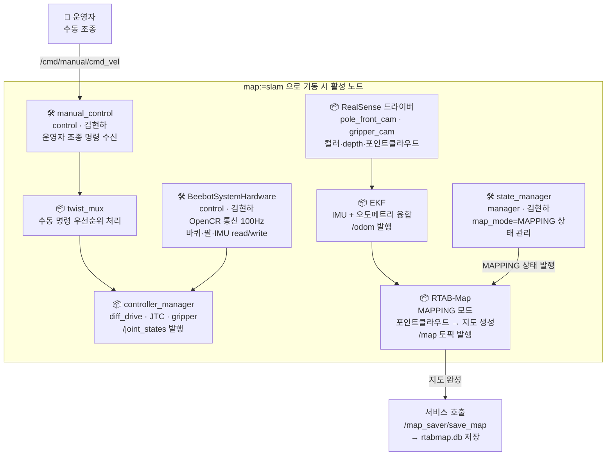
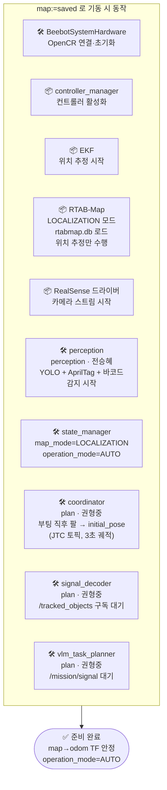
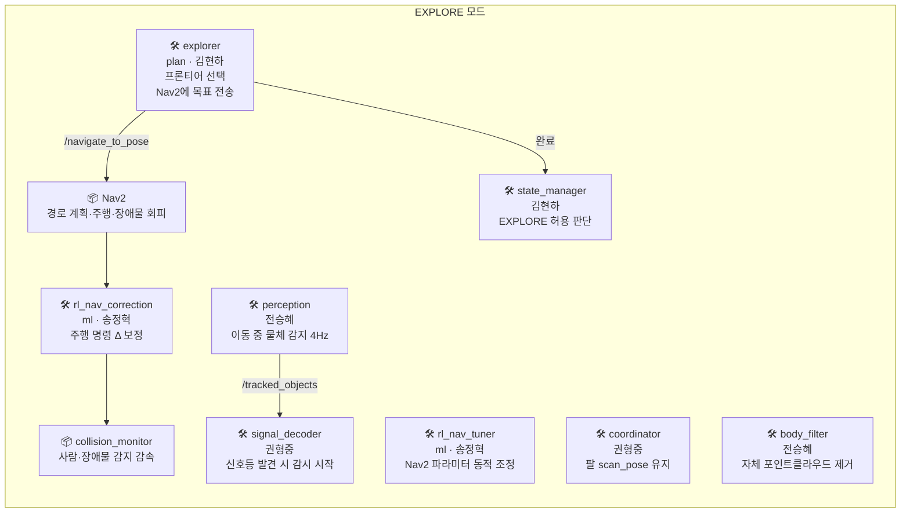
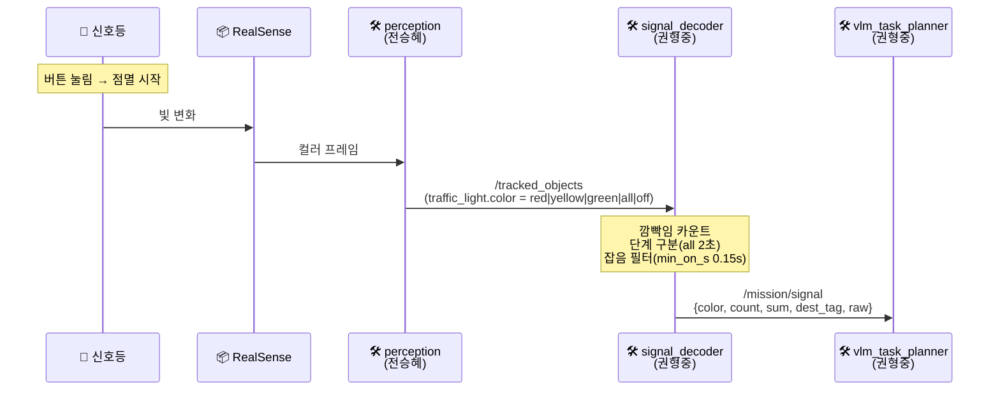
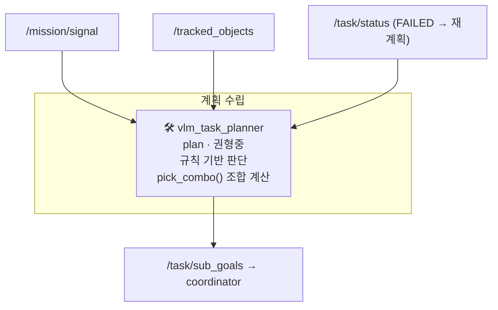
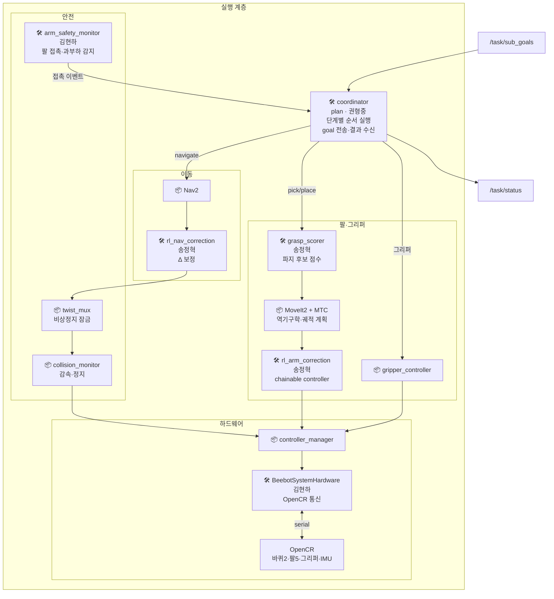
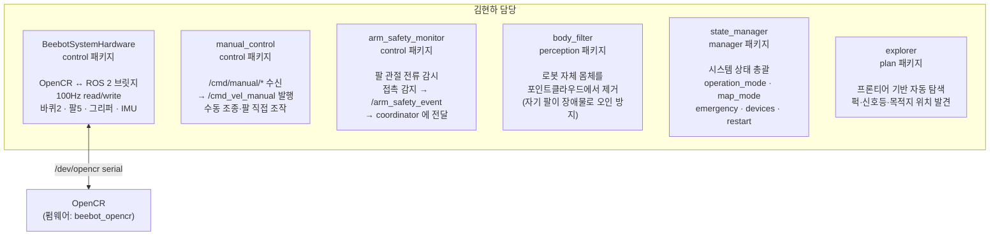

# 노드별 역할 명세 — 단계별 어느 노드가 무엇을 하는가

> 각 단계에서 어떤 노드가 입력을 받아 어떤 출력을 내는지 정리.
> 패키지·담당자·실행 명령 포함.

---

## 노드 전체 목록

```
패키지         노드                     담당     언어
────────────────────────────────────────────────────────
bringup        (launch only)            권형중   Python
manager        state_manager            김현하   C++
plan           signal_decoder           권형중   C++
plan           user_input               권형중   C++
plan           vlm_task_planner         권형중   C++
plan           coordinator              권형중   C++
plan           explorer                 김현하   C++
perception     perception               전승혜   Python
perception     body_filter              전승혜   C++
ml             grasp_scorer             송정혁   C++
ml             rl_nav_tuner             송정혁   C++
ml             rl_nav_correction        송정혁   C++
ml             rl_arm_correction        송정혁   C++ (controller plugin)
control        manual_control           김현하   C++
control        arm_safety_monitor       김현하   C++
control        BeebotSystemHardware     김현하   C++ (hardware plugin)
ros_system     Nav2                     📦 제공
ros_system     MoveIt2 + MTC            📦 제공
ros_system     RTAB-Map                 📦 제공
ros_system     EKF (robot_localization) 📦 제공
ros_system     controller_manager       📦 제공
ros_system     twist_mux                📦 제공
ros_system     velocity_smoother        📦 제공
ros_system     collision_monitor        📦 제공
```

---

## 실행 방법

```bash
# 경기용 (사전 SLAM 완료 후)
ros2 launch bringup bringup.launch.py map:=saved

# SLAM 지도 제작용
ros2 launch bringup bringup.launch.py map:=slam

# 특정 지도 지정
ros2 launch bringup bringup.launch.py map:=saved map_name:=20261025_competition

# 학습 노드 없이 (비교 기준)
ros2 launch bringup bringup.launch.py learning_enabled:=false

# 노드 하나만 재시작
ros2 topic pub --once /cmd/restart std_msgs/msg/String "{data: 'node perception'}"

# 전체 재시작
ros2 topic pub --once /cmd/restart std_msgs/msg/String "{data: 'all'}"
```

---

## 사전 준비 (SLAM) — 노드 역할



| 노드 | 패키지 | 담당 | 역할 | 입력 | 출력 |
|------|--------|------|------|------|------|
| `BeebotSystemHardware` | control | **김현하** | OpenCR 통신 | serial | `/joint_states` `/imu` `/motor_status` |
| `controller_manager` | ros_system | 📦 | 바퀴/팔/그리퍼 컨트롤러 | `/cmd_vel` | 바퀴 속도 명령 |
| `EKF` | ros_system | 📦 | IMU + 오도메트리 융합 | `/imu` `/joint_states` | `/odom` |
| `RTAB-Map` | ros_system | 📦 | 지도 제작 (MAPPING) | 카메라, `/odom` | `/map`, map→odom TF |
| `manual_control` | control | **김현하** | 운영자 조종 명령 처리 | `/cmd/manual/cmd_vel` | `/cmd_vel_manual` |
| `state_manager` | manager | **김현하** | map_mode 상태 관리 | `/cmd/map_mode` | `/state/map_mode` |

---

## Phase 0 — 부팅 (경기용) — 노드 역할



| 노드 | 패키지 | 담당 | 역할 | 입력 | 출력 |
|------|--------|------|------|------|------|
| `BeebotSystemHardware` | control | **김현하** | OpenCR 초기화·통신 | serial | `/joint_states` `/imu` |
| `RTAB-Map` | ros_system | 📦 | LOCALIZATION — 지도 매칭 | 카메라, `/odom` | map→odom TF |
| `EKF` | ros_system | 📦 | 오도메트리 융합 | `/imu` `/joint_states` | `/odom` |
| `perception` | perception | **전승혜** | 카메라 처리 시작 | 카메라 2대 | `/tracked_objects` |
| `state_manager` | manager | **김현하** | 시스템 상태 초기화 | 파라미터 | `/state/map_mode` `/state/operation_mode` |
| `coordinator` | plan | **권형중** | **팔 initial_pose 이동** | `/joint_states` | `/arm_controller/joint_trajectory` |
| `signal_decoder` | plan | **권형중** | 감시 준비 (대기) | `/tracked_objects` | — |
| `vlm_task_planner` | plan | **권형중** | 신호 대기 | `/mission/signal` | — |

---

## Phase 1 — 요소 탐색 — 노드 역할



| 노드 | 패키지 | 담당 | 역할 | 입력 | 출력 |
|------|--------|------|------|------|------|
| `explorer` | plan | **김현하** | 프론티어 탐색, 이동 목표 전송 | `/map` `/global_costmap/costmap` TF | `/navigate_to_pose` 액션 |
| `Nav2` | ros_system | 📦 | 경로 계획·추종 | `/navigate_to_pose` `/map` 센서 | `/cmd_vel_nav` |
| `rl_nav_correction` | ml | **송정혁** | 주행 명령 Δ 보정 (±0.05m/s) | `/cmd_vel_nav` | `/cmd_vel_corrected` |
| `rl_nav_tuner` | ml | **송정혁** | Nav2 speed_limit 동적 조정 | 센서 `/tracked_objects` | `/speed_limit` Nav2 파라미터 |
| `twist_mux` | ros_system | 📦 | 자동/수동/비상정지 우선순위 | `/cmd_vel_corrected` 등 | `/cmd_vel_mux` |
| `velocity_smoother` | ros_system | 📦 | 급가속 완화 | `/cmd_vel_mux` | `/cmd_vel` |
| `collision_monitor` | ros_system | 📦 | 사람·장애물 감지 감속·정지 | 센서 `/cmd_vel` | `/cmd_vel` (제한) |
| `body_filter` | perception | **전승혜** | 로봇 자체 점군 제거 | 포인트클라우드 | 필터링된 포인트클라우드 |
| `perception` | perception | **전승혜** | YOLO·AprilTag 감지·추적 | 카메라 2대 | `/tracked_objects` |
| `coordinator` | plan | **권형중** | **팔 scan_pose 유지** (SLAM 보조) | `/joint_states` `/state/map_mode` | `/arm_controller/joint_trajectory` |
| `signal_decoder` | plan | **권형중** | traffic_light 발견 시 감시 시작 | `/tracked_objects` | (신호 시 `/mission/signal`) |
| `state_manager` | manager | **김현하** | EXPLORE 허용·AUTO 복귀 | `/cmd/operation_mode` `/explore/result` | `/state/operation_mode` |

---

## Phase 2 — 신호 읽기 — 노드 역할



| 노드 | 패키지 | 담당 | 역할 | 입력 | 출력 |
|------|--------|------|------|------|------|
| `perception` | perception | **전승혜** | 신호등 색 분류 (`classify_color`) | pole_front_cam | `/tracked_objects` (traffic_light) |
| `signal_decoder` | plan | **권형중** | 3단계 깜빡임 해석, 잡음 필터링 | `/tracked_objects` | `/mission/signal` |

---

## Phase 3 — 계획 수립 — 노드 역할



| 노드 | 패키지 | 담당 | 역할 | 입력 | 출력 |
|------|--------|------|------|------|------|
| `vlm_task_planner` | plan | **권형중** | 미션 신호 해석, 조합 계산, 계획 수립 | `/mission/signal` `/tracked_objects` `/task/status` | `/task/sub_goals` |

> `vlm_endpoint`가 설정되면 ai-service(외부 LLM)에 POST /plan → SubGoalArray 수신.
> 비어 있으면(기본·경기용) 규칙 템플릿만 사용.

---

## Phase 4 — 실행 — 노드 역할



### 단계별 담당 노드 상세

| 단계 | 노드 순서 | 패키지 | 담당 |
|------|-----------|--------|------|
| **navigate** | coordinator → Nav2 → rl_nav_correction → twist_mux → velocity_smoother → collision_monitor → controller_manager → BeebotSystemHardware | plan/ros_system/ml/control | 권형중/📦/송정혁/김현하 |
| **pick** | coordinator → grasp_scorer → MoveIt2 → rl_arm_correction → controller_manager → BeebotSystemHardware | plan/ml/ros_system/control | 권형중/송정혁/📦/김현하 |
| **place tray** | coordinator → MoveIt2 → gripper_controller → BeebotSystemHardware | plan/ros_system/control | 권형중/📦/김현하 |
| **inspect** | coordinator → MoveIt2 → (팔 이동) → perception(gripper_cam 태그 읽기) | plan/ros_system/perception | 권형중/📦/전승혜 |
| **안전 감시** | arm_safety_monitor → coordinator (접촉 시 중단) | control | **김현하** |
| **자체 필터** | body_filter → Nav2·collision_monitor (자기 몸 오감지 방지) | perception | **전승혜** |

---

## Phase 5 — 수납 확인 — 노드 역할

| 노드 | 패키지 | 담당 | 역할 | 입력 | 출력 |
|------|--------|------|------|------|------|
| `vlm_task_planner` | plan | **권형중** | 60초마다 목적지로 look/recarry 계획 | `/tracked_objects` `/task/status` | `/task/sub_goals` |
| `coordinator` | plan | **권형중** | 목적지 이동 후 inspect 실행 | `/task/sub_goals` | `/navigate_to_pose` `/task/status` |
| `perception` | perception | **전승혜** | gripper_cam으로 퍽 tag 읽기 | gripper_cam | `/tracked_objects` (details.tag) |

---

## 김현하(제어) 담당 노드 요약



| 노드 | 패키지 | 언제 활성 | 핵심 역할 |
|------|--------|----------|-----------|
| `BeebotSystemHardware` | control | 항상 | 하드웨어 최하단 — 없으면 로봇 안 움직임 |
| `manual_control` | control | 항상 | 수동 전환 시 운영자 명령 전달 |
| `arm_safety_monitor` | control | 항상 | 팔 접촉·과부하 감지·중단 |
| `body_filter` | perception | 항상 | Nav2·collision_monitor 오감지 방지 |
| `state_manager` | manager | 항상 | 전체 상태 관리 (SLAM→경기 모드 전환 포함) |
| `explorer` | plan | Phase 1 (EXPLORE) | 랜덤 배치된 요소 위치 탐색 |
