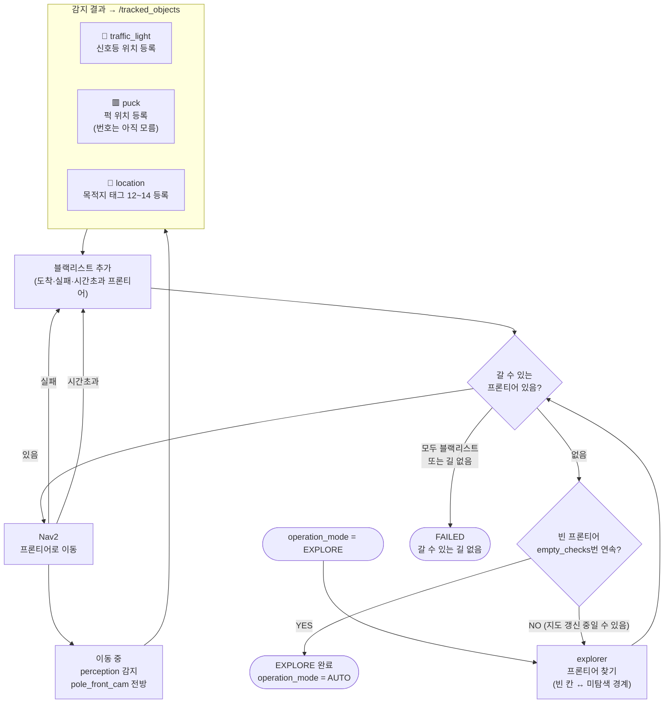

# Phase 1 — 탐색 (EXPLORE)

> 목적: 신호등·퍽·목적지 위치를 알아내기. 위치는 모두 랜덤 → 돌아다니며 발견.

## 흐름



## 핵심 동작 설명

### explorer 프론티어 선택 기준
- `min_frontier_cells` 이상 크기인 덩어리만 대상
- **코스트맵에서 로봇과 실제로 이어진 경로**가 있는 것만 선택 (직선거리로 고르면 벽 너머 목표 문제 발생)
- 로봇에서 `min_goal_dist` 안의 프론티어는 제외 (카메라가 바로 앞을 못 봄)
- 도착·실패한 곳 `blacklist_radius` 안은 재방문 안 함

### 탐색 중 팔 자세 (scan_pose)
```
scan_pose: [2.618, 0.681, -1.414, 1.082, 0.0]
→ gripper_cam이 로봇 왼쪽 뒤를 바라봄
→ pole_front_cam(전방) + gripper_cam(후방) 2대가 동시에 감지
→ SLAM 포인트 더 풍부하게 수집
```

### 신호등 발견 시점
탐색 중 신호등이 `tracked_objects`에 등록되는 순간부터 `signal_decoder`가 자동으로 깜빡임 감시를 시작한다. 탐색이 끝나기 전에 신호를 읽어도 무방 — vlm_task_planner가 정보 부족 시 `wait` 상태로 기다린다.

## 파라미터 (explorer)

| 파라미터 | 기본값 | 설명 |
|----------|--------|------|
| `min_frontier_cells` | - | 프론티어 최소 크기 (칸 수) |
| `blacklist_radius` | - | 재방문 금지 반경 |
| `goal_timeout_s` | - | 목표 도달 타임아웃 |
| `min_goal_dist` | - | 최소 목표 거리 |
| `goal_search_radius` | - | 목표 후보 탐색 반경 |
| `empty_checks` | - | 완료 판정 연속 횟수 |
