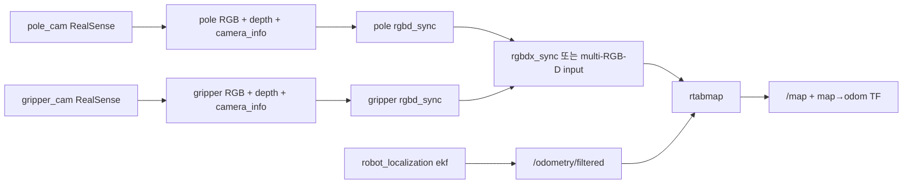

# RTAB-Map 2대 RGB-D 카메라 지원 제안

## 목적

현재 `feature/jetson` 브랜치의 RTAB-Map은 `pole_cam` 1대의 RGB-D만 사용한다. 이 문서는 `pole_cam`과 `gripper_cam` 2대를 RTAB-Map multi-RGB-D SLAM에 사용하는 방안과 검증 계획을 제안한다.

> 이 문서는 구현 완료가 아닌 proposal이다. 기존 `pole_cam` 단독 SLAM을 기본 fallback으로 유지하고, 2대 카메라 구성은 검증 후 선택적으로 활성화한다.

관련 문서:

- [`ros_system.launch.py`](../../lv2_module6/ros2_ws/src/ros_system/launch/ros_system.launch.py)
- [`02-sense.md`](../ros2-design/02-sense.md)
- [`04-nav.md`](../ros2-design/04-nav.md)
- [`07-tf.md`](../ros2-design/07-tf.md)

## 현재 구현 상태

현재 [`ros_system.launch.py`](../../lv2_module6/ros2_ws/src/ros_system/launch/ros_system.launch.py)의 RTAB-Map 입력은 다음과 같다.

```python
'rgb_topic': '/pole_cam/color/image_raw',
'depth_topic': '/pole_cam/aligned_depth_to_color/image_raw',
'camera_info_topic': '/pole_cam/color/camera_info',
'odom_topic': '/odometry/filtered',
'visual_odometry': 'false',
'approx_sync': 'true',
'localization': LaunchConfiguration('localization'),
'rtabmap_args': '--Reg/Force3DoF true --Grid/Sensor 1',
```

```text
/pole_cam/color/image_raw
/pole_cam/aligned_depth_to_color/image_raw
/pole_cam/color/camera_info
             │
             ├──> rtabmap ──> /map, map→odom TF
             │
/odometry/filtered
```

`/odometry/filtered`는 `/odom`과 `/imu`를 `robot_localization` EKF가 융합한 결과이며, 카메라 융합 결과가 아니다.

| 카메라 | 현재 역할 | 현재 RTAB-Map 입력 |
|---|---|---:|
| `pole_cam` | RGB-D SLAM/localization, 장애물, perception | 예 |
| `gripper_cam` | 팔 끝 근접 인지, grasp scoring용 PointCloud | 아니오 |

두 RealSense 드라이버는 각각 다음 토픽을 낸다.

```text
/pole_cam/color/image_raw
/pole_cam/color/camera_info
/pole_cam/aligned_depth_to_color/image_raw
/pole_cam/depth/color/points

/gripper_cam/color/image_raw
/gripper_cam/color/camera_info
/gripper_cam/aligned_depth_to_color/image_raw
/gripper_cam/depth/color/points
```

`perception`은 설계상 두 카메라의 컬러·aligned depth·camera_info를 모두 구독한다. 목적은 두 카메라의 물체 검출 결과를 depth/TF로 `map`에 변환하고 association/tracking하여 `/tracked_objects`로 발행하는 것이다. 그러나 현재 실제 depth projection, TF 변환, association, tracking은 TODO/골격 상태이며 `/tracked_objects`는 더미 데이터다.

정리하면:

```text
카메라 2대 드라이버       구현됨
perception 두 카메라 구독  골격 구현
object fusion            미구현/TODO
RTAB-Map 2대 입력         미구현
```

## 목표 아키텍처



목표 흐름:

```text
pole RGB + depth + camera_info
        │
        └─ pole_rgbd_sync ──> /pole_rgbd_image

gripper RGB + depth + camera_info
        │
        └─ gripper_rgbd_sync ──> /gripper_rgbd_image

/pole_rgbd_image
/gripper_rgbd_image
/odometry/filtered
        │
        └─> rtabmap ──> /map, map→odom TF
```

## 구현 후보

### 후보 A: `rgbd_sync` 2개 + `rgbd_cameras:=2`

카메라별 `rtabmap_sync/rgbd_sync`를 실행한 후 RTAB-Map에 두 RGB-D 입력을 직접 연결한다.

```text
pole RGB/depth/info ───> pole_rgbd_sync ───> /pole_rgbd_image
gripper RGB/depth/info ─> gripper_rgbd_sync ─> /gripper_rgbd_image

/pole_rgbd_image
/gripper_rgbd_image
        │
        └─> rtabmap
```

예상 파라미터:

```text
subscribe_rgb: false
subscribe_depth: false
subscribe_rgbd: true
rgbd_cameras: 2
rgbd_image0: /pole_rgbd_image
rgbd_image1: /gripper_rgbd_image
odom_topic: /odometry/filtered
visual_odometry: false
```

전제조건:

- Jetson의 RTAB-Map이 `rgbd_cameras:=2`와 `rgbd_image0/1`을 지원해야 한다.
- multi-RGB-D 지원 빌드 옵션이 활성화되어야 할 수 있다.
- 카메라별 frame ID, TF, timestamp가 정확해야 한다.
- publisher/subscriber QoS가 호환되어야 한다.

### 후보 B: `rgbd_sync` 2개 + `rgbdx_sync`

직접 multi-RGB-D subscription이 제한된 경우 중간에서 여러 RGB-D 스트림을 묶는다.

```text
pole_rgbd_sync ─────┐
                    ├─> rgbdx_sync ─> /rgbd_images ─> rtabmap
gripper_rgbd_sync ──┘
```

전제조건:

- Jetson 환경에 `rgbdx_sync` 실행 파일과 필요한 메시지 타입이 있어야 한다.
- output 메시지가 각 카메라의 frame과 timestamp를 보존해야 한다.
- RTAB-Map의 multi-RGB-D 입력 방식과 정확히 맞아야 한다.

| 항목 | 후보 A | 후보 B |
|---|---|---|
| 연결 | RTAB-Map에 RGB-D 2개 직접 연결 | 중간 메시지로 묶은 뒤 연결 |
| 진단 | 카메라별 입력 확인이 쉬움 | 중간 sync 확인 필요 |
| 의존성 | multi-RGB-D 지원 확인 | `rgbdx_sync` 지원 확인 |
| 우선 검토 | 지원이 확인된 환경 | 직접 입력이 제한된 환경 |

Jetson에서 먼저 확인한다.

```bash
ros2 pkg prefix rtabmap_sync
ros2 pkg prefix rtabmap_slam
ros2 run rtabmap_sync rgbd_sync --help
ros2 run rtabmap_sync rgbdx_sync --help
ros2 param describe /rtabmap rgbd_cameras
```

## 매핑 모드: 매니퓰레이터를 뒤쪽 자세로 고정

`gripper_cam`이 팔 끝에 장착되어 있어도, **mapping 중 매니퓰레이터를 뒤쪽의 지정된 stowed pose로 이동시킨 뒤 정지·hold하면 해당 mapping 세션 동안 operationally fixed camera로 사용할 수 있다.**

```text
base_link
  └─ arm joints = 고정된 stowed pose
      └─ gripper_link
          └─ gripper_cam
```

관절값이 변하지 않으면 세션 동안 다음 변환은 실질적으로 일정하다.

```text
base_link → arm links → gripper_link → gripper_cam_link
```

따라서 `pole_cam`과 `gripper_cam`을 고정 extrinsic을 가진 두 RGB-D 카메라처럼 사용하여 mapping을 실험할 수 있다. 단, 이것은 물리적/운용상 고정이지 TF 구조를 static TF로 바꾸는 의미가 아니다.

### 반드시 지킬 조건

1. 매핑 시작 전에 stowed pose에 도착해야 한다.
2. controller hold 또는 torque 유지로 관절을 고정해야 한다.
3. 매핑 중 joint position이 흔들리거나 drift하지 않아야 한다.
4. `/joint_states`가 계속 발행되어야 한다.
5. `robot_state_publisher`가 기존 joint-based TF를 계속 발행해야 한다.
6. 별도의 static TF로 `base_link → gripper_cam_link`를 중복 발행하지 않는다.
7. localization 때도 같은 stowed pose를 재현해야 한다.

확인:

```bash
ros2 topic echo /joint_states
ros2 run tf2_ros tf2_echo base_link gripper_cam_link
ros2 run tf2_ros tf2_echo base_link pole_cam_link
```

### 매핑과 localization 자세 일치

매핑 때와 localization 때의 gripper pose가 다르면 `gripper_cam`의 base 기준 extrinsic이 달라진다.

```text
mapping:     gripper_cam = stowed pose A
localization: gripper_cam = pose B
                         └─ camera extrinsic 불일치
```

따라서 다음 정책 중 하나를 명시해야 한다.

```text
정책 A: mapping과 localization 모두 동일한 stowed pose 사용
정책 B: mapping은 두 카메라, localization은 pole_cam 단독 사용
```

초기 운영에는 정책 B 또는 다음 정책을 권장한다.

```text
매핑/일반 주행: stowed pose에서 multi-camera 실험
팔 이동/파지:   pole_cam 단독 SLAM fallback
```

### 시야 중첩 주의

매니퓰레이터를 뒤쪽으로 돌리면 `pole_cam`은 전방/하향, `gripper_cam`은 후방을 볼 수 있다. 두 카메라의 시야가 겹치지 않으면 카메라 간 직접 feature matching 효과는 작다.

```text
pole_cam    → 전방 장면
 gripper_cam → 후방 장면
```

이 경우 RTAB-Map의 효과는 두 카메라의 공통 feature fusion보다는 다음에 의존한다.

```text
각 카메라의 RGB-D 관측
+ /odometry/filtered
+ 정확한 camera TF
```

따라서 후방 그리퍼 카메라를 추가했을 때 실제 map 품질이 좋아지는지는 mapping 실험으로 확인해야 한다.

## TF 요구사항

목표 TF 트리:

```text
map
 └─ odom
     └─ base_footprint
         └─ base_link
             ├─ pole_cam_link → pole_cam optical frame
             └─ arm joints → gripper_link → gripper_cam_link
                                      └─ gripper_cam optical frame
```

`pole_cam`은 base에 고정되어 있으므로 URDF/`robot_state_publisher`로 고정 TF를 제공한다.

`gripper_cam`은 팔 끝에 장착되어 있으므로 매핑 중 stowed pose로 고정하더라도 TF는 `/joint_states`와 `robot_state_publisher` 경로를 유지한다.

센서 메시지의 촬영 시각을 기준으로 TF를 조회한다.

```cpp
lookupTransform(
    "map" 또는 "base_footprint",
    camera_optical_frame,
    image.header.stamp
);
```

현재 시각의 TF를 사용하면 팔 이동 중 camera pose가 어긋나 object/feature 위치가 틀어진다.

추가 확인 항목:

- color/depth optical frame 방향(`z` 전방, `x` 오른쪽, `y` 아래)
- color/depth alignment
- intrinsic(`fx`, `fy`, `cx`, `cy`, distortion)
- base/gripper camera extrinsic
- joint state timestamp와 센서 timestamp 차이

## 동기화 및 QoS

두 RealSense는 서로 다른 장치이므로 timestamp가 완전히 같지 않을 수 있다.

필요한 처리:

- 각 카메라 내부 RGB/depth/camera_info 동기화
- `approx_sync:=true` 검토
- 허용 timestamp 차이 설정
- 오래된 frame 삭제
- sensor `header.stamp` 유지
- gripper 움직임 및 stowed pose 진입 시 TF buffer 확보

초기 프로파일:

```text
pole_cam: 640x480 @ 30 Hz
gripper_cam: 640x480 @ 15 Hz
```

확인:

```bash
ros2 topic info /pole_cam/color/image_raw -v
ros2 topic info /pole_cam/aligned_depth_to_color/image_raw -v
ros2 topic info /gripper_cam/color/image_raw -v
ros2 topic info /gripper_cam/aligned_depth_to_color/image_raw -v
ros2 node info /rtabmap
```

RealSense sensor topic의 best-effort/sensor-data QoS와 sync/RTAB-Map subscriber의 QoS가 호환되지 않으면 topic name이 보여도 실제 연결되지 않을 수 있다.

## PointCloud 처리

현재 저장소에는 실기용 독립 PointCloud filter node가 없다.

```text
/pole_cam/depth/color/points
        ├─ Nav2 costmap
        ├─ MoveIt OctoMap
        └─ collision_monitor

/gripper_cam/depth/color/points
        └─ grasp_scorer
```

시뮬레이터 `fake_camera`에는 `depth == 0` 제거와 `cloud_step` 기반 downsample이 있지만, 이는 별도 실기 filter node가 아니다. Nav2 `voxel_layer`/STVL의 높이 제한과 voxelization도 원본 PointCloud2를 재발행하는 독립 filter와는 구분해야 한다.

필요하면 주행/충돌용 filter chain을 별도로 추가한다.

```text
RealSense PointCloud2
        │
        └─ pointcloud_filter
             ├─ NaN 제거
             ├─ PassThrough: 거리 제한
             ├─ CropBox: robot/arm 영역 제거
             ├─ VoxelGrid: downsample
             ├─ 높이 제한
             └─ optional outlier removal
                    │
                    └─ /pole_cam/points_filtered
                         ├─ Nav2 costmap
                         ├─ collision_monitor
                         └─ MoveIt OctoMap
```

RGB-D image를 사용하는 SLAM 입력과 PointCloud를 사용하는 Nav2/MoveIt/collision 입력은 목적이 다르므로 filter chain을 분리할 수 있다.

## 안전한 운영 모드

launch에 다음 선택 파라미터를 추가하는 방안을 제안한다.

```text
use_multi_camera_slam:=false
```

### 기본 모드

```text
pole_cam → RTAB-Map
gripper_cam → perception/grasp_scorer
```

### 실험 모드

```text
매니퓰레이터 stowed pose 고정
pole_cam + gripper_cam → RGB-D sync → RTAB-Map
```

### fallback 정책

```text
팔 이동/파지 중          pole_cam 단독
stowed pose 미도달       pole_cam 단독
gripper frame stale       pole_cam 단독
TF lookup 실패            pole_cam 단독
multi-camera 검증 실패   기존 단일 카메라 구성
```

## 단계별 구현 및 검증 계획

### 1. 단일 카메라 기준선

```bash
ros2 node list | grep -E 'rtab|realsense|ekf'
ros2 node info /rtabmap
ros2 topic echo /odometry/filtered --once
```

`pole_cam` RGB/depth/camera_info, `/odometry/filtered`, `/map`, `map→odom`을 확인한다.

### 2. stowed pose 검증

매핑 전에 다음을 확인한다.

```bash
ros2 topic echo /joint_states
ros2 run tf2_ros tf2_echo base_link gripper_cam_link
```

관절 위치가 안정된 뒤 일정 시간 기록한다. 기준 시간 동안 joint position 변화량이 허용 범위 이내여야 한다.

### 3. 카메라별 RGB-D sync

```bash
ros2 run rtabmap_sync rgbd_sync --help
```

`/pole_rgbd_image`, `/gripper_rgbd_image`의 발행과 timestamp를 확인한다.

### 4. multi-RGB-D 테스트

후보 A 또는 B를 적용하고 RTAB-Map이 두 입력을 실제로 구독하는지 확인한다.

```bash
ros2 node info /rtabmap
```

### 5. mapping

`localization:=false`로 새 DB에 기록한다. 다음 조건을 분리해 비교한다.

```text
실험 1: pole_cam 단독
실험 2: pole_cam + gripper_cam, arm stowed pose 고정
실험 3: pole_cam + gripper_cam, arm 움직임 허용
```

실험 3은 proposal 검증용이며 기본 운영에는 사용하지 않는다.

### 6. localization

`localization:=true`로 재기동하고 mapping과 동일한 stowed pose를 재현한 경우와 재현하지 않은 경우를 비교한다.

### 7. 자원 및 품질 측정

Jetson에서 CPU/GPU/메모리/USB bandwidth, RTAB-Map 처리 주기, dropped frame, map drift를 기록한다.

## 완료 조건

- [ ] 두 RealSense가 독립 실행된다.
- [ ] RGB/depth/camera_info가 카메라별로 동기화된다.
- [ ] 두 optical frame이 올바른 TF tree에 연결된다.
- [ ] gripper camera의 동적 TF가 joint state에 따라 갱신된다.
- [ ] stowed pose에서 joint position이 안정된다.
- [ ] sensor `header.stamp` 기준 TF lookup이 성공한다.
- [ ] multi-RGB-D input이 발행된다.
- [ ] RTAB-Map이 두 RGB-D 입력을 구독한다.
- [ ] `/odometry/filtered`가 정상 입력된다.
- [ ] `/map`과 `map→odom`이 정상 발행된다.
- [ ] mapping/localization이 성공한다.
- [ ] mapping/localization에서 stowed pose가 일치한다.
- [ ] stowed pose에서 gripper 이동으로 인한 map 흔들림이 허용 범위 이내다.
- [ ] stale/TF 오류/자세 불일치 시 pole_cam 단독 fallback이 가능하다.
- [ ] Jetson resource 사용량을 기록한다.
- [ ] 기존 pole_cam 단독 SLAM이 유지된다.

## 예상 후속 변경 파일

```text
lv2_module6/ros2_ws/src/ros_system/launch/ros_system.launch.py
lv2_module6/ros2_ws/src/ros_system/launch/multi_rgbd.launch.py
lv2_module6/ros2_ws/src/ros_system/config/rtabmap_multi_camera.yaml
lv2_module6/ros2_ws/src/ros_system/config/pointcloud_filter.yaml
lv2_module6/ros2_ws/src/ros_system/package.xml
lv2_module6/ros2_ws/src/ros_system/CMakeLists.txt
documents/ros2-design/04-nav.md
documents/ros2-design/04b-mapping.md
documents/ros2-design/07-tf.md
documents/API.md
```

이번 변경에서는 proposal 문서만 수정하고 launch/config/노드 구현은 후속 PR로 분리한다.

## 결론

현재 RTAB-Map은 `pole_cam` 단독이다. 기술적으로는 다음 구성이 가능하다.

```text
pole_cam RGB-D ───────┐
                      ├─> RGB-D synchronization ─> RTAB-Map
 gripper_cam RGB-D ───┘
```

매핑 중 매니퓰레이터를 뒤쪽 stowed pose로 이동시키고 controller hold로 고정하면, 그 세션 동안 `gripper_cam`의 base 기준 pose가 사실상 일정해져 고정 카메라처럼 사용할 수 있다. 그러나 TF는 계속 `joint_states → robot_state_publisher` 경로로 유지해야 하며, 별도 static TF를 중복 발행하면 안 된다.

매핑과 localization에서 같은 stowed pose를 재현해야 하며, 두 카메라의 시야가 겹치지 않으면 multi-camera feature fusion 효과가 제한될 수 있다. 따라서 **기존 pole_cam 단독 SLAM을 깨뜨리지 않는 것을 최우선으로 하고, `use_multi_camera_slam:=false`를 기본값으로 하는 실험적 multi-camera 지원을 후속 구현한다.**
