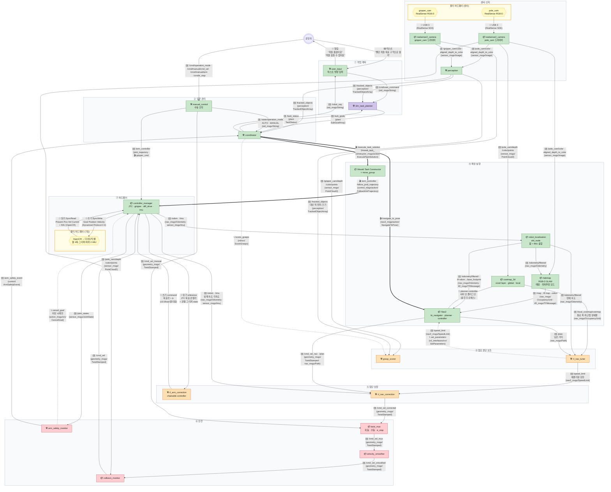

[목차](README.md) · [◀ 개요·원칙](00-overview.md) · [1 센서·인지 ▶](02-sense.md)

## 전체 아키텍처 — 7계층

위에서 아래로 흐르고, 왼쪽이 팔, 오른쪽이 베이스입니다. 학습 노드(주황)는 ③과 ⑤에만 있고, 안전(빨강)은 항상 학습 노드 뒤에 있습니다. 실선=토픽, 굵은 선=액션, 점선=서비스·파라미터·피드백·매핑 단계 전용. 화살표 라벨은 **[종류 이모지] 이름 (메시지 타입)** 형식입니다. 어디서 시작해 어떤 순서로 흐르는지는 문서 아래 **▶ 흐름 따라가기**에서 상황을 골라 화살표 하나씩 따라가 보세요.

> 인터페이스 명세: [토픽](../API.md#api-topics)

- **수동 조작은 manual_control → twist_mux.** 수동 모드(/cmd/operation_mode → state_manager)면 coordinator가 진행 중 이동·팔 goal을 취소하고 멈추고(/state/operation_mode), 운영자의 바퀴 명령은 twist_mux에서 자동보다 우선한다. 수동이어도 velocity_smoother·collision_monitor를 지나며, /cmd/e_stop은 twist_mux 잠금으로 모든 바퀴 명령을 막는다.
- **모든 🛠 노드는 /diagnostics로 자기 상태를 낸다.** diagnostic_updater(OK·WARN·ERROR + 값)를 bringup의 diagnostic_aggregator가 계층별로 묶어 /diagnostics_agg로 — 도식에는 생략.
- **물리 하드웨어는 노란 영역, 토픽은 내지 않는다.** 장치(육각형)는 신호가 오가는 곳 가까이에 두고 같은 노란 "물리 하드웨어" 영역으로 표시했다 — 센서 쪽(카메라)과 구동 쪽(OpenCR·모터·IMU). RealSense 카메라 2대는 🔌 USB 3로 realsense2_camera 드라이버 노드에 붙고, 토픽은 드라이버 노드가 발행한다. 모터·IMU는 OpenCR → hardware interface(controller_manager) 경로로 같은 원칙을 따른다.
- **학습 노드도 입력을 보고 판단한다.** rl_nav_tuner는 local costmap(통로 폭·최근접 장애물), `/odometry/filtered`(현재 속도), `/plan`(남은 거리)을 보고 1~2초마다 프리셋 A/B/C를 고른다. rl_nav_correction은 `/cmd_vel_nav`가 올 때마다 `/plan`(경로 오차), `/odom`·`/imu`(실제 움직임), `/speed_limit`(재클리핑 상한)으로 Δ를 계산한다. grasp_scorer는 `/tracked_objects`로 대상 퍽을 찾고 gripper_cam 점구름으로 후보를 매긴다.
- **rl_arm_correction은 ROS 노드가 아니다.** controller_manager 안에서 JTC 바로 뒤에 체인으로 붙는 컨트롤러 플러그인이다 (컨트롤러 탭 참고).
- **controller_manager 한 주기(100Hz)는 read → update → write.** MTC의 팔 궤적과 collision_monitor의 `/cmd_vel`은 언제든 도착해 다음 update에서 쓰인다. update에서 `/joint_states`(→ arm_safety_monitor)와 `/odom`·`/imu`(→ EKF, rl_nav_correction)를 발행하고, JTC 목표에 rl_arm_correction의 Δ를 더해 write로 보낸다. arm_safety_monitor의 궤적 취소만 주기와 무관한 비동기 호출이다. 단계별로는 **흐름 따라가기 → "팔 한 주기"**에서 볼 수 있다.
- **controller_manager는 하나.** 베이스·팔·그리퍼·IMU가 같은 OpenCR에 붙어 있으므로 hardware component 하나에 컨트롤러들을 함께 올린다.
- **LiDAR가 없으므로 /scan도 없다.** 장애물은 pole_cam PointCloud2를 Nav2 costmap(voxel layer)·collision_monitor·MoveIt octomap에 그대로 넣는다.
- **SLAM·위치추정은 RTAB-Map.** RGB-D 영상 + 휠/IMU 오도메트리로 지도를 만들고(매핑 모드), 운영 중에는 같은 DB로 위치만 추정한다(위치추정 모드). slam_toolbox·amcl은 LaserScan이 필요해서 쓰지 않는다 (Nav2·SLAM 섹션의 3-1).
- **TF 발행자는 딱 둘로 나뉜다.** map→odom은 rtabmap, odom→base_footprint는 robot_localization EKF(바퀴 `/odom` + `/imu` 융합)만 낸다. EKF의 `/odometry/filtered`는 rtabmap의 오도메트리 입력이자 Nav2 controller의 현재 속도 입력이다. diff_drive_controller는 `enable_odom_tf: false`로 TF를 내지 않는다 (베이스·TF 섹션 참고).
- **gripper_cam도 RealSense.** 파지 직전 근접 점구름을 grasp_scorer에 주고, 접근 단계의 미세 정렬에 쓴다.
---

## ▶ 흐름 따라가기

도식의 화살표를 단계별로 따라간 설명입니다. (원본 페이지에서는 단계마다 해당 화살표가 강조됩니다.)

### 퍽 이송 — 처음부터 끝까지

1. **운영자가 명령한다** — "빨간 퍽을 목표 구역으로 옮겨" — user_input이 텍스트 명령을 받습니다. 모든 일은 여기서 시작합니다.  
   화살표: 사람 → user_input
2. **명령이 VLM으로** — ✉️ /cmd/user_command (std_msgs/String) 문자열 하나가 vlm_task_planner에 들어갑니다.  
   화살표: user_input → vlm_task_planner
3. **카메라는 늘 보고 있다** — pole_cam 영상·depth가 USB로 드라이버 → perception으로 계속 흐릅니다. 명령과 상관없이 상시 입력입니다.  
   화살표: pole_cam → realsense2_camera · realsense2_camera → perception
4. **무엇이 어디 있나** — ✉️ /tracked_objects — 퍽 id 3, 목표 구역 id 5, 장애물 id 7. VLM은 계획에, coordinator는 id 검증에 씁니다.  
   화살표: perception → vlm_task_planner · perception → coordinator
5. **VLM이 순서만 정한다** — ✉️ /sub_goals [navigate(퍽 앞) → pick(퍽) → navigate(목표 구역) → place(목표 구역)]. 어떻게 움직일지는 정하지 않습니다.  
   화살표: vlm_task_planner → coordinator
6. **이동 시작** — coordinator가 검증 후 퍽 앞 (3.45, 0.9)을 계산해 🎬 /navigate_to_pose 액션을 보냅니다. 팔은 stow.  
   화살표: coordinator → Nav2
7. **내가 지도 어디에 있나** — rtabmap이 map→odom, EKF가 odom→base_footprint를 냅니다. 둘을 이으면 Nav2가 지도 기준 로봇 위치를 압니다.  
   화살표: realsense2_camera → rtabmap · controller_manager → robot_localization · robot_localization → rtabmap · rtabmap → Nav2 · robot_localization → Nav2
8. **장애물 지도** — pole_cam 점구름이 costmap voxel layer에 쌓여 장애물를 피하는 경로를 만듭니다.  
   화살표: realsense2_camera → costmap_2d · costmap_2d → Nav2
9. **앞단 판단 보조 — 무엇을 보고 판단하나** — rl_nav_tuner 입력: local costmap(통로 폭 0.73m, 장애물까지 거리), /odometry/filtered(현재 속도), /plan(남은 거리).  
   화살표: costmap_2d → rl_nav_tuner · robot_localization → rl_nav_tuner · Nav2 → rl_nav_tuner
10. **앞단 판단 보조 — 결정** — 좁은 통로·장애물 근처 → 프리셋 B. /speed_limit 60%(≈0.15m/s)를 Nav2와 rl_nav_correction에, max_vel_theta 1.0을 set_parameters로.  
   화살표: rl_nav_tuner → Nav2 · rl_nav_tuner → rl_nav_correction
11. **Nav2 속도 명령** — ✉️ /cmd_vel_nav = (0.12 m/s, 0.30 rad/s), 20Hz. 같은 선으로 /plan도 받습니다(경로 오차 계산용).  
   화살표: Nav2 → rl_nav_correction
12. **뒷단 RL 보정** — /odom·/imu로 실제 움직임을 보니 미끄러운 바닥에서 경로를 4cm 벗어남 → Δ(+0.02, +0.05) → (0.14, 0.35). /speed_limit 상한 0.15 안이라 통과.  
   화살표: controller_manager → rl_nav_correction · rl_nav_correction → velocity_smoother
13. **안전 — 가속 제한 → 충돌 감시** — velocity_smoother가 가속을 자르고, collision_monitor가 점구름으로 장애물까지 거리를 봅니다(0.5m, 통과).  
   화살표: velocity_smoother → collision_monitor · realsense2_camera → collision_monitor
14. **최종 /cmd_vel** — diff_drive_controller가 바퀴 속도로 바꿉니다 (좌 2.72, 우 5.76 rad/s).  
   화살표: collision_monitor → controller_manager
15. **모터로** — 100Hz로 쓰기(SyncWrite) · 읽기(SyncRead). 퍽 앞에 도착하면 Nav2 액션 결과가 "성공".  
   화살표: controller_manager → OpenCR → 다이나믹셀 · OpenCR → 다이나믹셀 → controller_manager
16. **어떻게 잡을까** — /tracked_objects로 대상 퍽을 찾고 gripper_cam 근접 점구름으로 후보를 매김. 📞 /score_grasps → [B 0.87, C 0.62, A 0.41].  
   화살표: gripper_cam → realsense2_camera · realsense2_camera → grasp_scorer · perception → grasp_scorer · coordinator → grasp_scorer
17. **집기 실행** — 🎬 /execute_task_solution 후보 B — 접근·열기·파지·attach·들어올리기를 MTC가 계획.  
   화살표: coordinator → MoveIt Task Constructor
18. **팔 궤적** — 🎬 /arm_controller/follow_joint_trajectory로 관절 궤적이 controller_manager에 들어갑니다.  
   화살표: MoveIt Task Constructor → controller_manager
19. **팔 처짐 보정** — JTC 목표 [0.00, 0.62, −0.31, 1.10] + Δ[0, +0.03, −0.01, 0] → joint2 중력 처짐 보상.  
   화살표: controller_manager → rl_arm_correction · rl_arm_correction → controller_manager
20. **팔 모터로** — 같은 OpenCR 버스로 팔 관절 목표를 쓰고 현재값을 읽습니다.  
   화살표: controller_manager → OpenCR → 다이나믹셀 · OpenCR → 다이나믹셀 → controller_manager
21. **안전 감시는 항상** — /joint_states를 arm_safety_monitor가 계속 봅니다. 이상이 없으면 조용합니다.  
   화살표: controller_manager → arm_safety_monitor · arm_safety_monitor → coordinator
22. **목표 구역에 가서 내려놓기** — 퍽을 든 채 footprint를 키우고 이동 → place → detach. 경로는 위 이동 단계와 같습니다.  
   화살표: coordinator → Nav2 · coordinator → MoveIt Task Constructor
23. **완료 보고** — ✉️ /task_status 완료 — VLM은 다음 명령을 기다립니다.  
   화살표: coordinator → vlm_task_planner
24. **운영자에게 알림** — ✉️ /robot_say → 💬 "퍽을 옮겼어요". 끝.  
   화살표: coordinator → user_input · user_input → 사람

### 베이스 속도 명령 한 주기 (20Hz)

1. **Nav2 controller** — 경로를 따라가는 속도 /cmd_vel_nav를 냅니다.  
   화살표: Nav2 → rl_nav_correction
2. **RL 보정** — /odom·/imu(실제 움직임)를 보고 Δ를 더한 뒤(±0.05m/s, ±0.10rad/s) /speed_limit 상한으로 다시 자릅니다.  
   화살표: controller_manager → rl_nav_correction · rl_nav_tuner → rl_nav_correction · rl_nav_correction → velocity_smoother
3. **가속 제한 → 충돌 감시** — 갑작스러운 가속을 막고, 점구름 다각형 안에 장애물이 있으면 감속·정지.  
   화살표: velocity_smoother → collision_monitor · realsense2_camera → collision_monitor
4. **diff_drive_controller** — /cmd_vel을 바퀴 각속도로 바꿉니다.  
   화살표: collision_monitor → controller_manager
5. **쓰고 읽기** — 바퀴 목표 속도를 쓰고, 실제 바퀴 회전과 IMU를 읽습니다.  
   화살표: controller_manager → OpenCR → 다이나믹셀 · OpenCR → 다이나믹셀 → controller_manager
6. **피드백** — /odom·/imu → EKF → /odometry/filtered. Nav2가 다음 명령을 계산할 때 현재 속도로 씁니다.  
   화살표: controller_manager → robot_localization · robot_localization → Nav2

### 팔 한 주기 — controller_manager read → update → write

1. **입력** — MTC가 팔 궤적을 보냅니다 (동작 시작 때 1회). 다음 update에서 쓰입니다.  
   화살표: MoveIt Task Constructor → controller_manager
2. **read** — OpenCR에서 관절 위치·속도·전류와 IMU를 읽습니다.  
   화살표: OpenCR → 다이나믹셀 → controller_manager
3. **update — 상태 발행** — /joint_states(→ arm_safety_monitor), /odom·/imu(→ EKF, rl_nav_correction).  
   화살표: controller_manager → arm_safety_monitor · controller_manager → robot_localization · controller_manager → rl_nav_correction
4. **update — JTC 목표** — JTC가 이번 주기 목표 관절각을 rl_arm_correction에 reference로 넘깁니다.  
   화살표: controller_manager → rl_arm_correction
5. **update — 보정** — Δ(±0.05rad)를 더해 command로 씁니다.  
   화살표: rl_arm_correction → controller_manager
6. **write** — 최종 명령을 OpenCR로. 다음 주기 read로 돌아갑니다 (100Hz).  
   화살표: controller_manager → OpenCR → 다이나믹셀
7. **이상 시에만** — arm_safety_monitor가 문제를 찾으면 팔 궤적을 취소합니다 (주기와 무관한 비동기 호출).  
   화살표: arm_safety_monitor → controller_manager

### 위치 추정 — map·odom은 어디서 오나

1. **바퀴·IMU 원자료** — OpenCR에서 바퀴 회전과 IMU를 읽습니다.  
   화살표: OpenCR → 다이나믹셀 → controller_manager
2. **/odom · /imu** — diff_drive가 바퀴만으로 계산한 /odom, imu broadcaster의 /imu가 EKF로.  
   화살표: controller_manager → robot_localization
3. **odom→base_footprint** — EKF가 둘을 융합해 연속적인(대신 드리프트 있는) odom→base_footprint TF를 냅니다.  
   화살표: robot_localization → Nav2
4. **RTAB-Map 입력** — pole_cam 컬러·depth + /odometry/filtered로 지도와 맞춰봅니다.  
   화살표: pole_cam → realsense2_camera · realsense2_camera → rtabmap · robot_localization → rtabmap
5. **map→odom** — rtabmap이 드리프트를 상쇄하는 map→odom을 냅니다. 가끔 점프하지만 odom 쪽은 끊기지 않습니다 (맵핑·위치추정 탭 참고).  
   화살표: rtabmap → Nav2

### 파지 실패 → 재시도 → 재계획 → 다시 집기

1. **후보 점수** — 📞 /score_grasps → [B 0.87, C 0.62, A 0.41].  
   화살표: coordinator → grasp_scorer
2. **1순위 B 시도 → 실패** — 그리퍼가 완전히 닫힘(빈손) → coordinator가 놓친 것으로 판단.  
   화살표: coordinator → MoveIt Task Constructor
3. **2순위 C 재시도 → 또 실패** — VLM을 부르지 않고 coordinator가 직접 다음 후보로. 실행 세부는 coordinator의 권한입니다.  
   화살표: coordinator → MoveIt Task Constructor
4. **재계획 요청** — ✉️ /task_status (step 2, FAILED, reason: grasp_failed_all). 후보를 다 써서 이제 VLM 차례입니다.  
   화살표: coordinator → vlm_task_planner
5. **VLM이 새 계획** — 지금 보이는 물체(/tracked_objects)를 다시 보고 ✉️ /sub_goals — 예) [navigate(퍽 옆, 퍽 방향으로 정렬), pick(퍽 3), navigate(목표 구역), place].  
   화살표: perception → vlm_task_planner · vlm_task_planner → coordinator
6. **새 계획 실행 — 다른 방향으로 이동** — 검증 후 팔을 접고 🎬 /navigate_to_pose 새 접근 위치. 4축 팔은 퍽이 팔 평면 안에 있어야 옆 파지가 되므로 방향이 중요합니다.  
   화살표: coordinator → Nav2
7. **새 위치에서 후보 다시** — 장면을 갱신하고 gripper_cam 새 점구름으로 📞 /score_grasps를 다시 — 예) [D 0.81, B 0.70].  
   화살표: realsense2_camera → grasp_scorer · coordinator → grasp_scorer
8. **다시 집기 → 성공** — 🎬 /execute_task_solution 후보 D → 퍽 attach. 성공하면 원래 계획대로 목표 구역으로 옮기러 이어갑니다.  
   화살표: coordinator → MoveIt Task Constructor
9. **재계획도 실패하면 — 알리고 정지** — pick 단계가 두 번째로 실패(같은 단계 2회 연속)하면 ✉️ /robot_say → 💬 "퍽을 잡을 수 없어요" 후 정지. 이건 재계획을 해 보고도 안 될 때만입니다.  
   화살표: coordinator → user_input · user_input → 사람

### 이동 실패 → 복구 → 재계획

1. **이동 중 막힘** — 🎬 /navigate_to_pose 진행 중, 장애물가 통로를 막아 경로가 안 나오거나 로봇이 제자리에 갇힙니다.  
   화살표: coordinator → Nav2
2. **Nav2가 먼저 스스로 복구** — bt_navigator가 Spin·BackUp·Wait 복구를 시도합니다. 복구 중 속도 명령도 같은 안전 체인을 거칩니다 (BackUp은 0.1m 이하).  
   화살표: Nav2 → rl_nav_correction · rl_nav_correction → velocity_smoother · velocity_smoother → collision_monitor · collision_monitor → controller_manager
3. **복구도 실패 → ABORTED** — 정해진 재시도 횟수를 넘기면 NavigateToPose가 ABORTED로 끝나고, 결과가 coordinator에 돌아옵니다.  
   화살표: coordinator → Nav2
4. **실패 보고** — ✉️ /task_status (step 1, FAILED, reason: nav_failed). VLM은 FAILED를 받으면 재계획합니다.  
   화살표: coordinator → vlm_task_planner
5. **재계획** — ✉️ /sub_goals 다시 — 예) "퍽 반대편으로 접근", "장애물를 피해 다른 방향". coordinator가 다시 검증합니다.  
   화살표: vlm_task_planner → coordinator
6. **새 목표로 재시도** — 🎬 /navigate_to_pose (새 접근 위치).  
   화살표: coordinator → Nav2
7. **또 실패하면 알리고 정지** — 같은 단계가 2회 연속 실패하면 ✉️ /robot_say → 💬 "목표까지 갈 수 없어요".  
   화살표: coordinator → user_input · user_input → 사람

---

[목차](README.md) · [◀ 개요·원칙](00-overview.md) · [1 센서·인지 ▶](02-sense.md) · [원본 페이지](https://dooboostore.github.io/ros2?concept=design&sec=arch)
