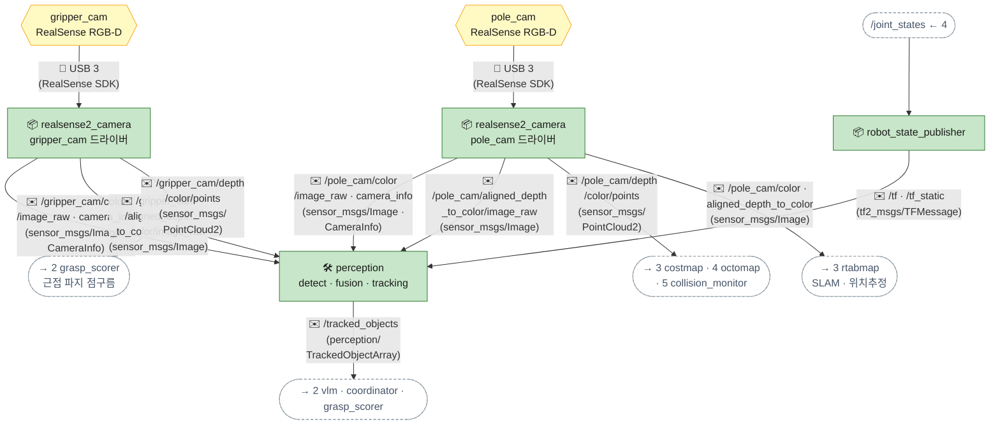

[목차](README.md) · [◀ 전체 아키텍처](01-arch.md) · [2 계획·임무 ▶](03-plan.md)

## 1. 센서·인지

센서 장치(육각형)는 🔌 USB로 드라이버 노드에 연결되고, **토픽은 드라이버 노드가 발행**합니다. 카메라 드라이버가 영상·depth·camera_info를 내고, perception이 물체를 map 기준 3D로 추적합니다. gripper_cam은 팔과 함께 움직이므로 **영상 시각의 TF**로 변환해야 위치가 어긋나지 않습니다(`lookupTransform`에 header.stamp 사용, 메시지 필터로 동기화).

> 인터페이스 명세: [토픽](../API.md#api-topics)

| 이름 | 종류 | 메시지 타입 | 보내는 쪽 → 받는 쪽 | 주기 · QoS |
| --- | --- | --- | --- | --- |
| /gripper_cam/color/image_raw | 토픽 | sensor_msgs/Image | realsense2_camera (gripper_cam) → perception | 15~30Hz · best_effort |
| /gripper_cam/color/camera_info | 토픽 | sensor_msgs/CameraInfo | realsense2_camera (gripper_cam) → perception | 15~30Hz |
| /gripper_cam/aligned_depth_to_color/image_raw | 토픽 | sensor_msgs/Image | realsense2_camera (gripper_cam) → perception | 15~30Hz · best_effort |
| /gripper_cam/depth/color/points | 토픽 | sensor_msgs/PointCloud2 | realsense2_camera (gripper_cam) → grasp_scorer | pick 단계에서만 |
| /pole_cam/color/image_raw | 토픽 | sensor_msgs/Image | realsense2_camera (pole_cam 드라이버) → perception | 30Hz · best_effort |
| /pole_cam/aligned_depth_to_color/image_raw | 토픽 | sensor_msgs/Image | realsense2_camera (pole_cam 드라이버) → perception, rtabmap | 30Hz · best_effort |
| /pole_cam/depth/color/points | 토픽 | sensor_msgs/PointCloud2 | realsense2_camera (`pointcloud.enable`) → costmap, move_group, collision_monitor | 10~15Hz (다운샘플) |
| /tf, /tf_static | 토픽 | tf2_msgs/TFMessage | robot_state_publisher, rtabmap, ekf → 전체 | 10~100Hz |
| /tracked_objects | 토픽 | 커스텀 TrackedObjectArray | perception → vlm_task_planner, coordinator, grasp_scorer | 10Hz · reliable |

- **TrackedObject 한 항목:** id, class, map 기준 pose(+위치 공분산), 크기, 신뢰도, 마지막 관측 시각 + 마지막으로 본 카메라·박스 중심 px(VLM 이미지 마킹용) + 색(퍽·신호등). VLM·coordinator가 같은 물체를 id로 가리킨다. 필드별 뜻은 [API.md](../API.md#api-msg-trackedobject).
- **두 카메라 융합 (객체 단위):** 카메라마다 컬러·정렬 depth를 시각 동기화해 박스 중심 + depth 중앙값으로 3D 점 1개 → **영상 시각의 TF**로 odom 변환(gripper_cam이 팔과 함께 움직여도 찍힌 순간 자세 — 추적·융합은 끊김 없는 odom에서, 발행 때 그 순간의 map ← odom으로 map 기준) → 같은 클래스·0.4m 안 트랙에 1:1 배정 → 칼만 갱신. 관측 공분산은 depth 축 σ = 0.005 + 0.01·z², 가로·세로 σ = 4px·z/f를 TF 회전으로 map에 — 가까운 gripper_cam이 자연히 무겁고, 두 카메라가 다른 방향에서 보면 서로의 depth 축 오차를 줄인다. 융합 전 카메라별 검출은 `/perception/<cam>/detections`(디버그·시뮬레이터 [감지 물체 보기]).
- **/scan이 없다:** LiDAR를 쓰지 않으므로 LaserScan 기반 노드(slam_toolbox, amcl)는 빠진다. 거리 정보는 전부 RealSense depth에서 온다. 굳이 스캔이 필요하면 `pointcloud_to_laserscan`(target_frame=base_footprint, 높이 범위 지정)을 쓰고, `depthimage_to_laserscan`은 하향 카메라에선 바닥을 장애물로 잡으니 쓰지 않는다.
- **RealSense 2대 운용:** 드라이버를 카메라마다 하나씩 띄우고 `serial_no`로 구분, `camera_namespace:=''`·`camera_name:=pole_cam / gripper_cam`으로 토픽을 위 이름에 맞춘다. 가능하면 서로 다른 USB 3 컨트롤러에 꽂고, 대역폭·CPU를 아끼려 640×480 · 15~30fps로 둔다. 둘 다 `align_depth.enable:=true`.
- **gripper_cam 근접 한계:** D435 계열은 최소 측정 거리가 대략 0.2~0.3m라 그리퍼가퍽에 바짝 붙으면 depth가 비어 버린다. 근접 점구름이 중요하면 D405 같은 근거리 모델을 고르거나, 점구름은 접근 시작점(약 0.3m)에서 미리 찍어 둔다.
- **gripper_cam은 움직인다:** 점구름을 쓸 때 영상 시각의 TF(gripper_cam_link)로 변환해야 팔이 움직이는 동안에도 위치가 맞는다.
---

## ▶ 흐름 따라가기

도식의 화살표를 단계별로 따라간 설명입니다. (원본 페이지에서는 단계마다 해당 화살표가 강조됩니다.)

### pole_cam 영상 → 물체 추적 → 다른 노드로

1. **카메라 → 드라이버** — 카메라는 🔌 USB 3로 realsense2_camera 드라이버에 붙습니다. 카메라 자체는 토픽을 내지 않고, 토픽은 드라이버 노드가 발행합니다.  
   화살표: pole_cam → realsense2_camera
2. **영상 + depth → perception** — 컬러 영상·camera_info와 컬러에 정렬된 depth가 30Hz(best_effort)로 들어갑니다. 정렬(align_depth)이 돼 있어야 픽셀마다 거리를 바로 읽습니다.  
   화살표: realsense2_camera → perception · realsense2_camera → perception (#2)
3. **카메라가 어디 있나 (TF)** — /joint_states → robot_state_publisher → /tf. perception이 카메라 좌표의 물체를 map 기준으로 바꿀 때 이 TF를 씁니다.  
   화살표: /joint_states ← 4 → robot_state_publisher · robot_state_publisher → perception
4. **추적 결과 발행** — ✉️ /tracked_objects 10Hz(reliable) — id·class·map 기준 위치·크기·신뢰도. VLM·coordinator·grasp_scorer가 같은 물체를 id로 가리킵니다.  
   화살표: perception → 2 vlm · coordinator · grasp_scorer

### pole_cam 하나가 어디까지 쓰이나

1. **한 대의 카메라** — LiDAR가 없어서 거리 정보는 전부 이 RealSense에서 나옵니다.  
   화살표: pole_cam → realsense2_camera
2. **① 인지** — 영상·depth → perception → 물체 추적.  
   화살표: realsense2_camera → perception · realsense2_camera → perception (#2)
3. **② 위치추정** — 컬러 + 정렬 depth → rtabmap (SLAM·위치추정, map→odom).  
   화살표: realsense2_camera → 3 rtabmap
4. **③ 장애물** — 점구름 → Nav2 costmap(voxel layer), MoveIt octomap, collision_monitor. 10~15Hz로 다운샘플.  
   화살표: realsense2_camera → 3 costmap · 4 octomap

### gripper_cam — 집기 직전 근접 보기

1. **그리퍼에 붙은 카메라** — 팔과 함께 움직입니다. pole_cam과 다른 USB 3 컨트롤러에 꽂고 serial_no로 구분합니다.  
   화살표: gripper_cam → realsense2_camera
2. **영상 + depth → perception** — 근접에서 퍽을 다시 확인합니다.  
   화살표: realsense2_camera → perception · realsense2_camera → perception (#2)
3. **움직이는 카메라의 위치** — 팔이 움직이는 중이라 영상 시각(header.stamp)의 TF로 변환해야 위치가 어긋나지 않습니다.  
   화살표: /joint_states ← 4 → robot_state_publisher · robot_state_publisher → perception
4. **근접 점구름 → grasp_scorer** — pick 단계에서만. D435 계열은 0.2~0.3m보다 가까우면 depth가 비므로 접근 시작점(약 0.3m)에서 미리 찍어 둡니다.  
   화살표: realsense2_camera → 2 grasp_scorer

---

[목차](README.md) · [◀ 전체 아키텍처](01-arch.md) · [2 계획·임무 ▶](03-plan.md) · [원본 페이지](https://dooboostore.github.io/ros2?concept=design&sec=sense)
