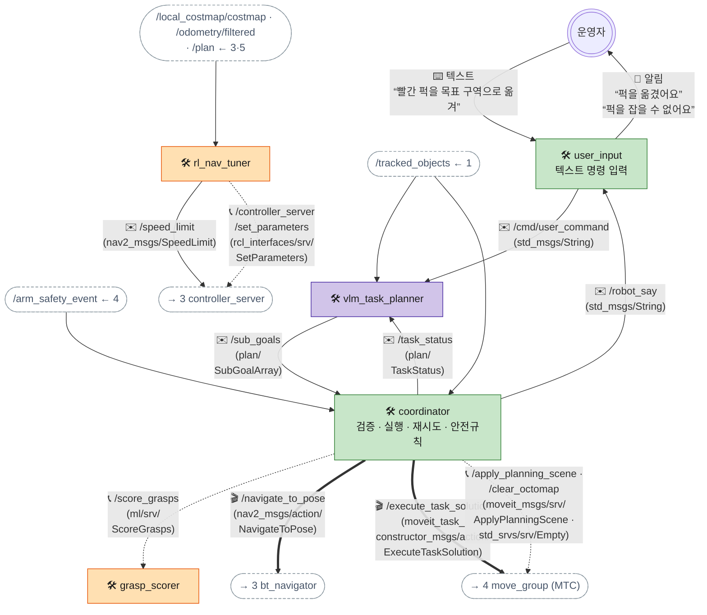

[목차](README.md) · [◀ 1 센서·인지](02-sense.md) · [3 Nav2·SLAM ▶](04-nav.md)

## 2. 계획·임무

VLM이 작업 순서를 정하고, coordinator가 검증한 뒤 Nav2와 MoveIt에 **액션**으로 실행을 맡깁니다. 앞단 학습 노드 두 개가 여기에 붙습니다.

> 인터페이스 명세: [토픽](../API.md#api-topics) · [액션](../API.md#api-actions) · [서비스](../API.md#api-services)

| 이름 | 종류 | 메시지 타입 | 보내는 쪽 → 받는 쪽 | 주기 · QoS |
| --- | --- | --- | --- | --- |
| /cmd/user_command | 토픽 | std_msgs/String | user_input → vlm_task_planner | 명령마다 · reliable |
| /robot_say | 토픽 | std_msgs/String | coordinator → user_input | 알릴 때 · reliable |
| /sub_goals | 토픽 | 커스텀 SubGoalArray | vlm_task_planner → coordinator | 계획마다 · reliable + transient_local |
| /task_status | 토픽 | 커스텀 TaskStatus | coordinator → vlm_task_planner, UI | 단계 완료·실패 시 · reliable |
| /score_grasps | 서비스 | 커스텀 ScoreGrasps.srv | coordinator → grasp_scorer | pick 직전 1회 |
| /speed_limit | 토픽 | nav2_msgs/SpeedLimit | rl_nav_tuner → controller_server, rl_nav_correction | 프리셋 변경 시 · reliable |
| /controller_server/set_parameters | 서비스 | rcl_interfaces/srv/SetParameters | rl_nav_tuner → controller_server | 프리셋 변경 시 |
| /navigate_to_pose | 액션 | nav2_msgs/action/NavigateToPose | coordinator → bt_navigator | 이동 단계마다 |
| /execute_task_solution | 액션 | moveit_task_constructor_msgs/action/ExecuteTaskSolution | coordinator(MTC 태스크) → move_group | pick·place마다 |
| /apply_planning_scene | 서비스 | moveit_msgs/srv/ApplyPlanningScene | coordinator → move_group | pick 전 (퍽·장애물 등록) |
| /clear_octomap | 서비스 | std_srvs/srv/Empty | coordinator → move_group | pick 직전 |

**coordinator가 지키는 실행 규칙**

1. **VLM 출력 검증:** 형식(JSON 스키마), 허용 동작(navigate·pick·place·say), 대상 id가 /tracked_objects에 실제로 있는지.
   - pick·place의 대상 `tray` = 로봇 뒤 적재함 (MISSION ③ MOVE_TO_B — 손에 들고 옮기면 인정 안 됨). 칸은 coordinator 파라미터 `tray_slots`(base_footprint, MoveIt 실측으로 닿는 곳 — 앞줄 x −0.095 · 뒷줄 x −0.135, y ±0.05), 실린 수는 coordinator가 센다 (꽉 차면 `tray_full`, 비면 `tray_empty`). 같은 구역에 여러 번 place하면 `place_spacing`(0.08m)씩 비켜 놓는다. 템플릿(오프라인): 명령에 `MOVE_TO_B`가 있으면 퍽(최대 4개)마다 navigate·pick·place tray → navigate 구역 → (pick tray · place 구역)×개수
2. **이동 전 팔 접기:** navigate 전에 팔을 stow 자세로. 퍽을 든 채 이동하면 footprint를 키운 파라미터(`/local_costmap/local_costmap/set_parameters` footprint)로 바꾼다.
3. **팔은 베이스가 멈췄을 때만:** NavigateToPose 성공 후 0.5초 안정 대기 → planning scene 갱신 → pick.
4. **파지 재시도는 coordinator 몫:** grasp_scorer 후보를 점수순으로 최대 2개 시도. 모두 실패하면 그때 /task_status로 VLM에 재계획을 요청한다.
5. **재시도 한도:** 같은 단계 2회 실패면 `/robot_say`로 user_input에 보내 운영자에게 알리고 정지.

**명령 하나가 처리되는 순서** — 단계별로는 문서 아래 **▶ 흐름 따라가기**에서 볼 수 있다.

- 명령 → VLM 계획 → coordinator가 /sub_goals를 받아 검증
- 이동 단계: NavigateToPose. 이동하는 동안 rl_nav_tuner가 1~2초마다 속도 상한·파라미터를 바꾼다
- pick 단계: 장면 갱신(octomap 지우기·퍽 등록) → 파지 후보 점수 → MTC 실행. 실패하면 다음 후보로 재시도
- 단계가 끝날 때마다 /task_status (place까지 이동·pick을 반복한 뒤 마지막 완료 보고)
- 결과를 음성으로 알림
- 번호 없는 화살표(/tracked_objects, /arm_safety_event, 내비 상태)는 늘 들어오는 입력이다.

- grasp_scorer는 pick 직전에 한 번만 물으면 되므로 토픽보다 서비스가 맞다.
- rl_nav_tuner의 출력은 **속도 상한(/speed_limit 토픽)** 과 **DWB kinematic 파라미터(set_parameters)** 두 경로로만 나간다. 자세한 건 학습 탭의 프리셋 표 참고.
---

## ▶ 흐름 따라가기

도식의 화살표를 단계별로 따라간 설명입니다. (원본 페이지에서는 단계마다 해당 화살표가 강조됩니다.)

### 명령 하나 처리

1. **운영자가 명령한다** — "빨간 퍽을 목표 구역으로 옮겨".  
   화살표: 사람 → user_input
2. **VLM에 명령** — /cmd/user_command 문자열 + 지금 보이는 물체 목록(/tracked_objects)을 함께 보고 계획합니다.  
   화살표: user_input → vlm_task_planner · /tracked_objects ← 1 → vlm_task_planner
3. **계획 → coordinator 검증** — /sub_goals [navigate, pick, navigate, place]. coordinator가 형식·허용 동작·대상 id가 /tracked_objects에 실제 있는지 확인합니다.  
   화살표: vlm_task_planner → coordinator · /tracked_objects ← 1 → coordinator
4. **이동** — 팔을 stow로 접고 🎬 NavigateToPose (3.45, 0.9).  
   화살표: coordinator → 3 bt_navigator
5. **이동 중 속도 프리셋** — rl_nav_tuner가 costmap·현재 속도·남은 거리를 보고 1~2초마다 /speed_limit과 set_parameters로 바꿉니다.  
   화살표: /local_costmap/costmap · /odometry/filtered → rl_nav_tuner · rl_nav_tuner → 3 controller_server · rl_nav_tuner → 3 controller_server (#2)
6. **장면 갱신** — 베이스가 멈추고 0.5초 안정 대기 → /clear_octomap → 퍽·장애물을 /apply_planning_scene으로 등록.  
   화살표: coordinator → 4 move_group (MTC) (#2)
7. **파지 후보 점수** — 📞 /score_grasps → [B 0.87, C 0.62, A 0.41]. pick 직전 한 번이라 서비스.  
   화살표: coordinator → grasp_scorer
8. **집기 실행** — 🎬 /execute_task_solution 후보 B. 실패하면 다음 후보로 다시 집기.  
   화살표: coordinator → 4 move_group (MTC)
9. **단계 결과 보고** — /task_status. place까지 이동·집기를 반복한 뒤 마지막에 완료 보고.  
   화살표: coordinator → vlm_task_planner
10. **말할 내용** — /robot_say "퍽을 옮겼어요".  
   화살표: coordinator → user_input
11. **알림** — user_input이 운영자에게 보여 줍니다. 끝.  
   화살표: user_input → 사람

### 파지 실패 → 재시도 → 재계획 → 다시 집기

1. **후보 B 실패** — 그리퍼가 완전히 닫힘(빈손) → 놓친 것으로 판단.  
   화살표: coordinator → 4 move_group (MTC)
2. **후보 C 재시도 → 또 실패** — VLM을 부르지 않고 coordinator가 직접 2순위로 (규칙 4). 실행 세부는 coordinator의 권한입니다.  
   화살표: coordinator → 4 move_group (MTC)
3. **재계획 요청** — /task_status (step 2, FAILED, reason: grasp_failed_all).  
   화살표: coordinator → vlm_task_planner
4. **새 계획** — VLM이 /tracked_objects를 다시 보고 /sub_goals — 예) [navigate(퍽 옆, 퍽 방향 정렬), pick(퍽 3), navigate(목표 구역), place]. coordinator가 다시 검증.  
   화살표: /tracked_objects ← 1 → vlm_task_planner · vlm_task_planner → coordinator
5. **새 접근 위치로 이동** — 팔을 접고 NavigateToPose (다른 방향).  
   화살표: coordinator → 3 bt_navigator
6. **장면 갱신 · 후보 다시** — 멈춘 뒤 octomap 지우기·퍽 등록 → 새 위치에서 /score_grasps 다시.  
   화살표: coordinator → 4 move_group (MTC) (#2) · coordinator → grasp_scorer
7. **다시 집기 → 성공** — 퍽 attach. 성공하면 원래 계획대로 목표 구역에 내려놓기(이동 → place)로 이어갑니다.  
   화살표: coordinator → 4 move_group (MTC)
8. **재계획도 실패하면 — 알리고 정지** — pick이 두 번째로 실패(같은 단계 2회 연속, 규칙 5)할 때만 "퍽을 잡을 수 없어요".  
   화살표: coordinator → user_input · user_input → 사람

### 팔 안전 이벤트로 멈출 때

1. **접촉 감지 보고** — arm_safety_monitor가 궤적을 취소하고 /arm_safety_event를 보냅니다 (4장).  
   화살표: /arm_safety_event ← 4 → coordinator
2. **단계 실패 보고** — coordinator가 pick 단계를 실패로 기록하고 /task_status (FAILED, reason: arm_contact)로 VLM에 알립니다.  
   화살표: coordinator → vlm_task_planner
3. **재계획** — ✉️ /sub_goals 다시 — 예) 다른 방향에서 접근. coordinator가 검증합니다.  
   화살표: vlm_task_planner → coordinator
4. **새 계획 실행** — 이동 → 장면 갱신 → 후보 점수 → 집기를 다시. 성공하면 원래 계획대로 이어갑니다.  
   화살표: coordinator → 3 bt_navigator · coordinator → 4 move_group (MTC) (#2) · coordinator → grasp_scorer · coordinator → 4 move_group (MTC)
5. **또 실패하면 알리고 정지** — 같은 단계가 2회 연속 실패할 때만 알리고 정지.  
   화살표: coordinator → user_input · user_input → 사람

### 이동 실패 → 재계획

1. **이동 요청** — 🎬 NavigateToPose (3.45, 0.9).  
   화살표: coordinator → 3 bt_navigator
2. **결과 ABORTED** — Nav2가 복구(Spin·BackUp·Wait)까지 해보고도 못 가면 액션이 ABORTED로 끝나 coordinator에 돌아옵니다 (3장).  
   화살표: coordinator → 3 bt_navigator
3. **실패 보고** — /task_status (step 1, FAILED, reason: nav_failed).  
   화살표: coordinator → vlm_task_planner
4. **재계획** — VLM이 지금 보이는 물체(/tracked_objects)를 다시 보고 새 /sub_goals — 예) 퍽 반대편 접근.  
   화살표: vlm_task_planner → coordinator · /tracked_objects ← 1 → vlm_task_planner
5. **새 목표로 재시도** — 검증 후 다시 NavigateToPose.  
   화살표: coordinator → 3 bt_navigator
6. **또 실패하면 알리고 정지** — 같은 단계 2회 연속 실패 → /robot_say "목표까지 갈 수 없어요".  
   화살표: coordinator → user_input · user_input → 사람

---

[목차](README.md) · [◀ 1 센서·인지](02-sense.md) · [3 Nav2·SLAM ▶](04-nav.md) · [원본 페이지](https://dooboostore.github.io/ros2?concept=design&sec=plan)
