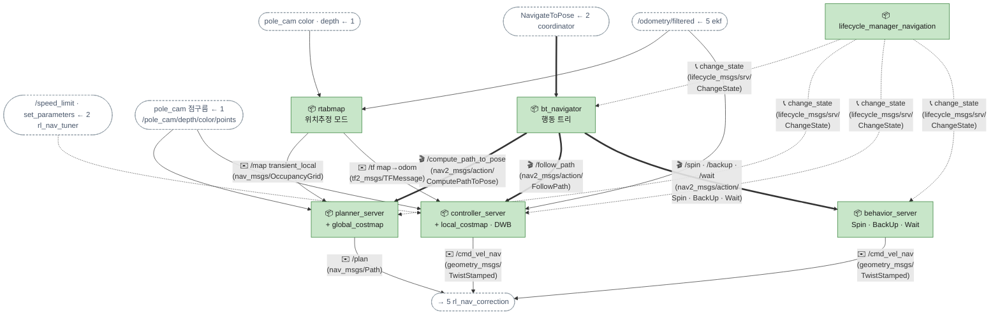
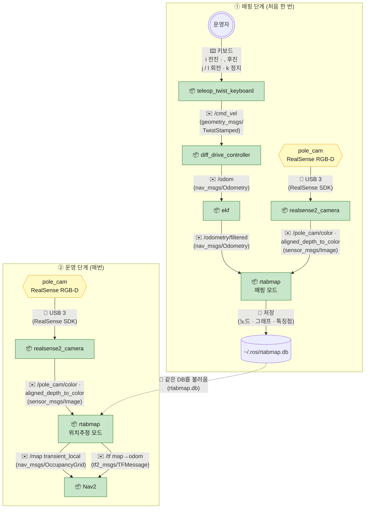

[목차](README.md) · [◀ 2 계획·임무](03-plan.md) · [3-1 지도 맵핑 실습 ▶](04b-mapping.md)

## 3. Nav2

bt_navigator가 행동 트리로 "경로 계산 → 따라가기 → 막히면 복구"를 지휘합니다. LiDAR가 없으므로 **장애물은 pole_cam 점구름**, **위치는 RTAB-Map**(위치추정 모드)이 공급합니다. planner_server 안에 global_costmap, controller_server 안에 local_costmap과 DWB가 들어 있고, **behavior_server**가 Spin·BackUp·Wait 복구를 맡습니다(기본 BT가 호출하므로 반드시 띄운다).

> 인터페이스 명세: [토픽](../API.md#api-topics) · [액션](../API.md#api-actions)



| 이름 | 종류 | 메시지 타입 | 보내는 쪽 → 받는 쪽 | 주기 · QoS |
| --- | --- | --- | --- | --- |
| /compute_path_to_pose | 액션 | nav2_msgs/action/ComputePathToPose | bt_navigator → planner_server | 약 1Hz 재계획 |
| /follow_path | 액션 | nav2_msgs/action/FollowPath | bt_navigator → controller_server | 경로 변경 시 |
| /spin, /backup, /wait | 액션 | nav2_msgs/action/Spin 등 | bt_navigator → behavior_server | 복구 시 |
| /map | 토픽 | nav_msgs/OccupancyGrid | rtabmap → global_costmap | 갱신 시 · **transient_local** |
| /plan | 토픽 | nav_msgs/Path | planner_server → rl_nav_correction, RViz | 계획마다 |
| /cmd_vel_nav | 토픽 | geometry_msgs/TwistStamped | controller_server, behavior_server → rl_nav_correction | 20Hz |
| */change_state | 서비스 | lifecycle_msgs/srv/ChangeState | lifecycle_manager → 관리 대상 노드 | 시작·종료 시 |

**순서** — 단계별로는 문서 아래 **▶ 흐름 따라가기**에서 볼 수 있다.

- 시작할 때 1회: lifecycle_manager가 Nav2 서버들을 configure → activate 한다
- coordinator의 NavigateToPose 도착
- 경로 계산 → /plan 발행
- 경로 따라가기 → /cmd_vel_nav 20Hz. 주행 중 경로 계산~따라가기가 약 1Hz로 반복된다(재계획)
- 막혔을 때만: 복구 동작(Spin·BackUp·Wait) → 복구 중 속도 명령. 끝나면 경로 계산부터 다시
- 번호 없는 화살표(/map, map→odom, 점구름, /odometry/filtered, rl_nav_tuner)는 늘 들어오는 입력이다.

- **costmap 장애물 층:** LaserScan이 없으므로 `voxel_layer`(또는 STVL)에 PointCloud2를 `observation_sources`로 넣는다. `min_obstacle_height 0.03`, `max_obstacle_height 0.40`으로 바닥과 목표 구역 상판 위를 거른다.
- **시야 사각지대:** pole_cam 수평 화각은 약 87°라 옆·뒤가 안 보인다. 한 번 본 장애물이 시야 밖에서도 남도록 voxel layer의 clearing을 보수적으로 두고, BT의 **BackUp 복구는 빼거나 거리를 0.1m 이하로** 제한한다(뒤를 못 보므로 collision_monitor도 막아 주지 못한다). Spin도 짧게. 구현: `ros_system/config/navigate_to_pose.xml`(Nav2 기본 BT 복사본에서 BackUp만 0.10m · 0.05m/s)을 `ros_system.launch.py`가 `default_nav_to_pose_bt_xml`로 넘긴다. 기본 0.30m로는 벽에 박혀 odom이 밀리고 → 위치추정이 벽 안으로 → 출발점부터 경로 실패 → 또 후진이 반복되는 것을 테스트베드에서 봤다.
- **lifecycle:** rtabmap은 Nav2 lifecycle 관리 대상이 아니다. localization용 lifecycle_manager는 필요 없고, navigation용 하나만 둔다.
- **나머지 Nav2 서버:** smoother_server, waypoint_follower는 이 작업에 필수는 아니지만 기본 bringup에 포함돼 있어 같이 띄워도 된다. velocity_smoother·collision_monitor는 5장에서 다룬다.
- **리매핑 하나:** Nav2 기본 bringup은 controller_server 출력을 /cmd_vel_nav, velocity_smoother 입력을 /cmd_vel_nav로 잇는다. 여기서는 velocity_smoother 입력만 /cmd_vel_corrected로 바꿔 사이에 rl_nav_correction을 끼운다. behavior_server의 출력도 같은 /cmd_vel_nav로 맞춰 복구 동작도 안전 필터를 거치게 한다.
- **Twist vs TwistStamped:** Jazzy 이후(Lyrical 포함) Nav2 `enable_stamped_cmd_vel: true`, diff_drive_controller는 TwistStamped만 받는다. 체인 전체를 하나로 통일한다.

## 3-1. 지도 생성 (SLAM) — RTAB-Map

LiDAR가 없으므로 **RGB-D SLAM인 RTAB-Map**을 씁니다. pole_cam의 컬러 + 정렬된 depth와 휠/IMU 오도메트리(/odometry/filtered)로 지도를 만들고, 결과는 **rtabmap.db** 하나에 저장됩니다. 운영 때는 같은 DB를 위치추정 모드로 열어 map→odom만 냅니다. Nav2가 쓰는 2D 지도(/map)는 RTAB-Map이 depth에서 바로 만들어 줍니다.



| 단계 | 실행 노드 | 하는 일 | 결과 |
| --- | --- | --- | --- |
| 1. 지도 생성 | rtabmap (매핑 모드, `localization:=false`) | 텔레옵으로 0.1~0.15m/s로 천천히 돌며 RGB-D + 오도메트리로 지도 작성. 같은 장소를 다른 방향에서도 보고, 출발점으로 돌아와 루프 클로저 | rtabmap.db, /map, map→odom TF |
| 2. 저장 | rtabmap (자동) | 종료 시 DB가 자동 저장된다. 2D 지도를 따로 보관하려면 map_saver_cli | rtabmap.db (+ home.yaml/pgm 선택) |
| 3. 운영 | rtabmap (위치추정 모드, `localization:=true`) | 저장된 DB로 현재 위치를 찾고 map→odom 발행. 지도는 더 키우지 않음 | /map, map→odom TF |

```bash
# 1) 매핑 — 기존 DB를 지우고 새로 (-d)
ros2 launch rtabmap_launch rtabmap.launch.py   rgb_topic:=/pole_cam/color/image_raw   depth_topic:=/pole_cam/aligned_depth_to_color/image_raw   camera_info_topic:=/pole_cam/color/camera_info   frame_id:=base_footprint odom_topic:=/odometry/filtered   visual_odometry:=false approx_sync:=true qos:=1   subscribe_scan_cloud:=true scan_cloud_topic:=/pole_cam/depth/color/points_filtered   rtabmap_args:="-d --Reg/Force3DoF true --Grid/Sensor 0"

# 2) (선택) Nav2·RViz용 2D 지도 파일 따로 보관
ros2 run nav2_map_server map_saver_cli -f ~/maps/home

# 3) 운영 — 같은 DB로 위치추정만
ros2 launch rtabmap_launch rtabmap.launch.py ...(위와 같은 토픽 인자) localization:=true
```

- **오도메트리는 휠+IMU(ekf)로:** `visual_odometry:=false`로 두고 /odometry/filtered를 넣는다. 카메라가 하향이라 시각 오도메트리는 바닥 질감에 약하다.
- **평면 로봇 고정:** `Reg/Force3DoF true`로 x·y·yaw만 추정하게 해서 기울어짐 오차를 막는다.
- **지도 품질 팁:** 화각이 좁으므로 천천히, 같은 공간을 여러 방향에서 본다. 흰 벽·유리처럼 특징이 없는 곳은 루프 클로저가 안 되니 근처 가구를 함께 비추며 지나간다. 조명이 크게 다르면(낮/밤) 위치 찾기가 약해지니 두 조건 모두에서 매핑해 둔다.
- **시작 위치:** 위치추정 모드는 처음 몇 초간 지도와 맞는 장면을 찾아야 map→odom이 나온다. 그 전에는 Nav2 목표를 보내지 않는다(coordinator가 TF를 기다림).
- **가구가 크게 바뀌면** 다시 매핑한다. 장애물처럼 자주 움직이는 물체는 costmap이 실시간 점구름으로 잡는다.
- **대안:** `pointcloud_to_laserscan`으로 가짜 스캔을 만들어 slam_toolbox + amcl을 쓸 수도 있지만, 화각 87°의 짧은 스캔이라 매칭이 자주 실패한다. RGB-D만 있다면 RTAB-Map이 표준 선택이다.
---

## ▶ 흐름 따라가기

도식의 화살표를 단계별로 따라간 설명입니다. (원본 페이지에서는 단계마다 해당 화살표가 강조됩니다.)

### Nav2 이동 명령 하나

1. **시작할 때 1회** — lifecycle_manager가 Nav2 서버들을 configure → activate. rtabmap은 관리 대상이 아닙니다.  
   <sub>화살표: lifecycle_manager_navigation → bt_navigator · lifecycle_manager_navigation → planner_server · lifecycle_manager_navigation → controller_server · lifecycle_manager_navigation → behavior_server</sub>
2. **위치는 늘 들어온다** — rtabmap(위치추정 모드)이 /map(transient_local)과 map→odom을 냅니다. map→odom이 나오기 전엔 coordinator가 목표를 보내지 않습니다.  
   <sub>화살표: pole_cam color · depth ← 1 → rtabmap · /odometry/filtered ← 5 ekf → rtabmap · rtabmap → planner_server · rtabmap → controller_server</sub>
3. **목표 도착** — coordinator의 NavigateToPose가 bt_navigator로.  
   <sub>화살표: NavigateToPose ← 2 coordinator → bt_navigator</sub>
4. **경로 계산** — 🎬 compute_path_to_pose. global_costmap은 pole_cam 점구름(voxel layer)으로 장애물을 채웁니다.  
   <sub>화살표: bt_navigator → planner_server · pole_cam 점구름 ← 1 → planner_server</sub>
5. **/plan** — 경로가 나옵니다. rl_nav_correction도 경로 오차 계산에 씁니다.  
   <sub>화살표: planner_server → 5 rl_nav_correction</sub>
6. **경로 따라가기** — 🎬 follow_path. controller_server(DWB)가 local_costmap·현재 속도(/odometry/filtered)·rl_nav_tuner 상한을 보고 명령을 만듭니다.  
   <sub>화살표: bt_navigator → controller_server · pole_cam 점구름 ← 1 → controller_server · /odometry/filtered ← 5 ekf → controller_server · /speed_limit · set_parameters ← 2 rl_nav_tuner → controller_server</sub>
7. **/cmd_vel_nav 20Hz** — 베이스 체인(5장)으로. 주행 중 경로 계산~따라가기가 약 1Hz로 반복(재계획)됩니다.  
   <sub>화살표: controller_server → 5 rl_nav_correction</sub>
8. **막혔을 때만 복구** — Spin·BackUp·Wait. pole_cam이 뒤를 못 보므로 BackUp은 빼거나 0.1m 이하로.  
   <sub>화살표: bt_navigator → behavior_server</sub>
9. **복구 중 속도 명령** — 같은 /cmd_vel_nav로 내서 안전 필터를 거치게 합니다. 끝나면 경로 계산부터 다시.  
   <sub>화살표: behavior_server → 5 rl_nav_correction</sub>

### 막힘 → 복구 → 그래도 안 되면 coordinator에 실패

1. **따라가다 막힘** — 장애물가 통로를 막아 controller_server가 진행하지 못합니다 (progress checker가 멈춤 감지).  
   <sub>화살표: bt_navigator → controller_server · controller_server → 5 rl_nav_correction</sub>
2. **경로 다시 계산** — 막힌 곳을 피하는 경로를 찾아봅니다. 찾으면 따라가기로 계속.  
   <sub>화살표: bt_navigator → planner_server</sub>
3. **복구 동작** — 경로가 안 나오면 Spin·BackUp·Wait. 복구 속도 명령도 안전 체인을 거칩니다.  
   <sub>화살표: bt_navigator → behavior_server · behavior_server → 5 rl_nav_correction</sub>
4. **복구 후 재시도** — 경로 계산부터 다시. 행동 트리에 정해진 재시도 횟수만큼 반복합니다.  
   <sub>화살표: bt_navigator → planner_server · bt_navigator → controller_server</sub>
5. **결과 ABORTED → coordinator** — 횟수를 넘기면 NavigateToPose 액션이 ABORTED로 끝납니다. 그다음 재계획은 coordinator·VLM 몫입니다 (2장 "이동 실패 → 재계획").  
   <sub>화살표: NavigateToPose ← 2 coordinator → bt_navigator</sub>

### RTAB-Map — 지도 만들기 → 운영

1. **① 매핑: 사람이 몬다** — teleop_twist_keyboard로 0.1~0.15m/s 천천히. 같은 곳을 여러 방향에서 보고 출발점으로 돌아와 루프 클로저.  
   <sub>화살표: 사람 → teleop_twist_keyboard</sub>
2. **/cmd_vel** — diff_drive_controller가 바퀴를 굴립니다.  
   <sub>화살표: teleop_twist_keyboard → diff_drive_controller</sub>
3. **휠+IMU 오도메트리** — /odom → ekf → /odometry/filtered → rtabmap. 하향 카메라라 시각 오도메트리는 끕니다(visual_odometry:=false).  
   <sub>화살표: diff_drive_controller → ekf · ekf → rtabmap</sub>
4. **카메라 영상** — pole_cam 컬러 + 정렬 depth로 장면을 기억합니다.  
   <sub>화살표: pole_cam → realsense2_camera · realsense2_camera → rtabmap</sub>
5. **DB 저장** — ~/.ros/rtabmap.db에 노드·그래프·특징점. 지도는 이 파일 하나입니다.  
   <sub>화살표: rtabmap → ~/.ros/rtabmap.db</sub>
6. **② 운영: 같은 DB를 불러옴** — localization:=true. 지도는 더 키우지 않고 위치만 찾습니다.  
   <sub>화살표: ~/.ros/rtabmap.db → rtabmap</sub>
7. **지금 보이는 장면** — 처음 몇 초간 지도와 맞는 장면을 찾아야 위치가 잡힙니다.  
   <sub>화살표: pole_cam → realsense2_camera · realsense2_camera → rtabmap</sub>
8. **/map · map→odom → Nav2** — 위치를 찾으면 map→odom을 내기 시작합니다. 이때부터 Nav2 목표를 보낼 수 있습니다.  
   <sub>화살표: rtabmap → Nav2 · rtabmap → Nav2 (#2)</sub>


---

[목차](README.md) · [◀ 2 계획·임무](03-plan.md) · [3-1 지도 맵핑 실습 ▶](04b-mapping.md) · [원본 페이지](https://dooboostore.github.io/ros2?concept=design&sec=nav)
