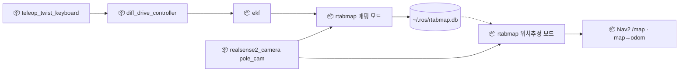

[목차](README.md) · [◀ 3 Nav2·SLAM](04-nav.md) · [4 팔·MoveIt ▶](05-arm.md)

## 3-1. 지도 맵핑 — RTAB-Map 실습

Nav2가 달리기 전에 지도를 한 번 만들어 둔다. LiDAR가 없으므로 pole_cam RGB-D + 휠/IMU 오도메트리로 RTAB-Map 매핑을 하고, 운영 때는 같은 DB를 위치추정 모드로 연다. 상세 설계는 [3 Nav2·SLAM](04-nav.md#3-1-지도-생성-slam--rtab-map) 참조 — 여기는 손으로 따라 하는 절차만 모았다.

> 인터페이스 명세: [토픽](../API.md#api-topics)



### 준비

| 항목 | 값 |
| --- | --- |
| 카메라 | `/pole_cam/color/image_raw` + `/pole_cam/aligned_depth_to_color/image_raw` + `camera_info` |
| 오도메트리 | `/odometry/filtered` (EKF, 휠+IMU). `visual_odometry:=false` — 하향 카메라는 시각 오도메트리가 약하다 |
| 고정 파라미터 | `frame_id:=base_footprint`, `Reg/Force3DoF true` (x·y·yaw만), `Grid/Sensor 0` + `subscribe_scan_cloud` = body_filter의 `/pole_cam/depth/color/points_filtered` (자기 몸 뺀 점구름으로 2D지도 — depth 영상(1)으로 하면 pole_cam에 찍힌 팔이 로봇 둘레 벽으로 남아 출발점이 늘 장애물, 실측) |
| 속도 | 0.1~0.15m/s로 천천히 |

### 절차

```bash
# 1) 매핑 — 기존 DB를 지우고 새로 (-d)
ros2 launch rtabmap_launch rtabmap.launch.py rgb_topic:=/pole_cam/color/image_raw depth_topic:=/pole_cam/aligned_depth_to_color/image_raw camera_info_topic:=/pole_cam/color/camera_info frame_id:=base_footprint odom_topic:=/odometry/filtered visual_odometry:=false approx_sync:=true qos:=1 subscribe_scan_cloud:=true scan_cloud_topic:=/pole_cam/depth/color/points_filtered rtabmap_args:="-d --Reg/Force3DoF true --Grid/Sensor 0"

# 2) (선택) Nav2·RViz용 2D 지도 파일 따로 보관
ros2 run nav2_map_server map_saver_cli -f ~/maps/home

# 3) 운영 — 같은 DB로 위치추정만
ros2 launch rtabmap_launch rtabmap.launch.py rgb_topic:=/pole_cam/color/image_raw depth_topic:=/pole_cam/aligned_depth_to_color/image_raw camera_info_topic:=/pole_cam/color/camera_info frame_id:=base_footprint odom_topic:=/odometry/filtered visual_odometry:=false approx_sync:=true qos:=1 localization:=true subscribe_scan_cloud:=true scan_cloud_topic:=/pole_cam/depth/color/points_filtered rtabmap_args:="--Reg/Force3DoF true --Grid/Sensor 0"
```

1. 텔레옵으로 천천히 한 바퀴 — 같은 장소를 다른 방향에서도 보고 출발점으로 돌아와 루프 클로저.
2. 종료 시 `~/.ros/rtabmap.db` 자동 저장 — 이 파일 하나가 지도다.
3. 운영 모드(`localization:=true`)로 띄우면 지도는 안 키우고 위치만 찾아 `/map` + `map→odom` 발행.

`launch`로는 `ros_system.launch.py`의 `use_rtabmap`, `localization` 인자가 같은 일을 한다 (`localization:=true`=운영, `false`=매핑).

### 품질 팁 · 실패 대응

- 화각이 좁으므로 천천히, 같은 공간을 여러 방향에서 본다.
- 흰 벽·유리처럼 특징 없는 곳은 루프 클로저가 안 된다 — 근처 가구를 함께 비추며 지나간다.
- 조명이 크게 다르면(낮/밤) 위치 찾기가 약해진다 — 두 조건에서 매핑해 둔다.
- 위치추정 모드는 처음 몇 초간 지도와 맞는 장면을 찾아야 `map→odom`이 나온다 — 그 전에는 Nav2 목표를 보내지 않는다 (coordinator가 TF 대기).
- 가구가 크게 바뀌면 다시 매핑한다. 자주 움직이는 물체는 costmap 실시간 점구름이 담당.
- 대안(`pointcloud_to_laserscan` + `slam_toolbox`/`amcl`)은 화각 87° 짧은 스캔이라 매칭 실패가 잦다 — RGB-D만 있다면 RTAB-Map이 표준.

### 확인 체크

- [ ] `rtabmap.db` 저장됐나
- [ ] 위치추정 모드에서 시작 위치를 찾은 뒤 `map→odom`이 나오나
- [ ] `/map`이 Nav2 `global_costmap` static layer에 들어가나
- [ ] coordinator가 TF 대기 후에만 `NavigateToPose`를 보내나

---

[목차](README.md) · [◀ 3 Nav2·SLAM](04-nav.md) · [4 팔·MoveIt ▶](05-arm.md) · [원본 페이지](https://dooboostore.github.io/ros2?concept=design&sec=nav)
