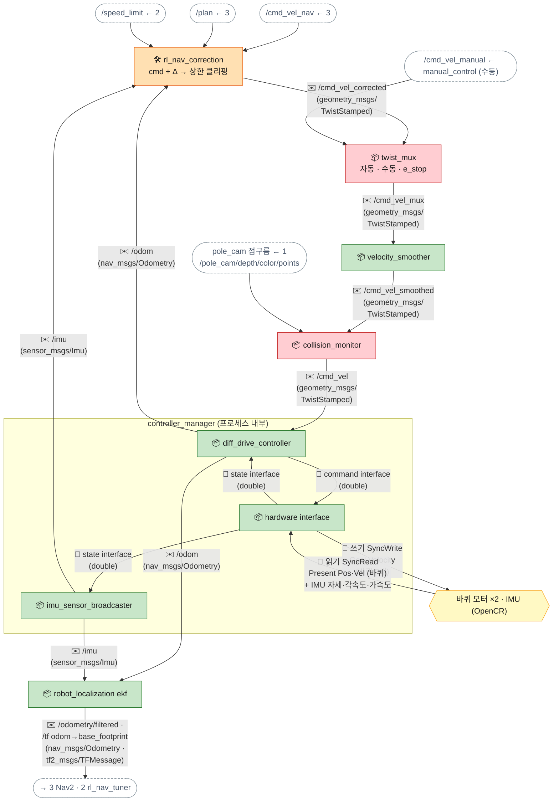

[목차](README.md) · [◀ 4 팔·MoveIt](05-arm.md) · [6 TF·QoS ▶](07-tf.md)

## 5. 베이스: 보정 → 다듬기 → 안전 → 구동

속도 명령은 RL 보정, twist_mux(자동·수동 고르기, 비상정지 잠금), velocity_smoother(가속 제한), collision_monitor(충돌 감속·정지) 순서로 지나간 뒤 diff_drive_controller로 들어갑니다. 바퀴 오도메트리와 IMU는 **robot_localization EKF**가 융합해 odom→base_footprint를 냅니다.

> 인터페이스 명세: [토픽](../API.md#api-topics)

**순서** — 단계별로는 문서 아래 **▶ 흐름 따라가기**에서 볼 수 있다.

- 속도 명령 체인 (20Hz): Nav2 명령 → RL 보정 → 가속 제한 → 충돌 감시 → diff_drive_controller
- controller_manager 한 주기 (read → update → write)
  - read: 바퀴 위치·속도와 IMU를 읽는다
  - 읽은 값이 state interface로 diff_drive·imu broadcaster에 보인다
  - update: /odom, /imu 발행. rl_nav_correction은 이 값을 **다음 보정 계산**에 쓴다 (피드백)
  - update: diff_drive가 /cmd_vel로 바퀴 목표 속도를 쓴다
  - write: 모터로 보내고 다음 주기 read로
- EKF가 /odom·/imu를 융합해 /odometry/filtered와 odom→base_footprint TF를 낸다

| 이름 | 종류 | 메시지 타입 | 보내는 쪽 → 받는 쪽 | 주기 |
| --- | --- | --- | --- | --- |
| /cmd_vel_corrected | 토픽 | geometry_msgs/TwistStamped | rl_nav_correction → twist_mux (자동) | 20Hz |
| /cmd_vel_manual | 토픽 | geometry_msgs/TwistStamped | manual_control → twist_mux (수동, 우선) | 수동 조작 시 |
| /cmd_vel_mux | 토픽 | geometry_msgs/TwistStamped | twist_mux → velocity_smoother | 20Hz |
| /cmd/e_stop | 토픽 | std_msgs/Bool | 운영자 → state_manager → /state/emergency → twist_mux (잠금) | 비상정지 |
| /cmd_vel_smoothed | 토픽 | geometry_msgs/TwistStamped | velocity_smoother → collision_monitor | 20Hz |
| /cmd_vel | 토픽 | geometry_msgs/TwistStamped | collision_monitor → diff_drive_controller | 20Hz |
| /odom | 토픽 | nav_msgs/Odometry | diff_drive_controller → ekf, rl_nav_correction | 50Hz |
| /imu | 토픽 | sensor_msgs/Imu | imu_sensor_broadcaster → ekf, rl_nav_correction | 100Hz · best_effort |
| /odometry/filtered | 토픽 | nav_msgs/Odometry | ekf → rtabmap, controller_server, rl_nav_tuner | 50Hz |

- **diff_drive_controller 토픽 이름:** 기본은 `/diff_drive_controller/cmd_vel`, `/diff_drive_controller/odom`. launch에서 /cmd_vel, /odom으로 리매핑한다.
- **odom TF는 EKF가:** diff_drive_controller의 `enable_odom_tf: false`, ekf의 `publish_tf: true`. 둘 다 내면 TF가 싸운다.
- **collision_monitor 설정 예:** 다각형 3개 — approach(1.0초 뒤 충돌 예상 시 감속), slowdown(0.3m 안 40%), stop(0.15m 안 정지). 입력은 pole_cam PointCloud2 하나(바닥 제거 높이 0.03~0.40m). **전방 화각 안만 지켜 주므로** 후진·제자리 회전은 behavior_server 설정에서 짧게 제한한다.
- **rl_nav_correction의 마지막 줄:** Δ를 더한 뒤 |v| ≤ min(프리셋 상한, /speed_limit), |ω| ≤ max_vel_theta로 다시 자른다. 입력이 0.2초 넘게 끊기면 Δ=0으로 통과만 시킨다.
---

## ▶ 흐름 따라가기

도식의 화살표를 단계별로 따라간 설명입니다. (원본 페이지에서는 단계마다 해당 화살표가 강조됩니다.)

### 속도 명령 한 주기

1. **rl_nav_correction 입력** — Nav2 /cmd_vel_nav(20Hz), /plan(경로 오차), /speed_limit(상한).  
   화살표: /cmd_vel_nav ← 3 → rl_nav_correction · /plan ← 3 → rl_nav_correction · /speed_limit ← 2 → rl_nav_correction
2. **RL 보정** — Δ를 더하고 min(프리셋 상한, /speed_limit)으로 다시 자름. 입력이 0.2초 넘게 끊기면 Δ=0으로 통과만.  
   화살표: rl_nav_correction → velocity_smoother
3. **가속 제한** — velocity_smoother가 급가속·급감속을 자릅니다.  
   화살표: velocity_smoother → collision_monitor
4. **충돌 감시 → /cmd_vel** — pole_cam 점구름으로 approach(1초 뒤 충돌 예상 시 감속)·slowdown(0.3m, 40%)·stop(0.15m) 다각형 검사.  
   화살표: pole_cam 점구름 ← 1 → collision_monitor · collision_monitor → diff_drive_controller
5. **read** — 바퀴 위치·속도와 IMU를 읽습니다 (controller_manager 한 주기 시작).  
   화살표: 바퀴 모터 ×2 · IMU (OpenCR) → hardware interface
6. **state interface** — 읽은 값이 diff_drive·imu broadcaster에 보입니다.  
   화살표: hardware interface → diff_drive_controller · hardware interface → imu_sensor_broadcaster
7. **/odom · /imu** — EKF로, 그리고 rl_nav_correction의 다음 보정 계산으로 (피드백).  
   화살표: diff_drive_controller → robot_localization ekf · imu_sensor_broadcaster → robot_localization ekf · diff_drive_controller → rl_nav_correction · imu_sensor_broadcaster → rl_nav_correction
8. **바퀴 목표 속도** — diff_drive가 collision_monitor의 /cmd_vel로 좌·우 바퀴 속도를 씁니다.  
   화살표: diff_drive_controller → hardware interface
9. **write** — 모터로 보내고 다음 주기 read로.  
   화살표: hardware interface → 바퀴 모터 ×2 · IMU (OpenCR)
10. **EKF 출력** — /odometry/filtered와 odom→base_footprint TF → Nav2·rl_nav_tuner.  
   화살표: robot_localization ekf → 3 Nav2 · 2 rl_nav_tuner

### odom은 어디서 오나 — 바퀴·IMU → EKF

1. **원자료** — 바퀴 회전량과 IMU 각속도·가속도.  
   화살표: 바퀴 모터 ×2 · IMU (OpenCR) → hardware interface
2. **컨트롤러가 읽음** — diff_drive는 바퀴만으로 위치를 적분, imu broadcaster는 IMU 값을 그대로.  
   화살표: hardware interface → diff_drive_controller · hardware interface → imu_sensor_broadcaster
3. **EKF로 융합** — 바퀴만 쓰면 회전이 특히 부정확합니다. 속도 위주로 넣어 미끄러짐을 줄입니다.  
   화살표: diff_drive_controller → robot_localization ekf · imu_sensor_broadcaster → robot_localization ekf
4. **odom TF는 EKF 하나만** — diff_drive는 enable_odom_tf: false. 둘 다 내면 TF가 싸워 로봇이 떨립니다 (맵핑·위치추정 탭 "문제 1").  
   화살표: robot_localization ekf → 3 Nav2 · 2 rl_nav_tuner

---

[목차](README.md) · [◀ 4 팔·MoveIt](05-arm.md) · [6 TF·QoS ▶](07-tf.md) · [원본 페이지](https://dooboostore.github.io/ros2?concept=design&sec=base)
