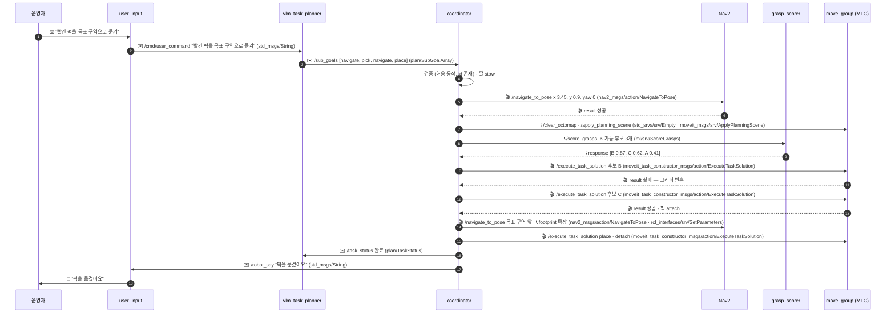
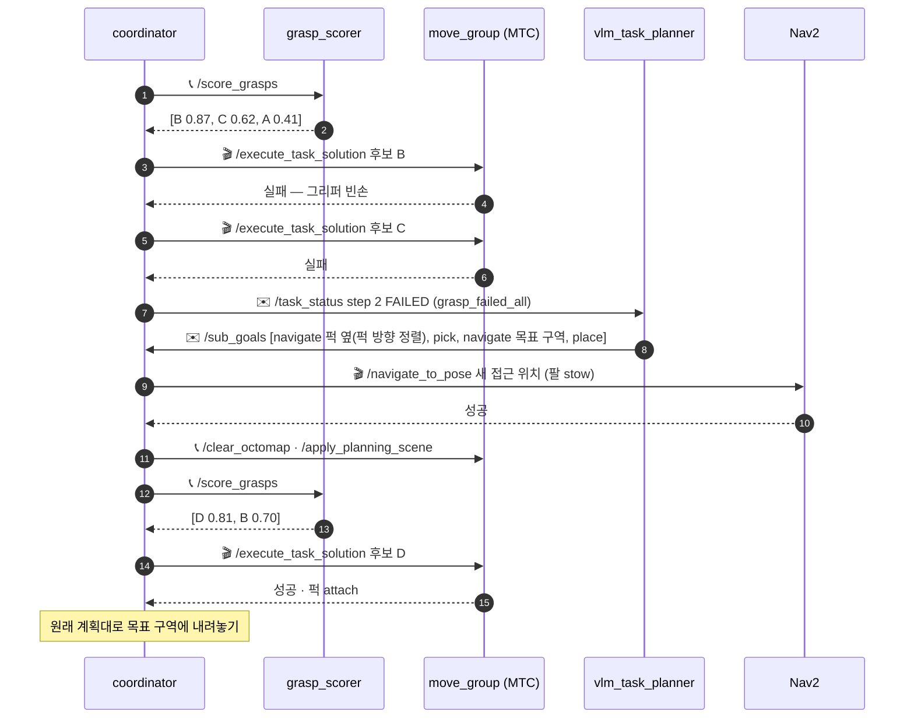
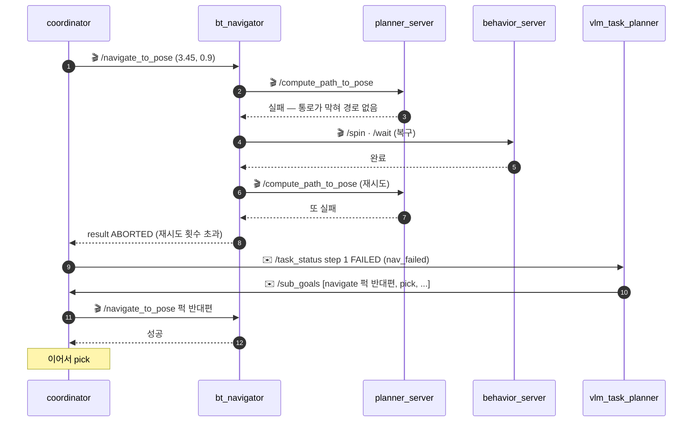
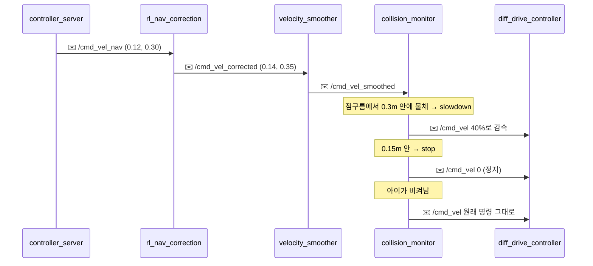
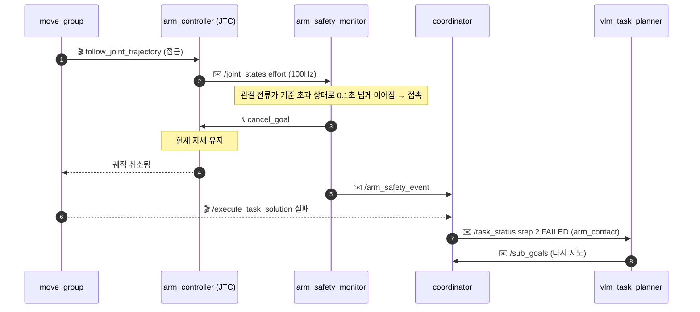
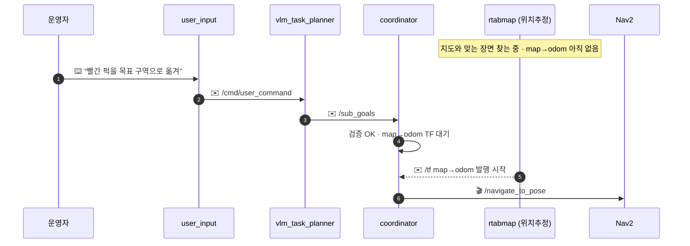

[목차](README.md) · [◀ Isaac 파이프라인](12-isaac.md) · [체크리스트·로드맵 ▶](14-check.md)

## 시나리오

같은 설계가 상황마다 어떻게 움직이는지 봅니다. 1번이 정상 흐름이고, 2~7번은 일이 꼬였을 때입니다.

| # | 시나리오 | 무엇을 보나 |
| --- | --- | --- |
| 1 | 퍽을 목표 구역으로 옮기기 | 정상 흐름 — 명령부터 전달까지 |
| 2 | 파지 실패 → 재계획 → 다시 집기 | 재시도는 coordinator, 재계획은 VLM |
| 3 | 가는 길이 막혔다 | Nav2 자체 복구 → 안 되면 재계획 |
| 4 | 이동 중 아이가 앞을 지나간다 | 재계획 없이 collision_monitor가 감속·정지 |
| 5 | 집는 중 사람이 팔을 잡았다 | 전류로 접촉 감지 → 궤적 취소 |
| 6 | 전원 켜자마자 명령 | 위치(map→odom)를 찾을 때까지 기다림 |
| 7 | 학습 노드를 모두 끄고 같은 명령 | 끄면 무엇이 달라지나 |

## 시나리오 1: 퍽을 목표 구역으로 옮기기 (정상 흐름)

로봇은 현관, 낮은 목표 구역(높이 0.45m)은 4m 떨어진 거실, 가는 길에 미끄러운 바닥과 장애물. 아래 값은 각 노드가 실제로 주고받는 메시지 예시입니다.



### 1단계: 인식과 계획

1. **사람:** "빨간 퍽을 목표 구역으로 옮겨" → /cmd/user_command
2. **perception:** pole_cam 영상·depth로 물체 추적

```yaml
/tracked_objects:
  - { id: 3, class: puck,      pos: [3.67, -2.36, 0.0], size: [0.06, 0.06, 0.04], conf: 0.93 }
  - { id: 5, class: goal_zone, pos: [0.00, -1.58, 0.0], size: [0.30, 0.30, 0.01] }
  - { id: 7, class: obstacle,  pos: [1.47, -1.58, 0.0], size: [0.20, 0.20, 0.30] }
```

3. **vlm_task_planner:** 무엇을, 어떤 순서로만.

```json
{ "sub_goals": [
  { "step": 1, "skill": "navigate", "target": "3", "relation": "front", "offset_m": 0.20 },
  { "step": 2, "skill": "pick",     "target": "3" },
  { "step": 3, "skill": "navigate", "target": "5", "relation": "front", "offset_m": 0.20 },
  { "step": 4, "skill": "place",    "target": "5", "relation": "on" } ] }
```

4. **coordinator:** 허용 동작인지, id 3·5가 목록에 있는지 확인. 퍽 앞 가장자리(x=3.75)에서 0.2m + 로봇 반경 약 0.1m 떨어진 **(3.45, 0.9)** 를 계산해 NavigateToPose. 팔은 stow.

### 2단계: 목표 구역로 이동

1. **rl_nav_tuner(규칙):** 통로 0.73m · 장애물 근처 → 프리셋 B. /speed_limit 60%(≈0.15m/s), max_vel_theta 1.0.
2. **Nav2:** planner_server가 장애물를 피하는 경로, controller_server가 20Hz로 명령. 예) /cmd_vel_nav = (0.12, 0.30)
3. **rl_nav_correction:** 미끄러운 바닥에서 IMU 각속도 0.24, 경로에서 4cm 벗어남 → Δ = (+0.02, +0.05) → (0.14, 0.35). 상한 0.15 이내라 그대로 통과.
4. **velocity_smoother → collision_monitor:** 장애물까지 0.5m라 통과. slowdown 다각형(0.3m) 안이면 40%, stop(0.15m) 안이면 정지.
5. **diff_drive_controller:** 좌 2.72, 우 5.76rad/s. 도착하면 Nav2 성공 → coordinator가 pick으로.

### 3단계: 퍽 집기

1. **coordinator:** 0.5초 안정 대기 → /clear_octomap → 퍽·장애물 CollisionObject 등록 → /score_grasps.

```text
후보 (OM-X IK 가능한 것만)
  B: 옆에서 수평   → 0.87  ← 1순위
  C: 위에서 비스듬히 → 0.62  ← 2순위
  A: 위에서 수직   → 0.41  (가장자리가 얇아 미끄러짐)
```

2. **move_group(MTC):** 후보 B로 접근(직선 8cm) → 열기 → 파지 → attach → 들어올리기(직선 5cm) 계획. 속도 스케일 0.4.
3. **arm_controller:** 매 주기 목표 관절각. 예) [0.00, 0.62, −0.31, 1.10]
4. **rl_arm_correction:** 팔을 뻗자 중력으로 joint2가 0.59에 머묾 → Δ = [0.00, +0.03, −0.01, 0.00] → [0.00, 0.65, −0.32, 1.10]
5. **gripper_controller:** GripperCommand로 닫기. 퍽을 든 뒤 처짐이 커지면 정책이 Δ를 키운다.

### 실패와 재시도

1. GripperCommand 결과 그리퍼 관절 위치가 완전히 닫힘(빈손)에 가깝다 → 놓친 것으로 판단.
2. **coordinator가 직접** 2순위 후보 C로 재시도 (VLM 호출 없음).
3. C도 실패하면 /task_status (step 2, reason: grasp_failed_all)로 VLM에 재계획 요청 — 예) "다른 방향에서 접근하도록 navigate 재지정".
4. 같은 단계가 두 번 연속 실패하면 coordinator가 `/robot_say`로 "퍽을 잡을 수 없어요"를 보내고(user_input이 알림) 정지.

### 4단계: 전달

퍽을 든 채 이동할 땐 footprint를 키우고 프리셋 상한을 낮춘다(액체 출렁임 방지). 목표 구역에 place → detach → 팔 stow → /task_status 완료.

> **학습 노드를 모두 꺼도**(enabled:=false, 규칙 프리셋) 이 시나리오는 끝까지 동작한다. 차이는 미끄러운 바닥에서 경로를 조금 더 벗어나고, 팔이 처져 파지 성공률이 떨어지는 정도다.

## 시나리오 2: 파지 실패 → 재계획 → 다시 집기

퍽 표면이 미끄러워 옆에서 잡는 후보가 연달아 실패한 경우입니다.



- **재시도는 coordinator, 재계획은 VLM.** 후보를 바꿔 다시 잡는 건 실행 세부라 coordinator가 직접 합니다(계획·임무 규칙 4). 후보를 다 쓴 뒤에야 VLM이 "어디서 어떻게 접근할지"를 다시 정합니다.
- **4축 팔이라 접근 방향이 핵심이다.** 옆 파지는 퍽이 팔 평면 안에 있어야 되므로, 새 계획은 베이스를 퍽 방향으로 정렬해 세우는 것부터 바꿉니다.
- **재계획 뒤에도 또 실패하면** 같은 단계 2회 실패라 `/robot_say` "퍽을 잡을 수 없어요" 후 정지합니다(규칙 5).
- 후보 D 같은 값은 예시입니다.

## 시나리오 3: 가는 길이 막혔다 → 복구 → 재계획

장애물이 놓여 0.73m 통로가 막힌 경우입니다.



- **Nav2가 먼저 스스로 푼다.** 경로 재계산 → 복구(Spin·Wait) → 다시 계산을 행동 트리에 정해진 횟수만큼 반복합니다. pole_cam이 뒤를 못 보므로 BackUp은 빼거나 0.1m 이하입니다.
- **그래도 안 되면 그때 coordinator·VLM 차례.** 액션이 ABORTED로 끝나면 coordinator가 FAILED로 보고하고 VLM이 다른 접근 위치로 다시 계획합니다.
- 같은 단계가 2회 연속 실패하면 운영자에게 알리고 정지합니다(규칙 5).

## 시나리오 4: 이동 중 아이가 앞을 지나간다

재계획이 필요 없는 경우입니다. 명령 체인의 마지막 관문이 속도만 줄였다가 풉니다.



- **안전장치는 학습 노드 뒤에 있다.** RL 보정이 무엇을 내든 collision_monitor가 최종 명령을 거릅니다(개요의 규칙).
- **Nav2 액션은 계속 진행 중**이라 coordinator는 개입하지 않습니다. 다만 오래 막혀 있으면 controller_server가 멈춤으로 보고 시나리오 3처럼 복구로 넘어갑니다.
- **전방 화각 안만 지켜 준다.** pole_cam 화각(약 87°) 밖, 옆·뒤는 못 봅니다.

## 시나리오 5: 집는 중 사람이 팔을 잡았다

MoveIt의 충돌 검사는 궤적을 만들 때 한 번뿐이라, 실행 중 끼어든 손은 전류로 잡습니다.



- **충돌 처리는 세 겹이다.** 계획 검사(planning scene) → 실행 중 감시(JTC 허용오차, 전류) → 하드웨어 한계(속도 스케일·전류 한계). 이 경우는 두 번째 층이 잡습니다.
- **기준 전류는 퍽을 든 상태까지 먼저 재 둔다.** 그래야 정상 동작을 접촉으로 오인하지 않습니다.
- 다시 시도해도 또 접촉이면 같은 단계 2회 실패로 알리고 정지합니다.

## 시나리오 6: 전원 켜자마자 명령

RTAB-Map 위치추정 모드는 처음 몇 초간 지도와 맞는 장면을 찾아야 map→odom을 냅니다.



- **map→odom 전에는 목표를 보내지 않는다.** Nav2가 지도 기준 로봇 위치를 모르는 상태라 바로 실패합니다. coordinator가 TF를 기다립니다(Nav2·SLAM 섹션 3-1).
- 이 구조는 맵핑·위치추정 탭의 initial_pose와 같은 이야기입니다. AMCL은 /initialpose를 받아야, RTAB-Map은 지도와 맞는 장면을 찾아야 map→odom이 나옵니다.
- 조명이 매핑 때와 크게 다르면 오래 걸립니다. 낮·밤 두 조건에서 매핑해 둡니다.

## 시나리오 7: 학습 노드를 모두 끄고 같은 명령

| 노드 | 켜짐 | enabled:=false |
| --- | --- | --- |
| rl_nav_tuner | 상황 따라 프리셋 A/B/C | 프리셋 A 고정 |
| rl_nav_correction | 명령에 Δ를 더함 | Δ=0, 통과만 |
| rl_arm_correction | 팔 처짐 보상 Δ | Δ=0 |

- **노드를 내리지 않고 끈다.** `enabled:=false`면 원래 시스템과 같아야 합니다(개요의 규칙). 그래서 학습 노드를 넣기 전·후를 같은 조건에서 비교할 수 있습니다.
- **시나리오 1은 끝까지 동작합니다.** 차이는 미끄러운 바닥에서 경로를 조금 더 벗어나고, 팔이 처져 파지 성공률이 떨어지는 정도입니다. 그만큼 시나리오 2(재시도·재계획)가 더 자주 일어납니다.

---

[목차](README.md) · [◀ Isaac 파이프라인](12-isaac.md) · [체크리스트·로드맵 ▶](14-check.md) · [원본 페이지](https://dooboostore.github.io/ros2?concept=design&sec=scenario)
