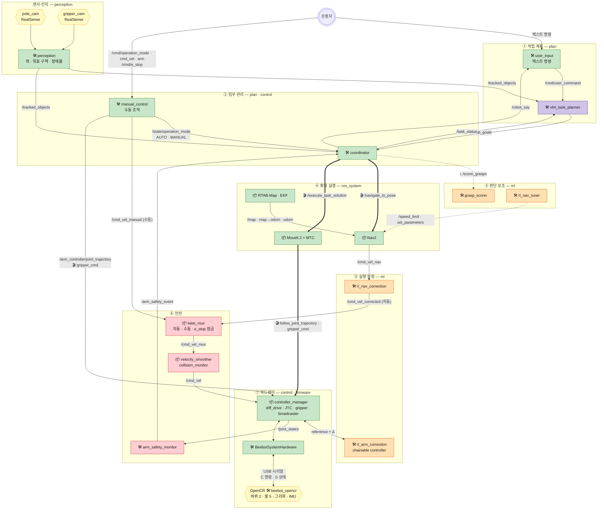
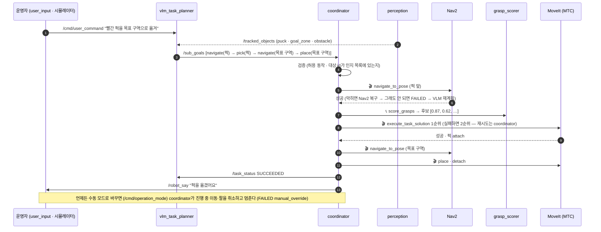
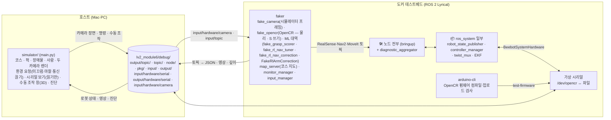

# lv2_module6 — 자율주행 기반 물류 이송 및 장애물 회피

**미로 코스 안에서 로봇(beebot)이 스스로 주행하며 코스를 스캔하고, 흩어진 퍽을 찾아 집어 목표 구역으로 옮겨 놓는다.**
가는 길의 장애물·끼어드는 사람은 피하거나 멈춘다 — 로봇 대회의 "물건 옮기고 위치시키기" 미션.

- 처음이면 **[DEVELOP.md](develop/DEVELOP.md)** — 셋팅 · 도커 · 빌드 · 커스텀 메시지 · 파라미터 · 수동 조작 · 상태 진단 · 테스트 · 펌웨어 · 시뮬레이터 · CI
- 설계(노드·토픽 상세): [documents/ros2-design](../documents/ros2-design/README.md)
- ROS 2 Lyrical (Ubuntu 26.04) · C++ (ament_cmake) · OpenCR 펌웨어 (Arduino)

코드 구조: 노드마다 `include/<패키지>/<노드>.hpp`(선언) · `src/<노드>.cpp`(구현) · `src/<노드>_main.cpp`(main), 클래스는 `namespace <패키지>`.

지금은 **골격**이다. 🛠 노드들이 설계대로 토픽·서비스·액션을 주고받고, 각 노드의 실제 내용(인지 모델·계획·학습 정책)은 `TODO(담당자)` 자리에 담당자가 채운다.

## 미션 · 코스 · 로봇

| | |
| --- | --- |
| 미션 | 코스 스캔(지도) → 퍽·목표 구역·장애물 인지 → 퍽 앞으로 이동 → 집기 → 목표 구역으로 이동 → 내려놓기. 장애물 회피, 끼어드는 사람 앞 감속·정지 |
| 코스 | 미로 4.46 × 6.36m, 벽 높이 0.39m, 통로 약 0.73m — [course/](course/README.md) (원본 waffle-lyrical-slam `twin_closed_maze`, 세로 벽 보강). 가운데 벽이 위·아래 두 미로로 나눈다 |
| 이동 | TurtleBot3 Waffle Pi (차동 구동, 바퀴 반경 0.033m · 간격 0.287m, LiDAR 없음) |
| 팔 | OpenMANIPULATOR-X **RM-X52-TNM** (4축 + 그리퍼, XM430-W350-T) + **손목 roll 1축 추가** — 차체 앞쪽 절반 상판 위 |
| 카메라 | Intel RealSense RGB-D 2대 — `pole_cam`(뒤쪽 전원선 가이드 폴 위, 전방 하향: 인지·SLAM·장애물) · `gripper_cam`(그리퍼 위: 근접 파지) |
| 제어보드 | OpenCR 1개가 바퀴 2 · 팔 5축 · 그리퍼 · IMU 전부 ([firmware/](firmware/README.md)) |
| 운영 | 자동(명령 → 계획 → 실행) · **수동**(원격 조종·팔 직접 조작) · **비상정지**(`/cmd/e_stop`) |

## 담당자

| 이름 | 역할 | 패키지 |
| --- | --- | --- |
| 송정혁 | 설계, 학습 | `ml` |
| 권형중 | 통합 | `plan`, `ros_system`, `bringup`, `faker`, `simulator/`, `course/` |
| 전승혜 | 인지 | `perception` |
| 김현하 | 제어 | `control`, `manager`, `firmware/` |

## 전체 아키텍처

위에서 아래로: 계획 → 임무 관리 → 판단 보조 → 확정 실행 → 실행 보정 → 안전 → 하드웨어. 학습 노드(주황)는 판단 보조·실행 보정에만 있고, 안전(빨강)은 항상 학습 노드·수동 조작 뒤에 있다.
실선 = 토픽, 굵은 선 = 액션, 점선 = 서비스·파라미터. 🛠 직접 작성 · 📦 제공 패키지. 모든 🛠 노드는 `/diagnostics`로 자기 상태를 낸다 (아래 "상태 진단").



## 미션 한 번의 흐름



## 수동 조작 · 비상정지

| 무엇 | 토픽 | 받는 쪽 |
| --- | --- | --- |
| 자동 탐사 | `/cmd/operation_mode` EXPLORE (지도 모드 MAPPING일 때만) | state_manager → `/state/operation_mode` EXPLORE → explorer가 프론티어로 Nav2 목표 · coordinator 멈춤 → 끝나면 `/explore/result` → AUTO |
| 수동 모드 켜기·끄기 | `/cmd/operation_mode` (std_msgs/String MANUAL·AUTO) | state_manager → `/state/operation_mode` "MANUAL"·"AUTO" → manual_control 수동 명령 통과 · coordinator 자동 실행 멈춤·재개 |
| 지도 모드 (스캔 ↔ 위치추정) | `/cmd/map_mode` (std_msgs/String MAPPING·LOCALIZATION) | state_manager → RTAB-Map 모드 전환 → `/state/map_mode` |
| 원격 조종 | `/cmd/manual/cmd_vel` (TwistStamped) | manual_control → `/cmd_vel_manual` → twist_mux(자동보다 우선) → 안전 체인 → 바퀴 |
| 팔·그리퍼 | `/cmd/manual/arm` (JointState: joint1~5 rad · gripper_left_joint m) | manual_control → JTC `/arm_controller/joint_trajectory` · 그리퍼 액션 |
| 비상정지 | `/cmd/e_stop` (std_msgs/Bool true) | state_manager → `/state/emergency` → twist_mux 잠금 — 자동·수동 바퀴 명령 전부 차단 |

시뮬레이터 수동 조작 창(바퀴 버튼 · 로봇/팔 3D에서 관절 드래그) · 키보드(`ros2 run teleop_twist_keyboard teleop_twist_keyboard --ros-args -p stamped:=true -r cmd_vel:=/cmd/manual/cmd_vel`) · `ros2 topic pub` 어느 것으로도 보낼 수 있다. 수동 바퀴 명령도 안전 체인(velocity_smoother · collision_monitor)을 지난다.

## 상태 진단

모든 🛠 노드와 하드웨어 플러그인이 ROS 표준 `diagnostic_updater`로 `/diagnostics`에 자기 상태(OK · WARN · ERROR + 값)를 1초마다 내고,
`diagnostic_aggregator`(bringup)가 계층별로 묶어 `/diagnostics_agg`로 낸다 — `ros2 topic echo /diagnostics_agg` · 시뮬레이터 진단 패널 · `rqt_robot_monitor`.

| 묶음 | 노드 · 주요 값 |
| --- | --- |
| 인지 | perception — pole_cam 영상 끊김, 발행 수 |
| 계획·임무 | user_input — 못 보낸 명령 · vlm_task_planner — 계획 보류·재계획 · coordinator — 모드·단계·연속 실패·서버 대기 |
| 학습 | grasp_scorer — enabled·요청 · rl_nav_tuner — 프리셋 · rl_nav_correction — /odom 끊김(Δ=0)·속도 상한 |
| 제어 | arm_safety_monitor — 접촉 감지 · manual_control — 모드 · **beebotsystem: OpenCR 연결** — 마지막 S 수신·송수신 줄 수 · controller_manager |
| 제공 패키지 | EKF · twist_mux · … |

## SIL 테스트베드 (실기 없이)

**SIL(Software-in-the-Loop)**: 실기 대신 시뮬레이터와 가상 장치가 세상과 로봇 몸을 흉내 내고, ROS 쪽은 실제 노드·컨트롤러·하드웨어 플러그인·펌웨어 빌드를 그대로 돌린다. CI도 같은 컨테이너에서 같은 검사를 한다.



| 검사 (`test-all`) | 확인하는 것 |
| --- | --- |
| test-serial | 가상 시리얼 ↔ 파일 왕복 |
| test-firmware | OpenCR 펌웨어 컴파일 + 업로드(가상 시리얼로 .bin 전송) |
| test-packages | 패키지별 `colcon test` (gtest · URDF · launch) — 수동 조작 · 수동 전환 시 멈춤 포함 |
| test-hardware | BeebotSystemHardware ↔ 시리얼 프로토콜 (C 명령 송신 · S 상태 → `/joint_states`) |
| test-bringup | 🛠 노드 전부 기동 + config yaml 파라미터 일치 + `/diagnostics_agg`에 노드마다 상태 |
| test-faker | 명령 → 계획 → 이동 → 집기 → 완료까지 전체 흐름 (정상 · 파지 실패 후 재계획) |

CI(`.github/workflows/ci.yml`): x86_64 · aarch64 각각 `test-all` → 배포 패키지(`ros2_ws-deploy-<arch>.tar.gz`: install + 펌웨어 .bin + 실행 스크립트) artifact → main 병합 시 Release `run-<RUN ID>` + 제출 태그 `lv2-module6-submit`.

## 폴더

```text
lv2_module6/
├── develop/                  개발 가이드(DEVELOP.md) + 단축 스크립트(faker·rviz·gazebo)
├── course/                   대회 코스 (미로 — 원본 + 세로 벽 보강한 상자 모델 · Gazebo 월드)
├── urdf/<이름>/urdf.xacro    로봇 모델 (폴더 하나 = 모델 하나, launch urdf:= · 기본 beebot_mesh) (더미 치수 — 팔은 ROBOTIS OM-X 원본 값 + 손목 roll)
├── firmware/beebot_opencr/   OpenCR 펌웨어 (호스트 BeebotSystemHardware와 같은 시리얼 프로토콜)
├── isaac/                    Isaac Sim 장면·로봇 USD(sim/) + Isaac Lab 학습(lab/) — isaac/README.md
├── simulator/                SIL 시뮬레이터 (main.py · 수동 조작 창 manual_window.py · opencr.py = fake_opencr 연결, 읽기·요청만)
├── ros2_ws/
│   ├── start.sh · firmware-upload.sh · download-artifact.sh · monitor.sh   실기·배포 패키지용 스크립트
│   └── src/
│       ├── perception/   🛠 perception                                         + msg TrackedObject(Array)
│       ├── control/      🛠 arm_safety_monitor · manual_control · body_filter · BeebotSystemHardware(ros2_control)  + msg ArmSafetyEvent
│       ├── manager/      🛠 state_manager (상태의 주인 — /state/operation_mode · /state/map_mode · /state/map_name · /state/emergency)
│       ├── ml/           🛠 grasp_scorer · rl_nav_tuner · rl_nav_correction · rl_arm_correction  + srv ScoreGrasps
│       ├── plan/         🛠 user_input · vlm_task_planner · coordinator         + msg SubGoal(Array) · TaskStatus
│       ├── ros_system/   📦 robot_state_publisher · controller_manager · twist_mux · RealSense ×2 · EKF · RTAB-Map · Nav2
│       ├── bringup/      전체 실행 = ros_system + 🛠 노드 전부 + diagnostic_aggregator
│       └── faker/        도커에 없는 📦·ML(GPU) 대역 + 호스트 파일 연동
└── debug/                (gitignore) 테스트베드·시뮬레이터가 주고받는 파일
```

## 실행

```bash
# 테스트베드 (저장소 루트에서) — 자세한 건 develop/DEVELOP.md
cd docker && docker compose build && docker compose up -d && docker compose exec lyrical bash
test-all                                  # push 전 필수 (CI와 같은 검사)
test-faker 0                              # 띄워 두기 (fake_opencr가 OpenCR — 미끄럼·충돌·통신 끊김) → 호스트에서 simulator/main.py
test-faker 0 mock_hardware:=true          # OpenCR 없이 mock (물리 없음)

# 실기 (라즈베리파이·PC, CI 배포 패키지 또는 저장소)
./ros2_ws/firmware-upload.sh              # OpenCR 펌웨어 올리기
./ros2_ws/start.sh                        # 장치 확인 → bringup
./ros2_ws/start.sh mock_hardware:=true    # OpenCR 없이
./ros2_ws/stop.sh                         # 떠 있는 ROS 전부 끄기
```

## 아직 없는 것

- 노드 내용: 인지 모델(퍽·목표 구역·장애물 검출 — 지금은 고정 더미), VLM 호출, 학습 정책, MTC 태스크 구성 (담당자 `TODO`)
- Gazebo 물리 시뮬레이션 — 코스 모델(`course/twin_closed_maze/model.sdf`)은 준비됨, 로봇 쪽 gz_ros2_control·센서 플러그인은 아직
- URDF 실측 치수·메시, 펌웨어 관절 부호·영점·그리퍼 변환 실측, SyncRead/SyncWrite로 주기 올리기
- MoveIt 설정 패키지 · `nav2_params.yaml` (velocity_smoother 입력 = `/cmd_vel_mux`) — move_group은 launch에 TODO, Nav2는 기본 꺼짐
- 테스트베드는 GPU·모델이 없어 ML은 faker 대역(`ml:=fake` 기본, 진짜는 `ml:=real`)
- 테스트베드 이미지에는 MoveIt · RTAB-Map · RealSense 본체가 없다 — 그 부분은 faker 대역. **Nav2는 진짜**를 ros_system이 띄운다 (지도·map→odom은 RTAB-Map 대신 faker의 map_server + 항등 TF, 카메라는 시뮬레이터 렌더)
