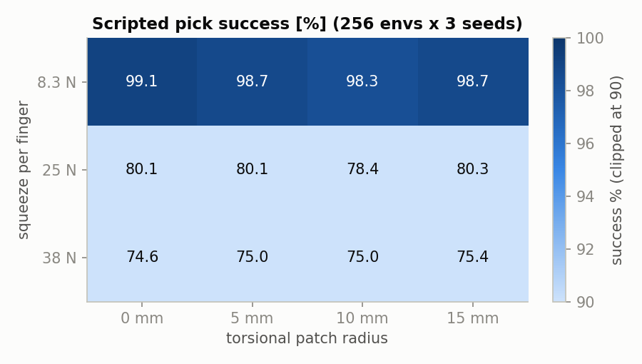
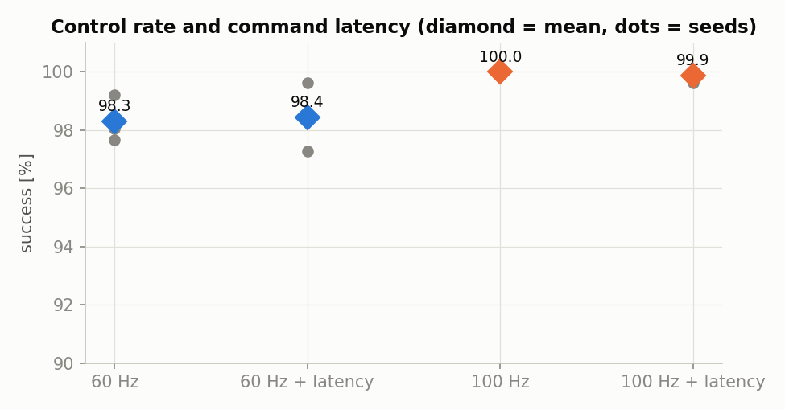
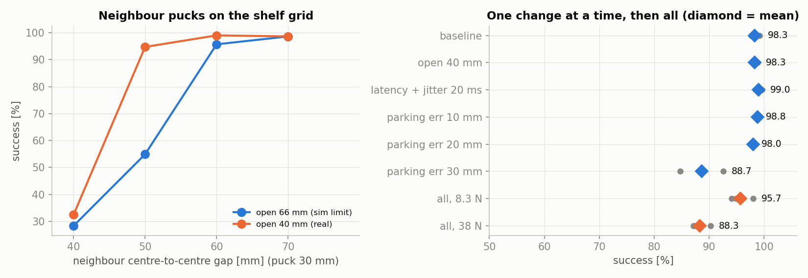
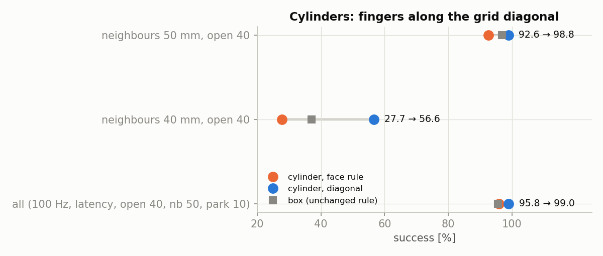
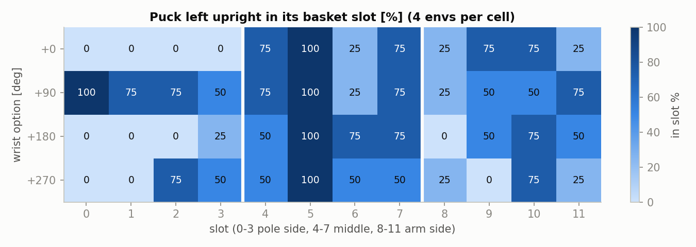
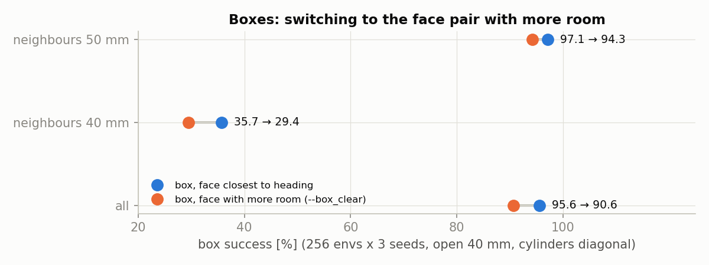
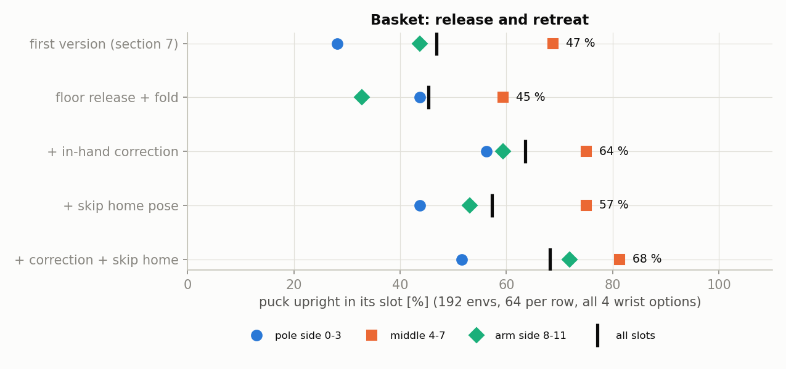

# 2026-10-27 scripted pick 시뮬 시험 (env0 낙하, 그리퍼, 당겨 빼기, 제어 주기, 랜덤화, 대각선 집기, 바구니, 박스 면 선택, pick → 바구니 사이클)

`scripts/pick_sm.py` 의 스크립트 pick(기본 자세 → 접근 → 내려가기 → 쥐기 → 들기 → 기본 자세)을 Isaac Lab 6.1 에서 env 256 개로 돌린 시험이다.
11/1 에 "잔차 RL 이 필요한가"(기준 약 97 %)를 판단하기 전에, 실물 데이터 없이 시뮬에서 할 수 있는 시험을 한 번에 했다.

성공 기준은 pick_sm 그대로다. 기본 자세로 돌아왔을 때 퍽이 선반에서 30 mm 이상 떠 있고 손끝에서 50 mm 안에 있으면 성공이다.
따로 적지 않으면 env 256 개, 랜덤화(퍽 위치·yaw·종류·질량·마찰, 손가락 마찰, 인식 노이즈 5 mm·10°)는 켜져 있고, 조건마다 seed 2~3 개를 돌렸다.

| 시험 | 결론 |
|---|---|
| 1. env0 퍽 낙하 | **Isaac Lab 6.1 질량 랜덤화 버그.** 실행의 절반에서 env0 퍽 질량이 0 이 되어 바닥을 뚫는다. 수정 후 0/12 |
| 2. 그리퍼 힘 × 비틀림 | 8.3 N 에서 98~99 %. **25·38 N 으로 올리면 원통 퍽만 75~80 % 로 떨어진다.** 비틀림 반지름은 영향 없음 |
| 3. 당겨 빼기 | 빠지는 힘은 쥐는 힘에 비례한다. 8.3 N 기준 아래 1.9 N, 바깥 5.3 N, 비틀기 0.04 N m |
| 4. 제어 주기 | **100 Hz 에서 100 %** (60 Hz 98.3 %). 지연을 넣어도 99.9 % |
| 5. 랜덤화 | **옆 퍽 간격**이 가장 크다. 실물 개방폭 40 mm 에서 간격 50 mm 이상이면 95 % 이상. 모두 켜면 95.7 % (8.3 N) |
| 6. 원통 대각선 집기 | 옆 퍽 50 mm 에서 원통 92.6 → **98.8 %**. 모두 켠 조건 95.7 → **97.3 %** |
| 7. 바구니 넣기 | 기둥 쪽 줄은 그리퍼를 세운 채로 닿지 않는다. **20° 기울이고 손목 −90°(joint5)** 일 때만 들어간다(12/16). 나머지 줄은 놓은 뒤 손가락에 걸려 넘어지는 문제가 남았다 |
| 8. 바구니 → 놓는 선반 | 놓는 선반(주사위 칸) asset 이 없어 하지 않았다 |
| 9. 박스 면 선택 | 옆 퍽이 없는 쪽 면을 고르면 **오히려 나빠진다**(박스 97.1 → 94.3 %). 손목을 45° 넘게 돌린 박스가 쥐다가 실패한다. 쓰지 않는다 |
| 10. 바구니 놓기·손 빼기 개선 | 47 → **68 %**. 바닥에 내려놓고 놓기, 손 안 위치 보정, 기본 자세 생략이 효과. 남은 실패는 대부분 놓은 뒤 쓰러짐 |
| 11. pick → 바구니 한 사이클, 경로 비교 | **운반 자세 90°(로봇 옆), 멈춤 없이**가 가장 빠르고(14.7 s) 가장 잘 들어간다(68 %). 기본 자세 경유는 23.6 s, 45 % |
| 12. 놓는 높이·칸별 | 3 mm 위에서 놓으면 74 %. **칸 2·8·9 만 3 ~ 34 %**, 나머지 9 칸은 84 ~ 100 % |
| 13. 연속 적재 (퍽 5 개) | 칸 2·8·9 를 뒤로 미루는 순서로 73.5 % (마지막까지 칸에 남음 69 %). 팔 쪽 줄부터 채우면 12 % |

도표와 표는 `python3 make_figs.py` 로 `data/` 에서 다시 만든다. `data/` 에는 run 마다 env 별 결과(`.npz`)가 있다.

### 육안 확인 방법 (공통)

각 장 끝의 "육안 확인" 명령은 Isaac 창을 띄워 장면을 직접 보는 명령이다. 레포 루트에서 시작한다.

```bash
cd lv2_module6/isaac/lab/scripts
```

```bash
ISAACLAB=<Isaac Lab 6.1 폴더>   # isaaclab.sh 가 있는 폴더
```

- `--viz newton`: 창을 띄운다. 동작이 끝나도 창을 닫거나 Ctrl+C 를 누를 때까지 마지막 자세를 유지한다.
- 카메라는 env0 근처에서 시작한다. env 사이 간격은 2 m 다. 다른 env 는 마우스로 옮겨 가서 본다.
- 퍽 종류는 env 마다 돌아가며 놓인다. env 0·1 은 박스, env 2·3 은 원통이다(4 개씩 반복).
- 에피소드가 끝나면(20 s, `--basket` 은 40 s) env 가 자동 리셋된다. 그 뒤 화면은 의미가 없다.
- 같은 `--seed` 면 퍽 위치가 같다. 옵션 하나만 바꿔 두 번 돌리면 차이를 나란히 볼 수 있다.

---

## 바뀐 코드

| 파일 | 내용 |
|---|---|
| `scripts/cycle_sm.py` | 새로 만듦. pick → 바구니 사이클 시험(경로, 시간, 연속 적재) (11 ~ 13장) |
| `scripts/pick_lib.py` | 새로 만듦. `pick_sm.py` 와 `cycle_sm.py` 가 같이 쓰는 오프라인 IK(`ArmIK`) |
| `scripts/bee_env_cfg.py` | 퍽 질량 랜덤화를 `mdp.randomize_rigid_body_mass` 에서 `randomize_mass_synced` 로 바꿈 (1장). **이 수정 전 결과는 질량 랜덤화가 절반쯤 꺼진 상태였다** |
| `scripts/pick_sm.py` | 시험용 옵션 추가. 옵션을 주지 않으면 이전과 같이 동작한다 |

`pick_sm.py` 옵션 (모두 `scripts/` 에서 `isaaclab.sh -p pick_sm.py --num_envs 256 ...`):

| 옵션 | 뜻 |
|---|---|
| `--seed`, `--out run.npz`, `--trace` | 재현용 seed, env 별 결과 저장, step 별 퍽·차체·팔 기록 |
| `--grip_force N`, `--grip_damping`, `--torsion mm` | 30 mm 퍽에서 손가락 하나가 누르는 힘, 그리퍼 damping, 비틀림 patch 반지름 |
| `--hz` | 제어 주기 (sim dt = 1 / (2 × hz)) |
| `--latency`, `--lat_jitter_ms` | R2S 실측 명령 지연 (joint1~5 45~62 ms, 그리퍼 20 ms), env 마다 ± 흔들림 |
| `--neighbors mm` | 목표 퍽 앞뒤좌우에 퍽 4 개 (중심 간격). 선반 밖으로 나가는 자리는 비운다 |
| `--park_err_mm` | 퍽 범위(x 0.12~0.20, y ±0.08)를 ± 만큼 넓힘 = 로봇이 선반 앞에 서는 위치 오차 |
| `--open_gap_mm` | 열었을 때 손가락 간격. 기본은 관절 한계 66 mm, 실물은 약 40 mm |
| `--pull down\|out\|twist` | 기본 자세에서 퍽에 힘·토크를 4 s 동안 0 부터 키워 빠지는 값을 기록 |
| `--diag` | 원통 퍽은 손가락이 선반 격자의 대각선 방향으로 닫히게 집는다 (6장) |
| `--basket` | pick 뒤 로봇 바구니 칸에 넣는다. env i → 칸 i % 12, 손목 옵션 (i // 12) % 4 (7장) |
| `--basket_retreat fold\|direct` | 놓고 빠지는 방식. `fold`(기본): 바닥에 내려놓고 놓기 → 위로 → 축 가까이 올리기 → 접기 → joint1 돌리기. `direct`: 7장 첫 버전 (10장) |
| `--basket_correct` | 바구니 전에 손 안의 퍽 위치를 한 번 재서 퍽 바닥을 칸 중심에 맞춘다(실물은 손목 카메라) (10장) |
| `--basket_skip_home` | 들어 올린 뒤 기본 자세를 거치지 않고 바로 바구니로 간다 (10장) |
| `--box_clear` | 박스: 두 면 쌍 중 손가락 축 방향에 옆 퍽까지 여유가 더 큰 쪽을 잡는다 (9장, 쓰지 않음) |

---

## 1. env0 퍽 낙하

오전 결과에서 env0 만 가끔 퍽이 바닥 아래로 사라지고 팔이 이상한 자세로 꺾였다. 성공률을 깎는 이 실패가 스크립트 문제인지, 시뮬(설정·Lab) 문제인지 가려야
이후 모든 성공률을 믿을 수 있어서 원인부터 찾았다. 팔을 움직이지 않는 짧은 실행을 여러 번 돌려, 이벤트를 하나씩 끄고 PhysX 안의 값을 직접 읽었다.

**현상.** 가끔 env0 의 퍽만 바닥을 뚫고 수백 m 아래로 떨어졌다. 그러면 IK 목표가 바닥 아래가 되어 팔이 joint4 하한(−97°)에 붙는다.
10-27 오전 결과의 실패 중 env0 는 이것이었다(손끝 오차 최대 1102~1481 mm).

**찾은 과정.**
- 팔을 움직이지 않아도 리셋 직후 8 step 안에 떨어진다. 그리퍼 명령과도 관계없다. 16 env 실행 12 번 중 6 번, 늘 env0 다.
- 시작 이벤트를 하나씩 끄면 퍽 질량 랜덤화를 껐을 때만 0/5 로 사라진다.
- PhysX 가 실제로 가진 질량을 읽으면, 떨어진 실행마다 **env0 질량이 0** 이고 나머지 env 는 랜덤화 전 값(25 g / 20 g)이다.
  PhysX 에서 질량 0 은 역질량 0, 곧 무한 질량이라 선반과 바닥이 밀어내지 못하고 중력만 받는다.

**원인.** Lab 6.1 PhysX 백엔드의 `RigidObject.set_masses_index` 는 질량과 env 번호를 GPU 에서 pinned CPU 버퍼로 비동기 복사(`wp.copy`)한 뒤
동기화 없이 바로 `root_view.set_masses` 에 넘긴다. 복사가 끝나기 전에 PhysX 가 읽으면 env 번호는 0 으로, 질량은 0 으로 들어간다.
관성(`set_inertias_index`)도 같은 구조다. 재질(마찰) 랜덤화는 CPU 에서만 처리해서 영향이 없다.

**수정.** `bee_env_cfg.randomize_mass_synced`: 질량·관성을 CPU 에서 만들고 `wp.synchronize()` 뒤 PhysX 에 쓴다. Lab 의 GPU 버퍼도 같은 값으로 맞춘다.
수정 후 12 번 모두 낙하 없음, 질량은 모든 env 에서 14.2~32.5 g 으로 랜덤화됐다.


**도표 읽는 법.**
- 왼쪽: 가로축은 실행 번호(실행마다 env 16 개), 세로축은 PhysX 가 실제로 쓰는 env0 퍽 질량이다. 주황 점은 수정 전, 파란 점은 수정 후다.
  "fell" 이 붙은 실행은 그 실행에서 env0 퍽이 떨어진 것이다. 떨어진 실행은 모두 질량이 0 이다.
- 오른쪽: 리셋 뒤 처음 1 초 동안 퍽 바닥의 높이다. 파란 선(env1)은 선반 윗면(70 mm)에 머물고, 주황 선(env0, 질량 0)은 선반과 바닥(0)을 뚫고 계속 떨어진다.

| | 실행 | env0 질량 0 | 낙하 |
|---|---|---|---|
| 수정 전 (Lab 함수) | 12 | 6 | 6 |
| 수정 후 | 12 | 0 | 0 |

**영향.** 이 수정 전의 성공률(10-27 오전 99.6 % 등)은 실행마다 질량 랜덤화가 켜지거나 꺼진 상태가 섞여 있었다. 아래 결과는 모두 수정 후다.
같은 Lab 함수를 다른 asset 에 쓰는 곳이 있으면 같은 방법으로 바꿔야 한다.

**육안 확인.** 수정 후에는 env0 퍽이 선반 위에 그대로 있어야 한다. 퍽이 정착하는 처음 1 초를 본다.

```bash
$ISAACLAB/isaaclab.sh -p pick_sm.py --num_envs 16 --seed 1 --viz newton
```

수정 전 현상을 다시 보려면 `bee_env_cfg.py` 의 `puck_mass` 를 잠시 Lab 함수로 되돌린다
(`func=mdp.randomize_rigid_body_mass`, `params` 에 `"mass_distribution_params": (0.7, 1.3), "operation": "scale"`).
그러면 실행 두 번에 한 번꼴로 env0 퍽이 시작 직후 선반을 뚫고 사라지고, 팔이 아래로 꺾인다. 확인 후 원래대로 돌려놓는다.

---

## 2. 그리퍼 힘 × 비틀림 patch 반지름

쥐는 힘(손가락 하나당 8.3 / 25 / 38 N)과 비틀림 patch 반지름(0 / 5 / 10 / 15 mm)을 바꿔 가며 pick 성공률을 쟀다. 시뮬 그리퍼는 손가락 하나당 약 8.3 N 으로 쥔다(stiffness 1000 N/m, 퍽에서 8.3 mm 에 멈춤). 실물 추정은 25~38 N 이다(R2S 10-24, 전류 × KT).
실측(R2S `grip_test`) 전에 그 범위에서 결과가 어떻게 바뀌는지 미리 봤다.
비틀림 반지름(`torsional_patch_radius`)은 고무 패드의 면적을 흉내 내려고 10 mm 를 넣어 둔 값이다. 이 값이 실제로 효과가 있는지도 같이 봤다.



**도표 읽는 법.** 행은 쥐는 힘, 열은 비틀림 반지름이고, 칸의 숫자는 seed 3 개 평균 성공률(%)이다.
진할수록 성공률이 높다. 90 % 이하는 모두 가장 옅은 색으로 칠했다. 행(힘)에 따라 색이 크게 바뀌고 열(반지름)로는 거의 안 바뀌는 것이 요점이다.

| 쥐는 힘 | 0 mm | 5 mm | 10 mm | 15 mm |
|---|---|---|---|---|
| 8.3 N | 99.1 | 98.7 | 98.3 | 98.7 |
| 25 N | 80.1 | 80.1 | 78.4 | 80.3 |
| 38 N | 74.6 | 75.0 | 75.0 | 75.4 |

- **세게 쥘수록 나빠진다. 실패는 원통 퍽뿐이다.** 38 N 에서 박스는 100 %, 원통은 45~53 % 다(seed 1).
  실패한 원통 env 는 쥐는 동안 손끝이 평균 9.3 mm 밀려났다(성공 4.3 mm). 강한 힘으로 둥근 면을 조이면 팔(관절 stiffness 20 Nm/rad)이 옆으로 밀리고 퍽이 빠진다.
- 닫는 충격 때문은 아니다. 38 N 에서 damping 을 10 → 400 으로 올려도 74.6 → 73.8 % 로 같다 (`data/t2b_*`).
- **비틀림 반지름은 성공률에도, 3장의 비틀기 토크에도 영향이 없다.** 오전에 이 값을 넣으며 좋아졌던 것은 같이 넣은 "인식 전 0.5 s 정착" 수정 덕분이었던 것으로 보인다.
  값이 실제로 PhysX 에 들어갔는지는 아직 확인하지 않았다.

**다음.** 실물 `grip_test sweep` 로 실제 힘을 잰 뒤, 그 힘에서 원통이 정말 빠지는지 실물로 확인한다.
실물에서 빠지지 않으면 시뮬 쪽(손가락 충돌 형상, 원통 충돌체, 팔 stiffness)을 의심한다.

**육안 확인.** 원통(env 2·3)을 본다. 38 N 에서는 쥐는 순간 손이 옆으로 밀리고 퍽이 빠진다. 8.3 N 과 번갈아 돌려 비교한다.

```bash
$ISAACLAB/isaaclab.sh -p pick_sm.py --num_envs 4 --seed 1 --grip_force 38 --viz newton
```

```bash
$ISAACLAB/isaaclab.sh -p pick_sm.py --num_envs 4 --seed 1 --grip_force 8.3 --viz newton
```

---

## 3. 시뮬 당겨 빼기

기본 자세에서 쥔 퍽을 세 방향으로 점점 세게 당겨, 손에서 빠지는 힘을 쟀다. 실물 `grip_test pull` 결과와 바로 비교할 시뮬 쪽 숫자를 미리 만들어 두려는 것이다.
실물 값이 이 표의 어느 쥐는 힘과 맞는지 보면 시뮬 그리퍼 설정을 정할 수 있다. 힘은 4 s 동안 0 부터 키우고, 퍽이 손 안에서 5 mm 또는 10° 움직인 순간의 값을 기록했다.
- down: 아래로 (세계 −z)
- out: 손가락 끝 방향으로 (손에서 빠져나가는 방향)
- twist: 손가락이 닫히는 축을 중심으로 돌리는 토크


**도표 읽는 법.**
- 왼쪽·가운데: 가로축은 쥐는 힘, 세로축은 퍽이 빠진 순간의 당기는 힘이다. 점은 중앙값, 세로 막대는 p10 ~ p90(가운데 80 % env 가 들어가는 범위)이다.
  점이 위에 있을수록 잘 버틴다.
- 오른쪽: 가로축은 비틀림 반지름, 세로축은 퍽이 돌기 시작한 비틀기 토크다. 파란 선은 8.3 N, 주황 선은 38 N 이다.
  두 선이 겹치지 않게 좌우로 조금 비켜 그렸다. 선이 평평하다 = 비틀림 반지름이 효과가 없다.

| 방향 | 8.3 N | 25 N | 38 N |
|---|---|---|---|
| down [N] | 1.9 (1.1~3.0) | 5.8 (3.3~8.3) | 8.9 (3.8~12.7) |
| out [N] | 5.3 (3.9~6.4) | 13.3 (8.3~17.5) | 17.7 (10.1~22.8) |
| twist [N m] | 0.043 (0.018~0.076) | | 0.214 (0.071~0.356) |

중앙값 (p10~p90). 비틀림 반지름 10 mm, seed 1, 기본 자세까지 성공한 env 만 (8.3 N 254 개, 25 N 201 개, 38 N 191 개). 모든 env 에서 범위 안에 빠졌다.

- 빠지는 힘은 쥐는 힘에 거의 비례한다. 마찰계수 0.6~1.0 이면 이론상 2 × μ × F 인데, down 은 그 1/7 정도로 훨씬 작다.
  기본 자세에서 퍽이 손가락에 수평으로 물려 있어 아래로 당기면 손가락 끝 쪽으로 기울며 빠지기 때문으로 보인다.
- 퍽 무게는 약 0.25 N 이라 8.3 N 에서도 down 중앙값 1.9 N 은 무게의 약 8 배다. 하지만 p10 1.1 N 이면 급정거·충격에서 빠질 수 있다.

**다음.** 실물 pull 값이 이 표의 어느 열에 가까운지 보고 시뮬 그리퍼 힘을 정한다. 저울이 없으면 물 무게로 down 만 재도 된다.

**육안 확인.** 기본 자세에 돌아온 뒤 4 초 동안 힘이 커진다. 퍽이 손 안에서 움직이기 시작하는 순간을 본다. `twist` 는 손가락 축을 중심으로 퍽이 도는 모습이다.

```bash
$ISAACLAB/isaaclab.sh -p pick_sm.py --num_envs 4 --seed 1 --pull twist --viz newton
```

```bash
$ISAACLAB/isaaclab.sh -p pick_sm.py --num_envs 4 --seed 1 --pull down --viz newton
```

`--pull out` 은 손가락 끝 방향으로 당긴다. `--grip_force 38` 을 붙이면 같은 동작에서 훨씬 늦게 빠진다.

---

## 4. 제어 주기 60 Hz → 100 Hz

제어 주기(60 / 100 Hz)와 실측 명령 지연(켬 / 끔)을 바꿔 성공률을 쟀다. 실물 배포 주기는 100 Hz 인데 env 는 dt 1/120 × decimation 2 = 60 Hz 였다.
주기가 다르면 시뮬 결과를 실물에 그대로 옮길 수 없어서, 100 Hz 로 바꿔도 되는지, 바꾸면 무엇이 달라지는지 확인했다.
100 Hz 에서는 실측 지연이 step 단위로 더 정확히 들어간다(60 Hz: 3·4·3·3·3·1 step = 50~67 ms, 100 Hz: 5·6·5·5·5·2 step = 50~60 ms).



**도표 읽는 법.** 조건마다 회색 점은 seed 하나의 성공률, 마름모는 평균이다. 파랑은 60 Hz, 주황은 100 Hz 다.
세로축이 90 % 에서 시작하므로 높이 차이는 실제보다 커 보인다. 차이는 2 %p 안쪽이다.

| 조건 | seed 1 | seed 2 | seed 3 | 평균 |
|---|---|---|---|---|
| 60 Hz | 99.2 | 98.0 | 97.7 | 98.3 |
| 60 Hz + 지연 | 97.3 | 98.4 | 99.6 | 98.4 |
| 100 Hz | 100.0 | 100.0 | 100.0 | 100.0 |
| 100 Hz + 지연 | 100.0 | 99.6 | 100.0 | 99.9 |

- 100 Hz 가 더 좋다. sim dt 가 1/120 → 1/200 s 로 작아져 쥐는 접촉이 안정해진 것으로 보인다(60 Hz 실패 13 개는 모두 원통이 들어 올린 뒤 기본 자세로 돌아오는 길에 빠진 것).
- 지연은 두 주기 모두 영향이 거의 없다. 궤적이 단계마다 1.5~3 s 로 느려서다.

**다음.** env 기본값을 100 Hz(`sim.dt = 1/200`)로 바꾸는 것을 제안한다. 아직 env 기본값은 바꾸지 않았다(`--hz 100` 으로만 시험).

**육안 확인.** 60 Hz 에서 실패한 env 는 원통이 기본 자세로 돌아오는 길에 손에서 빠진다. 실패는 256 개 중 몇 개라 env 를 많이 띄워야 보인다.
터미널 마지막 줄 `failed envs` 에 나온 번호의 env 로 카메라를 옮겨 본다.

```bash
$ISAACLAB/isaaclab.sh -p pick_sm.py --num_envs 64 --seed 2 --viz newton
```

```bash
$ISAACLAB/isaaclab.sh -p pick_sm.py --num_envs 64 --seed 2 --hz 100 --viz newton
```

---

## 5. 랜덤화 추가

지금까지의 시뮬에는 실제 상황 몇 가지가 빠져 있었다. 옆 퍽, 실물 그리퍼 열림 폭, 지연 흔들림, 로봇이 선반 앞에 서는 위치 오차를
하나씩 넣어 성공률이 얼마나 떨어지는지 보고, 마지막에 모두 켰다. 어느 것이 성공률을 가장 많이 깎는지 알아야 고칠 곳의 순서를 정할 수 있다.

### 옆 퍽

실제 선반에는 퍽 여러 개가 격자로 놓인다. 목표 퍽 앞뒤좌우에 퍽 4 개를 같은 간격으로 놓았다(선반 밖으로 나가는 자리는 비움, env 당 중앙값 2~3 개).

**먼저 찾은 차이: 시뮬 손가락이 실물보다 훨씬 넓게 벌어진다.** 시뮬 손가락 안쪽 간격은 30 mm + 2 × (관절값 − 8.3 mm) 로,
`OPEN = 1.0`(관절 26.5 mm)에서 **66 mm** 다. 실물은 열어도 약 38~40 mm 다(R2S 10-24, 간격 = 40.1 − 1.22 × 측정값).
그래서 같은 간격에서 시뮬 손가락이 옆 퍽을 더 친다. `--open_gap_mm 40` 으로 실물 폭도 같이 돌렸다.



**도표 읽는 법.**
- 왼쪽: 가로축은 옆 퍽까지의 중심 간격, 세로축은 성공률이다. 파란 선은 시뮬 손가락을 끝까지(66 mm) 여는 경우, 주황 선은 실물처럼 40 mm 만 여는 경우다.
  선이 오른쪽(간격이 넓음)으로 갈수록 올라가고, 주황이 파랑보다 먼저 올라간다 = 실물 폭이면 더 좁은 간격에서도 된다.
- 오른쪽: 한 줄이 한 조건이다. 회색 점은 seed 별 성공률, 마름모는 평균이다. 파란 줄은 하나씩 넣은 것, 주황 줄은 모두 켠 것이다.
  기준(맨 위)보다 왼쪽으로 많이 간 줄이 성공률을 많이 깎는 요소다.

| 간격 | 열림 66 mm 성공 | 옆 퍽 친 env | 열림 40 mm 성공 | 옆 퍽 친 env |
|---|---|---|---|---|
| 40 mm | 28.3 | 35.7 | 32.4 | 53.1 |
| 50 mm | 54.9 | 52.0 | 94.7 | 24.8 |
| 60 mm | 95.7 | 26.0 | 99.0 | 3.9 |
| 70 mm | 98.6 | 1.4 | 98.6 | 0.6 |

단위 %, seed 2 개 평균. "옆 퍽 친 env" 는 옆 퍽이 10 mm 넘게 밀린 env 비율.

- 실물 폭(40 mm)이면 **중심 간격 50 mm(틈 20 mm) 이상**에서 95 % 이상이다. 40 mm(틈 10 mm)는 폭과 상관없이 30 % 안팎이다.
- 옆 퍽 없이 40 mm 로만 열면 98.3 % 로 66 mm 와 같다. 인식 노이즈 5 mm 를 넣어도 40 mm 폭이면 충분하다.

### 나머지 하나씩, 그리고 모두

| 조건 | 성공 % (seed 별) | 평균 |
|---|---|---|
| 기준 (60 Hz) | 99.2 · 98.0 · 97.7 | 98.3 |
| 열림 40 mm | 98.0 · 98.0 · 98.8 | 98.3 |
| 지연 + 흔들림 ±20 ms | 98.8 · 98.4 · 99.6 | 99.0 |
| 정지 위치 오차 ±10 mm | 98.8 · 98.8 | 98.8 |
| 정지 위치 오차 ±20 mm | 98.0 · 98.0 | 98.0 |
| 정지 위치 오차 ±30 mm | 84.8 · 92.6 | 88.7 |
| **모두, 8.3 N** | 94.9 · 94.1 · 98.0 | **95.7** |
| **모두, 38 N** | 87.1 · 87.5 · 90.2 | **88.3** |

"모두" = 100 Hz + 지연 + 흔들림 20 ms + 열림 40 mm + 옆 퍽 50 mm + 정지 위치 오차 ±10 mm.

- 정지 위치 오차는 ±20 mm 까지 괜찮고 ±30 mm 에서 떨어진다. 실패의 절반 이상은 퍽이 몸통 쪽 한계(x 0.12 m) 안으로 들어온 경우다(seed 1: 실패 39 개 중 23 개). 도달 한계(r 0.22 m) 밖은 9 개다.
  실물에서 선반 앞 정지 정확도가 ±20 mm 안이어야 한다.
- 모두 켜면 8.3 N 에서 95.7 % 로 기준 97 % 바로 아래다. 대부분 옆 퍽 50 mm 에서 온다(단독 94.7 %).
- 38 N 이면 88.3 % 다. 2장의 원통 문제가 그대로 더해진다.
- 쓰러진 퍽은 넣지 않았다. 인식이 쓰러진 퍽을 어떻게 다룰지(세워서 집기, 건너뛰기)부터 정해야 한다.
- 관측 지연(측정값이 늦게 오는 것)은 넣지 않았다. 스크립트는 퍽 위치를 한 번만 읽고, 처짐 보정도 멈춘 뒤에 해서 영향이 작다. RL 정책을 붙일 때 넣는다.

**육안 확인.** 옆 퍽 4 개가 목표 퍽 앞뒤좌우에 놓인다. 손가락이 내려갈 때 옆 퍽을 치는지 본다.
열림 폭 66 mm(기본)와 40 mm(실물)를 번갈아 돌리면 손가락이 벌어지는 폭 차이가 보인다.

```bash
$ISAACLAB/isaaclab.sh -p pick_sm.py --num_envs 4 --seed 3 --neighbors 50 --viz newton
```

```bash
$ISAACLAB/isaaclab.sh -p pick_sm.py --num_envs 4 --seed 3 --neighbors 50 --open_gap_mm 40 --viz newton
```

정지 위치 오차 ±30 mm 는 퍽이 몸통 쪽(x 0.12 m 안쪽)에 놓이는 env 를 찾아 본다.

```bash
$ISAACLAB/isaaclab.sh -p pick_sm.py --num_envs 16 --seed 1 --park_err_mm 30 --viz newton
```

---

## 6. 원통 퍽 대각선 집기

원통 퍽을 집을 때 손가락이 닫히는 방향을 선반 격자의 대각선으로 돌려, 옆 퍽이 있을 때 성공률이 오르는지 쟀다. 5장에서 성공률을 가장 많이 깎은 것은 옆 퍽이었다. 퍽이 격자로 놓이면 바로 옆 퍽은 격자 간격만큼, 대각선 퍽은 그 1.41 배 떨어져 있다.
손가락은 도구 y 축(yaw + 90°)으로 닫히므로, 원통은 yaw 를 45° + k × 90° 중 팔 방향에 가장 가까운 값으로 고르면 손가락이 대각선 빈자리로 벌어진다.
원통은 어느 방향으로 잡아도 되기 때문에 가능하다. 박스는 면을 잡아야 해서 그대로 두었다 (`--diag`).



**도표 읽는 법.** 한 줄이 한 조건이다. 주황 원은 대각선 전 원통, 파란 원은 대각선 후 원통, 회색 네모는 박스(규칙 그대로)다.
주황에서 파랑으로 오른쪽 이동한 거리가 대각선 집기의 효과다. 오른쪽 숫자는 "전 → 후" 원통 성공률이다.

| 조건 | 박스 전 / 후 | 원통 전 / 후 | 전체 전 / 후 |
|---|---|---|---|
| 옆 퍽 50 mm, 열림 40 mm | 96.9 / 96.9 | 92.6 / **98.8** | 94.7 / 97.9 |
| 옆 퍽 40 mm, 열림 40 mm | 37.1 / 35.9 | 27.7 / 56.6 | 32.4 / 46.3 |
| 모두 (100 Hz, 지연, 열림 40, 옆 퍽 50, 정지 오차 10) | 95.6 / 95.6 | 95.8 / **99.0** | 95.7 / **97.3** |

seed 2~3 개, env 256 개씩.

- 실제와 가까운 조건을 모두 켜도 **97.3 %** 로 기준(97 %)을 넘는다.
- 남은 실패는 대부분 박스다. 박스는 면을 잡아야 해서 손가락이 바로 옆 퍽 쪽으로 벌어질 수 있다.
  실제 선반에서 박스가 격자에 맞춰 놓인다면, 박스는 옆 퍽이 없는 쪽 면을 고르는 규칙이 다음 개선 후보다.
- 40 mm(틈 10 mm)는 대각선이어도 절반이다. 퍽 간격이 이 정도면 집는 방식 자체를 바꿔야 한다(밀어서 띄운 뒤 집기 등).

**육안 확인.** 원통(env 2·3)을 위에서 내려다본다. `--diag` 가 없으면 손가락이 선반 격자 방향(앞뒤 또는 좌우)으로 벌어져 바로 옆 퍽 쪽으로 내려간다.
`--diag` 를 붙이면 손가락이 45° 돌아가 대각선 방향, 곧 옆 퍽 사이 빈 곳으로 벌어진다. 박스(env 0·1)는 두 경우가 같다.

```bash
$ISAACLAB/isaaclab.sh -p pick_sm.py --num_envs 4 --seed 3 --neighbors 50 --open_gap_mm 40 --viz newton
```

```bash
$ISAACLAB/isaaclab.sh -p pick_sm.py --num_envs 4 --seed 3 --neighbors 50 --open_gap_mm 40 --diag --viz newton
```

---

## 7. 바구니 넣기

pick 다음 단계인 "로봇 위 바구니 칸에 넣기"를 처음 시뮬에 넣었다. 12 칸 모두에 그리퍼가 닿는지, 기둥(프로파일) 쪽 뒷줄은
"손목을 180° 돌려야 할 것"이라는 예상이 맞는지, 손목 방향 4 가지(0 / 90 / 180 / 270°)를 칸마다 시험했다.

바구니는 로봇 몸체(`base_link`)에 붙어 있다. 칸 12 개(3 행 × 4 열, 간격 65 mm), 칸 바닥 중심은 `base_link` 기준 x −0.04 ~ −0.17 m, y ±0.0325 / ±0.0975 m, z 0.091 m 다.
칸 벽은 바닥에서 35 mm 높이다(`storage_collision` STL). 기둥(알루미늄 프로파일 20 × 20 mm)은 x −0.209 m, y 0 에 서 있다.
로봇 자기충돌이 켜져 있어(`physxArticulation:enabledSelfCollisions = 1`) 팔·그리퍼와 기둥·바구니 벽의 충돌도 계산된다.

**닿는 높이 (오프라인 IK).** 퍽을 벽 너머로 옮기려면 퍽 바닥이 칸 바닥보다 약 40 mm 위에 있어야 한다. 그리퍼를 똑바로 아래로 세운 채 닿는 최대 높이:

| 줄 | 칸 | 최대 높이 (수직) | 20° 기울이면 |
|---|---|---|---|
| 기둥 쪽 (x −0.17) | 0 ~ 3 | 0 ~ 10 mm (모서리 칸은 바닥도 5 mm 모자람) | 75 ~ 80 mm |
| 가운데 (x −0.10) | 4 ~ 7 | 45 ~ 60 mm | |
| 팔 쪽 (x −0.04) | 8 ~ 11 | 65 mm | |

기둥 쪽 줄은 joint4 가 상한(+113°)에 걸려 그리퍼를 세울 수 없다. 손끝을 팔 반대쪽으로 20° 기울이면 닿는다.

**시뮬 방법 (`--basket`).** pick 뒤 기본 자세에서 칸 위 → 내려놓기(퍽 바닥 5 mm) → 놓기 → 빼기 → 기본 자세. 관절 공간 직선 보간이다(MoveIt 경로 계획 아님).
기둥 쪽 줄은 칸 위 50 mm 에서 20°, 내려놓을 때 10° 기울인다. 손목 옵션은 도구 축 둘레로 0 / 90 / 180 / 270° 돌린 것이다.
옵션 0 은 shelf 에서 집을 때와 같은 방향(joint5 0°, 손가락이 팔과 직각 방향으로 닫힘)이고, +90 은 joint5 −90°(손가락이 팔 방향으로 닫힘)다.
성공 = 퍽이 칸 중심 ±20 mm, 바닥 ±15 mm 안에 20° 미만으로 서 있음. 100 Hz, 열림 40 mm, 칸 × 옵션마다 env 4 개.



**도표 읽는 법.** 가로는 칸 번호(0 ~ 3 기둥 쪽, 4 ~ 7 가운데, 8 ~ 11 팔 쪽, 흰 세로줄로 나눔), 세로는 손목 옵션이다.
칸의 숫자는 env 4 개 중 퍽이 칸에 서서 들어간 비율(%)이고, 진할수록 잘 된다. 칸 하나는 4 개뿐이라 거칠므로 줄(4 칸)씩 묶어 본다.
기둥 쪽 4 칸에서 +90 행만 진한 것이 요점이다.

| 줄 | +0 (joint5 0°) | +90 (−90°) | +180 (180°) | +270 (+90°) |
|---|---|---|---|---|
| 기둥 쪽 0 ~ 3 | 0/16 | **12/16** | 1/16 | 5/16 |
| 가운데 4 ~ 7 | 11/16 | 11/16 | 12/16 | 10/16 |
| 팔 쪽 8 ~ 11 | 8/16 | 8/16 | 7/16 | 5/16 |

- **기둥 쪽 줄은 손목 방향이 결정적이다.** 손가락이 팔 방향으로 닫히는 joint5 −90° 만 된다(12/16). joint5 0° 와 180° 는 기울어진 채 놓인 퍽이 쓰러진다.
  "뒤쪽 줄은 손목 180°" 라는 예상과 달리 시뮬에서는 180° 가 아니라 90° 회전이 맞았다. 실물 joint5 영점·방향이 시뮬과 같은지 확인한 뒤 비교해야 한다.
- 가운데·팔 쪽 줄은 손목 방향과 상관없이 50 ~ 75 % 다. 실패는 놓은 뒤 생긴다. 놓을 때·손을 뺄 때·기본 자세로 돌아갈 때 손가락이 퍽을 건드려 넘어뜨린다(단계별 기울기 기록).
- 막힘(관절 명령과 실제의 차이 10° 초과 = 무언가에 걸림)은 칸 위로 가는 동안에는 없었다. 내려놓을 때 9 개(기둥 쪽 5, 팔 쪽 4)가 걸렸고 모두 실패했다.
  **기둥 쪽 줄에서 기본 자세로 돌아갈 때 20 개가 걸렸다**(그중 17 개 실패). 관절 공간 직선 보간이 팔을 기둥 쪽으로 쓸고 지나가기 때문으로 보인다. 손을 뺀 뒤 기둥을 피하는 경유 자세가 필요하다.
- 그래서 바구니 넣기의 다음 개선은 손 빼는 동작과 돌아가는 경로다. 놓은 뒤 먼저 수직으로 충분히 올린 다음 기본 자세로 가야 한다.
  팔 쪽 줄은 수직으로 65 mm 까지만 올라가므로, 손을 뺄 때는 그리퍼를 기울여도 된다(빈손이라 방향 제약이 없다).
- 칸 × 옵션마다 env 4 개라 칸 하나의 숫자는 거칠다. 줄 단위(16 개)로 읽는다.
- 계획대로 바구니 넣기를 "기록한 관절값"으로 할 때도 기둥 쪽 줄은 이 기울기와 손목 방향을 담은 관절값이어야 한다. 위 표의 joint5 와 `data/t7_basket.npz` 의 `b_q_over`, `b_q_lower` 가 출발점이다.

**육안 확인.** 7장의 첫 버전은 `--basket_retreat direct` 다(기본값은 10장에서 고친 `fold`). env i 는 칸 i % 12 에 손목 옵션 (i // 12) % 4 로 넣는다. 16 개를 띄우면 env 0 ~ 11 은 손목 옵션 +0, env 12 ~ 15 는 +90(joint5 −90°)으로 기둥 쪽 줄(칸 0 ~ 3)에 넣는다.

| 보고 싶은 것 | env |
|---|---|
| 기둥 쪽 줄, joint5 0° (실패: 기울어진 퍽이 쓰러짐) | 0 ~ 3 |
| 기둥 쪽 줄, joint5 −90° (성공) | 12 ~ 15 |
| 가운데 줄 / 팔 쪽 줄, joint5 0° | 4 ~ 7 / 8 ~ 11 |
| 기둥 쪽 줄에서 기본 자세로 돌아갈 때 팔이 기둥에 걸리는 모습 | 0 ~ 3, 12 ~ 15 의 마지막 3 초 |

```bash
$ISAACLAB/isaaclab.sh -p pick_sm.py --num_envs 16 --seed 1 --hz 100 --open_gap_mm 40 --basket --basket_retreat direct --viz newton
```

손목 +180°(env 24 ~ 35)와 +270°(env 36 ~ 47)까지 보려면 `--num_envs 48` 로 띄운다.

---

## 8. 바구니 → 놓는 선반

바구니에서 꺼내 놓는 선반(주사위 칸)에 놓는 단계다. 미션의 마지막 동작이라 같은 방식으로 시험하려 했다.

놓는 선반(주사위 칸) asset 이 없어 하지 않았다. 치수와 위치가 정해지면 같은 방식(스크립트 + 성공률)으로 시험한다.

---

## 9. 박스 면 선택 (`--box_clear`)

박스 퍽을 집을 때 두 면 쌍 중 옆 퍽과의 여유가 더 큰 쪽을 고르면 옆 퍽이 있을 때 성공률이 오르는지 쟀다. 6장 원통 대각선 집기의 박스 버전이다. 원통은 대각선으로 잡아 옆 퍽을 피했지만(6장), 박스는 면을 잡아야 해서 손가락 축이 두 방향(면 쌍 두 개)뿐이다.
지금 규칙은 팔 방향에 가까운 면 쌍을 고른다(손목 회전 45° 이하). 새 규칙은 두 면 쌍 중 손가락이 벌어지는 축 방향에 옆 퍽까지 여유가 더 큰 쪽을 고른다.
여유는 손가락 축 양옆 35 mm 띠 안의 옆 퍽 가운데 축 방향으로 가장 가까운 거리이고, 옆 퍽 위치에는 목표 퍽과 같은 인식 노이즈를 넣었다. 5 mm 이상 차이 날 때만 바꾼다.



**도표 읽는 법.** 한 줄이 한 조건이다. 파란 원은 지금 규칙, 주황 원은 `--box_clear` 의 박스 성공률이다.
주황이 파랑보다 왼쪽에 있으면 새 규칙이 더 나쁘다는 뜻이다. 세 조건 모두 왼쪽에 있다.

| 조건 | 박스: 지금 규칙 | 박스: `--box_clear` | 전체: 지금 / `--box_clear` |
|---|---|---|---|
| 옆 퍽 50 mm | 97.1 | 94.3 | 97.4 / 96.0 |
| 옆 퍽 40 mm | 35.7 | 29.4 | 47.0 / 44.0 |
| 모두 (5장과 같은 조건 + 원통 대각선) | 95.6 | 90.6 | 97.3 / 94.8 |

열림 40 mm, 원통은 대각선, env 256 개 × seed 3 개. 박스 128 개 중 22~38 개가 다른 면 쌍으로 바뀌었다.

- **나빠졌다.** 면 쌍을 바꾼 박스(손목 회전 45° 초과)는 72~73 % 만 성공했고, 바꾸지 않은 박스는 96~98 % 다.
- 팔은 목표에 잘 닿았다(접근·내려가기 손끝 오차 중앙값 0.5~0.7 mm). 실패는 쥐고 들어 올리는 단계에서 난다(들어 올림 69~72 %).
- 규칙은 손가락이 벌어지는 축만 본다. 손목을 90° 돌리면 그리퍼 몸체와 손목 카메라가 놓이는 방향도 바뀐다. 그쪽이 옆 퍽에 걸리는 것으로 보인다(아직 직접 확인하지 않음).
- 그래서 `--box_clear` 는 기본값으로 쓰지 않는다. 다시 시도하려면 손가락만이 아니라 그리퍼 전체가 내려가는 자리(발자국)로 여유를 재야 한다.

**육안 확인.** 박스(env 0·1, 4·5, …)를 본다. 터미널의 `[box_clear] ... switched` 수만큼 박스가 손목을 크게 돌려 잡는다. 그 박스에서 손목·카메라 쪽이 옆 퍽을 치는지 본다.

```bash
$ISAACLAB/isaaclab.sh -p pick_sm.py --num_envs 16 --seed 1 --neighbors 50 --open_gap_mm 40 --diag --box_clear --viz newton
```

```bash
$ISAACLAB/isaaclab.sh -p pick_sm.py --num_envs 16 --seed 1 --neighbors 50 --open_gap_mm 40 --diag --viz newton
```

---

## 10. 바구니 놓기·손 빼기 개선

7장에서 남은 실패(놓은 뒤 쓰러짐, 돌아갈 때 기둥에 걸림)를 줄이려고 놓는 방법, 손 빼는 경로, 손 안 위치 보정, 기본 자세 생략을 하나씩 더해 가며 쟀다. 7장의 첫 버전은 47 %(90/192)였다. 실패는 대부분 놓은 뒤 퍽이 쓰러지는 것이었고, 기둥 쪽 줄은 돌아갈 때 팔이 걸렸다.

**바꾼 것 (`--basket_retreat fold`, 기본값).**
1. **바닥에 내려놓고 놓기.** 칸 바닥에 닿게 내린 뒤 손가락을 연다. 기울기는 0, −5, −10, −15° 중 닿는 가장 작은 값이다.
   처음에는 15 mm 위에서 놓았는데, 퍽이 놓이면서 약 30° 기울어 열린 손가락 사이에 대각선으로 끼었다. 퍽의 대각 폭(약 56 mm)이 손가락 간격(40 mm)보다 커서 손을 따라 그대로 올라갔다(step 기록으로 확인).
2. **위로 빼기.** 그리퍼 방향을 그대로 둔 채 닿는 만큼(+35~60 mm) 수직으로 올린다. 방향을 풀어 주면 그리퍼가 돌면서 손가락이 퍽을 쓸었다.
3. **축 가까이 올리기.** 손끝을 joint1 축에서 9 cm, base_link 위 38 cm 로 옮긴다(빈손이라 방향 자유).
4. **접기 → 돌기.** joint1 은 칸 쪽을 둔 채 나머지 관절을 기본 자세로 접고, 마지막에 joint1 만 0° 로 돌린다. 팔을 편 채로 기둥 쪽을 쓸지 않는다.

**추가 옵션.**
- `--basket_correct`: 퍽이 손 안에서 가운데가 아니다. 인식 노이즈만큼 어긋나게 집히고 기울어 매달린다. 바구니 전에 손 안 위치를 한 번 재서(실물은 손목 카메라) 퍽 바닥을 칸 중심에 맞춘다.
  칸 안쪽은 45 mm, 퍽은 30 mm 라 여유가 ±7.5 mm 뿐이다. 보정 없이는 7~10 mm 어긋나 벽 위에 얹혔다.
- `--basket_skip_home`: 기본 자세에서는 그리퍼가 앞을 보고 퍽이 수평으로 물려, 무게 때문에 손가락 축을 중심으로 돈다.
  손 안 위치 오차(90 번째 백분위)가 기본 자세를 거치면 37 mm, 거치지 않으면 6 mm 다. 들어 올린 뒤 바로 바구니로 가면 퍽이 아래로 매달린 채 유지된다.



**도표 읽는 법.** 위에서 아래로 개선을 하나씩 더한 순서다. 파란 원은 기둥 쪽 줄, 주황 네모는 가운데 줄, 초록 마름모는 팔 쪽 줄의 성공률이고,
검은 세로 막대와 오른쪽 숫자는 전체 성공률이다. 검은 막대가 아래로 갈수록 오른쪽으로 가면 개선이 효과가 있다는 뜻이다.

| 방식 | 기둥 쪽 | 가운데 | 팔 쪽 | 전체 | 손 안 오차 p90 |
|---|---|---|---|---|---|
| 첫 버전 (7장, `direct`) | 28 | 69 | 44 | 47 % (90/192) | |
| 바닥 놓기 + 접기 (`fold`) | 44 | 59 | 33 | 45 % (87/192) | 37 mm |
| + 손 안 보정 | 56 | 75 | 59 | 64 % (122/192) | 37 mm |
| + 기본 자세 생략 | 44 | 75 | 53 | 57 % (110/192) | 6 mm |
| + 보정 + 기본 자세 생략 | 52 | 81 | 72 | **68 % (131/192)** | 6 mm |

줄마다 64 개(칸 4 × 손목 옵션 4 × env 4), 100 Hz, 열림 40 mm, seed 1. 같은 설정을 다시 돌리면 ±10 개 정도 달라진다(GPU 비결정성).

- 놓기·빼기 방식만 바꿨을 때(`fold`)는 첫 버전과 비슷했다. 효과가 큰 것은 **손 안 위치 보정**(+35 개)과 **기본 자세 생략**이다.
- 남은 실패 61 개의 대부분은 놓은 뒤 쓰러진 퍽이다. 아직 원인을 좁히지 못했다. 후보는 칸 안에서 퍽이 기운 채 놓이는 것(기둥 쪽 줄은 −10~−15° 기울여 놓음)과 손가락이 열릴 때 퍽을 미는 것이다.
- 시뮬에서 퍽이 손 안에서 쉽게 도는 것은 실물 고무 패드와 다를 수 있다. 내일 그립 실측(비틀기)이 이 결과를 얼마나 믿을지 정한다.
- 기본 자세를 생략하는 것은 미션 흐름(pick 뒤 기본 자세로 복귀)과 다르다. 바구니에 바로 넣는 흐름으로 바꿀지는 정해야 한다.

**육안 확인.** 기둥 쪽 줄은 env 0 ~ 3(손목 0°)과 env 12 ~ 15(손목 −90°)다. 놓은 뒤 손이 위로 빠지고, 축 가까이 올라간 다음, 접고 도는 순서를 본다.
첫 명령이 최종 설정이고, 둘째는 기본 자세를 거치는 경우다(퍽이 손 안에서 도는 모습).

```bash
$ISAACLAB/isaaclab.sh -p pick_sm.py --num_envs 16 --seed 1 --hz 100 --open_gap_mm 40 --basket --basket_correct --basket_skip_home --viz newton
```

```bash
$ISAACLAB/isaaclab.sh -p pick_sm.py --num_envs 16 --seed 1 --hz 100 --open_gap_mm 40 --basket --basket_correct --viz newton
```

---

## 11. pick → 바구니 한 사이클: 경로 비교 (`cycle_sm.py`)

선반에서 집어 바구니에 넣고 다음 퍽 위로 돌아오기까지를 한 사이클로 묶어, 경로 3 가지(바로 가기 / 운반 자세 / 기본 자세)와
경유점 멈춤 여부(연속 동작 / 0.3 s 정지)별로 시간과 성공률을 쟀다. 기본 자세를 기준점으로 두고 바구니 넣기·꺼내기 궤적을 부팅 때 미리 계산하려는 계획이 있었다.
그런데 MoveIt 계획 시간(pick_ik 0.2 s 제한, RRTConnect 수십 ms)보다 팔이 기본 자세를 들렀다 가는 이동 시간이 훨씬 길 수 있어, 그 계획이 실제로 시간을 아끼는지 확인하려는 것이다.

**사이클.** 퍽 위(접근) → 내려가기 → 쥐기 → 들기 → [운반 구간] → 칸 위 → 칸 바닥에 내려놓기 → 놓기 → 손 빼기 → [빈손 구간] → 다음 퍽 위.
시간은 "퍽 위"에서 "다음 퍽 위"까지다(다음 퍽은 같은 자리로 둠). 이동은 관절 공간 사다리꼴로, 팀 MoveIt 관절 한계(3 rad/s, 5 rad/s²) × 0.3 에 맞췄다
(`joint_limits.yaml` 의 `default_velocity_scaling_factor`). coordinator 가 속도를 더 줄이면 시간은 그만큼 늘어난다. MoveIt 계획 시간은 들어 있지 않다.

| 경로 | 운반 구간 | 빈손 구간 |
|---|---|---|
| 바로 가기 | 들기 → 칸 위 | 손 빼기 → 축 가까이 올리기 → 다음 퍽 |
| 운반 자세 | 들기 → 운반 자세 → 칸 위 | 손 빼기 → 운반 자세 → 다음 퍽 |
| 기본 자세 | 들기 → 기본 자세 → 칸 위 | 손 빼기 → 올리기 → 접기 → 기본 자세 → 다음 퍽 |

운반 자세는 그리퍼가 아래를 보고 팔을 접은 고정 자세로, 바구니 왼쪽·오른쪽에 하나씩(칸 쪽을 고름) 있다. 끝점 높이 0.21 m.
150° 는 팔 쪽 줄 위, 90° 는 로봇 옆(바구니 밖)이다. 운반 자세 ↔ 칸 구간은 부팅 때 한 번 계산해 둘 수 있다.
"멈춤 0.3 s" 는 들기·운반 자세·칸 위 등 경유점마다 0.3 s 정지(정지 후 출발)이고, 0 은 멈추지 않고 이어 간다(연속 동작).
퍽 하나, env 192 개(칸마다 16 개), seed 2 개, 100 Hz, 지연 켬, 열림 40 mm, 손 안 보정 켬.


**도표 읽는 법.**
- 왼쪽: 점 하나가 경로 하나다. 가로축은 한 사이클 시간(작을수록 빠름), 세로축은 칸에 서서 들어간 비율(클수록 좋음)이다.
  **왼쪽 위일수록 좋다.** 주황 마름모가 고른 경로(운반 자세 90°), 회색은 경유점마다 0.3 s 멈춘 경우다.
- 오른쪽: 고른 경로의 한 사이클을 단계별 시간(중앙값)으로 이어 붙였다. 파랑 = 집기(내려가기·쥐기·들기), 주황 = 운반(운반 자세·칸 위·운반 자세로 복귀),
  초록 = 바구니(내려놓기·놓기·손 빼기), 회색 = 다음 퍽으로. 막대가 길수록 시간을 많이 쓰는 단계다.

| 경로 | 칸에 들어감 (seed 1, 2) | 줄별 기둥 / 가운데 / 팔 | 걸림 | 사이클 중앙값 |
|---|---|---|---|---|
| 바로 가기 | 50.0, 53.1 | 43 / 65 / 47 | 33 % | 14.9 s |
| 바로 가기, 멈춤 0.3 s | 53.6, 54.2 | 44 / 68 / 50 | 37 % | 16.1 s |
| 운반 자세 150° | 54.7, 59.4 | 41 / 84 / 45 | 13 % | 15.2 s |
| 운반 자세 150°, 멈춤 0.3 s | 50.5, 50.5 | 33 / 73 / 45 | 17 % | 16.7 s |
| 기본 자세 | 44.8, 44.8 | 62 / 53 / 20 | 34 % | 23.6 s |
| 기본 자세, 멈춤 0.3 s | 46.9, 47.4 | 63 / 53 / 25 | 35 % | 25.7 s |
| **운반 자세 90°** | **68.8, 68.2** | 74 / 85 / 46 | 13 % | **14.7 s** |

걸림 = 이동 중 관절 명령과 실제 차이가 10° 를 넘은 env 비율.

- **기본 자세를 들르면 약 9 s 더 걸리고 덜 들어간다.** 계획 시간(0.1 ~ 0.3 s)을 아끼는 것보다 이동이 훨씬 길다. 기본 자세에서 퍽이 손 안에서 도는 문제(10장)도 그대로다.
- **운반 자세 90° 가 바로 가기보다 빠르면서 잘 들어간다.** 바로 가기는 퍽 위치마다 경로가 달라 걸림이 33 % 인데, 운반 자세를 거치면 칸에 늘 같은 방향으로 들어가 13 % 다.
  150° 는 팔 쪽 줄 위를 지나 그쪽 칸 성공률이 낮다.
- **멈춤 0.3 s 는 시간만 1.2 ~ 1.5 s 늘리고 성공률은 그대로거나 낮다.** 연속 동작(멈춤 0)을 쓴다.
- 온라인 계획 수는 세 경로 모두 같다(선반 쪽 2 번: 퍽 → 운반 / 운반 → 다음 퍽). 미리 계산으로 줄일 수 있는 것은 바구니 쪽 구간뿐이다.
- 사이클 15.0 s 의 구성(운반 자세 90°, 중앙값): 내려가기 1.4, 쥐기 0.6, 들기 1.1, 운반 2.5, 칸 위 1.9, 내려놓기 1.5, 놓기 0.5, 손 빼기 1.2, 운반 자세로 1.9, 다음 퍽 2.5 s.

**선정: 운반 자세 90°, 연속 동작.** 12·13장은 이 설정이다.

**육안 확인.** env i 는 칸 i % 12 다. 로봇 옆 운반 자세를 거쳐 칸으로 들어가는 모습을 본다. 둘째는 기본 자세 경유(시간 차이와 손 안에서 퍽이 도는 모습).

```bash
$ISAACLAB/isaaclab.sh -p cycle_sm.py --num_envs 12 --seed 1 --route carry --carry_deg 90 --latency --viz newton
```

```bash
$ISAACLAB/isaaclab.sh -p cycle_sm.py --num_envs 12 --seed 1 --route home --latency --viz newton
```

---

## 12. 놓는 높이·놓는 폭, 칸별 결과

11장에서 고른 설정(운반 자세 90°)에도 실패가 30 % 남아, 놓는 높이·손가락 여는 폭·손목 방향을 바꿔 원인을 나눴고, 칸별 성공률을 쟀다.
어느 칸이 왜 안 되는지 알아야 연속 적재(13장)의 채우는 순서를 정할 수 있다.

운반 자세 90° 에서 실패를 더 나눴다. 팔 쪽 줄 실패의 대부분은 놓고 손을 뺀 뒤에도 퍽이 손가락 사이에 남아 같이 올라온 경우였다(35 개 중 32 개).
손이 충분히 올라가지 못하는 기둥 쪽 줄은 이 판정이 정확하지 않아 팔 쪽 줄만 셌다. 퍽 하나, env 192 개, seed 1.

| 놓는 방식 | 칸에 들어감 | 줄별 기둥 / 가운데 / 팔 | 팔 쪽 실패 중 손에 남음 |
|---|---|---|---|
| 칸 바닥에 닿게 내려놓고 놓기 (11장) | 69 % | 72 / 89 / 45 | 32 |
| **바닥 3 mm 위에서 놓기** (`--lower_mm 3`) | **74 %** | 78 / 94 / 52 | 28 |
| 손가락을 66 mm 까지 열기 (시뮬만 가능) | 72 % | 78 / 89 / 50 | 1 |
| 3 mm + 66 mm | 76 % | 75 / 95 / 56 | 0 |
| 3 mm + 손목 좌우 대칭 | 72 % | 73 / 94 / 48 | 30 |

- 66 mm 로 열면 손에 남는 퍽은 없어진다. 퍽이 40 mm 손가락 사이에 끼는 것이 원인이다. 실물은 40 mm 까지만 열리므로 쓸 수 없다.
  실물 고무 패드가 퍽을 곧게 잡아 끼지 않는지는 실측(`grip_test`)으로 확인할 일이다.
- 3 mm 위에서 놓기는 실물에서도 가능해 기본값으로 쓴다(이후 결과, `cycle_sm.py` 기본값: 운반 자세 90°, 멈춤 0, 3 mm, good first).

**칸별** (3 mm, seed 2 개, 칸마다 32 개):


**도표 읽는 법.** 바구니 칸 배치 그대로 그렸다. 위 줄이 기둥 쪽, 아래 줄이 팔 쪽이고, 열은 로봇 기준 y 좌표(mm)다.
칸의 숫자는 칸마다 env 32 개 중 퍽이 서서 들어간 비율이다. 진할수록 잘 되고, **옅은 칸(2, 8, 9)이 문제 칸**이다.

| | y −97 | y −32 | y +32 | y +97 |
|---|---|---|---|---|
| 기둥 쪽 | 0: 97 | 1: 94 | **2: 34** | 3: 97 |
| 가운데 | 4: 88 | 5: 91 | 6: 100 | 7: 100 |
| 팔 쪽 | **8: 6** | **9: 3** | 10: 84 | 11: 100 |

- **실패는 칸 2·8·9 에 몰린다.** 나머지 9 칸은 84 ~ 100 %(평균 약 94 %)다.
- 8·9 는 −y 쪽 팔 쪽 줄이고, 대칭인 10·11 은 잘 된다. IK 해는 좌우 대칭이었고(8: joint1 −133°, 11: +133°), 손목을 좌우 대칭으로 돌려도 그대로였다.
  원인은 아직 모른다. 다음에 볼 것은 이 칸 근처의 충돌체(로봇 몸체 메시, 바퀴, 케이블 등 좌우가 다른 것)와 그리퍼 충돌체다.
- 칸 2 도 대칭인 1 이 94 % 라 같은 종류의 문제로 보인다.

**육안 확인.** env 2, 8, 9 (실패 칸)와 env 1, 10, 11 (대칭인 성공 칸)을 비교한다.

```bash
$ISAACLAB/isaaclab.sh -p cycle_sm.py --num_envs 12 --seed 1 --route carry --carry_deg 90 --latency --lower_mm 3 --viz newton
```

---

## 13. 연속 적재 (선반 퍽 5 개 → 바구니)

실제 미션처럼 선반의 퍽 여러 개를 차례로 집어 바구니를 채웠다. 한 퍽씩 시험할 때는 보이지 않는 문제
(이미 넣은 퍽이 다음 적재를 막거나 밀리는지, 앞선 집기가 남은 퍽을 흐트러뜨리는지, 채우는 순서에 따라 결과가 달라지는지)를 보려는 것이다.

**방법.** 선반에 목표 퍽과 앞뒤좌우 퍽 4 개(간격 50 mm, 선반 밖으로 나가는 자리는 비움)를 두고, 차례로 집어 바구니 칸에 채운다.
퍽 순서는 목표 → +x → −x → +y → −y 이고, 칸은 아래 순서대로 채운다. 운반 자세 90°, 연속 동작, 3 mm 놓기, 원통 대각선, 손 안 보정. env 64 개 × seed 2 개.

| 채우는 순서 | 칸 순서 |
|---|---|
| good first | 0, 1, 3, 4, 5, 6, 7, 10, 11, 2, 8, 9 (기둥 쪽부터, 12장의 나쁜 칸 2·8·9 는 맨 뒤) |
| back first | 1, 2, 0, 3, 5, 6, 4, 7, … (기둥 쪽 줄부터) |
| front first | 9, 10, 8, 11, … (팔 쪽 줄부터) |


**도표 읽는 법.** 가로축은 적재 순서(1 = 처음 집은 목표 퍽, 2 ~ 5 = 옆 퍽 +x, −x, +y, −y), 세로축은 그 퍽이 칸에 서서 들어간 비율이다.
선 하나가 채우는 순서 하나다. 선이 높고 평평할수록 좋다. back first 는 둘째 퍽(칸 2)에서, front first 는 첫 퍽 뒤로 무너진다.
선반 밖으로 나가 놓이지 않은 퍽은 그 env 에서 빠지므로 점마다 env 수가 다르다(표의 괄호).

| 순서 | 퍽별 집기 / 넣기 % (env 수) | 전체 집기 | 전체 넣기 | 마지막까지 칸에 남음 | 사이클 |
|---|---|---|---|---|---|
| **good first** | 98/83 (128) · 97/96 (128) · 84/57 (82) · 90/89 (97) · 30/30 (97) | 81.6 | **73.5** | **69.0** | 14.6 s |
| back first | 98/85 · 95/27 · 87/55 · 74/57 · 39/34 | 80.5 | 52.1 | 52.1 | 14.8 s |
| front first | 98/41 · 60/2 · 12/0 · 5/5 · 3/3 | 41.4 | 11.7 | 12.0 | 15.0 s |

- **나쁜 칸을 피하면 연속 적재도 한 퍽과 비슷하게 된다**(73.5 %). 이미 넣은 퍽이 나중 적재에 밀려 빠지는 경우는 4.5 %p(73.5 → 69.0)다.
- back first 는 둘째 퍽이 칸 2 로 가서 거의 다 걸린다(걸림 61 ~ 63 / 64). 12장의 칸 2 문제와 같다.
- front first 는 첫 퍽을 칸 9 에 넣다 손에 남은 퍽이 다음 집기를 막아 연쇄로 실패한다(둘째 퍽 집기 60 → 넣기 2 %). 퍽이 손에 남으면 다음 집기 전에 알아채고 멈추는 확인 단계가 필요하다.
- **나중 퍽일수록 집기가 떨어진다**(목표 98 % → 마지막 −y 퍽 30 %). 앞선 집기에서 손가락이 옆 퍽을 밀었거나, 셋째 퍽(−x, 몸 쪽) 이후 위치가 몸통 쪽 한계에 가까운 탓으로 보인다. 아직 나누어 보지 않았다.
- 사이클 시간은 한 퍽과 같다(14.6 s). 퍽 5 개면 팔 동작만 약 73 s 다(속도 0.3 배 기준).

**육안 확인.** 한 env 에서 퍽 다섯 개를 차례로 집어 칸에 넣는다. 둘째는 칸 2 에서 막히는 back first.

```bash
$ISAACLAB/isaaclab.sh -p cycle_sm.py --num_envs 4 --seed 1 --route carry --carry_deg 90 --latency --lower_mm 3 --pucks 5 --order good_first --viz newton
```

```bash
$ISAACLAB/isaaclab.sh -p cycle_sm.py --num_envs 4 --seed 1 --route carry --carry_deg 90 --latency --lower_mm 3 --pucks 5 --order back_first --viz newton
```

---

## 11/1 판단에 주는 것

- 지금 시뮬에서 스크립트 pick 은 실제와 가까운 조건을 모두 켜고 원통 대각선 집기를 쓰면 **97.3 %** 다. 옆 퍽 간격과 그리퍼 힘에 따라 88~100 % 사이로 움직인다.
- 성공률을 가르는 것은 **옆 퍽 간격, 그리퍼 힘(원통), 제어 주기**다. 지연과 정지 위치 오차(±20 mm 안)는 거의 영향이 없다.
  셋 다 RL 보다 설정과 실측으로 먼저 정할 수 있는 것들이다.
- 그래서 RL 판단 전에 할 일은 실물로 ① 그립 힘(`grip_test`), ② 실제 선반의 퍽 간격, ③ 원통 퍽을 세게 쥐어도 버티는지 확인하는 것이다.
- 바구니 넣기는 운반 자세 90° + 3 mm 놓기로 74 % 다. 실패는 칸 2·8·9 에 몰려 있고, 나머지 9 칸은 평균 약 94 % 다(12장).
  이 세 칸의 원인을 찾는 것이 RL 보다 먼저다. 퍽이 손가락 사이에 끼는 현상은 실물 그립 실측으로 시뮬을 얼마나 믿을지부터 정한다.
- 기본 자세를 기준점으로 쓰는 계획은 시간 면에서 손해다(23.6 s vs 14.7 s). 기준점은 로봇 옆 운반 자세가 낫고, 운반 자세 ↔ 칸 구간을 부팅 때 미리 계산하면 된다.
- 연속 적재는 나쁜 칸을 뒤로 미루면 73.5 % 다. 퍽이 손에 남은 채 다음 집기로 넘어가지 않게 확인 단계를 넣어야 한다.
