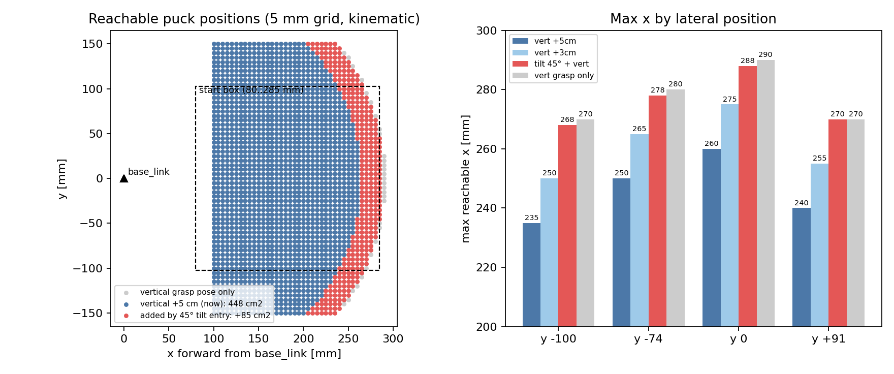

# pick_standing_far 도달성 검토 (2026-11-10)

## 요약
> 팔이 퍽 위 5 cm 수직 자세에 못 닿는 먼 퍽은 **45° 기울여 진입 → 퍽을 손가락 사이에 둔 채 피치 다운 → 수직으로 닫기**로 집을 수 있다. 도달 영역이 448 → 533 cm²(+19 %), 최대 반경이 263 → 289 mm(+26 mm)로 늘고, 수직 쥐는 자세가 닿는 영역(540 cm²)의 99 %를 덮는다. 이 구간은 시뮬 계산(IK + 메시 충돌)만 했고 실기·학습 환경에서는 아직 안 돌렸다. 승혜님이 `feature/skill-pick-far`에서 이어 받는다.

가까운 퍽은 지금의 수직 하강 `pick_standing_puck`을 그대로 쓰고, 먼 퍽만 새 skill `pick_standing_far`(액션 `/skills/pick_far`)로 간다. 기존 pick 설계는 BEE, pick 잔차 학습 설계, 태스크 분할은 BEE, RL 태스크 분할, 11-08 실기 점검은 BEE, 실기 pick·load·stand 점검 기록 (2026-11-08)에 있다.

## 설정
- **질문**: 퍽이 멀어서 `퍽 위 5 cm` 수직 자세 IK가 안 풀릴 때, 수직 하강 말고 어떤 접근이 가능하고 최대 얼마나 멀리까지 집을 수 있는가.
- **로봇 모델**: `urdf/beebot_mesh/beebot.urdf`, pinocchio 3.9.0 + hppfcl. 환경 기준은 작업 환경 (Isaac Sim 6.1 + ROS 2 Lyrical + cuVSLAM).
- **좌표**: 모두 `base_link` 기준(x 앞, y 왼쪽). joint1 축은 base_link에서 x 48 mm 앞. 시작 박스는 x 80 ~ 285 mm, y ±102.5 mm, 윗면 높이 60 mm(base 기준).
- **기울임 진입의 정의**:
  - 손가락 패드 중심(퍽 윗면에서 10 mm 아래, 퍽 바닥에서 50 mm)을 퍽 중심 축에 고정하고, 도구 축을 수직(90°)에서 진입 기울기까지 돌린다. 기울기 α는 수평에서 아래로 몇 도인지.
  - 손가락이 닫히는 방향은 반경 방향의 수직(좌우)으로 유지해 옆에서 퍽을 감싼다.
  - 기준 자세는 6D(위치 + 도구 방향) IK, 위치 2 mm · 각도 2° 이내, 관절 한계 포함, 단계 사이 관절 점프 0.5 rad 이내.
- **조건**:
  - 도달 영역: x 100 ~ 320 mm, y ±150 mm를 5 mm 격자(2,745점)로 훑음. 기울임 스윕은 3° 간격.
  - 충돌: 열린 그리퍼(기본 60 mm)와 퍽·시작 박스. 퍽은 직육면체 30×30×60 또는 원기둥 Ø30×60. 후퇴 자세(45°에서 도구 축으로 80 mm 뒤)부터 진입 → 90°까지 피치 다운 → 직육면체는 면 맞춤 롤까지.
- **같은 것 / 다른 것**: 비교한 방식(수직 + 5 cm, 수직 + 3 cm, 수직 쥐는 자세, 기울임)은 같은 IK 코드·관절 한계·좌표를 쓴다. 기울임만 6D 목표 방향이 다르다.
- **검증 기준**: 수직 쥐는 자세의 최대 x가 11-08 실측과 맞는다(y −74 mm에서 계산 278 mm, 실측 276 mm).
- **데이터·코드**: `isaac/rl/scripts/pick_far/` (재현 절 참고).

## 결과
### 수직 하강 한계 (최대 x, mm)
| 퍽 y | 수직 + 5 cm (지금) | 수직 + 3 cm | 수직 쥐는 자세 | 기울임 진입 + 수직 |
| --- | --- | --- | --- | --- |
| −100 mm | 235 | 250 | 270 | 268 |
| −74 mm | 250 | 265 | 280 | 278 |
| 0 | 260 | 275 | 290 | 288 |
| +91 mm | 240 | 255 | 270 | 270 |

### 도달 영역 (평면)
| 방식 | 면적 | 반경 (base_link 원점) | 반경 (joint1 축) | 최대 x |
| --- | --- | --- | --- | --- |
| 수직 + 5 cm (지금) | 448 cm² | 100 ~ 263 mm | 52 ~ 216 mm | 260 mm |
| 기울임 45° 진입 + 수직 | 264 cm² | 192 ~ 289 mm | 166 ~ 241 mm | 285 mm |
| **합침 (가까우면 수직, 멀면 기울임)** | **533 cm² (+85 cm², +19 %)** | **100 ~ 289 mm** | **52 ~ 241 mm** | **285 mm** |
| (참고) 수직 쥐는 자세만 | 540 cm² | 100 ~ 291 mm | 52 ~ 244 mm | 290 mm |



- 기울임 방식은 가까운 쪽이 막혀서(반경 192 mm 안쪽 불가) 단독으로는 못 쓴다. 가까운 퍽은 수직, 먼 퍽만 기울임으로 가는 분할이 맞고, 두 영역이 겹쳐서 빈 틈은 없다(방향별 수직 + 5 cm 끝 235 ~ 260 mm, 기울임 시작 185 ~ 215 mm).
- 기울임에서만 닿는 점은 85 cm², 수직 쥐는 자세에도 안 닿는 점은 0개.

### 진입 기울기 (수평이 어디까지 되는가, y = 0)
| 퍽 x | 120 | 140 | 160 | 180 | 200 | 220 | 240 | 260 | 280 | 300 |
| --- | --- | --- | --- | --- | --- | --- | --- | --- | --- | --- |
| 가장 낮출 수 있는 기울기 α | 58° | 52° | 54° | 52° | 50° | 44° | 38° | 24° | 18° | 없음 |

- 어느 위치에서도 수평(α = 0°)에 못 닿는다. 먼 퍽일수록 더 눕힐 수 있다.
- 45° 진입에서 도구 축으로 30·50·80 mm 후퇴한 자세까지 모두 풀린다(한계 x는 위 표의 기울임과 같음). 20°·30° 진입의 후퇴 자세는 IK 시드에 따라 결과가 들쭉날쭉해서 이번에는 결론을 못 냈다.

### 충돌 (45° 진입, 열림 60 mm)
| 퍽 위치 (x, y) | 퍽 종류 | 퍽과 최소 간격 | 좌우 오차 허용폭 | 앞뒤 오차 허용폭 |
| --- | --- | --- | --- | --- |
| (260, −74) | 직육면체 yaw 0° | 11.9 mm | ±12 mm | ≥ ±30 mm |
| (260, −74) | 직육면체 yaw 45° | 9.8 mm | ±8 mm | ≥ ±30 mm |
| (260, −74) | 원기둥 | 16.0 mm | ±16 mm | ≥ ±30 mm |
| (270, 0) | 직육면체 yaw 0° | 16.0 mm | ±14 mm | ≥ ±30 mm |
| (270, 0) | 직육면체 yaw 45° | 9.8 mm | ±8 mm | ±20 mm |
| (270, 0) | 원기둥 | 16.0 mm | ±14 mm | ≥ ±30 mm |
| (250, +91) | 직육면체 yaw 0° | 11.2 mm | ±10 mm | ≥ ±30 mm |
| (250, +91) | 직육면체 yaw 45° | 11.2 mm | ±12 mm | ±12 mm |
| (250, +91) | 원기둥 | 16.0 mm | ±16 mm | ≥ ±30 mm |
| (240, −100) | 직육면체 yaw 0° | 10.8 mm | ±10 mm | ±26 mm |
| (240, −100) | 직육면체 yaw 45° | 9.8 mm | ±8 mm | ±24 mm |

- 손이 가장 낮은 점과 시작 박스 윗면 간격은 36 mm로 박스에 안 닿는다. 진입 · 피치 다운 · 롤 전 구간에서 퍽과 충돌이 없었다.
- 허용폭은 "손이 조준한 곳 대비 실제 퍽이 이만큼 벗어나도 안 부딪히는 범위"다. 앞뒤(손 진행 방향)는 충돌이 아니라 쥐는 깊이 문제라 충돌 기준으로는 넓게 나온다.

| 열림 (위치 (260, −74), 직육면체) | yaw 0° 좌우 허용폭 | yaw 45° 좌우 허용폭 |
| --- | --- | --- |
| 60 mm | ±12 mm | ±9 mm |
| 66 mm | ±15 mm | ±12 mm |

## 문제
1. **먼 퍽은 퍽 위 5 cm 수직 자세에 못 닿는다.** 퍽이 x 235 ~ 260 mm를 넘으면 IK가 없다. 쥐는 자세 자체는 270 ~ 290 mm까지 닿으니, 5 cm 높이 때문에 약 30 mm를 잃는다.
2. **수평(0°)으로 눕혀서 들어가는 방식은 어디서도 안 된다.** 가장 눕힐 수 있는 기울기가 먼 쪽 18 ~ 24°, 가까운 쪽 50 ~ 58°다.
3. **yaw 45°로 돌아간 직육면체의 좌우 허용폭이 ±8 ~ 12 mm로 좁다.** 인식 오차 ±5 ~ 10 mm와 겹치면 빠듯하다.
4. **실기 `pick`은 도달 불가를 다른 실패와 구분하지 못한다.** IK가 안 풀리면 로그만 남기고 `grasp_failed_all`로 끝났다. 상위(coordinator·mission_manager)가 먼 퍽 경로로 넘어갈 근거가 없다.
5. **아직 확인 못 한 것**: 45°에서 패드가 퍽을 실제로 감싸는 깊이, 몸체·팔 자기충돌, 진입 줄 위 이웃 퍽, 손목 카메라 태그 가시성, 20 ~ 30° 진입의 후퇴 IK.

## 원인
1. **확인**: 도달 거리가 손 높이에 따라 줄어든다. 쥐는 자세에서 +3 cm 올리면 약 15 mm, +5 cm는 약 30 mm 줄었다(위 표의 열 비교). 팔을 위로 뻗을수록 수평 도달 거리가 짧아지는 5축 팔의 기하 때문이다.
2. **확인**: 관절 한계다. 손의 기울기 α = joint2 + joint3 + joint4(x 200 mm, α 50°에서 −39 + 78 + 12 = 51°로 확인).
   - 먼 퍽(x 260 ~ 280): 팔을 뻗어서 joint2 +40 ~ 49°, joint3 67 ~ 77°가 되면, α = 0°가 되려면 joint4 = −110 ~ −120°가 필요한데 하한이 −97.4°라 α 18 ~ 24°에서 막힌다.
   - 가까운 퍽(x 120 ~ 200): 손목이 퍽에서 그리퍼 길이(약 11 cm)만큼 뒤, 로봇 몸 가까이 낮게 와야 해서 joint2 −107 ~ −109°(하한 −110°), joint3 +78 ~ 80°(상한 80°)에 닿아 α 50 ~ 58°에서 막힌다.
   - 한계값(URDF): joint2 −110 ~ +110°, joint3 −90 ~ +80°, joint4 −97.4 ~ +113°.
3. **확인**: 직육면체 30×30의 대각선이 42.4 mm인데 열림이 60 mm라, yaw 45°에서는 한쪽 여유가 8.8 mm뿐이다. 계산한 허용폭(±8 ~ 12 mm)이 이 값과 맞는다. 열림은 손가락 관절 한계(0.0265 m, 최대 약 66.6 mm)까지 키울 수 있다.
4. **확인**: `pick_skill.cpp`는 IK 실패 때 `done(false)`만 하고 이유 문자열이 없었다.
5. **가설**: 패드 감싸는 깊이는 패드 길이(손가락 89 mm, 폭 58 mm)가 충돌 계산에 들어갔지만 쥠 판정은 시뮬 접촉으로만 확인된다. 자기충돌은 이번 계산에서 팔 링크 대 박스·퍽만 봤고 base 쪽 geometry는 제외했다.

## 해결 방법
1. **45° 진입(우선순위 1).** 먼 퍽은 후퇴 자세 → 슬라이드 진입 → 퍽 중심을 유지하며 피치 다운 → 수직 닫기. 기대 효과는 도달 +85 cm², 최대 반경 +26 mm. 가까운 퍽은 현행 수직 하강을 그대로 쓴다. 모드는 inspect 측정 위치로 한 번만 정하고 접근 중에는 바꾸지 않는다. 전환점은 수직 + 5 cm 한계에서 인식 오차 + 처짐 여유로 약 10 mm 안쪽(대략 y −100: 225, y −74: 240, y 0: 250, y +91: 230 mm).
2. **수평 진입 포기, 45° 고정.** 45°는 먼 쪽에서 확실히 풀리고 후퇴 80 mm까지 풀리는 값이다. 20 ~ 30°는 더 눕힐 수 있지만 후퇴 IK 결과가 시드에 따라 흔들려서, 구현 단계에서 해석 IK로 다시 확인한 뒤 낮춘다.
3. **열림 66 mm.** 직육면체 yaw 45° 허용폭이 ±8 → ±12 mm로 늘어난다(위 열림 비교).
4. **적용 완료(실기 코드, 커밋 안 함)**: `pick` skill이 IK 불가일 때 `pick_unreachable`을 돌려준다. 후보를 모두 시도한 뒤 다른 실패가 없으면 이 이유로 끝난다. `colcon build --packages-select skills`는 통과했고 노드를 띄워 동작은 확인하지 않았다. 패치 `isaac/rl/scripts/pick_far/pick_unreachable.patch`.
5. **다음 확인(우선순위 순)**: ① base 쪽 자기충돌·이웃 퍽을 hpp-fcl로 정밀 확인, ② 45°에서 패드가 퍽을 감싸는 깊이, ③ 진입 줄에 이웃 퍽이 있는 배치(가까운 퍽부터 집는 순서면 대부분 해소), ④ 손목 카메라로 태그가 보이는지, ⑤ 첫 버전은 정책 없이(Δ = 0) 실기에서 기하만 확인한 뒤 학습.

## 인계 (승혜님, `feature/skill-pick-far`)
### 정한 운영 로직
1. inspect로 시작 박스의 퍽 2개 확인.
2. 로봇에서 가깝거나 수직 IK가 있는 퍽을 먼저 `pick`.
3. 남은 퍽이 `pick`으로 안 닿으면(`pick_unreachable`) `pick_standing_far` skill로 집는다.
- skill 이름 `pick_standing_far`, 액션 `/skills/pick_far`. 한 노드에 `pick`과 `pick_far` 두 액션을 같이 내는 것은 가능하다(`stand` 노드가 `stand`와 `stand_pick`을 이미 한 노드에서 냄). 한 번에 하나만 실행된다.

### 실기에서 수정할 패키지 (`lv2_module6/ros2_ws/src`)
| 패키지 | 파일 | 내용 |
| --- | --- | --- |
| `skills` | `src/stand_plan.cpp`, `include/skills/stand_plan.hpp` | 기울임 IK `ik_tilt`(α를 받는 평면 2링크 + joint4 = α − q2 − q3)와 45° → 90° 경유점. 지금 `ik_down`은 수직(joint4 = π/2 − joint2 − joint3)만 푼다 |
| `skills` | `include/skills/arm_io.hpp`, `src/arm_io.cpp` | `ik_ee_yaw` 같은 형태의 `ik_ee_tilt` |
| `skills` | `src/pick_far_skill.cpp` (신규) 또는 `pick_skill.cpp`에 두 번째 `serve("pick_far")` | 후퇴 자세 → 열림 66 mm → 슬라이드 → 필요 시 롤 → 피치 다운 → 닫기 → 들어올림 |
| `skills` | `CMakeLists.txt`, `launch/skills.launch.py`, `config/skills.yaml` | 컴포넌트·노드 등록, `skill_pick_far` 파라미터(진입 기울기 45°, 후퇴 80 mm, 열림 66 mm 등) |
| `skills` | `test/test_stand_plan.cpp` | `ik_tilt`을 `tilt_reach.py` 결과와 비교하는 테스트 |
| `plan` | `src/coordinator.cpp`, `include/plan/coordinator.hpp` | `pick_far` 액션 클라이언트·허용 skill 집합·디스패치. 지금 코드에는 `pick`, `stand` 등이 문자열 집합으로 박혀 있다(97, 228, 298행 부근) |
| `plan` | `src/mission_manager.cpp`, `config/plan.yaml` | `survey()`의 `found` 순서를 가까운 퍽 먼저로, `grab()`에서 `pick_unreachable`이면 `pick_far`로 재시도, 거리 기준 파라미터 |
| `plan` | `src/vlm_task_planner.cpp` | planner 경로를 쓸 때만 허용 skill 목록에 `pick_far` 추가 |
| `ml` | `include/ml/arm_obs.hpp` 외 | 정책을 연결할 때만. 모드 one-hot을 넣으면 `pick_box` 67개가 68 ~ 69개가 되고, `rl_arm_correction.cpp` 분기와 `test_arm_obs.cpp`도 바뀐다 |
| (기타) | `models/skills/pick_standing_far/meta.yaml`, `learning/skills.yaml`, `documents/API.md` | 정책 폴더(`use: false`로 시작), 학습 skill 등록, API 표 |

### 정할 것
- **순서 기준**: (A) 지도 좌표 + 로봇 위치의 거리 규칙으로 가까운 퍽을 먼저 집고 `pick_unreachable`을 안전망으로 쓰기(변경 작음), 또는 (B) skill 쪽에 "닿는가" 조회 액션을 만들어 퍽마다 묻기(정확함). 추천은 (A) + 안전망.
- **첫 버전 정책 여부**: 정책 없이(Δ = 0) 기하만 먼저 실기에서 확인하고 이후 시뮬 학습을 추천한다.
- **두 번째 퍽의 판정 시점**: 첫 퍽을 적재함에 싣고 난 뒤 로봇이 같은 자리에 있는지(도킹 위치가 바뀌는지). 바뀌면 `pick_far` 필요 여부를 그 시점에 다시 판정한다.

### 학습 환경 쪽 (`isaac/rl/bee_isaac/tasks/pick_env.py`)
- 지금 계획표(`q_above`, `q_down`, 자코비안)는 side × yaw bin으로 한 번만 풀고 `above_m`이 상수 0.05라 수직 하강만 있다. 먼 퍽 모드를 학습하려면 계획표에 모드(수직 / 기울임) 차원, 관측에 모드 one-hot, 보상 1번 항(정렬)을 기울임 구간용으로 바꾸는 작업이 필요하다. 상세는 BEE, pick 잔차 학습 설계를 따른다.
- `above_m`을 0.03 ~ 0.05로 랜덤화하는 안은 이 모드 분할과 별개의 선택지다. 3 cm는 +5 cm보다 약 15 mm 더 닿지만 먼 퍽 전체를 덮지는 못한다.

## 형중님과 상의할 것
coordinator·plan·skills 계약 부분이라 승혜님 혼자 정하지 말고 형중님과 먼저 맞춘다. 아래 "제안"은 이번 검토에서 낸 안이고 확정이 아니다.

| # | 상의할 것 | 왜 형중님과 | 제안 |
| --- | --- | --- | --- |
| 1 | coordinator·mission_manager 분기: `pick_far` 액션 추가, 허용 skill 집합(`validate`), `grab()`에서 `pick_unreachable`이면 `pick_far`로 재시도 | coordinator는 형중님 담당. 한 번에 하나의 skill만 보내는 흐름과 재시도(`retries`) 규칙을 건드린다 | `pick`과 같은 경로로 `pick_far`를 추가하고, 재시도는 기존 `retries` 규칙 그대로 |
| 2 | 가까운 퍽 먼저 고르는 기준 | 순서는 `mission_manager.survey()`의 `found`(퍽 offset −40, +40 mm 순서 고정)와 `grab()`이 정한다 | (A) 거리 규칙 + `pick_unreachable` 안전망, 또는 (B) skill에 "닿는가" 조회 액션. 추천 (A) |
| 3 | `Skill.action` 계약: 새 실패 이유 `pick_unreachable`(적용함, 커밋 전), `pick_far`의 goal 필드 | `TaskStatus.reason`으로 그대로 올라가서 상위 로직이 이 문자열로 분기한다 | goal은 `pick`과 같은 필드(target id, shape, tag, objects), 필요하면 `values`에 진입 기울기 |
| 4 | 경유점을 누가 어디서 계산하나 | 세우기에서 정리한 쟁점과 같다(경로표 vs 해석 IK vs MoveIt `pick_ik`) | skills 안 해석 IK `ik_tilt`(세우기 `ik_down`과 같은 방식). 표가 필요하면 `stand_table_export.py` 방식 재사용 |
| 5 | 도킹 위치·정확도 | 먼 퍽의 도달 여유는 로봇이 박스에 얼마나 붙는지에 달렸다. 현재 `approach_gap` 0.085 m, 도킹 오차 ±10 mm | 도달 지도상 20~30 mm 더 붙으면 더 눕힐 수 있다. 박스 앞 정지 거리 규칙과 `collision_monitor`를 같이 확인 |
| 6 | 두 번째 퍽 판정 시점 | 첫 퍽을 적재함에 싣고 나면 로봇 위치가 바뀔 수 있다 | 첫 퍽 적재 직후, 두 번째 퍽의 `pick` 시작 전에 도달 여부를 다시 판정 |
| 7 | 그리퍼 열림 66 mm | `pick_open_gap_m` 기본 0.060, 코드 주석상 최대 약 0.070, 손가락 관절 한계로 약 66.6 mm. 펌웨어 한계와 그립 전류 경로는 형중님·현하님 영역 | 기울임 모드만 66 mm. 전류 → 힘 실측(B0-0)과 같이 확인 |
| 8 | 기울임 진입 중 접촉·과전류 감지 | `arm_safety_monitor` 기준 3.0 A는 정지 전류(11.1 V에서 약 2.1 A)보다 커서 안 걸린다. 막힘 감지 기준(joint2 + joint3 전류 +0.5 A)도 아직 `contact_step`에 안 들어갔다 | 진입 구간에 쓸 감지 기준을 같이 정한다 |
| 9 | 정책을 붙일 때 `SkillContext` phase와 `arm_obs` 레이아웃 | phase 0~5는 수직 하강 구간 기준이라 기울임 구간을 표현 못 한다. `rl_arm_correction`의 분기가 바뀐다 | 첫 버전은 정책 없이(Δ = 0) 가고, 정책을 붙일 때 phase·레이아웃을 같이 정한다 |
| 10 | 파일 충돌 방지 | `skills` 패키지(`pick_skill.cpp`, `skills.launch.py`, `skills.yaml`, `CMakeLists.txt`)를 둘 다 만진다 | 승혜님: `pick_far_skill.cpp`, `ik_tilt`, 테스트. 형중님: `coordinator`·`mission_manager` 분기와 계약. 공통 파일은 한 사람이 정리해서 먼저 머지 |
| 11 | 손목 카메라 태그 가시성 (`hand_relative`) | 45° 진입 중 태그가 화면에서 나갈지는 perception 담당과 확인해야 한다 | 담당 확인 필요 (첫 버전은 inspect 값으로만 진행) |

## 재현
- 저장 위치: 레포 `lv2_module6/isaac/rl/scripts/pick_far/` (아직 추적 안 되는 새 폴더, `feature/isaac-setup` 작업 트리).

| 파일 | 하는 일 |
| --- | --- |
| `tilt_reach.py` | 수직·기울임 IK 도달성 (공통 함수: `sweep`, `vertical_ok`) |
| `tab.py` | 진입 기울기별 최대 x와 손이 가장 낮은 점 |
| `stand.py` | 45° 진입 후퇴 거리별 도달성 |
| `coll.py` | 열린 그리퍼 × 퍽·박스 메시 충돌(진입 → 피치 다운 → 롤) |
| `grid.py`, `g66.py` | 좌우·앞뒤 오차 허용폭, 열림 60 vs 66 mm |
| `area.py`, `plot_reach.py` | 도달 영역 면적·반경, 그림 |
| `pick_unreachable.patch` | `pick_skill.cpp`의 도달 불가 이유 추가 |

```bash
PY=~/pa-course/IsaacLab-6.1/.venv/bin/python   # pinocchio 3.9.0 + hppfcl
cd ~/git/Lv2_bee_Assignment/lv2_module6/isaac/rl/scripts/pick_far
$PY tilt_reach.py         # 수직 +0/+3/+5 cm와 기울임 최대 x
$PY area.py               # 영역 면적·반경 (area.npz 저장)
$PY grid.py               # 허용폭 표 (약 3분)
$PY plot_reach.py out.png # 도달 영역 그림
```

공정성 점검:
- **같은 조건**: 비교 방식 모두 같은 IK(허용 2 mm · 2°)와 관절 한계. 기울임만 6D 방향 목표라 수직 방식과 IK 목표 형태가 다르다.
- **표본**: 도달 영역은 5 mm 격자라 면적 오차는 격자 한 칸(0.25 cm²) × 경계 점 수 정도. 통계 검정은 해당 없음(결정적 계산).
- **한계**: 순수 기구학 + 충돌(손 쪽 메시와 퍽·박스만). 처짐·서보 오차·인식 오차는 허용폭 표로만 반영했고, base 쪽 자기충돌과 이웃 퍽은 포함하지 않았다. 앞뒤 허용폭 "≥ ±30 mm"는 탐색 상한이 30 mm라 그 이상은 모른다. 후퇴 IK는 시드 세 개로만 시도해 20 ~ 30° 결과는 신뢰하지 않는다.
