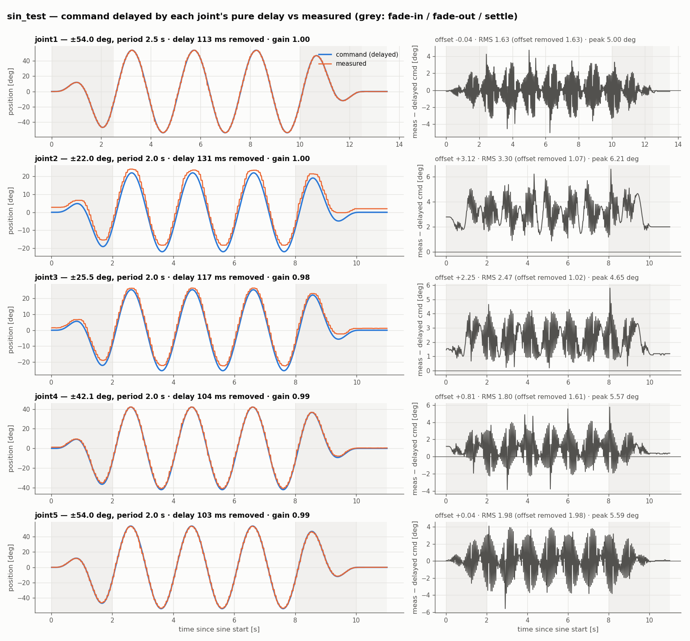
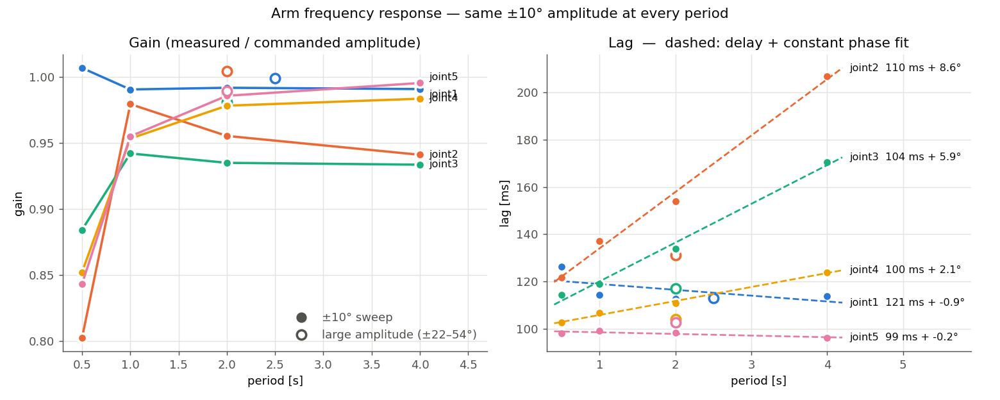
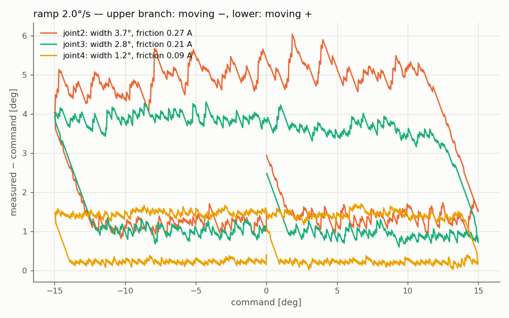

# 2026-10-24 작업 기록 — 실기 관절 응답 시험

실제 beebot 팔(joint1~5)과 그리퍼에 사인·계단·램프·정지 명령을 주고, 명령값과 측정값(`/joint_states`)을 비교했다.
목적은 Isaac Sim drive(stiffness·damping·friction)를 실기에 맞추는 것이다.

---

## 1. 사인 응답 (joint1~5)

조건: `update_rate` 50 Hz, 샘플 50 Hz, 관절별 center 0°. 같은 관절을 반복 측정했을 때 지연은 ±3.4 ms, 오프셋은 ±0.4° 안에서 같게 나와 재현성이 좋다.

| 관절 | 진폭 / 주기 | gain | 지연 | 평균 오프셋 | RMS (보정 전) | RMS (지연 보정) | RMS (지연+오프셋 보정) | 최대 전류 |
|---|---|---|---|---|---|---|---|---|
| joint1 | ±54.0° / 2.5 s | 1.00 | 113 ms | −0.04° | 9.52° | 1.63° | 1.63° | 0.18 A |
| joint2 | ±22.0° / 2.0 s | 1.00 | 131 ms | **+3.12°** | 6.49° | 3.30° | **1.07°** | 1.07 A |
| joint3 | ±25.5° / 2.0 s | 0.98 | 117 ms | **+2.25°** | 6.20° | 2.47° | **1.02°** | 0.67 A |
| joint4 | ±42.1° / 2.0 s | 0.99 | 104 ms | +0.81° | 8.54° | 1.80° | 1.61° | 0.26 A |
| joint5 | ±54.0° / 2.0 s | 0.99 | 103 ms | +0.04° | 10.79° | 1.98° | 1.98° | 0.20 A |

해석:
1. **진폭은 거의 그대로 따라가고(gain 0.98~1.00) 100~130 ms 늦다.** 위상이 20° 늦는데 gain이 줄지 않으므로(1차 지연이면 0.94) 대부분 **순수 지연**(통신·측정 경로)이다. 보정 전 오차의 대부분이 이 지연 때문이다.
2. **joint2·3은 중력 때문에 2~3° 처진다.** 오프셋까지 빼면 RMS가 약 1°로 줄어든다.
3. **측정값이 계단 모양이다.** 움직이는 동안 상태가 60 ms마다(약 17 Hz)만 갱신된다. OpenCR이 들어온 명령(C)을 모두 처리한 뒤에 상태(S)를 보내기 때문이다(C 없음 40 Hz, C 50 Hz면 약 17 Hz, C 100 Hz면 끊김). 지연을 보정해도 남는 peak 약 5°는 이 계단 오차(±속도 × 30 ms)와 맞는다. 서보가 아니라 측정 주기의 오차이므로 peak는 비교에 쓰지 않는다.
4. **joint1 시험 중 팔이 눈에 띄게 떨렸다.** 서보 목표도 60 ms마다 몰아서 들어가 한 번에 약 8°씩 튀는 것으로 추정한다(직접 측정은 안 함).

## 2. 정지 상태 (60초 기록)

| 항목 | 값 |
|---|---|
| 상태가 실제로 바뀌는 주기 | 중앙값 60 ms, 최대 120 ms |
| 엔코더 노이즈 | 인접 2 tick 사이만 오감 (±0.088°) |
| 전류 노이즈 | 표준편차 0.001~0.003 A |

정지 처짐으로 구한 stiffness (전류 × 1.78 Nm/A ÷ 처짐):

| 관절 | 처짐 | 전류 | stiffness |
|---|---|---|---|
| joint2 | +2.55° | −0.46 A | 0.32 Nm/deg |
| joint3 | +1.59° | −0.31 A | 0.35 Nm/deg |
| joint4 | +0.53° | −0.10 A | 0.34 Nm/deg |

**USD arm drive stiffness 0.35 Nm/deg와 일치한다.** Isaac Gain Tuner 결과(Peak / RMS: joint1 8.13/1.13, joint2 6.55/3.83, joint3 5.16/3.19, joint4 4.44/1.64, joint5 7.86/1.30)도 실기의 지연 보정 값과 비슷하다.
→ USD drive 게인은 유지하고, 통신 지연은 Isaac Lab에서 따로 모델링한다.

## 3. 주기별 응답 (±10°, 0.5 / 1 / 2 / 4 s)

지연은 `lag(T) = 순수 지연 + 일정 위상/360 × T` 로 맞췄다.

| 관절 | 순수 지연 | 일정 위상 지연 | gain 0.5 s | 1 s | 2 s | 4 s |
|---|---|---|---|---|---|---|
| joint1 | 약 115 ms | 없음 | **1.007** | 0.990 | 0.992 | 0.991 |
| joint2 | 110 ms | **8.6°** | 0.802 | 0.979 | 0.955 | 0.941 |
| joint3 | 104 ms | **5.9°** | 0.884 | 0.942 | 0.935 | 0.933 |
| joint4 | 100 ms | 2.1° | 0.852 | 0.953 | 0.978 | 0.983 |
| joint5 | 99 ms | 없음 | 0.843 | 0.955 | 0.986 | 0.995 |

해석:
1. **순수 지연은 약 100 ms**(joint1 약 115 ms)다. joint4·5는 주기를 8배 바꿔도 지연이 거의 같아서 시간 지연이 맞다.
2. **joint2·3에는 마찰/백래시가 있다.** 주기가 길수록 지연(ms)이 커지고, 진폭이 작을수록 gain이 떨어진다. 비선형이다. joint4·5는 거의 선형이다.
3. **0.5 s(2 Hz)에서 gain 0.80~0.88**은 계단 갱신만으로 생기는 감소(2.4%)보다 훨씬 크다. 서보 자체 대역폭이고, Isaac damping 검증에 쓸 값이다.
4. **joint1은 2 Hz에서 gain 1.007**이다. 감쇠가 약한 공진 성향이고, 1-4의 떨림과 맞는다.

## 4. 램프 · 정지 유지 · 계단

**램프 (±15°, 2°/s) — 마찰**

| 관절 | 히스테리시스 폭 | 마찰 전류 (토크) | 중력 토크 실측 / URDF |
|---|---|---|---|
| joint2 | **3.7°** | 0.27 A (**0.48 Nm**) | 0.99 / 1.26 Nm (0.79) |
| joint3 | **2.8°** | 0.21 A (**0.37 Nm**) | 0.77 / 1.11 Nm (0.70) |
| joint4 | 1.2° | 0.09 A (0.16 Nm) | 0.26 / 0.45 Nm (0.58) |

- 히스테리시스 폭 중 지연 때문인 것은 0.4°뿐이다. 나머지는 마찰·데드밴드다. 마찰 토크가 중력 토크의 절반 정도로 크다.
- 중력 토크 실측값이 URDF의 58~79%다. 저전류에서 전류-토크 계수(1.78 Nm/A)가 실제보다 크거나 URDF 질량이 실제보다 크다. 저울로 재야 구분된다.

**정지 유지 (hold):** 마찰이 각도에 따른 중력 차이보다 커서, 처짐·전류가 각도보다 **접근 방향**에 따라 달라졌다. 한 방향 접근으로는 중력을 분리할 수 없으므로 각 각도에 양방향으로 도착해 평균을 내야 한다.

**계단 (10°, 30°)**

| 관절 | 30° 최고 속도 | 30° 오버슈트 | 최종 오차 |
|---|---|---|---|
| joint1 | 172~177°/s | **1.3~1.7°** | 약 0 |
| joint2 | 137~196°/s | + 방향 **4.5~5.1°** | +1.5~2.5° |
| joint3 | 150~212°/s | + 방향 2.0~2.4° | +1.3~1.8° |
| joint4 | 191~217°/s | 0.4~0.7° | +0.4~0.9° |
| joint5 | 196~213°/s | 0.14° | 약 +0.1° |

- joint1은 중력이 없는데도 오버슈트가 있다. 감쇠 부족이고, 3장의 결론과 같다.
- joint2·3은 중력 방향으로 넘어간 뒤 마찰 때문에 되돌아오지 못한다.
- 실측 최고 속도는 약 200°/s다. USD `maxJointVelocity` 276°/s는 무부하 사양이다.

## 5. 그리퍼

| 항목 | 결과 |
|---|---|
| 방향 | URDF와 **반대**다. 측정값이 커질수록 닫힌다 |
| 변환 | 간격 ≈ 40.1 − 1.22 × 측정값 [mm]. 실제 계수 약 98 rad/m, 펌웨어 값 60 |
| 실물 간격 범위 | 약 20~40 mm (URDF는 손가락 하나 0~26.5 mm) |
| 지연 | 4 s 52 ms → 0.5 s 71 ms. 팔의 절반 |
| gain | 4 s 0.993 → 0.5 s 0.958 |
| 최고 속도 | 68 mm/s. URDF 속도 한계 0.07 m/s에 걸린 값 |
| 마찰 | 없음 |
| 쥐는 힘 (30 mm 퍽, 9 mm 명령) | 0.433 A, 약 38 N (34~45 N) |

쥐는 힘은 명령이 접촉점을 얼마나 지나가는지로 정해진다(측정값 1 mm당 약 0.65 A).

## 6. 영점 확인 (진행 중)

휴대폰 수평계로 확인했다. upper arm은 기대값과 1.5° 차이로 맞았다. forearm은 10° 차이가 났는데, 측정면이 축을 잇는 선과 평행하지 않았던 것으로 보인다. 다시 측정해야 한다.

---

## 7. Isaac에 반영할 값

| 항목 | 값 / 방법 |
|---|---|
| 지연 | action→관측 약 100 ms (joint1 115 ms), 무작위화 ±20 ms. 관측은 60 ms마다 갱신되는 zero-order hold |
| 관측 노이즈 | 위치 ±0.05° |
| stiffness | USD 0.35 Nm/deg 유지 |
| joint2·3·4 마찰 | `jointFriction` 목표 약 0.48 / 0.37 / 0.16 Nm. Gain Tuner ±10°·4 s gain 0.94 / 0.93과 램프 히스테리시스 폭 3.7 / 2.8 / 1.2°로 맞춘다 |
| damping 검증 | Gain Tuner ±10°·0.5 s gain이 0.80~0.88 근처인지 확인. joint1은 30° 계단 오버슈트가 약 1.5°인지 확인 |
| `maxJointVelocity` | 276 → 약 200°/s |
| 링크 질량 | 저울로 재기 전까지 URDF 유지 |
| 그리퍼 | 지연 약 55 ms, 최고 속도 0.07 m/s. Gain Tuner ±3 mm·0.5 s gain 0.96에 맞춘다 |

±10°를 Gain Tuner Amplitude %로 바꾸면 joint1 6%, joint2 9%, joint3 7%, joint4 5.5%, joint5 6%다. Gain Tuner에는 지연이 없으므로 gain만 비교한다.

## 8. 펌웨어 개선 요청 (펌웨어 담당)

지연 약 100 ms 중 30~50 ms는 측정이 늦게 보이는 시간이다. 명령 후 팔이 실제로 움직이기까지는 50~60 ms로 추정한다.

1. **SyncRead / SyncWrite**: 서보 8개를 패킷 하나로 읽고 쓴다. 상태 갱신이 100 Hz 이상 가능해지고, 지연이 약 40~50 ms 줄 것으로 예상한다.
2. 연속된 레지스터(Present Current~Position)는 한 번에 읽는다.
3. Return Delay Time을 0으로 설정한다.
4. 그리퍼 방향 반전, 영점(완전히 닫힘 = 0), 변환 계수(약 98 rad/m)를 고친다. 이 셋이 맞기 전에는 Isaac 그리퍼 명령을 실기에 그대로 보내면 안 된다.
