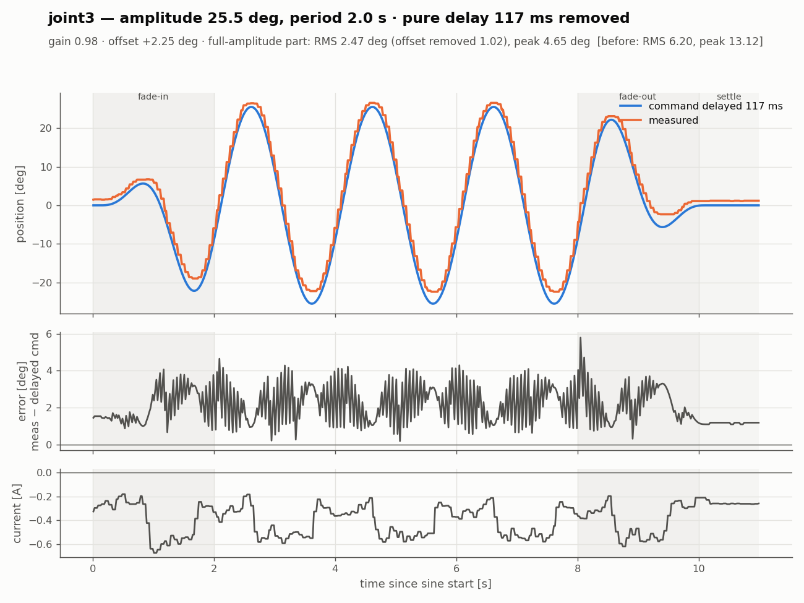
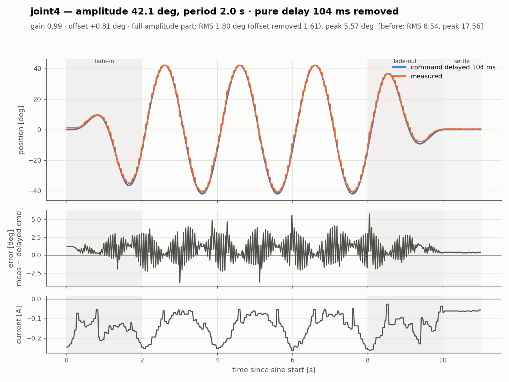
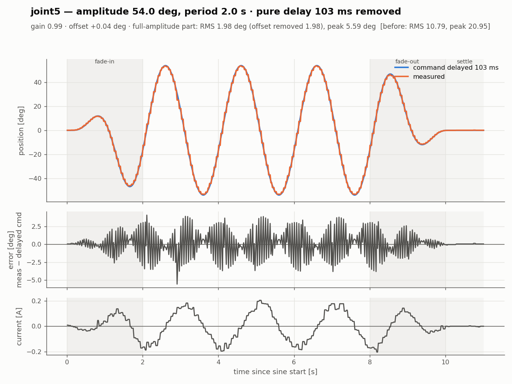

# 2026-10-24 작업 기록 — 실기 관절 사인파 응답 시험 (real_test)

실제 beebot 팔(joint1~5)에 사인파 위치 명령을 주고, 명령값과 측정값(`/joint_states`)을 기록했다.
목적은 Isaac Sim Gain Tuner 결과와 비교해서 시뮬레이션 drive(stiffness·damping)를 실기에 맞추는 것이다.
오늘은 시험 도구를 새 구조로 바꾸고, 실기 연결에서 생긴 문제를 하나씩 해결한 뒤 joint1~5를 측정했다.

- 작업 범위: `isaac/` 안의 파일만 수정했다. 메인 ws(`ros2_ws/src/control`, `ros_system`), `firmware/`, `urdf/`는 읽기만 했다.
- 메인 bringup(`ros_system`)은 시험하는 동안 쓰지 않는다. 하드웨어는 `real_test`의 `hw.launch.py`로만 띄운다.

---

## 1. 시험 도구 구조 변경

### 1-1. 변경 전
`sine_test.launch.py` 하나로 하드웨어, 컨트롤러, 테스트 노드(`sine_test_node`)를 한 번에 띄웠다.
`sine.yaml`에서 `test: true`인 관절을 차례로 시험하고, 끝나면 launch가 스스로 종료하는 일괄 실행 방식이었다.

### 1-2. 변경 후: 3개로 분리
```
터미널 1  ros2 launch sine_test hw.launch.py           # 하드웨어 + 컨트롤러만, 계속 유지
터미널 2  ros2 run sine_test set_center                # joint5 → joint1 순서로 0° 로
          ros2 run sine_test set_center joint3         # joint3 만 0° 로
          ros2 run sine_test sin_test joint3           # joint3 사인 시험 (설정은 config/sine.yaml)
```

| 구성 | 통신 | 동작 |
|---|---|---|
| `hw.launch.py` | – | rsp, ros2_control(inactive로 시작 → 2초 뒤 active), JSB·JTC spawn. 테스트 노드와 자동 종료는 없음 |
| `set_center` | **topic** `/arm_controller/joint_trajectory` | 인자가 없으면 joint5 → joint1 순서로 한 관절씩 0°(서보 수직, 2048)로 이동한다. 관절 이름을 주면 그 관절만 이동한다. 그리퍼는 개도를 유지한다 |
| `sin_test <joint>` | **action** `follow_joint_trajectory` | yaml의 `joints.<joint>` 설정으로 center 이동 → 사인(fade-in/out) → center에서 settle → **그 자리에 정지**한다. 로그를 저장하고 종료한다 |

공통 동작:
- **`q`** 또는 Ctrl+C를 누르면 그 자리에서 정지하고 정상 종료한다. `sin_test`는 그때까지의 로그를 저장하고 `interrupted: true`를 기록한다.
- 키 입력을 받아야 하므로 launch가 아니라 터미널에서 `ros2 run`으로 실행한다.
- 관절 이름이 잘못되면 로그만 남기고 아무것도 움직이지 않는다. `sin_test`는 yaml에 없는 이름, `set_center`는 joint1~5가 아닌 이름이 해당한다.

### 1-3. 설계에서 정한 것
- **center 정의:** 팔 관절은 **0°(서보 수직)**를 기준으로 한다. 원래 Isaac Gain Tuner처럼 URDF 범위의 가운데로 잡았는데 사용자 요청으로 바꿨다. 그리퍼는 범위 가운데(13.25 mm)를 그대로 쓴다.
  - Gain Tuner는 팔도 범위 가운데가 중심이다(joint3 −5°, joint4 +7.7°). Isaac과 비교하려면 Gain Tuner에도 같은 중심을 줘야 한다.
- **움직이지 않는 관절의 자세 유지 기준:** 측정값이 아니라 **JTC가 지금 명령하고 있는 값**(`/arm_controller/controller_state`의 `reference`)을 다시 보낸다.
  - 실기는 팔 무게 때문에 명령보다 조금 처진다. 측정값을 새 명령으로 보내면 시험을 반복할 때마다 자세가 조금씩 내려간다.
  - 이 값을 받아야 노드가 시작하므로 `arm_controller`가 active가 아니면 두 노드 모두 시작하지 않는다.
- **일괄 실행 방식(`sine_test_node.py`, `sine_test.launch.py`)은 삭제했다.** yaml의 `test`, `pre_center` 항목도 없앴다.

### 1-4. 바뀐 파일 (`isaac/sim/real_test/` 아래, 커밋 전)
| 파일 | 내용 |
|---|---|
| `ros2_ws/src/sine_test/sine_test/common.py` | 새 파일. 공통 코드(URDF 한계, `SineTest`, center 계산, `q` 키 감시, `ArmNode`) |
| `ros2_ws/src/sine_test/sine_test/set_center_node.py` | 새 파일 |
| `ros2_ws/src/sine_test/sine_test/sin_test_node.py` | 새 파일 |
| `ros2_ws/src/sine_test/launch/hw.launch.py` | 새 파일. `mesh_uri` 인자 포함 |
| `ros2_ws/src/sine_test/config/sine.yaml` | 관절별 설정만 남기고 설명 주석을 고침 |
| `ros2_ws/src/sine_test/config/controllers.yaml` | `update_rate` 100 → **50** (3장 참고) |
| `ros2_ws/src/sine_test/setup.py` | 실행 명령 `set_center`, `sin_test` 등록 |
| `README.md` | 새 구조에 맞춰 다시 씀 |
| `plot_logs.py` | 새 파일. 로그 분석과 그래프(보정 전/지연 보정, 요약, 관절별 한 장) |
| 삭제 | `sine_test_node.py`, `sine_test.launch.py` |

---

## 2. 시작 순서와 "0 명령" 문제 (참고)

`BeebotSystemHardware::on_activate()`(`ros2_ws/src/control/src/beebot_system_hardware.cpp:64`)는 현재 state를 명령으로 복사한다.
그런데 `on_configure()`가 state를 0으로 초기화하기 때문에, 첫 시리얼 읽기 전에 active가 되면 **팔 전체에 0 rad(서보 중앙) 명령이 나간다.**

- `hw.launch.py`는 하드웨어를 inactive로 띄워 2초 동안 실제 자세를 읽은 뒤 active로 바꾼다. 그래서 이 문제가 생기지 않는다.
- 메인 bringup(`ros_system.launch.py`)에는 이 문제가 그대로 있다. 시험 중에는 메인 bringup을 쓰지 않으므로 영향은 없고, `isaac/` 밖이라 수정하지 않았다.

---

## 3. 실기 연결 중 생긴 문제와 해결

### 3-1. 토픽이 하나도 안 보임 → `ROS_DISCOVERY_SERVER` 잔여 설정
- **증상:** hw.launch를 실행해도 `ros2 topic list`가 비어 있었다.
- **원인:** launch를 실행한 터미널에 `ROS_DISCOVERY_SERVER=127.0.0.1:11811`이 남아 있었는데, discovery server는 떠 있지 않았다.
  - 노드끼리 서로를 찾지 못해서 `set_hardware_component_state ... active`가 2분 넘게 멈춰 있었고, 그래서 spawner와 컨트롤러가 뜨지 않았다.
  - `~/.bashrc`에서는 주석 처리돼 있었지만 그 터미널에는 예전에 export한 값이 그대로 남아 있었다. `source ~/.bashrc`는 이미 설정된 변수를 지우지 않는다.
- **해결:** 각 터미널에서 `unset ROS_DISCOVERY_SERVER` 하거나 새 터미널을 열고, `ros2 daemon stop`. `ROS_DOMAIN_ID`는 8 → **88**로 바꿨다(사용자 변경).
- **참고:** hw.launch의 activate 단계에는 timeout이 없다. discovery가 안 되면 에러 없이 멈춰 있는다.

### 3-2. active 이후 OpenCR 상태(S) 수신 끊김 → C 명령이 밀림
- **증상:** `OpenCR 상태(S) 수신 없음 0.5초 넘음` 경고가 반복됐다.
- **진단:** `/diagnostics`의 하드웨어 카운터를 봤다.

  | 시점 | 마지막 S | 보낸 C | 받은 S |
  |---|---|---|---|
  | active 상태 (100 Hz) | 296 s 전 | 29645 (계속 증가) | **126** (멈춤) |
  | inactive로 바꾼 뒤 약 6초 | 0.016 s 전 | 29858 (멈춤) | **503** → 이후 1380 (계속 증가) |

  - S 126줄은 inactive였던 3초 정도 분량이다. **SBC가 C를 100 Hz로 보내기 시작한 순간 S가 끊겼다.**
  - C 송신을 멈추면(inactive) 즉시 S가 다시 들어왔다. 펌웨어가 멈춘 것이 아니라 C 처리에 밀려 S를 보낼 차례가 오지 않은 것이다.
- **원인 (펌웨어 구조, 5장 참고):** `loop()`가 USB로 들어온 C 줄을 전부 처리한 뒤에 S를 보낸다. C 한 줄마다 DXL 쓰기가 8번, S 한 번마다 읽기가 22번 들어간다.
- **해결:** real_test의 `controllers.yaml`에서 `update_rate`를 100 → 25로 낮춰 S가 들어오는 것을 확인했다. 현재는 **50 Hz**로 쓰고 있다.
- **주의:** `ros2 launch`는 `src/`가 아니라 `install/`에 복사된 yaml을 읽는다. 처음 25로 고쳤을 때는 다시 빌드하지 않아서 여전히 100 Hz로 돌았다. yaml을 바꾸면 `colcon build`를 다시 하거나, `--symlink-install`로 빌드해 둔다.

### 3-3. `arm_controller`가 시작하자마자 꺼짐 → URDF 한계 밖 자세
- **증상:** `arm_controller`가 `unconfigured` 상태였다.
  ```
  Joint position is out of bounds for the joint : 'joint2' actual position: -2.08029 limits: [-1.919862, 1.919862]
  Deactivating controllers : [ arm_controller ]
  ```
- **원인:** 팔이 접힌 자세였다. joint2 **−119.2°**(한계 ±110°), joint4 **+123.1°**(한계 −97.4° ~ +112.9°). ros2_control은 한계 밖 state를 받으면 컨트롤러를 바로 끈다.
- **해결:** 토크가 꺼진 상태(3-4)에서 손으로 팔을 한계 안으로 옮기고 다시 시작했다. 이후 joint2 −47°, joint4 +52.8° 등으로 범위 안에 들어왔다.

### 3-4. OpenCR 전원을 껐다 켜도 재부팅되지 않음 → USB 전원
- **구성:** Jetson과 OpenCR이 USB로 연결되어 있다. OpenCR의 MCU는 USB 5V로도 켜진다.
- **현상:** OpenCR 전원 스위치는 12V(모터 전원)만 끊는다.
  - MCU는 계속 켜져 있었다(USB 장치 번호 `004` 그대로, S가 38 Hz로 계속 나옴).
  - 모터는 12V가 다시 들어오면 **토크가 꺼진 상태**로 시작한다. 펌웨어는 부팅할 때 `setup()`에서만 토크를 켜므로 다시 켜지지 않는다.
- **토크를 다시 켜는 방법 (USB를 뽑지 않고):**
  1. OpenCR **RESET 버튼**
  2. 펌웨어 재업로드(`firmware/upload.sh`)를 하면 watchdog 리셋 → 부트로더 → 같은 펌웨어 실행 순서로 재부팅된다.
  - launch에서 토크를 켜는 방법은 없다. 프로토콜에 토크 명령이 없고, 추가하려면 펌웨어를 고쳐야 한다(isaac 밖).
- 이 상태를 활용해서 토크가 꺼진 동안 팔을 손으로 한계 안으로 옮겼다(3-3).

### 3-5. joint5 모터를 뺐을 때 그리퍼도 같이 끊김 (참고)
- joint5와 그리퍼가 모두 **서보 0°**로 읽혔다. 펌웨어는 읽기에 실패하면 0을 반환한다.
- 그리퍼(ID 16)가 joint5(ID 15) 뒤에 데이지 체인으로 연결돼 있어서 같이 끊긴 것으로 보인다.
- 그리퍼 값(−52 mm)이 한계 밖이라 `arm_controller`가 다시 꺼졌다. 이후 모터를 다시 연결해 정상으로 돌아왔다.
- 이때 joint4 전류가 +5.41 A로 계속 같은 값이었다(XM430 전류 한계보다 큼). 읽기 이상인지 실제 부하인지는 확인하지 못했다.
- 모터 일부를 뺀 채 시험하려고 `hw.launch joints:=`(연결된 관절만 제어)로 수정하던 중이었는데, 사용자 요청으로 중단했다. **반영된 변경은 없다.**

### 3-6. RViz에서 메시가 안 보임 → `mesh_uri`
- **증상:** PC의 RViz에서 `Could not load resource [package://ros_system/urdf/meshes/wheel_left_link.stl]`
- **원인:**
  - hw.launch가 xacro에 `mesh_uri`를 넘기지 않아 기본값 `package://ros_system/urdf/meshes`가 들어갔다. 실제 설치 경로는 `.../urdf/beebot_mesh/meshes`다.
  - `package://`는 **RViz를 띄운 PC에서** 찾으므로 PC에도 `ros_system` 패키지가 있어야 한다.
- **해결:** `hw.launch.py`에 `mesh_uri` 인자를 추가했다. 기본값은 메인 launch와 같은 `package://ros_system/urdf/beebot_mesh/meshes`다.

### 3-7. RViz에서만 팔이 떨림 → PC와 Jetson 시계 차이
- **진단:** PC에서 `ros2 topic delay /joint_states`를 실행했다.

  | | average delay | 표준편차 |
  |---|---|---|
  | 수정 전 | **−0.411 s** | 0.9 ms |
  | PC NTP 동기화 후 | **+0.023 s** | 2 ms |
  | 이후 | +0.006 s | 1 ms |

  - 음수는 PC 시계가 Jetson보다 늦다는 뜻이다. RViz가 PC 시각으로 TF를 조회하는데 메시지에는 0.4초 미래 시각이 찍혀 있어서 프레임마다 다른 TF를 썼다.
  - Jetson은 `systemd-timesyncd`로 `1.pool.ntp.org`에 동기화되어 있었다.
- **해결:** PC에서 `sudo timedatectl set-ntp true`
- **참고 1:** ssh로 `date`를 비교한 결과(1.8 s)는 비밀번호 입력 시간(왕복 2.8 s)이 섞여서 쓸 수 없었다.
- **참고 2:** 남은 미세한 떨림은 엔코더 **1 tick(0.088°)** 떨림이다. 위치를 유지하는 서보가 이웃한 두 값 사이를 오가는 정상 동작이고, joint3·joint4가 5초에 32~40번 바뀐다. 팔 끝 기준 0.5 mm 미만이라 실제로는 보이지 않는다. `/joint_states`와 `/tf`의 publisher는 각각 하나뿐임을 확인했다.

---

## 4. 시험 결과 (joint1~5)

조건: `update_rate` 50 Hz, `sample_hz` 50, `ramp_cycles` 1, `settle_s` 1, 관절별로 center 0°.
**아래 표와 그래프는 관절별 최신 측정 기준이다.** joint1·joint2·joint3은 14:41~14:42에 재측정한 값, joint4·joint5는 14:16~14:17 첫 측정 값이다.

| 관절 | 사용한 측정 | 다른 측정 |
|---|---|---|
| joint1 | `20261024_144242_joint1` | `20261024_141537_joint1`, `20261024_144222_joint1` |
| joint2 | `20261024_144140_joint2` | `20261024_141602_joint2` |
| joint3 | `20261024_144204_joint3` | `20261024_141622_joint3` |
| joint4 | `20261024_141643_joint4` | – |
| joint5 | `20261024_141703_joint5` | – |


### 4-1. 요약 (진폭이 일정한 구간, fade-in/out 제외)
| 관절 | 진폭 / 주기 | gain | 지연 | 위상 | RMS 오차 | 지연을 빼면 | peak 오차 | 평균 오프셋 | 최대 전류 |
|---|---|---|---|---|---|---|---|---|---|
| joint1 | ±54.0° / 2.5 s | 1.00 | 113 ms | 16.3° | 9.52° | **1.63°** | 18.52° | −0.04° | 0.18 A |
| joint2 | ±22.0° / 2.0 s | 1.00 | 131 ms | 23.6° | 6.49° | **3.30°** | 14.37° | **+3.12°** | 1.07 A |
| joint3 | ±25.5° / 2.0 s | 0.98 | 117 ms | 21.1° | 6.20° | **2.47°** | 13.12° | **+2.25°** | 0.67 A |
| joint4 | ±42.1° / 2.0 s | 0.99 | 104 ms | 18.8° | 8.54° | **1.80°** | 17.56° | +0.81° | 0.26 A |
| joint5 | ±54.0° / 2.0 s | 0.99 | 103 ms | 18.5° | 10.79° | **1.98°** | 20.95° | +0.04° | 0.20 A |

- **gain:** 측정 진폭 ÷ 명령 진폭. 진폭이 일정한 구간에서 시험 주파수의 사인을 최소제곱으로 맞춰 구했다.
- **지연:** 같은 사인 맞춤의 위상차를 시간으로 바꾼 값이다.
- **지연을 빼면:** 명령을 지연만큼 늦춰서 비교했을 때 남는 RMS 오차.
- 측정별 결과는 각 폴더의 `analysis.yaml`에 있다.

### 4-2. 재현성 (같은 관절 반복 측정)
| 관절 | 측정 | gain | 지연 | 평균 오프셋 | RMS (지연 보정) | RMS (지연 + 오프셋 보정) | 최대 전류 |
|---|---|---|---|---|---|---|---|
| joint1 | 14:15:37 | 1.00 | 114.9 ms | −0.01° | 1.61° | 1.61° | 0.24 A |
| joint1 | 14:42:22 | 1.00 | 113.6 ms | +0.01° | 1.59° | 1.59° | 0.14 A |
| joint1 | 14:42:42 | 1.00 | 112.9 ms | −0.04° | 1.63° | 1.63° | 0.18 A |
| joint2 | 14:16:02 | 1.00 | 127.8 ms | +2.76° | 2.92° | 0.96° | 0.99 A |
| joint2 | 14:41:40 | 1.00 | 131.2 ms | +3.12° | 3.30° | 1.07° | 1.07 A |
| joint3 | 14:16:22 | 0.98 | 115.3 ms | +2.11° | 2.35° | 1.05° | 0.65 A |
| joint3 | 14:42:04 | 0.98 | 117.2 ms | +2.25° | 2.47° | 1.02° | 0.67 A |

- 지연은 ±3.4 ms, 오프셋은 ±0.4°, 오프셋까지 뺀 RMS는 ±0.1° 안에서 같게 나왔다. **결과가 잘 재현된다.**
- joint2·joint3의 오프셋(중력 처짐)은 재측정에서 조금 커졌다(+0.36°, +0.14°). 시작 자세나 모터 온도에 따른 차이로 보이지만 확인하지는 않았다.

### 4-3. 해석
1. **진폭은 거의 그대로 따라간다(gain 0.98~1.00).** 대신 **103~131 ms 늦다.** `summary.yaml`의 큰 peak·RMS 오차는 대부분 이 지연 때문이다. 주기가 짧고 진폭이 큰 joint5·joint1의 오차가 가장 크다.
2. **joint2와 joint3은 중력 때문에 2~3° 처진다.** 사인 전과 settle 구간에서도 같은 만큼 떨어져 있다. 팔 무게를 받는 joint2의 전류가 최대 1.07 A로 가장 크다.
3. **측정값이 계단 모양이다.** 움직이는 동안 측정이 **60 ms마다(약 17 Hz)**만 갱신된다. `/joint_states`는 50 Hz지만 값은 60 ms마다 바뀐다.
   - 가만히 있을 때는 S가 40 Hz였다. C를 50 Hz로 받으면서 S 주기가 느려진 것이다(3-2와 같은 원인).
   - 오차 그래프의 톱니 모양과 평균 약 30 ms의 추가 측정 지연이 여기서 나온다.

### 4-4. Isaac Gain Tuner와 비교할 때 주의
- 103~131 ms 지연에는 서보가 실제로 늦게 따라가는 것 말고도 **통신·측정 경로의 지연**이 섞여 있다(4-6 참고).
- 이 지연을 전부 stiffness·damping으로 맞추면 시뮬레이션 drive가 실제보다 무르게 맞춰진다.
- 이번 로그에서 그대로 쓸 수 있는 것은 **gain(약 1)과 중력 오프셋(joint2·joint3)**이다. **지연은 상한값**으로 본다.
- 관절 부호·영점·그리퍼 변환은 아직 실측 전이다(펌웨어 `config.h` TODO).

### 4-5. 관절별 그래프 (보정 전)
각 그래프의 위쪽은 명령과 측정, 가운데는 오차(측정 − 명령), 아래쪽은 서보 전류다. 회색 구간은 fade-in, fade-out, settle이다.

| | |
|---|---|
|  |  |
|  |  |
|  | |

### 4-6. 순수 지연을 보정한 결과
진폭은 거의 그대로이고(gain 0.98~1.00) 위상만 16~24° 늦다. 일반적인 1차 지연이라면 위상이 20° 늦을 때 gain이 cos20° ≈ 0.94로 줄어야 한다.
그래서 지연 대부분을 **순수 지연**(통신·측정 경로)으로 보고, 명령을 관절별로 맞춘 지연만큼 늦춰서 다시 비교했다.
남는 오차가 서보 자체의 추종 오차다.

지연 103~131 ms의 구성 (추정):

| 구간 | 내용 |
|---|---|
| ① 명령 전달 | JTC 50 Hz → `C` 송신 → USB → OpenCR이 `send_state()`(읽기 22번) 하는 동안 대기 → `setGoalPosition` |
| ② 서보 추종 | XM430 위치 제어. gain이 약 1이라 작은 것으로 본다 |
| ③ 측정 전달 | 60 ms마다 `S` → SBC가 다음 주기에 읽음 → 그 시각이 stamp로 찍힘 |

①과 ③은 지금 데이터로는 나눌 수 없다. 나누려면 주기를 바꿔 시험하거나(1 s / 2 s / 4 s에서 지연이 ms 단위로 일정한지 확인), 펌웨어 `S`에 측정 시각을 넣어야 한다.

**한 장으로 보기 (관절별 최신 측정):** 왼쪽은 지연만큼 늦춘 명령과 측정, 오른쪽은 남은 오차(측정 − 늦춘 명령)다.


| 관절 | 보정한 지연 | 평균 오프셋 | RMS (지연 보정) | RMS (지연 + 오프셋 보정) | peak (지연 보정) | 보정 전 RMS / peak |
|---|---|---|---|---|---|---|
| joint1 | 113 ms | −0.04° | 1.63° | 1.63° | 5.00° | 9.52° / 18.52° |
| joint2 | 131 ms | **+3.12°** | 3.30° | **1.07°** | 6.21° | 6.49° / 14.37° |
| joint3 | 117 ms | **+2.25°** | 2.47° | **1.02°** | 4.65° | 6.20° / 13.12° |
| joint4 | 104 ms | +0.81° | 1.80° | 1.61° | 5.57° | 8.54° / 17.56° |
| joint5 | 103 ms | +0.04° | 1.98° | 1.98° | 5.59° | 10.79° / 20.95° |

해석:
1. **지연을 보정하면 RMS 오차가 1.6~3.3°로 줄어든다.** 오프셋까지 빼면 1.0~2.0°다. 남은 오차의 대부분은 아래 두 가지로 설명된다.
2. **joint2·joint3은 오프셋(중력 처짐)이 남은 오차의 대부분이다.** 오프셋을 빼면 RMS가 3.30° → 1.07°, 2.47° → 1.02°로 줄어든다.
3. **peak 약 5°는 측정 계단(60 ms 갱신) 때문이다.** 지연을 보정해도 계단 하나 안에서 생기는 톱니 오차 ±v·Δt/2는 남는다(v = 최고 속도, Δt = 60 ms).

   | 관절 | 최고 속도 | 계단 오차 ±v·0.03 s | + 오프셋 | 측정 peak |
   |---|---|---|---|---|
   | joint1 | 136 °/s | ±4.1° | 4.1° | 5.00° |
   | joint2 | 69 °/s | ±2.1° | 5.2° | 6.21° |
   | joint3 | 80 °/s | ±2.4° | 4.6° | 4.65° |
   | joint4 | 132 °/s | ±4.0° | 4.8° | 5.57° |
   | joint5 | 170 °/s | ±5.1° | 5.1° | 5.59° |

   계산값과 측정 peak가 대체로 맞는다(차이 0.0~1.0°). 이 부분은 서보가 아니라 측정 갱신 주기에서 생긴 오차다.
4. **Isaac과 비교할 때 쓸 값:** gain(약 1), 중력 오프셋(joint2 +2.8~3.1°, joint3 +2.1~2.3°), 지연 + 오프셋을 보정한 RMS 1~2°. peak 오차는 측정 주기의 영향이 커서 비교하는 데 쓰지 않는다.

| | |
|---|---|
|  |  |
|  |  |
|  | |

### 4-7. joint1 재측정 중 실제 팔 떨림 (관찰)
- joint1을 재측정할 때 팔이 눈에 띄게 떨렸다. 로그상으로는 지연을 보정한 측정이 명령과 거의 겹치고(RMS 1.6°), 전류도 ±0.15 A로 작다. 오차의 톱니는 측정 계단 때문이라 로그만으로는 실제 떨림과 구분되지 않는다.
- 추정 원인: **서보 목표 위치도 계단처럼 들어간다.** OpenCR이 S를 읽는 동안 C가 쌓이고, 끝나면 몰아서 처리하므로 목표가 약 60 ms마다 점프한다.
  - joint1은 최고 속도가 136 °/s로 빨라서 한 번에 약 8°씩 튄다.
  - 서보 Profile Velocity가 설정되어 있지 않아 목표가 튀면 바로 쫓아간다.
  - 직접 측정한 것은 아니다.
- 확인 방법: joint1 `period`를 2.5 → 5.0 s로 늘려 시험한다. 추정이 맞다면 한 번에 튀는 각도가 약 4°로 줄어 떨림이 줄어야 한다. 지연(ms)이 비슷하게 나오면 순수 지연이라는 것도 같이 확인된다.
- 근본 해결은 펌웨어 쪽이다: SyncWrite/SyncRead, 또는 서보 Profile Velocity/Acceleration 설정. Profile을 설정하면 응답이 느려지므로 Isaac에도 반영해야 한다.

다시 그리려면 (`plot.png`, `plot_lag_removed.png`, `analysis.yaml`은 측정마다, `summary*.png`, `joints_lag_removed.png`는 관절별 최신 측정으로 만든다):
```bash
cd isaac/sim/real_test
python3 plot_logs.py                              # logs/ 아래 전부
python3 plot_logs.py logs/20261024_144140_joint2  # 일부만
```

---

## 5. 현재 펌웨어 구조 (`firmware/beebot_opencr`, 읽기만 함)

- OpenCR 코어 1.5.3, **Dynamixel2Arduino 0.8.2**, DXL Protocol 2.0, 1 Mbps, XM430-W350 모터 8개.

  | 모터 | ID | 모드 |
  |---|---|---|
  | 바퀴 L/R | 1, 2 | Velocity |
  | joint1~5 | 11~15 | Position |
  | 그리퍼 | 16 | Current-based Position |

- SBC와 OpenCR 사이 USB 시리얼 ASCII 프로토콜:
  - `C,<바퀴L>,<바퀴R>,<j1..j5 rad>,<그리퍼 m>`: SBC → OpenCR, 제어 주기마다(active일 때만)
  - `S,<바퀴 pos,vel ×2>,<관절 pos,vel,A ×6>,<IMU 10>`: OpenCR → SBC, 목표 25 ms(40 Hz)
- **모터와의 통신이 모두 모터별 개별 패킷이다.**
  - C 한 줄마다 쓰기 8번(`setGoalVelocity`/`setGoalPosition`)
  - S 한 번마다 읽기 22번(`getPresentPosition/Velocity/Current`)과 IMU 갱신
- `loop()`는 들어온 C를 전부 처리한 뒤에 S를 보내므로 C가 많을수록 S가 밀린다.

  | C 수신 주기 | S |
  |---|---|
  | 없음 | 40 Hz |
  | 50 Hz | 움직이는 동안 약 17 Hz (60 ms) |
  | 100 Hz | 끊김 |

- 펌웨어 TODO: `SyncRead/SyncWrite로 바꿔 주기 올리기, 관절 부호·영점·그리퍼 변환 실측, 전류 한계 설정`
  - SyncWrite는 모터 8개의 목표값을 패킷 1번에, SyncRead는 연속 레지스터를 1번의 요청으로 처리한다. 통신 횟수가 크게 줄어 C 100 Hz와 S 40 Hz 이상을 함께 처리할 여유가 생길 것으로 예상한다(측정은 안 함).
  - 이 작업은 `isaac/` 밖이라 펌웨어 담당 쪽에 전달해야 한다.

---

## 6. IMU 관련 메모

- URDF의 `imu_link`는 `base_link` 기준 `xyz="-0.064 0 0.068"`, `rpy="0 0 0"`이다. RViz에 표시되는 위치가 실제 OpenCR 위치와 다르다.
- **real_test에는 영향이 없다.** IMU broadcaster가 없고 `/imu`를 쓰지 않는다.
- **메인 시스템에서도 위치는 영향이 없다.** EKF(`ros_system/config/ekf.yaml`)는 **yaw 회전속도(자이로 z)만** 쓰고, 강체의 회전속도는 위치와 무관하다.
- **방향은 중요하다.**
  - S 가속도 `[0.69, 0.02, 10.48]`에서 z가 +g이므로 보드가 뒤집혀 있지 않다. 약 4° 기울어 있는데, yaw 회전속도 오차는 0.2% 정도라 무시할 수 있다.
  - 로봇을 왼쪽(반시계)으로 돌렸을 때 `angular_velocity.z`가 +인지 메인 시스템에서 확인이 필요하다.
- IMU를 꼭 중앙에 둘 필요는 없다. 가속도계까지 쓴다면 회전 중심(바퀴 축 가운데) 근처가 유리하다. 지금 위치에서 생기는 구심가속도는 1 rad/s일 때 0.064 m/s²로 작다.
- 위치보다 **단단한 고정, 축 정렬, 진동원과의 거리**가 중요하다.
- TF 위치를 실측값으로 맞추려면 `urdf/`(isaac 밖)를 고쳐야 한다. URDF 담당 쪽에 전달한다.

---

## 7. 추가 측정 (오후)

### 7-1. 영점 확인 (진행 중)
휴대폰 수평계로 링크 기울기를 재서 `/joint_states` 측정값으로 계산한 기대값과 비교했다. URDF 기준 0 자세는 upper arm(joint2→joint3)이 수직에서 앞으로 10.6°(atan(24/128)), forearm·wrist는 수평이다.

| 링크 | 실측 (수평 기준) | 기대값 (그때 측정값 j2 6.91°, j3 3.92°, j4 1.46°) | 차이 |
|---|---|---|---|
| upper arm | 74° | 72.5° | +1.5° (휴대폰 정확도 수준) |
| forearm | −21° | −10.8° | −10° — 측정면이 joint3·joint4 축을 잇는 선과 평행하지 않았을 가능성. 축 나사 사이에 곧은 자를 대고 다시 잴 것 |

### 7-2. 정지 상태 1분 기록 (`idle_record.py` → `20261024_153136_idle/`)
테스트 노드 없이 팔이 멈춰 있는 동안 `/joint_states` 를 60초 기록했다.

| 항목 | 값 |
|---|---|
| `/joint_states` 주기 | 20.0 ms (50 Hz), 최대 24 ms |
| 상태가 실제로 바뀌는 주기 (S) | 중앙값 60 ms, 5% 40 ms, 최대 120 ms (한 번 건너뜀) |
| 엔코더 노이즈 | 모든 관절이 인접 2 tick 사이만 오감 (±1 tick = 0.088°), 그리퍼 0.03 mm |
| 전류 노이즈 | 표준편차 0.001~0.003 A |

정지 처짐 (측정 − 명령, 0 자세가 아니라 그때 자세):

| 관절 | 처짐 | 전류 | stiffness = 전류 × (4.1/2.3 Nm/A) / 처짐 |
|---|---|---|---|
| joint2 | +2.55° | −0.46 A | 0.32 Nm/deg |
| joint3 | +1.59° | −0.31 A | 0.35 Nm/deg |
| joint4 | +0.53° | −0.10 A | 0.34 Nm/deg |

USD 의 arm drive stiffness 0.35 Nm/deg 와 일치한다. 오전 사인 시험의 처짐·전류에서 구한 추정치 0.32~0.40 과도 같다.

Isaac Gain Tuner 결과(USD 게인 그대로)도 실기 순수 지연 보정 후 값과 비슷했다 (Peak / RMS deg):

| | joint1 | joint2 | joint3 | joint4 | joint5 |
|---|---|---|---|---|---|
| Gain Tuner | 8.13 / 1.13 | 6.55 / 3.83 | 5.16 / 3.19 | 4.44 / 1.64 | 7.86 / 1.30 |

→ USD drive 게인은 유지하고, 차이의 대부분인 통신 지연은 Isaac Lab 에서 따로 모델링한다.

### 7-3. 주기별 응답 (`config/sine_p{0.5,1,2,4}.yaml` → `freq/`, 그림 `freq/freq_response.png`)
모든 주기에서 진폭을 ±10°로 같게 두고 (주기만 바뀜) joint1~5 를 0.5 / 1 / 2 / 4 s 로 시험했다 (21 회, 중단 없음).
`sine_p*.yaml` 은 `tag`, `out_subdir` 키로 결과를 `logs/freq/<ts>_<joint>_p<주기>/` 에 따로 쌓는다 (`sin_test_node.py` 에 두 키 추가).
분석: `plot_logs.py logs/freq/2026*` → `freq_response.py`. 지연은 `lag(T) = 순수 지연 + 일정 위상/360 × T` 로 맞췄다.

| 관절 | 순수 지연 | 일정 위상 지연 | gain 0.5 s | 1 s | 2 s | 4 s |
|---|---|---|---|---|---|---|
| joint1 | 약 115 ms | 없음 | **1.007** | 0.990 | 0.992 | 0.991 |
| joint2 | 110 ms | **8.6°** | 0.802 | 0.979 | 0.955 | 0.941 |
| joint3 | 104 ms | **5.9°** | 0.884 | 0.942 | 0.935 | 0.933 |
| joint4 | 100 ms | 2.1° | 0.852 | 0.953 | 0.978 | 0.983 |
| joint5 | 99 ms | 없음 | 0.843 | 0.955 | 0.986 | 0.995 |

같은 2 s 주기의 큰 진폭(오전) 결과와 비교:

| 관절 | 큰 진폭 gain / lag | ±10° gain / lag |
|---|---|---|
| joint2 (±22°) | 1.00 / 131 ms | 0.955 / 154 ms |
| joint3 (±25.5°) | 0.98 / 117 ms | 0.935 / 134 ms |
| joint4 (±42°) | 0.987 / 104 ms | 0.978 / 111 ms |
| joint5 (±54°) | 0.989 / 103 ms | 0.986 / 98 ms |

해석:
1. **순수 지연은 약 100 ms** (joint1 약 115 ms). joint4·5 는 주기를 8 배 바꿔도 지연이 거의 같다 → 시간 지연이 맞다.
2. **joint2·3 은 마찰/백래시(히스테리시스)**: 주기가 길수록 지연(ms)이 커지고(일정 위상), 진폭이 작을수록 gain 이 떨어진다 → 선형이 아님. 중력을 받는 관절에 1~1.5° 정도의 데드밴드로 보인다. joint4·5 는 거의 선형.
3. **0.5 s(2 Hz)에서 gain 0.80~0.88**: 60 ms 계단 갱신만의 감소(sinc, 2.4%)보다 훨씬 크다 → 서보 자체 대역폭. Isaac damping 검증에 쓸 점.
4. **joint1 은 2 Hz 에서 gain 1.007, 지연 증가** → 감쇠가 약한 공진 성향. 4-7 의 실제 떨림과 맞는 증거.

### 7-4. Isaac 에 반영할 값

| 항목 | 값 / 방법 |
|---|---|
| 지연 | action→관측 약 100 ms (joint1 115 ms), 무작위화 ±20 ms. 관측은 60 ms 마다 갱신되는 zero-order hold |
| 관측 노이즈 | 위치 ±0.05° 정도면 충분 (엔코더 양자화 수준) |
| stiffness | USD 0.35 Nm/deg 유지 (실측 0.32~0.35) |
| joint2·3 마찰 | USD `jointFriction` 을 넣고, Gain Tuner ±10°·4 s 사인 gain 이 0.94 / 0.93 이 될 때까지 올린다 |
| damping 검증 | Gain Tuner ±10°·0.5 s 사인 gain 이 0.80~0.88 근처인지. 1 에 가까우면 시뮬레이션이 실기보다 빠르다 |

±10° 를 Gain Tuner Amplitude % 로: joint1 6%, joint2 9%, joint3 7%, joint4 5.5%, joint5 6%. Gain Tuner 에는 지연이 없으니 gain 만 비교한다.

### 7-5. 지연 100 ms 의 내역과 펌웨어 개선 요청 (펌웨어 담당에게)

**추정 내역** (명령 → 측정에 보일 때까지)

| 구간 | 대략 | 근거 |
|---|---|---|
| JTC 명령 갱신 (50 Hz) | 10 ms | 반 주기 |
| OpenCR C 처리 (개별 쓰기 8 번) | 5 ms | `setGoalPosition` 을 서보마다 호출 |
| 서보 자체 응답 (내부 PID) | 30~40 ms | 나머지 |
| S 갱신 60 ms 계단 | 30 ms | 반 주기 |
| S 한 번 만드는 시간 (개별 읽기 22 번) | 10 ms | 위치를 읽고 보낼 때까지 |
| ROS 상태 읽기 (50 Hz) | 10 ms | 반 주기 |

약 100 ms 중 30~50 ms 는 **측정이 늦게 보이는 시간**이다. 명령 후 팔이 실제로 움직이기까지는 50~60 ms 로 추정된다.
펌웨어 확인 결과 서보 Profile Velocity/Acceleration 은 설정하지 않으므로, 프로파일로 인한 추가 지연은 없다.

**개선 요청 (효과 큰 순)**

1. **SyncRead / SyncWrite** (Dynamixel2Arduino `syncRead`/`syncWrite`): 서보 8 개를 패킷 하나로 읽고 쓴다.
   - S 를 100 Hz 이상으로 보낼 수 있다. 계단 30 ms → 약 5 ms, 읽는 시간 10 ms → 약 2 ms.
   - C 가 S 를 굶기는 문제(3-2)도 사라지므로 `update_rate` 를 100 Hz 로 되돌릴 수 있다 (명령·읽기 쪽 약 −10 ms).
   - 합계 약 40~50 ms 단축 예상.
2. **읽는 항목 줄이기 / 연속 주소 한 번에 읽기**: 지금은 서보마다 위치·속도·전류를 따로 읽는다. Present Current(126)~Present Position(132) 는 연속 주소라 한 번(10 byte)에 읽을 수 있다.
3. **Return Delay Time = 0** (XM430 기본 250 µs, 패킷마다 추가). Dynamixel Wizard 로 EEPROM 에서 설정.
4. (마지막) 서보 Position P gain 을 올리면 서보 응답 30~40 ms 가 줄지만 stiffness 가 바뀌어 Isaac 값도 다시 맞춰야 한다.
5. **그리퍼 변환 (7-8)**: 방향이 URDF 와 반대, 영점(완전히 닫힘 = 0), `GRIPPER_RAD_PER_M` 60 → 실측 약 98 rad/m (링크 구조라 비선형).

**확인 방법** (개선 후, 이 폴더의 도구로 약 10 분)
- `python3 idle_record.py 60` → `state change interval` 중앙값이 60 ms 에서 10 ms 이하로 줄었는지
- `sine_p0.5 ~ p4` 로 joint1~5 다시 측정 → `plot_logs.py logs/freq/2026*` → `freq_response.py` 로 순수 지연 비교

### 7-6. hold / ramp / step (`profile_test` → `profile/`, 분석 `profile_analysis.py`)
새 노드 `profile_test <관절> <hold|step|ramp>` (설정 `config/profile.yaml`). 흐름과 출력 형식은 sin_test 와 같고 명령 모양만 다르다.
`profile_analysis.py` 는 관절·모드별 가장 최근의 완료된 run 을 분석해 `<run>/plot.png`, `<run>/analysis.yaml`,
`profile/profile_summary.yaml`, `profile/ramp_hysteresis.png` 를 만든다. URDF 중력 토크는 xacro 로 URDF 를 만들어 계산한다 (ROS source 필요).
전류 → 토크는 XM430-W350 정격(4.1 Nm / 2.3 A ≈ 1.78 Nm/A)으로 대략 환산했다.

실행: hold joint2·3·4, ramp joint2·3·4, step joint1~5 (joint4 step 의 `163134` 는 시작 직후 q 로 중단된 중복 실행이라 제외).

**ramp (±15°, 2°/s) — 마찰** (그림 `profile/ramp_hysteresis.png`)

| 관절 | 오차 + / − 방향 | 히스테리시스 폭 | 전류 + / − | 마찰 전류 (토크) | 중력 토크 실측 / URDF |
|---|---|---|---|---|---|
| joint2 | +1.27 / +4.99° | **3.7°** | −0.29 / −0.83 A | **0.27 A (0.48 Nm)** | 0.99 / 1.26 Nm (0.79) |
| joint3 | +0.96 / +3.79° | **2.8°** | −0.22 / −0.64 A | **0.21 A (0.37 Nm)** | 0.77 / 1.11 Nm (0.70) |
| joint4 | +0.22 / +1.45° | 1.2° | −0.06 / −0.24 A | 0.09 A (0.16 Nm) | 0.26 / 0.45 Nm (0.58) |

- 히스테리시스 폭 중 지연 몫은 0.4° (2 × 2°/s × 0.1 s) 뿐이다. 나머지(joint2 약 3.3°, joint3 약 2.4°)가 마찰·데드밴드.
- 마찰 토크가 중력 토크의 절반 정도로 크다. 7-3 에서 joint2·3 이 작은 진폭일 때 gain 이 떨어지고 일정 위상 지연이 생긴 원인.
- 방향이 바뀐 뒤 반대 가지로 넘어가는 데 명령 기준 약 3~4°(1.5~2 s)가 걸린다.
- 두 방향 평균(마찰 상쇄)으로 구한 중력 토크는 URDF 의 58~79 %. 원인은 (1) 저전류에서 1.78 Nm/A 가 실제보다 큼, 또는 (2) URDF 질량이 실제보다 큼 — 저울로 링크/로봇 무게를 재야 구분된다.

**hold — 접근 방향이 결과를 좌우**

| joint2 각도 (접근) | −30° (−) | −15° (+) | +15° (+) | +30° (+) |
|---|---|---|---|---|
| 처짐 | +2.59° | +1.23° | +1.50° | +1.11° |
| 전류 | −0.48 A | −0.24 A | −0.30 A | −0.26 A |
| URDF 중력 토크 | 0.65 Nm | 0.99 Nm | 1.47 Nm | 1.56 Nm |

joint3(−45~+45°)·joint4(−60~+60°)도 − 방향으로 도착한 첫 각도만 처짐·전류가 크다 (joint3 −45°: −0.55 A, joint4 −60°: −0.12 A). + 방향으로 도착한 나머지는 joint3 이 대략 URDF 모양(0° 근처가 최대, −0.19~−0.23 A → ±45° 쪽 −0.10 A)을 따르지만 크기가 작고, joint2·4 는 따르지 않는다 (joint4 +30·+60° 는 전류 0).
마찰(0.27 A)이 각도에 따른 중력 차이보다 커서 **한 방향 접근의 hold 로는 중력을 분리할 수 없다.** 중력 비교는 ramp 의 두 방향 평균을 쓴다.
다시 잰다면 각 각도에 + 방향과 − 방향으로 각각 도착해 평균을 내야 한다 (지금 노드로는 targets 를 `[-30, -15, ..., +30, ..., -30]` 처럼 왕복으로 주면 됨).

**step (10°, 30°)**

| 관절 | 30° 최고 속도 | 30° 오버슈트 | 최종 오차 | 비고 |
|---|---|---|---|---|
| joint1 | 172~177°/s | **1.3~1.7°** | 약 0 | 중력이 없는데 오버슈트 → 감쇠 부족 (7-3 의 2 Hz gain 1.007 과 같은 결론) |
| joint2 | 137~196°/s | + 방향 **4.5~5.1°** | +1.5~2.5° | 중력이 + 로 당기고, 마찰 때문에 되돌아오지 못함 |
| joint3 | 150~212°/s | + 방향 2.0~2.4° | +1.3~1.8° | 같은 양상 |
| joint4 | 191~217°/s | 0.4~0.7° | +0.4~0.9° | |
| joint5 | 196~213°/s | 0.14° | 약 +0.1° | 정착 240~300 ms |

- 실측 최고 속도는 약 200°/s (3.5 rad/s). USD `maxJointVelocity` 276°/s 는 무부하 사양이라 실제보다 높다.
- 명령 후 10 % 도달까지 40~100 ms. 상태가 60 ms 마다 바뀌어 시간 값은 20~60 ms 단위로 거칠다. − 방향 10° 계단은 처짐 때문에 90 % 에 못 미쳐 rise 가 없다.

### 7-7. Isaac 에 반영할 값 (7-4 에 추가)

| 항목 | 값 / 방법 |
|---|---|
| joint2·3·4 마찰 | USD `jointFriction` (또는 Isaac Lab actuator friction). 목표 토크 약 0.48 / 0.37 / 0.16 Nm. Gain Tuner ±10°·4 s 사인 gain 0.94 / 0.93 과 ramp 히스테리시스 폭 3.7 / 2.8 / 1.2° 로 맞춘다 |
| `maxJointVelocity` | 276 → 약 200°/s (3.5 rad/s) |
| joint1 damping | Gain Tuner 30° 계단의 오버슈트가 약 1.5° 인지 확인. 그보다 작으면 시뮬레이션 감쇠가 실기보다 큼 |
| 링크 질량 | 실측 중력 토크가 URDF 의 0.6~0.8 배. 저울 측정 전까지는 URDF 유지 |

### 7-8. 그리퍼 (`gripper_left_joint`)
측정값은 모두 `/joint_states` 의 `gripper_left_joint` 값(펌웨어가 서보 각을 `GRIPPER_RAD_PER_M = 60` 으로 나눈 값, mm)이다.

**방향·범위·변환 (캘리퍼 실측)**

| 측정값 | 실제 손가락 간격 | 비고 |
|---|---|---|
| 2.0 mm | 38 mm | URDF 하한(0) 때문에 이보다 더 열 수 없음 (0 mm 에서 약 40 mm 로 추정) |
| 8.33 mm | 30 mm | 30 mm 퍽을 쥔 위치 (아래 쥐는 힘 시험) |
| 10.0 mm | 27 mm | |
| 16.78 mm | 20 mm | **구조상 완전히 닫힘**. 이 위로 명령하면 약 18.1 mm 에서 멈추고 약 2 A 로 버팀 |

- **방향이 URDF 와 반대**: 값이 커질수록 닫힌다. URDF(`urdf.xacro` 421~434행)는 왼손가락 +y, 오른손가락 −y(mimic) 라 0 = 닫힘, 26.5 mm = 열림이다.
  측정값 2 mm 에서 RViz 는 꽉 닫힌 모습, 실물은 38 mm 열린 모습으로 확인했다.
- **변환**: `간격 ≈ 40.1 − 1.22 × 측정값` [mm] (세 점 직선 근사, 오차 ±0.8 mm). 링크 구조라 기울기가 구간마다 다르다 (2~10 mm: 1.375, 10~16.8 mm: 1.03).
  손가락 하나 기준 실제 계수는 약 98 rad/m (구간별 87~116), 펌웨어 값은 60. 퍽 위치 8.33 mm → 29.9 mm 로 식이 맞는 것을 확인.
- **실물 간격 범위는 약 20~40 mm** (손가락 하나 약 10 mm 이동). URDF/Isaac 은 손가락 하나 0~26.5 mm. 20 mm 보다 작은 물체는 잡을 수 없다.

**응답** (막히는 위치 아래에서)

| 항목 | 값 | 비고 |
|---|---|---|
| 지연 (±3 mm 사인, `freq/*gripper*`) | 4 s 52 ms, 2 s 56 ms, 1 s 63 ms, 0.5 s 71 ms | 팔(약 100 ms)의 절반 |
| gain | 4 s 0.993 → 0.5 s 0.958 | 팔(0.80~0.88)보다 빠름 |
| 최고 속도 (10 mm 계단, `170355`) | 68 mm/s | URDF velocity 0.07 m/s 와 같음 — controller_manager 가 URDF 속도 한계로 명령을 제한한 값(`hw.launch` 로그의 "Command ... out of limits ... limited"), 서보 자체 최고 속도는 이보다 클 수 있음 |
| 3·3.5 mm 계단 (`174048`, 새 설정) | 최고 29~38 mm/s, 10→90 % 40~60 ms, 시작 40~60 ms | 오버슈트 0.14 mm 이하, 최종 오차 0.07 mm 이하 |
| 마찰 (±3.5 mm, 2 mm/s 왕복) | 전류 차 0.003 A, 히스테리시스 0.23 mm (지연 몫) | 마찰 없음 |

첫 ramp(`170325`, ±10 mm)와 step(`170355`)의 +10 mm 계단은 막히는 위치를 넘어 섞인 데이터라 빼고 봤다 (최고 속도는 막히지 않은 −10 mm 계단 값). 분석은 새 설정의 `170728`(ramp), `171111`(hold), `174048`(step) 을 쓴다.

**쥐는 힘 (30 mm 퍽, `config/grip.yaml` → `profile/20261024_173658_gripper_left_joint_hold_grip/`)**
2 mm(열림, 퍽 넣기) → 9 mm 명령(퍽은 약 7.8 mm 에서 닿음) → 2 mm(빼기). profile 은 center 에서 시작·끝나므로 center 를 열린 쪽(2 mm)에 둔다.

| 항목 | 값 |
|---|---|
| 쥔 위치 / 전류 | 8.33 mm / **0.433 A** (12 s 동안 표준편차 0.007) |
| 서보 토크 | 0.433 A × 1.78 Nm/A ≈ 0.77 Nm |
| 간격 변화율 (8 mm 근처) | 약 20~23 mm/rad (측정값 1 mm = 서보 0.06 rad 당 간격 1.2~1.375 mm) |
| **쥐는 힘** (가상일: F = τ / (d간격/dθ), 한쪽 손가락이 누르는 힘) | **약 34~45 N, 대표 38 N** (전류-토크 계수가 7-6 처럼 0.6~0.8 배면 25~38 N) |
| 서보 강성 | 위치 오차 0.67 mm(0.040 rad) 에 0.77 Nm → 약 19 Nm/rad (0.34 Nm/deg, 팔 관절과 같은 수준) |
| 손가락 직동 강성 | 한쪽 손가락 0.41 mm 에 38 N → 약 9×10⁴ N/m (Isaac 그리퍼 stiffness 1000 보다 훨씬 큼) |

쥐는 힘은 명령이 접촉점을 얼마나 지나가느냐로 정해진다 (측정값 1 mm 당 약 0.65 A). 30 mm 퍽은 9 mm 명령이 적당하고, 그 이상 깊게 주면 힘이 빠르게 커져 손가락이 휠 수 있다.

**Isaac / 펌웨어에 반영할 것**
- 펌웨어 (7-5 요청에 추가): 그리퍼 방향 반전, 영점(완전히 닫힘 = 0), `GRIPPER_RAD_PER_M` 실측값(약 98, 비선형이면 표로). 이 셋이 맞기 전에는 Isaac 그리퍼 명령을 실기에 그대로 보내면 안 된다.
- URDF/Isaac 그리퍼 이동 범위(손가락 하나 0~26.5 mm)와 실물(약 10 mm, 간격 20~40 mm) 확인 — URDF 0 에서의 손가락 간격을 메시로 확인해 맞출 것.
- Isaac 그리퍼 drive: 지연 약 55 ms, 최고 속도 0.07 m/s 유지, 강성은 위 값을 참고해 Gain Tuner ±3 mm·0.5 s gain 0.96 에 맞춘다.

**바뀐 도구**
- `profile.yaml` 그리퍼 항목: 모든 명령 17 mm 이하 (hold 2/6/10/13.25/17 mm, step 3·3.5 mm, ramp ±3.5 mm), 방향 경고 주석.
- `config/grip.yaml` (새 파일): 위 쥐는 힘 시험. `tag: grip` 으로 `<ts>_gripper_left_joint_hold_grip/` 에 저장.
- `profile_test_node.py`: 폴더 이름에 yaml `tag` 를 붙임. `profile_analysis.py`: 그리퍼 mm 단위 분석, tag 별로 따로 분석, 기록이 빈 run 건너뜀, 짧은 왕복 구간 처리.
- `common.py` `dur()` 버그 수정: 6.999999999999999 s 가 `sec 6, nanosec 1e9` → 앞 점과 같은 7.000000 s 로 바뀌어 JTC 가 궤적을 거부했다 (그리퍼 ramp 가 빈 로그로 끝난 원인). `sin_test` 의 샘플 시각도 마지막 점이 끝 시각과 겹치지 않게 고쳤다. 오전 팔 측정은 이 조건에 걸리지 않아 영향 없음.

## 8. 남은 일

- [x] 변경 사항 커밋 (`cd84e31`)
- [x] joint1 장주기 시험 — 7-3 의 4 s 주기로 대신함 (지연 114 ms, gain 0.99, 주기와 무관)
- [ ] 영점 확인 마무리: forearm·wrist 를 축과 축을 잇는 선으로 다시 측정, joint1 정면 정렬, joint5 손가락 판 (7-1)
- [x] 자세별 처짐, 계단 응답, 느린 왕복 측정 (7-6)
- [ ] hold 를 두 방향 접근으로 다시 측정, 로봇·링크 무게 저울 측정 → URDF 질량 / 전류-토크 환산 확인 (7-6)
- [ ] Isaac: joint2·3·4 마찰, `maxJointVelocity` 200°/s, joint1 damping 확인 (7-7)
- [ ] Isaac 에 joint2·3 `jointFriction` 추가 후 Gain Tuner ±10° 4 s / 0.5 s 로 gain 비교 (7-4)
- [ ] README에 실기 주의 추가: S 끊김과 `update_rate` 50 Hz 이유, yaml 수정 후 재빌드, PC 시계 동기화, USB 전원 때문에 12V를 껐다 켜도 재부팅되지 않는 점
- [x] 그리퍼 응답·방향·변환·쥐는 힘 측정 (7-8)
- [ ] (펌웨어 담당) 7-5 개선 요청 (그리퍼 방향·영점·변환 포함), 팔 관절 부호·영점 실측
- [ ] URDF/Isaac 그리퍼 이동 범위를 실물(간격 20~40 mm)과 비교 (7-8)
- [ ] (메인 시스템) `BeebotSystemHardware::on_activate`가 시작할 때 0 명령을 보내는 문제, IMU yaw 부호 확인, `imu_link` 실측 위치
- [ ] (선택) 모터 일부를 뺀 상태로 시험해야 하면 `hw.launch joints:=`와 노드 수정을 다시 진행
- [ ] (선택) hw.launch activate 단계에 timeout과 원인 로그 추가
