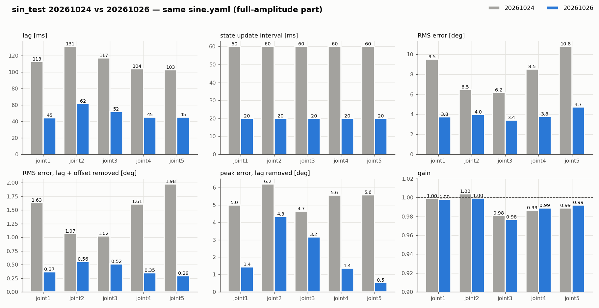
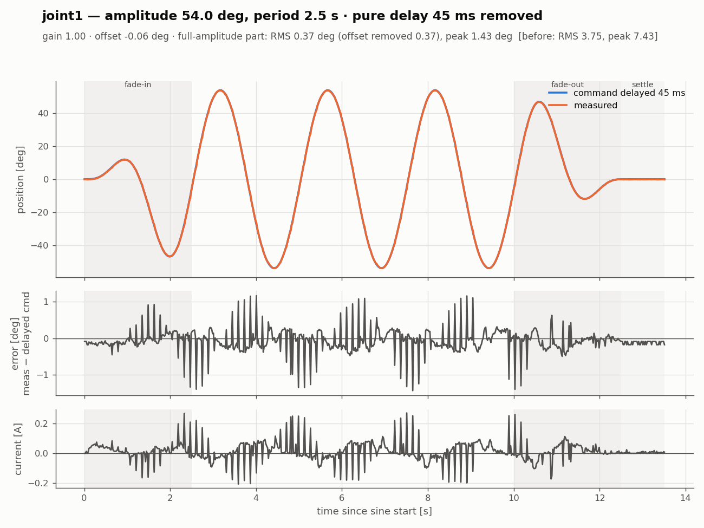
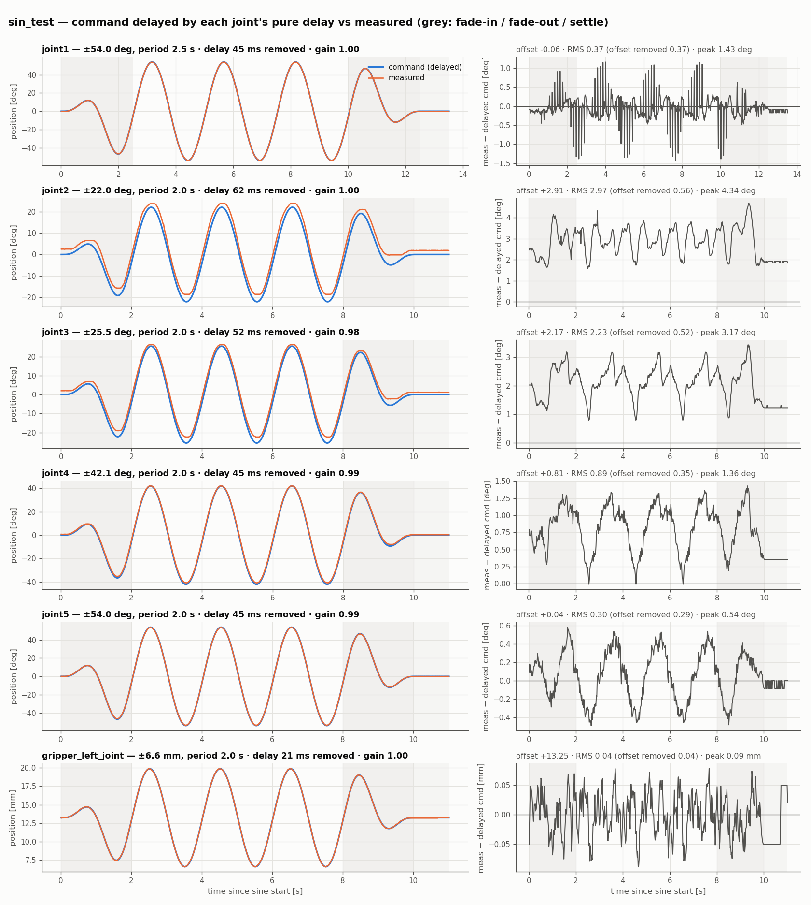

# 2026-10-26 펌웨어 통신 개선 전 → 후 (사인 응답)

10-24 시험에서 지연이 약 100 ms였고 측정값이 60 ms 계단으로 나왔다 (`20261024_worklog.md` 1·8장). 원인은 펌웨어 통신이었다.
펌웨어를 고친 뒤 10-26에 **같은 `config/sine.yaml`** 로 joint1~5와 그리퍼를 다시 측정했다.
진폭·주기·center 가 모두 같으므로 차이는 펌웨어 때문이다.

| | 전 (10-24) | 후 (10-26) |
|---|---|---|
| 서보 읽기·쓰기 | 서보 8 개를 패킷 하나씩 | **SyncRead**(전류·속도·위치 10 byte 연속) · **BulkWrite** 한 패킷 |
| 밀린 C(명령) | 들어온 C 를 모두 처리한 뒤 S(상태) 송신 | loop 한 번에 마지막 C 하나만 적용 |
| Return Delay Time | 기본 250 µs | 0 |
| S 주기 (`STATE_PERIOD_MS`) | 25 ms (C 50 Hz 면 실제 약 60 ms) | 10 ms |
| `controllers.yaml` `update_rate` | 50 Hz | 50 Hz (그대로) |

run: 전 `20261024_144242_joint1`, `144140_joint2`, `144204_joint3`, `141643_joint4`, `141703_joint5` / 후 `20261026_141202_joint1` ~ `141345_gripper_left_joint`

---

## 1. 한눈에

| 관절 | 지연 | 상태 갱신 | RMS (보정 전) | RMS (지연+오프셋 보정) | peak (지연 보정) | gain |
|---|---|---|---|---|---|---|
| joint1 | 113 → **45 ms** | 60 → **20 ms** | 9.52 → 3.75° | 1.63 → **0.37°** | 5.0 → 1.4° | 1.00 → 1.00 |
| joint2 | 131 → **62 ms** | 60 → 20 ms | 6.49 → 4.00° | 1.07 → 0.56° | 6.2 → 4.3° | 1.00 → 1.00 |
| joint3 | 117 → **52 ms** | 60 → 20 ms | 6.20 → 3.41° | 1.02 → 0.52° | 4.7 → 3.2° | 0.98 → 0.98 |
| joint4 | 104 → **45 ms** | 60 → 20 ms | 8.54 → 3.79° | 1.61 → 0.35° | 5.6 → 1.4° | 0.99 → 0.99 |
| joint5 | 103 → **45 ms** | 60 → 20 ms | 10.79 → 4.72° | 1.98 → 0.29° | 5.6 → 0.5° | 0.99 → 0.99 |
| 그리퍼 | 56 ms¹ → **21 ms** | — → 20 ms | — → 0.26 mm | — → 0.04 mm | — → 0.09 mm | 0.99¹ → 1.00 |

¹ 그리퍼는 10-24 에 같은 진폭(±6.6 mm) 시험이 없어 주기별 시험(±3 mm, 2 s, `freq/20261024_170501_gripper_left_joint_p2`) 값이다.

- 상태 갱신 = log.csv 에서 위치 값이 바뀌는 간격의 중앙값. 20 ms 는 로그 샘플 주기(50 Hz)와 같아서, 실제 갱신은 이보다 빠를 수 있다 (`idle_record.py` 로 확인 필요).
- RMS (보정 전) 는 지연이 대부분이라 지연이 줄어든 만큼 줄었다. 아직 3~5° 인 것도 남은 45~60 ms 지연 때문이다.

## 2. 계단이 없어졌다 (joint1, 지연 보정 후)

**전 (10-24, 113 ms 보정)** — 측정값이 60 ms 계단, 잔차 ±5°

**후 (10-26, 45 ms 보정)** — 측정값이 매끈하다, 잔차 대부분 ±0.3° 안

- 10-24 의 peak 오차 약 5° 는 "속도 × 계단 반 폭(30 ms)" 이었고, 계단이 없어지자 사라졌다.
- 후에도 **±1~1.4° 짜리 짧은 튐**이 속도가 큰 구간마다 남아 있다. 같은 시각에 전류도 튄다(최대 전류 0.18 → 0.27 A).
  측정 타이밍만의 문제라면 전류는 튀지 않아야 하므로, 서보 목표가 고르지 않게 들어가 실제로 움찔하는 것으로 추정한다 (확인 안 함).
  10 ms 어긋남 × 최고 속도 136°/s ≈ 1.4° 로 크기는 한 샘플 어긋남과 맞는다.

## 3. 모든 관절 (지연 보정 후)

**전 (10-24)**

**후 (10-26)**

- joint1·4·5: 지연을 빼면 잔차가 0.3~0.4° 로 엔코더 몇 tick 수준이다.
- joint2·3: 중력 처짐 오프셋(+2.9°, +2.2°)과 사인 모양 잔차가 그대로다. 통신과 무관한 마찰·백래시(worklog 3·4장)라 펌웨어로는 바뀌지 않는다.
  지연도 joint2·3 이 다른 관절보다 10~17 ms 더 크다. 마찰에 의한 일정 위상 지연(worklog 3장의 8.6°·5.9°)과 같은 원인이다.
- 그리퍼: 지연 21 ms, 잔차 0.04 mm. 팔보다 지연이 훨씬 작다.

## 4. 바뀌지 않은 것

- gain (0.98~1.00), 중력 오프셋(joint2 3.1 → 2.9°, joint3 2.2 → 2.2°, joint4 0.8 → 0.8°): 서보·기구 특성이다.
- 그리퍼 방향·영점·변환 계수 (worklog 5장): 이번 펌웨어에서 확인하지 않았다.

## 5. Isaac 에 반영할 값 (worklog 7장 갱신)

| 항목 | 전 | 후 |
|---|---|---|
| action → 관측 지연 | 약 100 ms (joint1 115 ms) | **약 45 ms**, joint2 60 ms · joint3 50 ms (마찰 몫 포함). 그리퍼 약 20 ms |
| 관측 갱신 | 60 ms zero-order hold | 20 ms 이하 (정확한 값은 idle_record 로) |
| stiffness · 마찰 · 질량 | — | 그대로 (변화 없음) |
