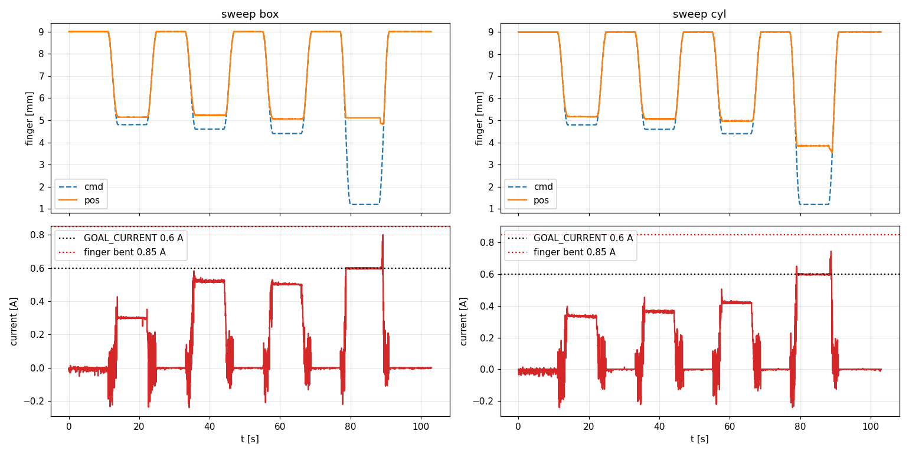
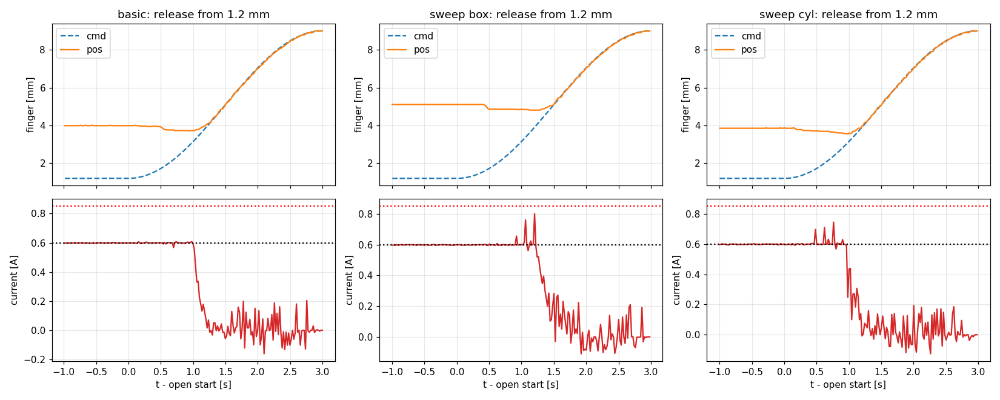

# 2026-10-28 그리퍼 퍽 그립 시험

Isaac 그리퍼(손가락당 8.3 N)를 실물 쥐는 힘에 맞추려고, 그리퍼 방향을 고친 펌웨어로 30 mm 퍽(원기둥·각진 퍽)을 쥐고 명령 위치별로 멈춘 위치와 서보 전류를 기록했다.
`gripper_left_joint` = 손가락 하나 [m], 0 = 닫힘, + = 열림. 손가락 간격 = 20 + 2 × 값 [mm], 30 mm 퍽 접촉 약 5 mm. 서보는 전류 기반 위치 모드, 접촉 뒤 0.6 A 에서 멈춤.
팔은 0° 자세, 샘플 50 Hz. 퍽은 열린 구간에 손으로 넣고, 쥐는 동안에는 아래만 받쳤다. 원본: `logs/profile/20261028_*_gripper_left_joint_hold_grip*/`.

| 시험 | 결론 |
|---|---|
| basic (9 → 1.2 → 9 mm) | 5.0~5.3 mm 에서 접촉, **3.99 mm·0.60 A(제한)** 에서 정지. 12 s 유지 중 위치 변화 0.02 mm 이내 |
| sweep 원기둥·각진 퍽 | 접촉 뒤 0.2~0.4 mm 만 더 명령해도 0.3 A → 제한 근처. **0.6 A 제한 ≈ 손가락 하나당 약 36 N** (KT 오차 고려 22~29 N) |
| 열 때 전류 튐 | 0.6 A 로 꽉 쥐었다 열면 세 번 모두 손가락이 0.3 mm 더 닫히고, 두 번은 **0.75~0.80 A** 까지 튐 |
| pull (당겨 빼기) | 제외. 유지력을 잴 도구가 없다 |

---

## 1. basic

10-24 와 같은 조건(열고 → 쥐고 → 열기)으로 새 펌웨어 방향의 기준값을 다시 잡았다.

### 결과

| 구간 | 명령 | 멈춘 위치 | 전류 |
|---|---|---|---|
| 열림 (퍽 넣기) | 9.00 mm | 9.00 mm | 0 A |
| 쥐기 | 1.20 mm | **3.99 mm** (간격 약 28 mm) | **0.60 A** (제한) |
| 다시 열기 | 9.00 mm | 9.00 mm | 0 A |

run `20261028_141905`. 같은 날 첫 run `140729` 은 설정이 옛 방향 그대로라 무효(9 mm 에서 접촉 없음, 2 mm 에서 4.35 mm·0.60 A).

### 분석

- 닫히는 중 5.0~5.3 mm 에서 닿고 3.99 mm 에서 멈췄다. 접촉 뒤 약 1 mm 더 들어가 패드가 눌린 것이다.
- 유지 12 s 동안 위치 변화 0.02 mm 이내로, 0.6 A 에서 퍽이 미끄러지지 않았다.
- 멈춘 위치가 sweep 원기둥의 1.2 mm 단계(3.85 mm)와 비슷해 원기둥으로 추정한다(퍽 종류 기록 없음).

---

## 2. sweep

명령을 접촉점 너머로 조금씩 더 줄 때 전류(= 쥐는 힘)가 어떻게 오르는지 보려고, 퍽 종류별로 4 단계를 쥐었다.

### 결과

| 명령 | 원기둥: 멈춘 위치 / 전류 / 힘 | 각진 퍽: 멈춘 위치 / 전류 / 힘 |
|---|---|---|
| 4.8 mm | 5.17 mm / 0.33 A / 20 N | 5.14 mm / 0.30 A / 18 N |
| 4.6 mm | 5.08 mm / 0.36 A / 22 N | 5.22 mm / 0.52 A / 31 N |
| 4.4 mm | 4.97 mm / 0.42 A / 25 N | 5.06 mm / 0.50 A / 30 N |
| 1.2 mm | **3.85 mm** / 0.60 A / 36 N | **5.11 mm** / 0.60 A / 36 N |

단계별 유지 구간 평균(앞 1/3 정착 구간 제외), 단계마다 9 mm 로 열었다 다시 쥠. 힘 = 손가락 하나당 `force_N_est` = 전류 × 59.5 N/A
(KT 4.1/2.3 Nm/A ÷ 접촉 근처 간격 기울기 29.9 mm/rad, 펌웨어 표 손가락 3.5 → 5 mm = 서보 0.600 → 0.4998 rad).

### 분석

- **원기둥은 명령을 0.2 mm 줄일 때마다 전류가 0.33 → 0.36 → 0.42 A 로 고르게 오른다.** 힘 추정에는 이 데이터가 깨끗하다.
- **각진 퍽은 4.6 / 4.4 mm 의 전류 순서가 뒤바뀌었다.** 다시 넣을 때마다 퍽 위치가 0.1~0.2 mm 씩 달라져, 그 차이가 단계 간격(0.2 mm)과 비슷하다.
- **같은 0.6 A 에서 원기둥은 3.85 mm 까지, 각진 퍽은 5.11 mm 에서 멈춘다.** 둥근 면이 미끄러지며 자리를 잡거나 패드가 더 눌린다. 각진 퍽은 퍽 크기와 거의 같은 지점에서 단단히 막힌다.
- 실제 쥐는 힘은 "약하게(0.3 A)"와 "제한(0.6 A)" 두 단계 정도로만 나뉜다. coordinator 처럼 완전히 닫으면(`GRIPPER_CLOSED_M` = 0) 항상 0.6 A 다.
- **0.6 A 는 손가락 하나당 약 36 N 으로 시뮬 그리퍼(8.3 N)의 약 4 배다.** KT 가 0.6~0.8 배 과대일 수 있어 실제는 22~29 N 범위로 본다. 시뮬 시험(2장)에서 25·38 N 이면 원통 성공률이 75~80 % 로 떨어진 범위다.
- pull 시험이 빠져 힘은 이 전류 추정에만 의존한다.

---

## 3. 완전히 닫았다가 열 때의 전류 튐

sweep 기록에서 꽉 쥔 뒤 열 때 전류가 제한값을 넘는 것이 보여, 쥐었다 여는 순간을 모두 뽑아 비교했다.

### 결과

| run | 쥐고 있던 명령 | 열기 직전 전류 | 최대 전류 | 손가락이 더 닫힌 양 |
|---|---|---|---|---|
| basic | 1.2 mm | 0.60 A | 0.608 A | −0.28 mm |
| sweep box | 4.8 / 4.6 / 4.4 mm | 0.30 / 0.52 / 0.50 A | 0.35 / 0.53 / 0.50 A | 0 |
| sweep box | **1.2 mm** | 0.60 A | **0.802 A** | **−0.30 mm** |
| sweep cyl | 4.8 / 4.6 / 4.4 mm | 0.34 / 0.37 / 0.42 A | 0.34 / 0.37 / 0.42 A | 0 |
| sweep cyl | **1.2 mm** | 0.60 A | **0.745 A** | **−0.32 mm** |

열기 시작 뒤 1.5 s 안.

### 분석

- **조금만 쥐었을 때(4.4~4.8 mm, 0.3~0.5 A)는 열 때 튀지 않는다.**
- **0.6 A 제한에 걸려 있던 세 번은 모두 열기 시작 약 0.45 s 뒤 손가락이 0.3 mm 더 닫혔고**, 두 번은 0.5~1.2 s 사이에 0.75~0.80 A 까지 튀었다.
- 그동안 명령은 1.2 mm 에서 천천히 올라가는 중이라 아직 실제 위치(3.9~5.1 mm)보다 안쪽이다. 서보 입장에서는 계속 "닫아라"인 채로 더 조여진다. 명령이 실제 위치를 지나면 전류가 떨어지고 손가락이 열린다.
- 원인 후보(확인 안 됨): 목표 위치가 바뀌는 순간 Present Current 가 Goal Current 상한을 잠깐 넘음 / 펌웨어가 매 주기 Goal Position 을 다시 씀 / 받치던 손의 영향.
- coordinator 는 0(완전히 닫힘)으로 쥐므로 **퍽을 놓을 때마다 생길 가능성이 높다.** 0.3 s 정도의 짧은 튐이고 0.85 A(손가락이 휜 값) 아래지만 여유가 크지 않다. 퍽 없이 끝까지 닫았다 여는 시험으로 손 영향을 빼고 다시 확인해야 한다.
