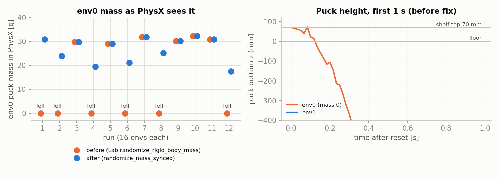
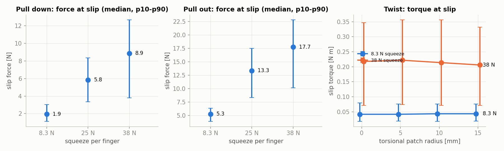
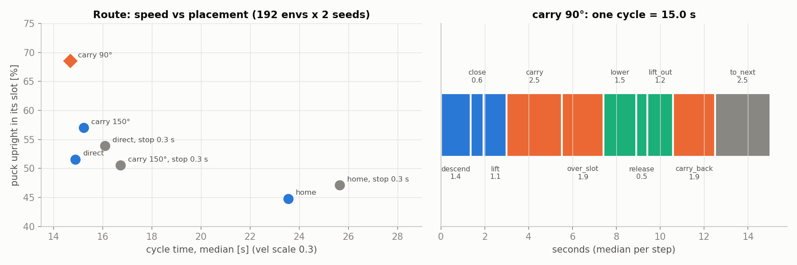
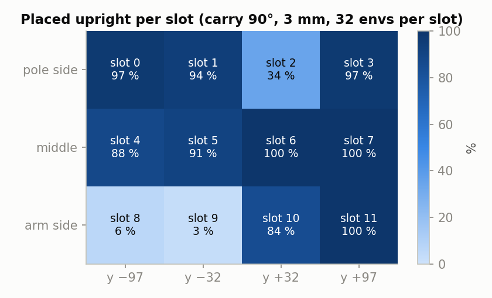
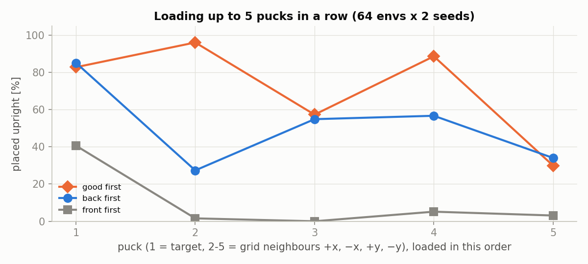

# 2026-10-27 scripted pick 시뮬 시험

11/1 에 "잔차 RL 이 필요한가"(기준 동작당 약 97 %)를 판단하기 전에, 실물 데이터 없이 시뮬에서 할 수 있는 pick·바구니 시험을 한 번에 했다.

Isaac Lab 6.1, `scripts/pick_sm.py`·`cycle_sm.py` 의 스크립트 pick(접근 → 내려가기 → 쥐기 → 들기 → 기본 자세).
성공 = 기본 자세에서 퍽이 선반 위 30 mm 이상, 손끝에서 50 mm 안. 따로 적지 않으면 env 256 개, seed 2~3 개, 랜덤화(퍽 위치·yaw·종류·질량·마찰, 손가락 마찰, 인식 노이즈 5 mm·10°) 켬.
도표와 표는 `python3 make_figs.py` 로 `data/` 에서 다시 만든다.

| 시험 | 결론 |
|---|---|
| 1. env0 퍽 낙하 | **Isaac Lab 6.1 질량 랜덤화 버그.** 실행의 절반에서 env0 퍽 질량이 0 이 되어 바닥을 뚫는다. 수정 후 0/12 |
| 2. 그리퍼 힘 × 비틀림 | 8.3 N 에서 98~99 %. **25·38 N 이면 원통 퍽만 75~80 %.** 비틀림 반지름은 영향 없음 |
| 3. 당겨 빼기 | 빠지는 힘은 쥐는 힘에 비례. 8.3 N 기준 아래 1.9 N, 바깥 5.3 N, 비틀기 0.04 N m |
| 4. 제어 주기 | **100 Hz 에서 100 %** (60 Hz 98.3 %). 지연을 넣어도 99.9 % |
| 5. 랜덤화 | **옆 퍽 간격**이 가장 크다. 열림 40 mm 에서 간격 50 mm 이상이면 95 % 이상. 모두 켜면 95.7 % |
| 6. 원통 대각선 집기 | 옆 퍽 50 mm 에서 원통 92.6 → **98.8 %**. 모두 켠 조건 95.7 → **97.3 %** |
| 7. 바구니 넣기 | 기둥 쪽 줄은 **20° 기울임 + joint5 −90°** 일 때만 들어간다(12/16). 나머지 줄은 놓은 뒤 쓰러짐 |
| 9. 박스 면 선택 | 옆 퍽이 없는 쪽 면을 고르면 **오히려 나빠진다**(박스 97.1 → 94.3 %) |
| 10. 바구니 놓기·손 빼기 | 47 → **68 %**. 손 안 위치 보정, 기본 자세 생략이 효과. 남은 실패는 대부분 놓은 뒤 쓰러짐 |
| 11. pick → 바구니 경로 | **운반 자세 90°, 멈춤 없이**가 가장 빠르고(14.7 s) 잘 들어간다(68 %). 기본 자세 경유 23.6 s, 45 % |
| 12. 놓는 높이·칸별 | 3 mm 위에서 놓으면 74 %. **칸 2·8·9 만 3~34 %**, 나머지 9 칸 84~100 % |
| 13. 연속 적재 (퍽 5 개) | 칸 2·8·9 를 뒤로 미루면 73.5 %. 팔 쪽 줄부터 채우면 12 % |

(8. 바구니 → 주사위 칸 놓기는 asset 이 없어 하지 않았다. 장 번호는 다른 문서의 참조 때문에 그대로 둔다.)

---

## 1. env0 퍽 낙하

가끔 env0 퍽만 바닥을 뚫고 사라지며 팔이 꺾였다. 스크립트 문제인지 시뮬 문제인지 가려야 이후 성공률을 믿을 수 있어서 원인부터 찾았다.

### 결과

| | 실행 (env 16 개) | env0 질량 0 | 낙하 |
|---|---|---|---|
| 수정 전 (Lab `randomize_rigid_body_mass`) | 12 | 6 | 6 |
| 수정 후 (`randomize_mass_synced`) | 12 | 0 | 0 |

수정 후 질량은 모든 env 에서 14.2~32.5 g 으로 랜덤화됐다.

### 분석

- 떨어진 실행은 모두 PhysX 의 env0 질량이 0 이었다. 질량 0 은 무한 질량이라 선반·바닥이 밀어내지 못한다.
- 원인은 Lab 6.1 `set_masses_index` 가 GPU → CPU 비동기 복사 뒤 동기화 없이 PhysX 에 넘기는 것이다. 관성도 같은 구조다.
- **수정 전 성공률(10-27 오전 99.6 % 등)은 질량 랜덤화가 켜지고 꺼진 상태가 섞인 값이다.** 아래 결과는 모두 수정 후다.

---

## 2. 그리퍼 힘 × 비틀림 patch 반지름

시뮬 그리퍼는 손가락당 8.3 N, 실물 추정은 25~38 N 이다. 실측 전에 그 범위에서 성공률이 어떻게 바뀌는지, 고무 패드를 흉내 낸 비틀림 반지름이 효과가 있는지 봤다.

### 결과

| 쥐는 힘 (손가락 하나) | 0 mm | 5 mm | 10 mm | 15 mm |
|---|---|---|---|---|
| 8.3 N | 99.1 | 98.7 | 98.3 | 98.7 |
| 25 N | 80.1 | 80.1 | 78.4 | 80.3 |
| 38 N | 74.6 | 75.0 | 75.0 | 75.4 |

열은 비틀림 반지름, 단위 %, seed 3 개 평균. 38 N 에서 박스 100 %, 원통 45~53 %(seed 1). 38 N 에서 damping 10 → 400 이어도 74.6 → 73.8 %.

### 분석

- **세게 쥘수록 나빠지고, 실패는 원통뿐이다.** 실패한 원통은 쥐는 동안 손끝이 평균 9.3 mm 밀렸다(성공 4.3 mm). 둥근 면을 세게 조이면 팔(관절 stiffness 20 Nm/rad)이 옆으로 밀리고 퍽이 빠진다.
- 닫는 충격 때문은 아니다(damping 을 바꿔도 같음).
- 비틀림 반지름은 성공률에도, 3장의 비틀기 토크에도 영향이 없다. 값이 PhysX 에 실제로 들어갔는지는 확인하지 않았다.
- 실물 추정 힘(25~38 N)이 맞다면 시뮬은 원통에서 실패를 예측한다. 실물에서 원통이 빠지지 않으면 시뮬 쪽(손가락·원통 충돌 형상, 팔 stiffness)을 의심한다.

---

## 3. 시뮬 당겨 빼기

실물 `grip_test pull` 과 비교할 시뮬 기준값을 만들려고, 쥔 퍽을 세 방향(down / out / twist)으로 당겨 빠지는 힘을 쟀다.

### 결과

| 방향 | 8.3 N | 25 N | 38 N |
|---|---|---|---|
| down [N] | 1.9 (1.1~3.0) | 5.8 (3.3~8.3) | 8.9 (3.8~12.7) |
| out [N] | 5.3 (3.9~6.4) | 13.3 (8.3~17.5) | 17.7 (10.1~22.8) |
| twist [N m] | 0.043 (0.018~0.076) | | 0.214 (0.071~0.356) |

기본 자세에서 4 s 동안 힘을 키우고 퍽이 5 mm 또는 10° 움직인 순간의 값. 중앙값 (p10~p90), 비틀림 반지름 10 mm, seed 1.

### 분석

- 빠지는 힘은 쥐는 힘에 거의 비례한다.
- down 은 이론값(2 × μ × F)의 약 1/7 이다. 기본 자세에서 퍽이 수평으로 물려, 아래로 당기면 손가락 끝 쪽으로 기울며 빠진다.
- 8.3 N 의 down 중앙값 1.9 N 은 퍽 무게(약 0.25 N)의 약 8 배지만, p10 1.1 N 이면 급정거·충격에서 빠질 수 있다.

---

## 4. 제어 주기 60 Hz → 100 Hz

env 는 60 Hz, 실물 배포는 100 Hz 다. 주기가 다르면 시뮬 결과를 그대로 옮길 수 없어서, 주기와 실측 명령 지연을 바꿔 성공률을 비교했다.

### 결과

| 조건 | seed 1 | seed 2 | seed 3 | 평균 |
|---|---|---|---|---|
| 60 Hz | 99.2 | 98.0 | 97.7 | 98.3 |
| 60 Hz + 지연 | 97.3 | 98.4 | 99.6 | 98.4 |
| 100 Hz | 100.0 | 100.0 | 100.0 | 100.0 |
| 100 Hz + 지연 | 100.0 | 99.6 | 100.0 | 99.9 |

지연 = 실측 명령 지연 50~67 ms(60 Hz) / 50~60 ms(100 Hz).

### 분석

- 100 Hz 가 더 좋다. sim dt 가 1/120 → 1/200 s 로 작아져 쥐는 접촉이 안정해진 것으로 본다. 60 Hz 실패 13 개는 모두 원통이 기본 자세로 돌아오는 길에 빠졌다.
- 지연은 두 주기 모두 영향이 거의 없다. 궤적이 단계마다 1.5~3 s 로 느리다.
- 실물 배포 주기(100 Hz)와 맞추려면 env 기본값을 100 Hz 로 바꿔야 한다.

---

## 5. 랜덤화 추가

시뮬에 빠져 있던 실제 조건(옆 퍽, 실물 열림 폭 40 mm, 지연 흔들림, 정지 위치 오차)을 하나씩 넣고 마지막에 모두 켰다. 무엇이 성공률을 가장 깎는지 알아야 고칠 순서를 정할 수 있다.

### 결과

**옆 퍽** (목표 퍽 앞뒤좌우 4 개, 중심 간격):

| 간격 | 열림 66 mm 성공 | 옆 퍽 친 env | 열림 40 mm 성공 | 옆 퍽 친 env |
|---|---|---|---|---|
| 40 mm | 28.3 | 35.7 | 32.4 | 53.1 |
| 50 mm | 54.9 | 52.0 | 94.7 | 24.8 |
| 60 mm | 95.7 | 26.0 | 99.0 | 3.9 |
| 70 mm | 98.6 | 1.4 | 98.6 | 0.6 |

단위 %, seed 2 개 평균. 옆 퍽 친 env = 옆 퍽이 10 mm 넘게 밀린 비율. 시뮬 손가락은 끝까지 열면 66 mm, 실물은 38~40 mm.

**나머지 하나씩, 그리고 모두:**

| 조건 | 성공 % (seed 별) | 평균 |
|---|---|---|
| 기준 (60 Hz) | 99.2 · 98.0 · 97.7 | 98.3 |
| 열림 40 mm | 98.0 · 98.0 · 98.8 | 98.3 |
| 지연 + 흔들림 ±20 ms | 98.8 · 98.4 · 99.6 | 99.0 |
| 정지 위치 오차 ±10 mm | 98.8 · 98.8 | 98.8 |
| 정지 위치 오차 ±20 mm | 98.0 · 98.0 | 98.0 |
| 정지 위치 오차 ±30 mm | 84.8 · 92.6 | 88.7 |
| **모두, 8.3 N** | 94.9 · 94.1 · 98.0 | **95.7** |
| **모두, 38 N** | 87.1 · 87.5 · 90.2 | **88.3** |

모두 = 100 Hz + 지연 + 흔들림 20 ms + 열림 40 mm + 옆 퍽 50 mm + 정지 위치 오차 ±10 mm.

### 분석

- **옆 퍽 간격이 가장 크다.** 실물 폭(40 mm)이면 중심 간격 50 mm(틈 20 mm) 이상에서 95 % 이상, 40 mm(틈 10 mm)는 30 % 안팎이다.
- 실물처럼 40 mm 만 열면 시뮬 66 mm 보다 옆 퍽을 덜 친다. 옆 퍽이 없으면 두 폭 모두 98.3 % 다.
- 정지 위치 오차는 ±20 mm 까지 괜찮다. ±30 mm 실패의 절반 이상은 퍽이 몸통 쪽 한계(x 0.12 m) 안으로 들어온 경우다. 실물 정지 정확도가 ±20 mm 안이어야 한다.
- 모두 켜면 95.7 % 로 기준 97 % 바로 아래다. 대부분 옆 퍽 50 mm 에서 온다. 38 N 이면 2장의 원통 문제가 더해져 88.3 % 다.
- 쓰러진 퍽과 관측 지연은 넣지 않았다.

---

## 6. 원통 퍽 대각선 집기

5장에서 옆 퍽이 가장 큰 원인이었다. 원통은 어느 방향으로 잡아도 되므로, 손가락을 격자 대각선(옆 퍽까지 1.41 배)으로 닫으면 나아지는지 봤다.

### 결과

| 조건 | 박스 전 / 후 | 원통 전 / 후 | 전체 전 / 후 |
|---|---|---|---|
| 옆 퍽 50 mm, 열림 40 mm | 96.9 / 96.9 | 92.6 / **98.8** | 94.7 / 97.9 |
| 옆 퍽 40 mm, 열림 40 mm | 37.1 / 35.9 | 27.7 / 56.6 | 32.4 / 46.3 |
| 모두 (5장과 같음) | 95.6 / 95.6 | 95.8 / **99.0** | 95.7 / **97.3** |

원통만 손가락이 선반 격자의 대각선(옆 퍽까지 1.41 배)으로 닫히게 yaw 를 골랐다(`--diag`).

### 분석

- 실제와 가까운 조건을 모두 켜도 **97.3 %** 로 기준(97 %)을 넘는다.
- 남은 실패는 대부분 박스다. 박스는 면을 잡아야 해서 손가락이 바로 옆 퍽 쪽으로 벌어질 수 있다.
- 틈 10 mm(40 mm 간격)는 대각선이어도 절반이다. 그 간격이면 집는 방식 자체를 바꿔야 한다.

---

## 7. 바구니 넣기

pick 다음 단계인 로봇 위 바구니 12칸 넣기를 처음 시험했다. 칸마다 그리퍼가 닿는지, 기둥 쪽 줄에 어떤 손목 방향이 맞는지 확인하려는 것이다.

### 결과

**닿는 높이 (오프라인 IK, 그리퍼 수직).** 퍽을 칸 벽(35 mm) 너머로 옮기려면 퍽 바닥이 칸 바닥보다 약 40 mm 위에 있어야 한다.

| 줄 | 칸 | 최대 높이 (수직) | 20° 기울이면 |
|---|---|---|---|
| 기둥 쪽 (x −0.17) | 0 ~ 3 | 0 ~ 10 mm (모서리 칸은 바닥도 5 mm 모자람) | 75 ~ 80 mm |
| 가운데 (x −0.10) | 4 ~ 7 | 45 ~ 60 mm | |
| 팔 쪽 (x −0.04) | 8 ~ 11 | 65 mm | |

**칸 × 손목 방향** (100 Hz, 열림 40 mm, 칸 × 옵션마다 env 4 개):

| 줄 | +0 (joint5 0°) | +90 (−90°) | +180 (180°) | +270 (+90°) |
|---|---|---|---|---|
| 기둥 쪽 0 ~ 3 | 0/16 | **12/16** | 1/16 | 5/16 |
| 가운데 4 ~ 7 | 11/16 | 11/16 | 12/16 | 10/16 |
| 팔 쪽 8 ~ 11 | 8/16 | 8/16 | 7/16 | 5/16 |

성공 = 퍽이 칸 중심 ±20 mm, 바닥 ±15 mm 안에 20° 미만으로 서 있음.

### 분석

- **기둥 쪽 줄은 joint4 상한(+113°) 때문에 그리퍼를 세울 수 없고, 20° 기울여야 닿는다.**
- **기둥 쪽 줄은 손목 방향이 결정적이다.** 손가락이 팔 방향으로 닫히는 joint5 −90° 만 된다. "뒤쪽 줄은 손목 180°" 예상과 달랐다. 실물 joint5 영점·방향이 시뮬과 같은지 확인한 뒤 비교해야 한다.
- 가운데·팔 쪽 줄은 손목 방향과 상관없이 50~75 % 다. 실패는 놓은 뒤 손가락이 퍽을 건드려 넘어뜨리는 것이다.
- 기둥 쪽 줄에서 기본 자세로 돌아갈 때 20 개가 기둥에 걸렸다(그중 17 개 실패). 관절 공간 직선 보간이 팔을 기둥 쪽으로 쓸고 지나간다. 손을 뺀 뒤 기둥을 피하는 경로가 필요하다(10장).
- 칸 하나에 env 4 개라 칸 단위 숫자는 거칠다. 줄 단위로 읽는다.

---

## 9. 박스 면 선택 (`--box_clear`)

6장의 박스 버전이다. 박스는 면을 잡아야 해서 손가락 축이 두 방향뿐이다. 둘 중 옆 퍽 여유가 큰 쪽을 고르면 나아지는지 봤다.

### 결과

| 조건 | 박스: 지금 규칙 | 박스: `--box_clear` | 전체: 지금 / `--box_clear` |
|---|---|---|---|
| 옆 퍽 50 mm | 97.1 | 94.3 | 97.4 / 96.0 |
| 옆 퍽 40 mm | 35.7 | 29.4 | 47.0 / 44.0 |
| 모두 (5장 + 원통 대각선) | 95.6 | 90.6 | 97.3 / 94.8 |

지금 규칙 = 팔 방향에 가까운 면 쌍(손목 회전 45° 이하). `--box_clear` = 손가락 축 방향으로 옆 퍽 여유가 큰 면 쌍. 박스 128 개 중 22~38 개가 바뀌었다.

### 분석

- **나빠졌다.** 면 쌍을 바꾼 박스(손목 회전 45° 초과)는 72~73 %, 바꾸지 않은 박스는 96~98 % 다.
- 팔은 목표에 잘 닿았다(손끝 오차 중앙값 0.5~0.7 mm). 실패는 쥐고 들어 올리는 단계다(들어 올림 69~72 %).
- 손목을 90° 돌리면 그리퍼 몸체와 손목 카메라 방향도 바뀐다. 그쪽이 옆 퍽에 걸리는 것으로 본다(직접 확인하지 않음). 다시 시도하려면 그리퍼 전체 발자국으로 여유를 재야 한다.

---

## 10. 바구니 놓기·손 빼기 개선

7장의 남은 실패(놓은 뒤 쓰러짐, 돌아갈 때 기둥에 걸림)를 줄이려고 놓는 방법, 손 빼는 경로, 손 안 위치 보정, 기본 자세 생략을 하나씩 더했다.

### 결과

| 방식 | 기둥 쪽 | 가운데 | 팔 쪽 | 전체 | 손 안 오차 p90 |
|---|---|---|---|---|---|
| 첫 버전 (7장, `direct`) | 28 | 69 | 44 | 47 % (90/192) | |
| 바닥 놓기 + 접기 (`fold`) | 44 | 59 | 33 | 45 % (87/192) | 37 mm |
| + 손 안 보정 | 56 | 75 | 59 | 64 % (122/192) | 37 mm |
| + 기본 자세 생략 | 44 | 75 | 53 | 57 % (110/192) | 6 mm |
| + 보정 + 기본 자세 생략 | 52 | 81 | 72 | **68 % (131/192)** | 6 mm |

줄마다 64 개, 100 Hz, 열림 40 mm, seed 1. 같은 설정을 다시 돌리면 ±10 개 정도 달라진다(GPU 비결정성).

### 분석

- 놓기·빼기 방식만 바꿨을 때(`fold`)는 첫 버전과 비슷했다. 효과가 큰 것은 **손 안 위치 보정**(+35 개)과 **기본 자세 생략**이다.
- 칸 안쪽 45 mm, 퍽 30 mm 라 여유가 ±7.5 mm 뿐이다. 보정 없이는 손 안 위치가 7~10 mm 어긋나 벽 위에 얹힌다.
- 기본 자세에서는 퍽이 수평으로 물려 무게로 손가락 축을 중심으로 돈다(손 안 오차 p90 37 mm). 들어 올린 뒤 바로 바구니로 가면 6 mm 다.
- 15 mm 위에서 놓으면 퍽이 약 30° 기울어 열린 손가락(40 mm) 사이에 대각선(약 56 mm)으로 끼어 같이 올라왔다.
- 남은 실패 61 개의 대부분은 놓은 뒤 쓰러짐이다. 원인 후보는 기운 채 놓이는 것(기둥 쪽 줄은 −10~−15°)과 손가락이 열릴 때 퍽을 미는 것이다.
- 시뮬에서 퍽이 손 안에서 쉽게 도는 것은 실물 고무 패드와 다를 수 있다.

---

## 11. pick → 바구니 한 사이클: 경로 비교

기본 자세를 기준점으로 바구니 궤적을 미리 계산하려는 계획이 실제로 시간을 아끼는지 보려고, 경로 3 가지와 경유점 멈춤 여부별로 시간과 성공률을 쟀다.

### 결과

| 경로 | 칸에 들어감 (seed 1, 2) | 줄별 기둥 / 가운데 / 팔 | 걸림 | 사이클 중앙값 |
|---|---|---|---|---|
| 바로 가기 | 50.0, 53.1 | 43 / 65 / 47 | 33 % | 14.9 s |
| 바로 가기, 멈춤 0.3 s | 53.6, 54.2 | 44 / 68 / 50 | 37 % | 16.1 s |
| 운반 자세 150° | 54.7, 59.4 | 41 / 84 / 45 | 13 % | 15.2 s |
| 운반 자세 150°, 멈춤 0.3 s | 50.5, 50.5 | 33 / 73 / 45 | 17 % | 16.7 s |
| 기본 자세 | 44.8, 44.8 | 62 / 53 / 20 | 34 % | 23.6 s |
| 기본 자세, 멈춤 0.3 s | 46.9, 47.4 | 63 / 53 / 25 | 35 % | 25.7 s |
| **운반 자세 90°** | **68.8, 68.2** | 74 / 85 / 46 | 13 % | **14.7 s** |

사이클 = 퍽 위 → 집기 → 운반 → 칸에 놓기 → 다음 퍽 위. 팀 MoveIt 관절 한계 × 0.3, MoveIt 계획 시간 제외. 걸림 = 관절 명령과 실제 차이 10° 초과. env 192 개, seed 2 개, 100 Hz, 지연, 열림 40 mm, 손 안 보정.

운반 자세 90° 사이클 구성(중앙값): 내려가기 1.4, 쥐기 0.6, 들기 1.1, 운반 2.5, 칸 위 1.9, 내려놓기 1.5, 놓기 0.5, 손 빼기 1.2, 운반 자세로 1.9, 다음 퍽 2.5 s.

### 분석

- **기본 자세를 들르면 약 9 s 더 걸리고 덜 들어간다.** 계획 시간(0.1~0.3 s)을 아끼는 것보다 이동이 훨씬 길다. 기본 자세에서 퍽이 손 안에서 도는 문제(10장)도 그대로다.
- **운반 자세 90°(로봇 옆)가 바로 가기보다 빠르면서 잘 들어간다.** 칸에 늘 같은 방향으로 들어가 걸림이 33 → 13 % 로 준다. 150° 는 팔 쪽 줄 위를 지나 그쪽 칸이 나쁘다.
- **경유점마다 0.3 s 멈추면 시간만 1.2~1.5 s 늘고 성공률은 그대로거나 낮다.**
- 온라인 계획 수는 세 경로 모두 같다(선반 쪽 2 번). 미리 계산으로 줄일 수 있는 것은 바구니 쪽 구간뿐이다.
- 선정: 운반 자세 90°, 연속 동작. 12·13장은 이 설정이다.

---

## 12. 놓는 높이·놓는 폭, 칸별 결과

11장에서 고른 설정에도 실패가 30 % 남았다. 놓는 높이·여는 폭·손목 방향으로 원인을 나누고, 13장의 채우는 순서를 정하려고 칸별 성공률을 쟀다.

### 결과

| 놓는 방식 | 칸에 들어감 | 줄별 기둥 / 가운데 / 팔 | 팔 쪽 실패 중 손에 남음 |
|---|---|---|---|
| 칸 바닥에 닿게 내려놓고 놓기 (11장) | 69 % | 72 / 89 / 45 | 32 |
| **바닥 3 mm 위에서 놓기** | **74 %** | 78 / 94 / 52 | 28 |
| 손가락을 66 mm 까지 열기 (시뮬만 가능) | 72 % | 78 / 89 / 50 | 1 |
| 3 mm + 66 mm | 76 % | 75 / 95 / 56 | 0 |
| 3 mm + 손목 좌우 대칭 | 72 % | 73 / 94 / 48 | 30 |

운반 자세 90°, 퍽 하나, env 192 개, seed 1.

**칸별** (3 mm, seed 2 개, 칸마다 32 개):

| | y −97 | y −32 | y +32 | y +97 |
|---|---|---|---|---|
| 기둥 쪽 | 0: 97 | 1: 94 | **2: 34** | 3: 97 |
| 가운데 | 4: 88 | 5: 91 | 6: 100 | 7: 100 |
| 팔 쪽 | **8: 6** | **9: 3** | 10: 84 | 11: 100 |

### 분석

- 팔 쪽 줄 실패의 대부분은 손을 뺀 뒤에도 퍽이 40 mm 손가락 사이에 끼어 같이 올라온 것이다. 66 mm 로 열면 없어지지만 실물은 40 mm 까지만 열린다.
- 3 mm 위에서 놓기는 실물에서도 가능해 기본값으로 쓴다.
- **실패는 칸 2·8·9 에 몰린다.** 나머지 9 칸은 84~100 %(평균 약 94 %)다.
- (10-28 정정) 이 시험은 칸을 env i → i % 12로 정해서 칸마다 퍽 종류가 고정돼 있었다(칸 8·9 직육면체, 10·11 원통). 칸마다 네 종류를 넣어 다시 재면 팔 쪽 줄은 좌우 상관없이 직육면체 0~6 %, 원통 88 %다. 칸 2는 손목 카메라 충돌이다. `../20261028_retest` 4장 참고.
- 8·9 와 대칭인 10·11 은 잘 된다. IK 해는 좌우 대칭이었고(8: joint1 −133°, 11: +133°) 손목을 대칭으로 돌려도 그대로였다. 원인은 모른다. 다음 후보는 좌우가 다른 충돌체(몸체 메시, 바퀴, 케이블)와 그리퍼 충돌체다.
- 칸 2 도 대칭인 1 이 94 % 라 같은 종류의 문제로 보인다.

---

## 13. 연속 적재 (선반 퍽 5 개 → 바구니)

한 퍽씩 할 때는 안 보이는 문제(이미 넣은 퍽이 방해하는지, 앞선 집기가 남은 퍽을 흐트러뜨리는지, 채우는 순서의 영향)를 보려고 퍽 5 개를 차례로 실었다.

### 결과

| 순서 | 퍽별 집기 / 넣기 % (env 수) | 전체 집기 | 전체 넣기 | 마지막까지 칸에 남음 | 사이클 |
|---|---|---|---|---|---|
| **good first** | 98/83 (128) · 97/96 (128) · 84/57 (82) · 90/89 (97) · 30/30 (97) | 81.6 | **73.5** | **69.0** | 14.6 s |
| back first | 98/85 · 95/27 · 87/55 · 74/57 · 39/34 | 80.5 | 52.1 | 52.1 | 14.8 s |
| front first | 98/41 · 60/2 · 12/0 · 5/5 · 3/3 | 41.4 | 11.7 | 12.0 | 15.0 s |

선반에 목표 퍽 + 앞뒤좌우 4 개(간격 50 mm), 순서 목표 → +x → −x → +y → −y. good first = 칸 0, 1, 3, 4, 5, 6, 7, 10, 11, 2, 8, 9 / back first = 기둥 쪽 줄부터 / front first = 팔 쪽 줄부터. env 64 개 × seed 2 개.

### 분석

- **나쁜 칸을 피하면 연속 적재도 한 퍽과 비슷하다**(73.5 %). 이미 넣은 퍽이 나중 적재에 밀려 빠지는 경우는 4.5 %p 다.
- back first 는 둘째 퍽이 칸 2 로 가서 거의 다 걸린다(12장의 칸 2 문제).
- front first 는 첫 퍽이 칸 9 에서 손에 남아 다음 집기를 막고 연쇄로 실패한다. **퍽이 손에 남았는지 확인하고 멈추는 단계가 필요하다.**
- **나중 퍽일수록 집기가 떨어진다**(98 % → 마지막 30 %). 앞선 집기에서 손가락이 옆 퍽을 밀었거나, −x(몸 쪽) 이후 위치가 몸통 쪽 한계에 가까운 탓으로 본다. 나누어 보지 않았다.
- 퍽 5 개면 팔 동작만 약 73 s 다(속도 0.3 배).

---

## 종합 (11/1 RL 판단)

- 스크립트 pick 은 실제와 가까운 조건을 모두 켜고 원통 대각선 집기를 쓰면 **97.3 %** 다. 옆 퍽 간격과 그리퍼 힘에 따라 88~100 % 사이로 움직인다.
- 성공률을 가르는 것은 **옆 퍽 간격, 그리퍼 힘(원통), 제어 주기**다. 지연과 정지 위치 오차(±20 mm 안)는 거의 영향이 없다. 셋 다 RL 보다 설정과 실측으로 먼저 정할 수 있다.
- 바구니 넣기는 운반 자세 90° + 3 mm 놓기로 74 % 다. 실패는 칸 2·8·9 에 몰려 있고 나머지 9 칸은 평균 약 94 % 다. 이 세 칸의 원인이 RL 보다 먼저다.
- 기본 자세를 기준점으로 쓰면 시간 손해다(23.6 s vs 14.7 s). 기준점은 로봇 옆 운반 자세가 낫다.
- 연속 적재는 나쁜 칸을 뒤로 미루면 73.5 % 다.
