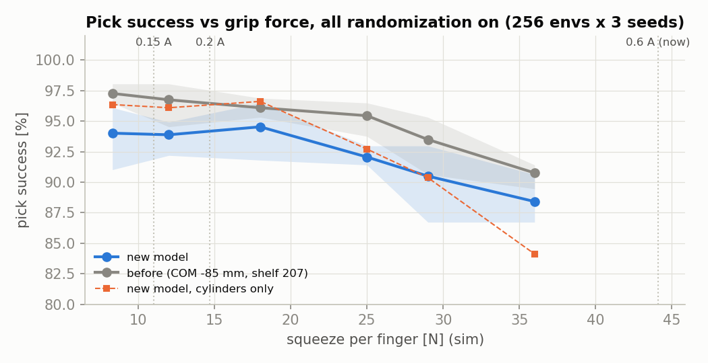
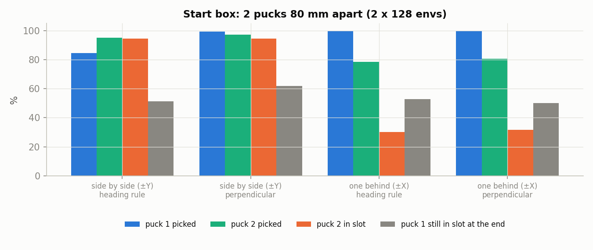
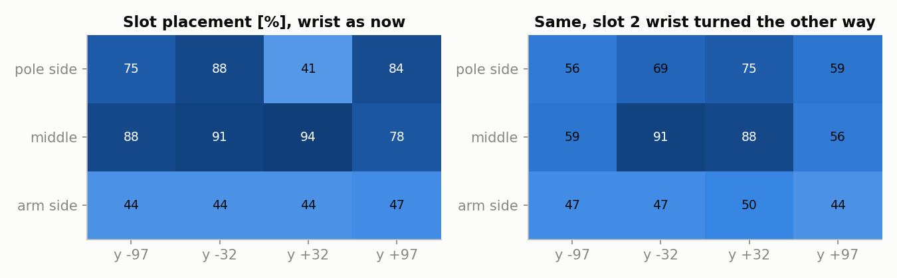
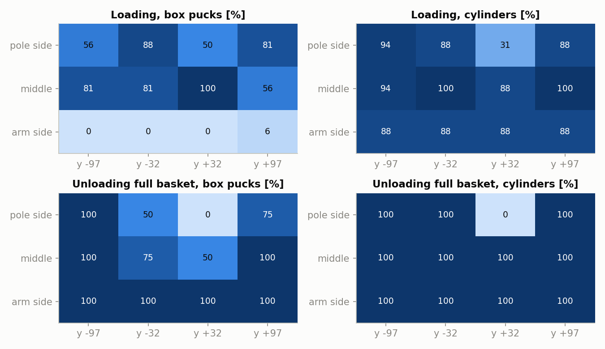
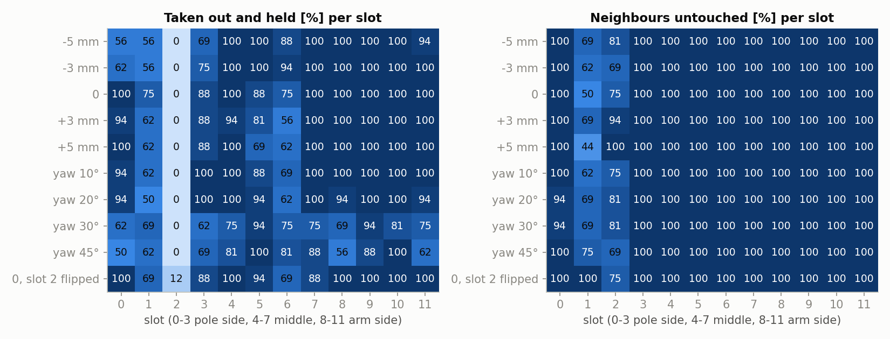
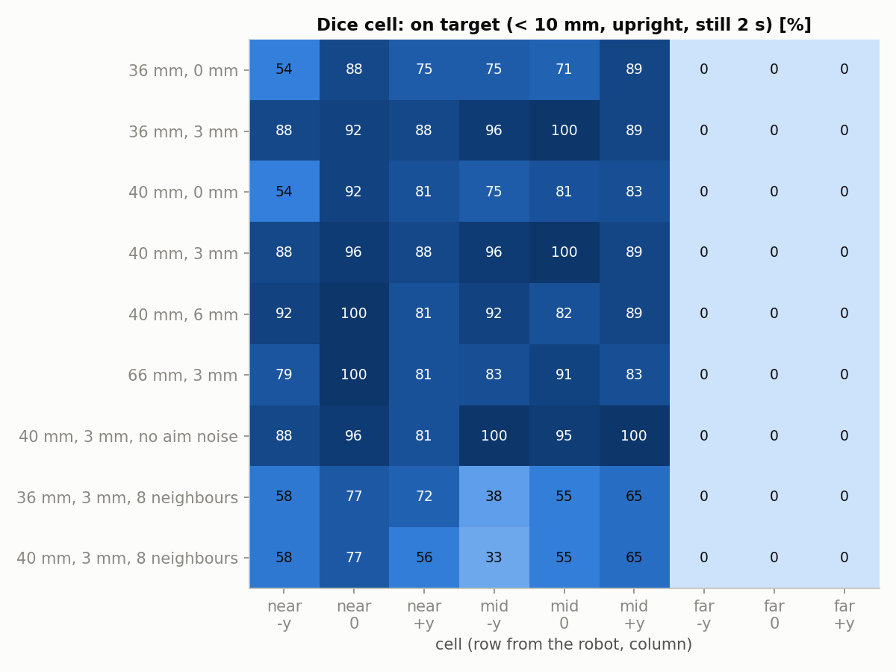

# 2026-10-28 시뮬 재시험 · 미션 단계별 시험

**무엇을 왜 했나.** 10-28 오후에 로봇 모델이 바뀌었다(base_link 무게중심 x −85.4 → −50.8 mm, 실물 균형 자세 기준). 그래서 로봇 전체가 움직이는 시뮬 결과를 새 모델로 다시 쟀다. 발제 v5에 맞춰 시험 계획의 0~4단계(시작 박스 집기 → 바구니 싣기 → 가득 찬 바구니 꺼내기 → 주사위 칸 놓기)도 처음으로 돌렸다. 목적은 두 가지다. 하나는 그립 전류를 정할 근거를 만드는 것이고, 다른 하나는 11/1 RL 판단 전에 동작마다 어디서 실패하는지 찾는 것이다.

**조건.** Isaac Lab 6.1, PhysX, 100 Hz 제어, 실물 지연 적용, 시작 박스 205×205×70 mm. 그립 힘은 손가락당 8.3 N이고, 1장에서만 바꿨다. 손가락은 40 mm까지 연다. 이전 결과는 `../20261027_sim_tests`에 있다.

- 1~2장은 `pick_sm.py`(집기만)로 쟀다. "모두 켬"은 이웃 퍽 50 mm, 정지 오차 ±10 mm, 지연 흔들림 ±20 ms, 원통 대각선 집기다.
- 3~7장은 `cycle_sm.py`(집기 → 바구니 → 꺼내기 → 놓기)로 쟀다.
- 모델 주의: 시험 중 `beebot.usda`에 편집기에서 저장된 `GroundPlane`이 로봇 prim 아래에 들어 있었다. 이를 뺀 복사본과 seed 3개를 비교하면 집기 성공률이 평균 약 1.3 %p 낮았다(94.0 vs 95.3 %). 1장의 "모델 변경 전후" 차이 중 이 부분은 모델 탓이 아니다.

## 요약

| 시험 | 결과 |
|---|---|
| 1. 그립 힘 (모두 켬) | 8.3~18 N은 94 % 안팎으로 같고, 25 N부터 떨어진다. 36 N(시험한 최댓값, 지금 0.6 A ≈ 44 N보다 작다)은 88.4 %, 원통만 보면 84 %. 새 모델은 모든 힘에서 이전보다 2~3 %p 낮다 |
| 2. 제어 주기 | 100 Hz 98.2~98.3 %, 60 Hz 95.3~95.7 %. 지연 영향 없음 |
| 3. 시작 박스 (퍽 2개, 80 mm) | 옆으로 나란히 + 손가락을 퍽 잇는 선과 직각: 집기 99.2 / 97.3 %. 앞뒤로 놓이면 먼 퍽(0.22 m) 집기 79 %, 넣기 31 % |
| 4. 바구니 칸별 넣기 | 평균 68 %. 팔 쪽 줄은 직육면체 0~6 %, 원통 88 %(이전의 "칸 8·9 문제"). 칸 2는 손목 카메라가 몸체에 부딪힌다. 손목을 반대로 돌리면 41 → 75 % |
| 5. 연속 적재 (퍽 5개) | 넣기 53~55 %(이전 모델 73.5 %). 퍽이 손에 있는지 확인하는 단계는 효과 없음 |
| 6. 가득 찬 바구니 꺼내기 | 높이 오차 0에서 85 %. 원통은 칸 2만 빼고 100 %. 칸 2는 0 %, 칸 1은 75 %이고 이웃 퍽을 자주 건드린다. 손이 5 mm 낮으면 칸 0·3이 56~69 % |
| 7. 주사위 칸 놓기 | 가까운·가운데 줄 6칸은 88~100 %(이웃 없을 때). **먼 줄 3칸은 모든 조건에서 0 %**. 이웃 8칸을 채우면 가까운·가운데 줄도 33~77 % |

---

## 1. 그립 힘 (모델 변경 전후)

실물 그립 전류(지금 0.6 A ≈ 손가락당 44 N 추정, 실측 KT 2.2 Nm/A 기준)를 낮출지 정하려고, 시뮬 집기 성공률을 힘별로 다시 쟀다. 같은 조건을 바뀌기 전 모델로도 돌렸다. 바뀌기 전 모델은 무게중심 −85 mm, 선반 207 mm다.

### 결과

| 손가락당 힘 | 새 모델 전체 | 직육면체 | 원통 | 바뀌기 전 모델 |
|---|---|---|---|---|
| 8.3 N | 94.0 | 91.7 | 96.4 | 97.3 |
| 12 N | 93.9 | 91.7 | 96.1 | 96.7 |
| 18 N | 94.5 | 92.4 | 96.6 | 96.1 |
| 25 N | 92.1 | 91.4 | 92.7 | 95.4 |
| 29 N | 90.5 | 90.6 | 90.4 | 93.5 |
| 36 N | 88.4 | 92.7 | 84.1 | 90.8 |

env 256개 × seed 3개, 단위 %.

### 분석

- 8.3~18 N 사이에서는 성공률이 같다. 25 N부터는 원통만 떨어진다(96 → 84 %). 직육면체는 힘과 상관없이 91~93 %다.
- 전류를 0.15~0.2 A(약 11~15 N)로 낮추면 시뮬 기준 성공률을 지금보다 5 %p 넘게 올릴 수 있다. 지금 0.6 A(약 44 N)는 시험한 최댓값 36 N보다 세서 실제 차이는 이보다 크다.
- 새 모델이 모든 힘에서 2~3 %p 낮다. 1.3 %p 정도는 위 모델 주의에 적은 `GroundPlane` 탓이다. 나머지는 무게중심 변경(그리고 선반 2 mm 차이) 탓으로 보인다. 차체 기울기를 재 보면 확인할 수 있다.

## 2. 제어 주기 × 지연

env 기본값을 100 Hz로 바꾼 근거를 새 모델로 다시 확인했다. 랜덤화는 기본값만 켰다(이웃·정지 오차 없음).

### 결과

| 주기 | 지연 | seed 1 / 2 / 3 | 평균 |
|---|---|---|---|
| 60 Hz | 없음 | 96.5 / 94.1 / 95.3 | 95.3 |
| 60 Hz | 있음 | 95.3 / 95.3 / 96.5 | 95.7 |
| 100 Hz | 없음 | 98.4 / 98.4 / 98.0 | 98.3 |
| 100 Hz | 있음 | 98.4 / 98.0 / 98.0 | 98.2 |

### 분석

- 100 Hz가 60 Hz보다 약 3 %p 높다. 이전 모델에서는 100 Hz에서 100 %였는데 지금은 98 %다.
- 지연(45~62 ms)은 두 주기 모두 영향이 없다. 100 Hz 기본값을 유지한다.

## 3. 시작 박스에서 퍽 2개 집기

발제 배치(박스 하나에 퍽 2개, 중심 간격 80 mm)에서 두 가지를 비교했다. 하나는 박스에 접근하는 방향이고, 다른 하나는 손가락 방향 규칙이다.
- 옆으로 나란히: 퍽이 base y ±40 mm에 놓이고, 둘 다 x 0.18 m다.
- 앞뒤로: 퍽이 x 0.14 m와 0.22 m에 놓인다.
- 지금 규칙은 직육면체 면이 팔 방향에 가깝게, 원통은 대각선으로 잡는다. 직각 규칙은 손가락을 두 퍽을 잇는 선과 직각으로 둔다.

두 퍽은 차례로 집어 칸 0·1에 넣는다. 정지 오차는 ±10 mm다.

### 결과

| 배치 | 규칙 | 첫 퍽 집기 / 넣기 / 끝까지 칸에 남음 | 둘째 퍽 집기 / 넣기 | 둘째 퍽 관절 오차 중앙값 |
|---|---|---|---|---|
| 옆으로 나란히 | 지금 규칙 | 84.4 / 77.7 / 51.2 | 94.9 / 94.5 | 5.7° |
| 옆으로 나란히 | **직각** | **99.2** / 88.7 / 61.7 | **97.3** / 94.5 | 5.8° |
| 앞뒤로 | 지금 규칙 | 100 / 90.6 / 52.7 | 78.5 / 30.1 | 19.3° |
| 앞뒤로 | 직각 | 100 / 84.4 / 50.0 | 80.5 / 31.6 | 18.1° |

env 128개 × seed 2개, 단위 %. 둘째 퍽이 첫 집기 때 5 mm 넘게 밀린 경우는 모든 조건에서 0이었다.

### 분석

- **박스 옆면(±Y)에서 접근하고 손가락을 퍽 잇는 선과 직각으로 두는 조합이 가장 좋다.** 집기가 97~99 %다. 지금 규칙은 옆 퍽 쪽으로 손가락이 벌어져 첫 퍽이 84 %다.
- 앞뒤 배치에서는 먼 퍽(0.22 m)에서 팔이 막힌다. 관절 오차가 18~19°이고, 집어도 넣기가 31 %다. 박스는 옆면에서 접근하는 것으로 정한다.
- 남은 퍽이 첫 집기 때 밀리지 않으므로, 13장의 "뒤 퍽일수록 떨어짐"은 집기 단계 문제가 아니다.
- 칸 0에 넣은 첫 퍽이 끝까지 남는 비율은 50~62 %로, 넣은 직후(78~91 %)보다 낮다. 바로 옆 칸 1에 둘째 퍽을 넣을 때 첫 퍽을 쳐낸다. 칸 채우는 순서에서 이웃 칸을 연달아 쓰지 않아야 한다.

## 4. 바구니 칸별 넣기

퍽 하나를 칸마다 넣어 다시 쟀다(이전 12장). 실패가 몰린 칸은 로봇 링크별 접촉력으로 원인을 찾았다. 칸 2는 손목을 반대로 돌리는 것(tool yaw = 방향 − 90°, 손가락 축은 같고 손목 카메라가 반대쪽)도 시험했다.

**배정 주의.** Lab은 퍽 종류를 env 순서대로 돌려 준다(env i → 종류 i % 4). 처음에는 칸을 env i → i % 12로 정해서 칸마다 퍽 종류가 고정됐다(칸 0·4·8 초록 직육면체, 1·5·9 빨강 직육면체, 2·6·10 초록 원통, 3·7·11 빨강 원통). 이전 보고서 12장의 "칸 2·8·9만 실패, 대칭 칸은 성공"도 같은 배정이다. 여기 결과는 env 4개씩 같은 칸을 쓰게 바꿔(칸 (i // 4) % 12) 칸마다 네 종류가 다 들어간 것이다.

### 결과

| | y −97 | y −32 | y +32 | y +97 |
|---|---|---|---|---|
| 기둥 쪽 | 0: 75 | 1: 88 | **2: 41** | 3: 84 |
| 가운데 | 4: 88 | 5: 91 | 6: 94 | 7: 78 |
| 팔 쪽 | **8: 44** | **9: 44** | **10: 44** | **11: 47** |

넣기 %, env 192개 × seed 2개(칸마다 32개, 종류마다 8개). 평균 68.0 %.

| 칸 | 직육면체 / 원통 % |
|---|---|
| 기둥 쪽 0 · 1 · 2 · 3 | 56/94 · 88/88 · 50/31 · 81/88 |
| 가운데 4 · 5 · 6 · 7 | 81/94 · 81/100 · 100/88 · 56/100 |
| 팔 쪽 8 · 9 · 10 · 11 | **0/88 · 0/88 · 0/88 · 6/88** |

- 팔 쪽 줄: 직육면체는 네 칸 모두 0~6 %, 원통은 네 칸 모두 88 %다. 실패한 직육면체는 거의 다 손을 뺀 뒤에도 손가락 사이에 끼어 같이 올라온다. 몸체·카메라와 이상한 접촉은 없다.
- 칸 2: 내리기·놓기·손 빼기 동안 `gripper_cam_link`가 `base_link`(바구니·기둥)에 57~75 N으로 닿는다. 다른 칸에서는 카메라 접촉이 없다. 두 종류 모두 실패한다.
- 칸 2 손목을 반대로 돌리면 칸 2가 41 → 75 %가 된다. 같은 실행에서 손목을 바꾸지 않은 다른 칸들이 0~29 %p 떨어졌다(평균 68.0 → 61.7 %).

### 분석

- **칸 8·9 문제는 "팔 쪽 줄의 직육면체" 문제다.** 좌우 비대칭이 아니었다. 팔 쪽 줄에서는 직육면체가 놓일 때 기울어 손가락에 끼고, 원통은 그렇지 않다. 7장 먼 줄의 증상과 같다. 손가락을 열어도 직육면체가 빠지지 않는 원인(손가락 패드 형상, 직육면체 모서리)을 찾아야 한다. 그전까지 직육면체는 팔 쪽 줄에 넣지 않는다.
- **칸 2는 손목 카메라와 바구니·기둥 충돌이 원인이다.** 손목을 반대로 돌리면 크게 나아진다. 실물 카메라 위치가 같은지 확인한 뒤 칸 2만 반대로 돌리는 규칙을 쓴다.
- 손목이 180° 도는 칸이 있으면 다른 칸이 같이 떨어진다. 시뮬은 env들이 한 동작씩 같이 끝나서, 다른 env가 칸 위에서 더 오래 멈춰 기다리기 때문으로 보인다. 칸 위 대기 시간이 길면 넣기가 나빠진다는 뜻이다. 실물에서는 대기 시간을 짧게 유지한다.

## 5. 연속 적재 (퍽 5개)

이전 13장을 새 모델로 다시 재고, 집은 뒤 퍽이 손에 있는지 확인해 없으면 그 퍽을 건너뛰는 단계의 효과를 봤다.

### 결과

| 손 확인 | 퍽별 집기 / 넣기 % (env 수) | 전체 넣기 | 끝까지 칸에 남음 |
|---|---|---|---|
| 있음 | 89/77 (128) · 73/52 (128) · 45/20 (82) · 79/76 (96) · 30/29 (96) | 53.0 | 48.9 |
| 없음 | 89/81 (128) · 73/60 (128) · 54/18 (82) · 75/71 (96) · 30/29 (96) | 55.1 | 49.4 |

env 64개 × seed 2개. 이전 모델은 넣기 73.5 %, 남음 69.0 %였다.

### 분석

- 손 확인 단계는 효과가 없다. 이 실험에서 연쇄 실패는 빈손으로 바구니에 가서 생기는 게 아니다.
- 이전보다 20 %p 떨어졌다. 둘째 퍽(칸 1)에서 관절 오차 10° 이상이 70~80 %로 크게 늘었고, 3장처럼 이웃 칸에 연달아 넣으며 생기는 간섭도 있다.

## 6. 가득 찬 바구니에서 꺼내기

새 시험이다. 12칸을 모두 채운 상태에서 env마다 칸 하나의 퍽을 꺼낸다. 손목은 실을 때와 같고, 칸 중심을 겨냥한다. 칸 안 퍽 위치는 남는 틈 안에서 무작위다. 손 높이 오차(−5~+5 mm)와 칸 안 퍽 yaw(실을 때보다 10~45° 돌아감)를 바꿨다. 칸 2를 반대로 돌린 실행도 하나 넣었다. 칸 배정은 4장과 같다(칸마다 네 종류).

### 결과

| 조건 | 꺼냄 % | 이웃을 건드린 env (3 mm 이상 밀림 또는 5° 이상 기울어짐) |
|---|---|---|
| 높이 −5 mm | 80.2 | 8/192 |
| −3 mm | 82.3 | 11/192 |
| 0 | 85.4 | 12/192 |
| +3 mm | 81.2 | 6/192 |
| +5 mm | 81.8 | 9/192 |
| yaw 10° | 84.4 | 10/192 |
| yaw 20° | 82.3 | 9/192 |
| yaw 30° | 69.3 | 9/192 |
| yaw 45° | 69.8 | 9/192 |
| 0, 칸 2 손목 반대 | 84.9 | 4/192 |

env 192개(칸마다 16개, 종류마다 4개), seed 1.

높이 오차 0에서 직육면체 / 원통 %(그림 `fig_r3b_slots_kind.png` 아래 줄):
- 원통은 칸 2를 빼고 11칸 모두 100 %다.
- 직육면체는 칸 1·6이 50 %, 3·5가 75 %, 나머지는 100 %다.
- 칸 2는 두 종류 모두 0 %다.

### 분석

- 팔 쪽 줄(8~11)과 칸 4·7은 높이 ±5 mm, yaw 20°까지 88~100 %이고, 꺼낼 때 손가락이 이웃 퍽을 건드리지 않는다. 넣을 때와 달리 꺼낼 때는 팔 쪽 줄의 직육면체도 문제없다.
- **기둥 쪽 줄이 가장 나쁘다.**
  - 칸 2는 넣을 때처럼 손목 카메라 충돌로 0 %다. 손목을 반대로 돌려도 12 %라 넣을 때만큼 회복되지 않는다.
  - 칸 1은 50~75 %이고 이웃 퍽을 가장 자주 건드린다(16개 중 4~9개).
  - 칸 0·3은 손이 낮을수록 나빠진다(0 mm 88~100 % → −5 mm 56~69 %). 계산했던 벽 위 5 mm 여유가 실제로 한계다. 높이는 낮추지 말고 0~+3 mm로 잡는다.
- yaw가 30°를 넘으면 거의 모든 칸이 떨어진다(평균 85 → 69 %). 계산했던 ±18~25° 한계와 맞다. 넣을 때 yaw가 20° 안으로 유지되면 카메라로 yaw를 재는 단계 없이 꺼낼 수 있다.
- 칸 1·2는 넣을 때와 꺼낼 때 모두 나쁘다. 그룹별로 나눠 싣는다면 비워 두는 편이 낫다.

## 7. 주사위 칸에 놓기

새 시험이다. 바구니 칸에서 꺼낸 퍽을 205 박스 위 3×3 격자(60 mm 간격, 박스 중심)의 한 칸에 놓는다. 운반 자세에서 손 안 퍽 위치를 한 번 재서(±2 mm 오차) 겨냥한다. 칸 위치 인식 오차는 ±5 mm다. 놓고 손을 5 cm 올린 뒤 2 s를 기다린다. 성공 기준은 중심 오차 10 mm 이내, 기울기 5° 이하, 2 s 동안 2 mm 이하로 움직임이다. 여는 폭(36 / 40 / 66 mm), 놓는 높이(0 / 3 / 6 mm), 이웃 8칸에 퍽이 있는 경우를 비교했다.

### 결과

| 여는 폭, 놓는 높이 | 성공 % (집고 있던 퍽 기준) | 손에 끼어 올라옴 | 이웃 밀림 | 가까운·가운데 줄 중심 오차 중앙값 / p90 mm |
|---|---|---|---|---|
| 36 mm, 0 mm | 50.3 | 63/189 | – | 5.5 / 21.6 |
| 36 mm, 3 mm | 61.9 | 59/189 | – | 4.3 / 8.8 |
| 40 mm, 0 mm | 51.9 | 53/189 | – | 5.3 / 12.8 |
| **40 mm, 3 mm** | **62.4** | 53/189 | – | 4.4 / 8.8 |
| 40 mm, 6 mm | 59.9 | 58/192 | – | 4.4 / 8.0 |
| 66 mm, 3 mm | 57.8 | 54/192 | – | 4.3 / 8.5 |
| 40 mm, 3 mm, 인식 오차 0 | 63.0 | 54/189 | – | 1.4 / 5.2 |
| 36 mm, 3 mm, 이웃 8칸 | 40.3 | 55/186 | 127 | 8.1 / 28.4 |
| 40 mm, 3 mm, 이웃 8칸 | 38.2 | 45/186 | 130 | 8.2 / 31.1 |

env 216개(칸마다 24개), seed 1. 집고 있던 퍽이 216개보다 적은 것은 바구니 칸 1·2에서 꺼내기에 실패해서다.

- 먼 줄 3칸(base x 0.24 m)은 모든 조건에서 0 %다.
  - 손가락을 연 직후 퍽이 5~7° 기울고 4~7 mm 떠오른 채 손가락에 1.3~1.6 N으로 닿아 있다. 손을 올리면 따라 올라간다.
  - 66 mm로 열어도 같다.
  - 놓기 직전 손 안 퍽 위치는 운반 때와 1~5 mm 차이다. 차체와 손의 기울기는 0.5° 이하다.

### 분석

- **놓는 높이는 3 mm, 여는 폭은 40 mm가 가장 좋다.** 0 mm에서 놓으면 바닥을 누르다 퍽이 밀려 가까운 줄 −y 칸이 54 %로 떨어진다. 6 mm·66 mm는 나아지지 않는다.
- 가까운·가운데 줄의 정확도는 기준 안이다. 중심 오차 p90이 8~9 mm(인식 오차 0이면 5 mm)로 10 mm 안에 들어온다. 오차 대부분은 칸 위치 인식에서 온다.
- **먼 줄은 놓을 수 없다.** 열어도 퍽이 손에 남아, 여는 폭이 원인이 아니다. 차체·손 기울기와 손 안 미끄러짐도 아니다. 바구니 팔 쪽 줄과 증상(기울어 끼어 따라 올라옴)이 같다. 다만 바구니에서는 직육면체만 끼는데, 먼 줄에서는 원통도 낀다(직육면체 33/34, 원통 20/28). 원인을 찾기 전까지는 정차 위치를 한 번 더 앞으로 옮겨 먼 줄을 가운데 줄 거리(0.18 m)로 만드는 방법이 현실적이다.
- **이웃 8칸이 차 있으면 이웃 퍽을 70 % 가까이 건드린다.** 놓기 성공률도 가까운·가운데 줄 33~77 %로 떨어진다. 가운데 줄 −y 칸이 가장 나쁘다(33~38 %). 틈 30 mm에서 손가락 여유가 실제로 부족하다. 놓는 순서(먼저 놓은 퍽 옆에 손가락이 오지 않게)와 손가락 축을 칸마다 정해야 한다.

---

## 종합

1. **그립 전류는 0.15~0.2 A로 낮추는 것을 권한다.** 약 11~15 N으로 시뮬에서 8.3 N과 같은 성공률이고, 지금 0.6 A(약 44 N)는 원통에서 12 %p 넘게 떨어지는 범위다.
2. **시작 박스는 옆면(±Y)에서 접근하고 손가락을 퍽 잇는 선과 직각으로 둔다.** 집기 97~99 %로 이번 시험에서 유일하게 97 % 기준을 넘는 동작이다.
3. **바구니는 칸 2에 손목 반대 규칙을 쓰고, 칸 1·2는 되도록 비우고, 직육면체는 팔 쪽 줄에 넣지 않는다.** 이웃 칸에 연달아 넣지 않는다. 꺼낼 때는 손 높이를 0~+3 mm로 잡는다.
4. **주사위 칸은 40 mm로 열고 3 mm에서 놓는다.** 가까운·가운데 줄은 정확도 기준(p90 10 mm) 안이다. 먼 줄 0 %와 이웃 퍽 간섭이 가장 큰 문제이고, 배점이 가장 큰 단계라 우선순위가 가장 높다.
5. 동작별로 보면 시작 박스 집기만 97 %를 넘는다. 바구니 넣기는 가장 좋은 칸(5·6)도 91~94 %라 RL 판단 기준(97 %)에 못 미친다(2단계 통과 기준 90 %는 넘는다). 꺼내기는 원통 기준 11칸 100 %다. 주사위 놓기는 먼 줄과 이웃 간섭을 풀기 전에는 판단할 수 없다. 11/1 RL 판단 전에 "놓을 때 퍽이 손가락에 끼는" 원인(바구니 팔 쪽 줄 직육면체, 주사위 먼 줄)을 먼저 찾는다.
