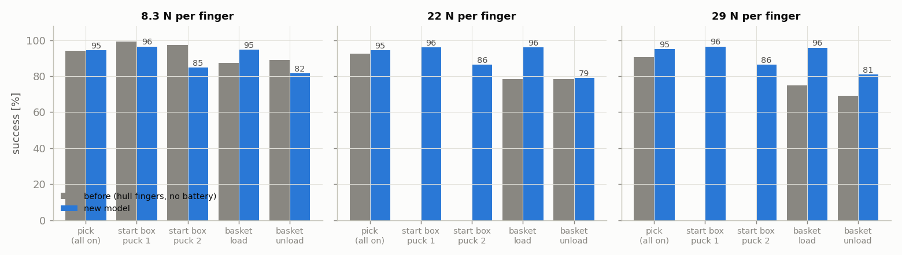
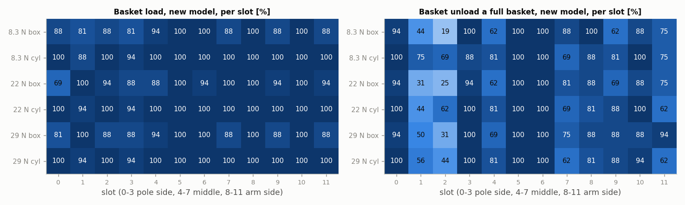
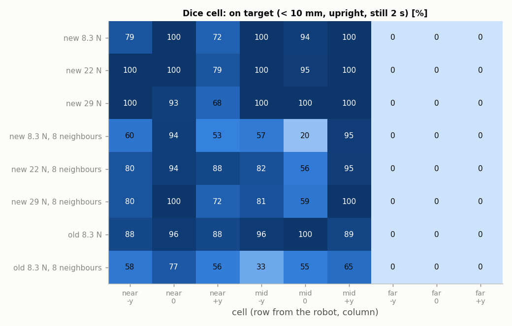

# 2026-10-29 새 모델 재시험 (배터리 · 손가락 충돌체 convex decomposition)

**무엇을 왜 했나.** 830b724에서 로봇 USD가 두 가지 바뀌었다. 첫째, 뒤 기둥에 배터리(`battery_link`, LiPo LB-012, 106 g)가 붙었다. 둘째, 손가락 충돌체가 convex hull에서 convex decomposition으로 바뀌었다(`../20261029_wrist_boxwall` 5·6장). 충돌체가 바뀌면서 손가락 정지 위치가 8.3 → 6.2 mm로 바뀌었다. 그래서 같은 "40 mm 열기"가 이제 실제 패드 기준 40 mm다(이전에는 약 44 mm). 이 모델로 집기·시작 박스·바구니 넣기와 꺼내기·주사위 칸 놓기를 다시 쟀다. 그립 힘은 시뮬 기본값 8.3 N과, 팀이 정한 0.3~0.4 A에 해당하는 22·29 N을 썼다.

**조건.** Isaac Lab 6.1, PhysX, 100 Hz, 실물 지연 적용, 손가락 40 mm 열기. 각 시험의 나머지 조건은 비교 대상인 이전 시험과 같다.
- 집기: 이웃 퍽 50 mm, 정지 오차 ±10 mm, 지연 흔들림 ±20 ms, 원통 대각선. env 256개 × seed 3개(`../20261028_retest` 1장).
- 시작 박스: 퍽 2개 옆으로 나란히, 손가락 직각 규칙, 정지 오차 ±10 mm. env 128개 × seed 2개(같은 보고서 3장).
- 바구니: 손목 반대 + 면 맞춤(기둥 쪽 줄 제외). −y 칸과 +y 칸을 따로 돌렸고, 각각 env 96개 × seed 2개다(`../20261029_wrist_boxwall` 1~4장).
- 놓기: 가득 찬 바구니에서 꺼낸 퍽을 3×3 격자에 놓는다. 40 mm로 열고 3 mm 위에서 놓는다. env 216개, seed 1(`../20261028_retest` 7장). 이전 놓기 시험은 바구니 규칙(손목 반대 + 면 맞춤) 전이라, 꺼내는 단계 조건이 다르다.

"이전"은 hull 손가락, 배터리 없는 모델이다. 22 N 집기는 10-29 보고서, 나머지 집기·시작 박스·놓기는 10-28 보고서, 바구니는 10-29 보고서의 값이다.

## 요약

| 시험 | 8.3 N 새 / 이전 | 22 N 새 / 이전 | 29 N 새 / 이전 |
|---|---|---|---|
| 집기 (모두 켬) | 94.5 / 94.0 | 94.5 / 92.6 | 94.9 / 90.5 |
| 시작 박스 첫 퍽 집기 | 96.5 / 99.2 | 96.1 / – | 96.5 / – |
| 시작 박스 둘째 퍽 집기 | **84.8** / 97.3 | **86.3** / – | **86.3** / – |
| 바구니 넣기 | 94.8 / 87.2 | 96.1 / 78.4 | 95.8 / 74.7 |
| 바구니 꺼내기 | **81.5** / 89.1 | 78.9 / 78.4 | 81.0 / 69.3 |
| 주사위 놓기 (집고 있던 퍽 기준) | 59.1 / 62.4 | 63.8 / – | 62.0 / – |

단위 %. 굵은 값은 이전보다 떨어진 곳이다.

- 그립 힘에 따른 차이가 사라졌다. 22·29 N에서도 집기와 바구니 넣기가 8.3 N과 같다.
- 시작 박스 둘째 퍽과 바구니 꺼내기는 떨어졌다. 둘 다 여는 폭 때문이다(4장). 44 mm로 열면 둘째 퍽 99 %, 꺼내기 91 %로 돌아온다.

---

## 1. 집기 (모두 켬)

### 결과

| 힘 | 새 모델 (seed 범위) | 직육면체 / 원통 | 이전 | 이전 직육면체 / 원통 |
|---|---|---|---|---|
| 8.3 N | 94.5 (93.0~96.1) | 93.5 / 95.6 | 94.0 | 91.7 / 96.4 |
| 22 N | 94.5 (93.0~96.5) | 93.0 / 96.1 | 92.6 | 91.7 / 93.5 |
| 29 N | 94.9 (94.1~96.5) | 94.0 / 95.8 | 90.5 | 90.6 / 90.4 |

### 분석

- 힘을 올려도 성공률이 같다. 이전 모델에서 29 N 원통이 90 %로 떨어지던 것이 96 %가 됐다. 10-29 보고서 5장의 쐐기 면 설명과 맞다.
- 이 시험은 이웃 퍽 50 mm 배치라 40 mm 열기로도 손가락 여유가 있다. 그래서 여는 폭 변화가 드러나지 않는다.
- 배터리 영향은 이 시험에서 보이지 않는다. 손가락 변경과 같이 들어가서 따로 떼어 볼 수는 없다.

## 2. 시작 박스에서 퍽 2개 집기

### 결과

| 조건 | 첫 퍽 집기 / 넣기 / 끝까지 칸에 남음 | 둘째 퍽 집기 / 넣기 |
|---|---|---|
| 새 8.3 N | 96.5 / 93.4 / 66.4 | 84.8 / 82.0 |
| 새 22 N | 96.1 / 94.5 / 64.1 | 86.3 / 83.2 |
| 새 29 N | 96.5 / 93.8 / 69.1 | 86.3 / 84.4 |
| 이전 8.3 N | 99.2 / 88.7 / 61.7 | 97.3 / 94.5 |

env 128개 × seed 2개, 단위 %.

### 분석

- **둘째 퍽 집기가 97 → 85~86 %로 떨어졌다.** 힘과는 관계없다. 22 N에서 둘째 퍽 실패 35개는 모두 직육면체다.
- 첫 퍽은 넣기가 오히려 좋아졌다(88.7 → 93~95 %). 끝까지 칸에 남는 비율도 64~69 %로 조금 낫다. 이웃 칸(0 → 1)에 넣을 때 먼저 넣은 퍽을 쳐내는 문제는 그대로다.
- 원인은 여는 폭이다(4장).

## 3. 바구니 넣기·꺼내기

### 결과

| 힘 | 넣기 (직육면체 / 원통) | 꺼내기 (직육면체 / 원통) | 이전 넣기 / 꺼내기 |
|---|---|---|---|
| 8.3 N | 94.8 (91.1 / 98.4) | 81.5 (77.6 / 85.4) | 87.2 / 89.1 |
| 22 N | 96.1 (93.2 / 99.0) | 78.9 (75.5 / 82.3) | 78.4 / 78.4 |
| 29 N | 95.8 (92.7 / 99.0) | 81.0 (81.2 / 80.7) | 74.7 / 69.3 |

seed 1 / 2 차이는 넣기 3.2~4.1 %p, 꺼내기 2.6~5.8 %p다.

꺼내기가 낮은 칸(직육면체 / 원통 %, 8.3 · 22 · 29 N):

| 칸 | 8.3 N | 22 N | 29 N |
|---|---|---|---|
| 1 (기둥 쪽) | 44 / 75 | 31 / 44 | 50 / 56 |
| 2 (기둥 쪽) | 19 / 69 | 25 / 62 | 31 / 44 |
| 4 (가운데) | 62 / 81 | 62 / 81 | 69 / 81 |
| 7 (가운데) | 88 / 69 | 81 / 69 | 75 / 62 |
| 11 (팔 쪽) | 75 / 75 | 75 / 62 | 94 / 62 |

칸·모양 하나당 n = 16이라 한 칸 값은 6 %p 단위로 움직인다.

### 분석

- **넣기는 크게 좋아졌다.** 8.3 N에서 87 → 95 %, 22·29 N에서 75~78 → 96 %다. 원통 넣기는 모든 힘에서 98~99 %다. 넣기 직육면체 81 % 미만인 칸이 없다(칸 0 22 N 69 %만 예외).
- **꺼내기는 8.3 N 기준으로 89 → 82 %로 떨어졌다.** 22·29 N은 이전보다 낫거나 같다.
  - 칸 1·2(기둥 쪽 가운데)가 가장 나쁘다. 직육면체 19~50 %, 원통 44~75 %다. 이전에는 원통이 94~100 %였다.
  - 가득 찬 바구니에서는 칸 안 퍽 위치가 ±7 mm쯤 흩어진다. 실제 40 mm로 열면 한쪽 여유가 5 mm라 손가락이 퍽 위에 걸린다(10-29 보고서 6장과 같은 증상). 44 mm로 열면 76 → 91 %다(4장).

## 4. 여는 폭 40 mm vs 44 mm (22 N)

2·3장에서 떨어진 두 시험만 44 mm로 다시 돌렸다. 이전 모델의 "40 mm"가 실제 패드 기준 약 44 mm였기 때문이다.

### 결과

| 여는 폭 | 시작 박스 첫 퍽 / 둘째 퍽 집기 / 둘째 퍽 넣기 | 꺼내기 (직육면체 / 원통), seed 1 |
|---|---|---|
| 40 mm | 96.1 / 86.3 / 83.2 | 76.0 (65.6 / 86.5) |
| 44 mm | 100.0 / 99.2 / 96.5 | 90.6 (87.5 / 93.8) |

시작 박스는 env 128개 × seed 2개, 꺼내기는 −y·+y 각 env 96개다.

### 분석

- **44 mm로 열면 둘 다 이전 수준으로 돌아온다.** 둘째 퍽 집기 99 %(이전 97 %), 꺼내기 91 %(이전 89 %)다. 떨어진 원인은 배터리가 아니라 여는 폭이다.
- 둘째 퍽 실패가 직육면체에만 생기는 이유: 직육면체는 대각 42.4 mm라, 면이 손가락과 조금만 어긋나도 40 mm 사이로 들어가지 않는다. 원통은 지름 30 mm라 여유가 있다.
- 문제는 실물 그리퍼가 최대 38~40 mm까지만 열린다는 점이다. 44 mm는 실물에서 쓸 수 없다. 이전 시뮬 결과(바구니 꺼내기 89 %, 시작 박스 97 %)는 여는 폭 면에서 낙관적이었다. 지금 40 mm 값이 실물에 더 가깝다.

## 5. 주사위 칸에 놓기

### 결과

| 조건 | 성공 % (집고 있던 퍽 기준) | 꺼내서 쥔 퍽 | 손에 끼어 올라옴 | 이웃 밀림 | 가까운·가운데 줄 중심 오차 중앙값 / p90 mm |
|---|---|---|---|---|---|
| 새 8.3 N | 59.1 | 164/216 | 50 | – | 4.3 / 7.4 |
| 새 22 N | 63.8 | 163/216 | 38 | – | 4.4 / 7.7 |
| 새 29 N | 62.0 | 166/216 | 41 | – | 4.3 / 8.3 |
| 이전 8.3 N | 62.4 | 189/216 | 53 | – | 4.4 / 8.8 |
| 새 8.3 N, 이웃 8칸 | 43.3 | 164/216 | 36 | 100 | 5.6 / 24.7 |
| 새 22 N, 이웃 8칸 | 56.0 | 168/216 | 44 | 91 | 5.0 / 14.0 |
| 새 29 N, 이웃 8칸 | 56.6 | 166/216 | 36 | 86 | 4.9 / 12.4 |
| 이전 8.3 N, 이웃 8칸 | 38.2 | 186/216 | 45 | 130 | 8.2 / 31.1 |

### 분석

- **먼 줄 3칸은 여전히 0 %다.** 손가락 충돌체를 바꿔도 같다. 그래서 먼 줄 실패는 hull 쐐기 면 탓이 아니다.
- 가까운·가운데 줄은 이웃이 없을 때 68~100 %이고, 중심 오차 p90은 7~8 mm로 10 mm 기준 안이다.
- 이웃 8칸이 차 있을 때는 이전보다 낫다(38 → 43~57 %). 이웃을 미는 횟수도 130 → 86~100회로 줄었다. 그래도 가운데 줄 가운데 칸은 20~59 %다.
- 꺼내서 쥔 퍽이 189 → 163~168개로 줄었다. 3장의 꺼내기 하락과 같은 원인으로 보인다.

## 종합

- 손가락 충돌체를 바꾸자 그립 힘에 따른 시뮬 차이가 사라졌다. 팀이 정한 0.3~0.4 A(22~29 N)에서 집기 95 %, 바구니 넣기 96 %다. 이제 이 힘을 시뮬 기준선으로 써도 된다.
- 대신 실제 40 mm 열기가 제대로 반영됐다. 그래서 손가락 여유가 좁은 두 동작이 떨어졌다. 시작 박스 둘째 퍽(직육면체)은 86 %, 가득 찬 바구니 꺼내기는 79~82 %다. 44 mm면 둘 다 회복되지만, 실물 그리퍼는 40 mm가 한계다.
- 다음에 볼 것:
  - 시작 박스 둘째 직육면체는 손가락 축과 면을 맞추는 규칙으로 여유를 만들 수 있는지 본다.
  - 바구니 칸 1·2 꺼내기는 칸 안 퍽 yaw·위치를 gripper_cam으로 재는 단계가 필요한지 본다.
  - 실물 그리퍼가 실제로 몇 mm까지 열리는지 다시 재서 시뮬 여는 폭을 맞춘다.
- 먼 줄 놓기 0 %는 충돌체와 무관하다. 정차 위치를 앞으로 옮기는 방안이 여전히 현실적이다.
- 동작당 97 %라는 RL 판단 기준에 닿은 동작은 아직 없다. 집기 95 %, 넣기 96 %가 가장 가깝다.
