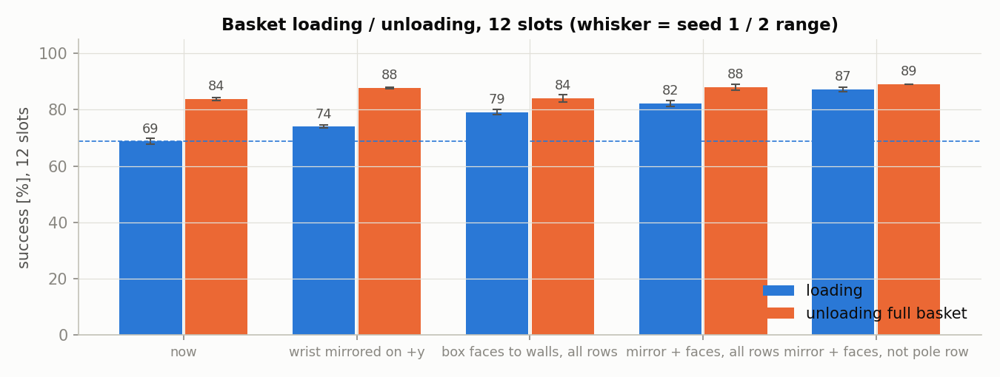
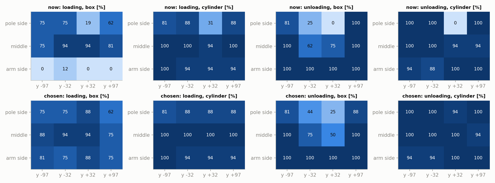
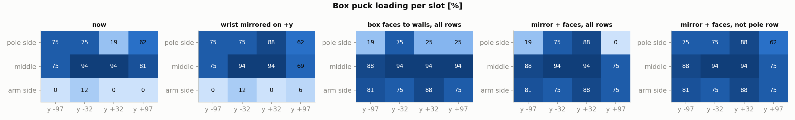

# 2026-10-29 바구니 손목 대칭 · 직육면체 면 맞춤 시험

**무엇을 왜 했나.** 10-28 재시험(`../20261028_retest` 4·6장)에서 바구니 칸 1·2가 거울 위치인데도 결과가 크게 달랐다. 팔 쪽 줄에서는 직육면체가 거의 들어가지 않았다. 이번에는 두 원인 후보를 따로, 또 함께 바꿔서 쟀다.

- 손목 대칭: 지금은 좌우 칸 모두 joint5 −90°다. 그래서 손목 카메라가 +y 칸에서만 기둥·바구니 쪽을 향한다. +y 쪽 손목을 반대로 돌리면 양쪽 카메라가 모두 바깥을 향한다. 10-28에는 칸 위 자세만 뒤집어서 운반 중에 손목이 180° 돌았다. 이번에는 운반 자세도 같이 뒤집었다.
- 직육면체 면 맞춤: 지금은 손가락을 팔 방향에 맞춘다. 그러면 직육면체가 칸 벽과 칸마다 8~42° 어긋나게 들어간다. 직육면체일 때는 tool yaw를 가장 가까운 칸 벽 축(0°/90°)에 맞춰 넣었다. 꺼낼 때도 같은 각도를 쓴다.

**조건.** Isaac Lab 6.1, PhysX, 100 Hz, 실물 지연 적용, 그립 8.3 N, 손가락 40 mm 열기. 넣기는 퍽 1개를 칸 하나에 넣는다. 꺼내기는 12칸이 모두 찬 바구니에서 칸 하나를 꺼낸다(높이 오차 0, yaw 오차 0). 10-28 시험에서는 손목을 바꾼 칸과 안 바꾼 칸을 같이 돌려서, 바꾼 칸의 긴 동작이 다른 칸의 대기 시간을 늘렸다. 이번에는 −y 칸(0·1·4·5·8·9)과 +y 칸(2·3·6·7·10·11)을 따로 돌렸다. 실행마다 env 96개(칸마다 16개, 종류마다 4개), seed 2개다. 칸·모양 한 칸당 n = 16이라 한 칸 값은 6 %p 단위로 움직인다. 칸 하나의 10~20 %p 차이는 경향으로만 본다.

## 요약

| 조건 | 넣기 % (직육면체 / 원통) | 꺼내기 % (직육면체 / 원통) |
|---|---|---|
| 지금 | 68.8 (49.0 / 88.5) | 83.9 (78.6 / 89.1) |
| +y 손목 반대(운반 자세 포함) | 74.0 (54.2 / 93.8) | 87.8 (78.6 / 96.9) |
| 직육면체 면을 벽에, 모든 줄 | 79.2 (69.3 / 89.1) | 84.1 (79.2 / 89.1) |
| 손목 반대 + 면 맞춤, 모든 줄 | 82.3 (70.8 / 93.8) | 88.0 (78.6 / 97.4) |
| **손목 반대 + 면 맞춤, 기둥 쪽 줄 제외** | **87.2 (80.7 / 93.8)** | **89.1 (80.2 / 97.9)** |

seed 1 / 2 차이는 모든 조건에서 2.6 %p 이하다.

---

## 1. 전체

### 결과

### 분석

- 두 변경은 서로 다른 칸을 고친다. 그래서 효과가 거의 더해진다. 넣기는 68.8 → 87.2 %(+18.4 %p), 꺼내기는 83.9 → 89.1 %(+5.2 %p)다.
- 손목 반대는 칸 2를 고친다(넣기 +5.2 %p, 꺼내기 +3.9 %p). 면 맞춤은 팔 쪽 줄 직육면체를 고친다(넣기 +10.4 %p).
- 면 맞춤을 기둥 쪽 줄까지 쓰면 그 줄이 나빠진다. 기둥 쪽 줄을 빼야 가장 좋다(82.3 → 87.2 %).

## 2. 손목 대칭

### 결과

| 칸 | 넣기 지금 → 선택 (직육면체 / 원통 %) | 꺼내기 지금 → 선택 (직육면체 / 원통 %) |
|---|---|---|
| 1 (−y, 칸 2의 거울) | 75/88 → 75/88 | 25/100 → 44/100 |
| 2 | 19/31 → 88/88 | 0/0 → 25/94 |
| 3 | 62/88 → 62/88 | 100/100 → 88/100 |
| 6 | 94/94 → 94/100 | 75/94 → 50/100 |

"선택" = 손목 반대 + 면 맞춤(기둥 쪽 줄 제외). 칸 2·3은 기둥 쪽 줄이라 면 맞춤이 적용되지 않는다. 그래서 칸 2·3의 변화는 손목 반대의 효과다.

### 분석

- **손목 대칭이 칸 2 문제의 원인이다.** 손목을 반대로 돌리면 칸 2 넣기가 19/31 → 88/88 %가 되어 거울 칸 1(75/88)과 같아진다. 꺼내기 원통도 0 → 94 %로 칸 1(100)과 비슷해진다.
- 10-28에 보였던 칸 3·6 넣기 악화는 이번에는 없다(칸 3 62/88 그대로, 칸 6 94/94 → 94/100). 그때의 악화는 운반 중 180° 회전이나 같이 돌린 칸의 대기 시간 탓이었던 것으로 보인다.
- 남은 것: 꺼내기 직육면체는 칸 1·2 모두 25~44 %로 여전히 낮다. 좌우가 같아졌으므로 이 실패는 카메라 방향과 관계없다. 기둥 쪽 가운데 두 칸의 직육면체 꺼내기 문제다.
- 칸 6 꺼내기 직육면체가 75 → 50 %(16개 중 12 → 8개)로 떨어졌다. 손목만 반대로 한 실행에서도 50 %였다. 경향으로 보고 다시 확인할 대상이다.

## 3. 직육면체 면 맞춤

### 결과

| 줄 | 직육면체 넣기 % 지금 → 면 맞춤 (칸별) | 벽 대비 손가락 각도 (지금) |
|---|---|---|
| 기둥 쪽 (0·1·2·3) | 75, 75, 19, 62 → 19, 75, 25, 25 | 24°, 8°, 9°, 24° |
| 가운데 (4·5·6·7) | 75, 94, 94, 81 → 88, 94, 94, 94 | 33°, 12°, 12°, 33° |
| 팔 쪽 (8·9·10·11) | 0, 12, 0, 0 → 81, 75, 88, 75 | 42°, 20°, 20°, 42° |

손목은 지금 그대로다. 원통은 면 맞춤의 영향을 받지 않는다(88.5 → 89.1 %).

### 분석

- **팔 쪽 줄 직육면체 문제의 원인은 면 방향이다.** 면을 벽에 맞추면 0~12 → 75~88 %다. 각도가 20°인 칸 9·10도 0~12 %에서 75~88 %로 오른다. 이 줄의 칸은 45 mm라, 20°만 어긋나도 손가락이 벌어질 때 퍽이 벽에 걸리는 것으로 보인다.
- **기둥 쪽 줄은 면 맞춤이 오히려 나쁘다.** 각도가 24°인 칸 0·3이 75/62 → 19/25 %로 떨어진다. 8~9°인 칸 1·2는 거의 그대로다. 이 줄은 손가락이 팔 방향이어야 한다는 제약(10-27 보고서 7장)이 있고, 이번 결과도 그 제약과 맞다. 기둥 쪽 줄의 x 방향 안쪽 길이는 65 mm라 각도가 어긋나도 여유가 있다.
- 꺼내기는 거의 같다(84.1 vs 83.9 %). 가득 찬 바구니에서 꺼낼 때는 10-28에도 팔 쪽 줄 직육면체가 이미 100 %였다.
- 면 맞춤이면 칸 위에서 joint5가 최대 42°(칸 8·11) 더 돈다.

## 종합

- 바구니 규칙: +y 칸은 손목을 반대로 돌린다(운반 자세 포함). 가운데·팔 쪽 줄에서는 직육면체 면을 칸 벽에 맞추고, 기둥 쪽 줄은 지금처럼 손가락을 팔 방향으로 둔다. 이 규칙으로 넣기는 87 %, 꺼내기는 89 %다.
- 12칸을 다 쓸 수 있는지에 대한 판단이 바뀐다. 10-28에는 칸 2와 팔 쪽 줄 직육면체 때문에 9칸만 쓸 수 있었다. 이번 규칙에서는 넣기에서 직육면체 62 % 미만인 칸이 없다.
- 남은 약점은 기둥 쪽 줄이다. 직육면체 넣기는 62~88 %이고, 칸 1·2 직육면체 꺼내기는 25~44 %다. 동작당 약 97 %라는 RL 판단 기준에는 아직 모든 칸이 못 미친다.
