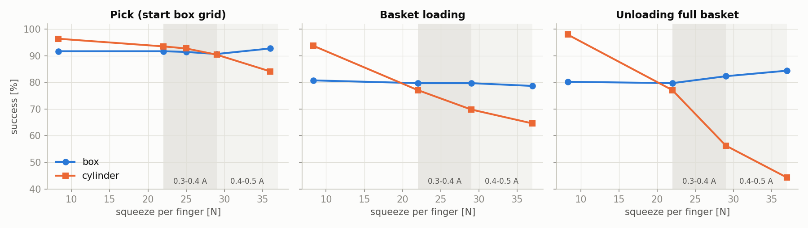
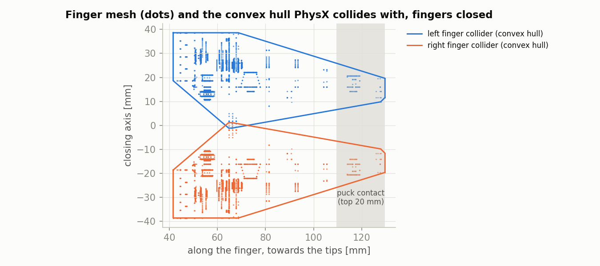

# 2026-10-29 바구니 손목 대칭 · 직육면체 면 맞춤 · 그립 힘 시험

**무엇을 왜 했나.** 10-28 재시험(`../20261028_retest` 4·6장)에서 바구니 칸 1·2가 거울 위치인데도 결과가 크게 달랐다. 팔 쪽 줄에서는 직육면체가 거의 들어가지 않았다. 이번에는 두 원인 후보를 따로, 또 함께 바꿔서 쟀다.

- 손목 대칭: 지금은 좌우 칸 모두 joint5 −90°다. 그래서 손목 카메라가 +y 칸에서만 기둥·바구니 쪽을 향한다. +y 쪽 손목을 반대로 돌리면 양쪽 카메라가 모두 바깥을 향한다. 10-28에는 칸 위 자세만 뒤집어서 운반 중에 손목이 180° 돌았다. 이번에는 운반 자세도 같이 뒤집었다.
- 직육면체 면 맞춤: 지금은 손가락을 팔 방향에 맞춘다. 그러면 직육면체가 칸 벽과 칸마다 8~42° 어긋나게 들어간다. 직육면체일 때는 tool yaw를 가장 가까운 칸 벽 축(0°/90°)에 맞춰 넣었다. 꺼낼 때도 같은 각도를 쓴다.

**조건.** Isaac Lab 6.1, PhysX, 100 Hz, 실물 지연 적용, 그립 8.3 N, 손가락 40 mm 열기. 넣기는 퍽 1개를 칸 하나에 넣는다. 꺼내기는 12칸이 모두 찬 바구니에서 칸 하나를 꺼낸다(높이 오차 0, yaw 오차 0). 10-28 시험에서는 손목을 바꾼 칸과 안 바꾼 칸을 같이 돌려서, 바꾼 칸의 긴 동작이 다른 칸의 대기 시간을 늘렸다. 이번에는 −y 칸(0·1·4·5·8·9)과 +y 칸(2·3·6·7·10·11)을 따로 돌렸다. 실행마다 env 96개(칸마다 16개, 종류마다 4개), seed 2개다. 칸·모양 한 칸당 n = 16이라 한 칸 값은 6 %p 단위로 움직인다. 칸 하나의 10~20 %p 차이는 경향으로만 본다.

## 요약

| 조건 | 넣기 % (직육면체 / 원통) | 꺼내기 % (직육면체 / 원통) |
|---|---|---|
| 지금 | 68.8 (49.0 / 88.5) | 83.9 (78.6 / 89.1) |
| +y 손목 반대(운반 자세 포함) | 74.0 (54.2 / 93.8) | 87.8 (78.6 / 96.9) |
| 직육면체 면을 벽에, 모든 줄 | 79.2 (69.3 / 89.1) | 84.1 (79.2 / 89.1) |
| 손목 반대 + 면 맞춤, 모든 줄 | 82.3 (70.8 / 93.8) | 88.0 (78.6 / 97.4) |
| **손목 반대 + 면 맞춤, 기둥 쪽 줄 제외** | **87.2 (80.7 / 93.8)** | **89.1 (80.2 / 97.9)** |

seed 1 / 2 차이는 모든 조건에서 2.6 %p 이하다.

| 그립 힘 (선택 규칙) | 집기 % | 넣기 % (직육면체 / 원통) | 꺼내기 % (직육면체 / 원통) |
|---|---|---|---|
| 8.3 N (시뮬 기본값) | 94.0 | 87.2 (80.7 / 93.8) | 89.1 (80.2 / 97.9) |
| 22 N (0.3 A) | 92.6 | 78.4 (79.7 / 77.1) | 78.4 (79.7 / 77.1) |
| 29 N (0.4 A) | 90.5 | 74.7 (79.7 / 69.8) | 69.3 (82.3 / 56.2) |
| 37 N (0.5 A) | 88.4 (36 N) | 71.6 (78.6 / 64.6) | 64.3 (84.4 / 44.3) |

팀이 정한 그립 전류 0.3~0.4 A에서는 원통을 바구니에 넣고 꺼낼 때 크게 떨어진다(4장).

---

## 1. 전체

### 결과

### 분석

- 두 변경은 서로 다른 칸을 고친다. 그래서 효과가 거의 더해진다. 넣기는 68.8 → 87.2 %(+18.4 %p), 꺼내기는 83.9 → 89.1 %(+5.2 %p)다.
- 손목 반대는 칸 2를 고친다(넣기 +5.2 %p, 꺼내기 +3.9 %p). 면 맞춤은 팔 쪽 줄 직육면체를 고친다(넣기 +10.4 %p).
- 면 맞춤을 기둥 쪽 줄까지 쓰면 그 줄이 나빠진다. 기둥 쪽 줄을 빼야 가장 좋다(82.3 → 87.2 %).

## 2. 손목 대칭

### 결과

| 칸 | 넣기 지금 → 선택 (직육면체 / 원통 %) | 꺼내기 지금 → 선택 (직육면체 / 원통 %) |
|---|---|---|
| 1 (−y, 칸 2의 거울) | 75/88 → 75/88 | 25/100 → 44/100 |
| 2 | 19/31 → 88/88 | 0/0 → 25/94 |
| 3 | 62/88 → 62/88 | 100/100 → 88/100 |
| 6 | 94/94 → 94/100 | 75/94 → 50/100 |

"선택" = 손목 반대 + 면 맞춤(기둥 쪽 줄 제외). 칸 2·3은 기둥 쪽 줄이라 면 맞춤이 적용되지 않는다. 그래서 칸 2·3의 변화는 손목 반대의 효과다.

### 분석

- **손목 대칭이 칸 2 문제의 원인이다.** 손목을 반대로 돌리면 칸 2 넣기가 19/31 → 88/88 %가 되어 거울 칸 1(75/88)과 같아진다. 꺼내기 원통도 0 → 94 %로 칸 1(100)과 비슷해진다.
- 10-28에 보였던 칸 3·6 넣기 악화는 이번에는 없다(칸 3 62/88 그대로, 칸 6 94/94 → 94/100). 그때의 악화는 운반 중 180° 회전이나 같이 돌린 칸의 대기 시간 탓이었던 것으로 보인다.
- 남은 것: 꺼내기 직육면체는 칸 1·2 모두 25~44 %로 여전히 낮다. 좌우가 같아졌으므로 이 실패는 카메라 방향과 관계없다. 기둥 쪽 가운데 두 칸의 직육면체 꺼내기 문제다.
- 칸 6 꺼내기 직육면체가 75 → 50 %(16개 중 12 → 8개)로 떨어졌다. 손목만 반대로 한 실행에서도 50 %였다. 경향으로 보고 다시 확인할 대상이다.

## 3. 직육면체 면 맞춤

### 결과

| 줄 | 직육면체 넣기 % 지금 → 면 맞춤 (칸별) | 벽 대비 손가락 각도 (지금) |
|---|---|---|
| 기둥 쪽 (0·1·2·3) | 75, 75, 19, 62 → 19, 75, 25, 25 | 24°, 8°, 9°, 24° |
| 가운데 (4·5·6·7) | 75, 94, 94, 81 → 88, 94, 94, 94 | 33°, 12°, 12°, 33° |
| 팔 쪽 (8·9·10·11) | 0, 12, 0, 0 → 81, 75, 88, 75 | 42°, 20°, 20°, 42° |

손목은 지금 그대로다. 원통은 면 맞춤의 영향을 받지 않는다(88.5 → 89.1 %).

### 분석

- **팔 쪽 줄 직육면체 문제의 원인은 면 방향이다.** 면을 벽에 맞추면 0~12 → 75~88 %다. 각도가 20°인 칸 9·10도 0~12 %에서 75~88 %로 오른다. 이 줄의 칸은 45 mm라, 20°만 어긋나도 손가락이 벌어질 때 퍽이 벽에 걸리는 것으로 보인다.
- **기둥 쪽 줄은 면 맞춤이 오히려 나쁘다.** 각도가 24°인 칸 0·3이 75/62 → 19/25 %로 떨어진다. 8~9°인 칸 1·2는 거의 그대로다. 이 줄은 손가락이 팔 방향이어야 한다는 제약(10-27 보고서 7장)이 있고, 이번 결과도 그 제약과 맞다. 기둥 쪽 줄의 x 방향 안쪽 길이는 65 mm라 각도가 어긋나도 여유가 있다.
- 꺼내기는 거의 같다(84.1 vs 83.9 %). 가득 찬 바구니에서 꺼낼 때는 10-28에도 팔 쪽 줄 직육면체가 이미 100 %였다.
- 면 맞춤이면 칸 위에서 joint5가 최대 42°(칸 8·11) 더 돈다.

## 4. 그립 힘 0.3~0.4 A

팀이 그립 전류를 0.3~0.4 A로 정했다. 73.5 N/A 기준으로 손가락당 22~29 N이다. 지금까지 시뮬 결과는 8.3 N 기준이라, 정한 힘으로 기준선을 다시 쟀다. 집기는 10-28 재시험 1장과 같은 조건이다(이웃 퍽 50 mm, 정지 오차 ±10 mm, 지연 흔들림 ±20 ms, 원통 대각선, env 256개 × seed 3개). 22 N만 새로 돌렸고 나머지는 10-28 데이터다. 바구니는 1~3장의 선택 규칙(손목 반대 + 면 맞춤, 기둥 쪽 줄 제외)이고 조건도 같다.

### 결과

| 힘 | 집기 % (seed 범위) | 집기 직육면체 / 원통 | 넣기 % | 꺼내기 % |
|---|---|---|---|---|
| 8.3 N | 94.0 (91.0~96.1) | 91.7 / 96.4 | 87.2 | 89.1 |
| 22 N | 92.6 (89.5~94.9) | 91.7 / 93.5 | 78.4 | 78.4 |
| 25 N | 92.1 (91.4~93.0) | 91.4 / 92.7 | – | – |
| 29 N | 90.5 (86.7~93.0) | 90.6 / 90.4 | 74.7 | 69.3 |
| 36~37 N | 88.4 (86.7~90.6), 36 N | 92.7 / 84.1 | 71.6 | 64.3 |

꺼낼 때 원통이 손에 남아 있는 비율(−y 칸, seed 1, 단계별 %):

| 힘 | 쥔 직후 | 칸 위로 들어 올린 뒤 | 운반 자세 도착 |
|---|---|---|---|
| 8.3 N | 100 | 100 | 100 |
| 29 N | 100 | 67 | 54 |

29 N에서 그리퍼 감쇠를 10(기본) → 19 → 35로 바꿔도 원통 꺼내기는 56 / 53 / 58 %다.

### 분석

- 원통을 0.4~0.5 A(29~37 N)로 세게 쥐는 안도 시험했다. 원통 넣기는 70 → 65 %, 꺼내기는 56 → 44 %로 더 나빠진다. 시뮬에서는 원통 힘을 올려도 효과가 없다.
- 힘이 세질수록 원통만 떨어진다. 직육면체는 넣기 80 %, 꺼내기 80~82 %로 힘과 관계없다.
- 집기에서는 원통이 96 → 90 %로 조금 떨어진다. 바구니에서는 훨씬 크게 떨어진다. 넣기는 94 → 70 %, 꺼내기는 98 → 56 %다.
- 원통은 쥐는 데는 성공하고, 들어 올리고 운반하는 동안 빠진다. 넣기에서도 집기 성공률은 같고(95 → 91 %) 칸에 들어가는 비율만 떨어진다.
- 감쇠를 바꿔도 같아서 그리퍼 진동은 원인이 아니다. 더 세게 쥐는데 더 잘 빠지는 것은 실제 마찰로는 설명되지 않는다. 원인은 5장에서 찾았다.
- 실물에서도 이렇게 되는지는 아직 모른다. 실물에서 원통을 0.3~0.4 A로 쥐고 들어 올려 운반하는 시험이 아직 없다. 그래서 22~29 N 시뮬 수치를 실물 예상치로 바로 쓰지 않는다. 원인을 찾기 전까지 시뮬 기준선은 8.3 N 결과로 두고, 원통 운반은 실물로 확인한다.

## 5. 원통이 빠지는 원인 — 손가락 충돌체

4장에서 원통이 세게 쥘수록 빠지는 이유를 찾으려고 접촉 설정을 하나씩 바꿨다. 조건은 29 N, 꺼내기, −y 칸, seed 1이다(원통 48개). 손 안 퍽 위치와 손가락 관절값을 쥔 직후와 들어 올린 뒤에 기록했다.

### 결과

| 바꾼 것 | 원통이 손에 남음 % (쥔 직후 / 들어 올린 뒤 / 운반 뒤) | 직육면체 꺼냄 % |
|---|---|---|
| 29 N 그대로 | 100 / 67 / 54 | 88 |
| 퍽 반발 계수 0 | 100 / 69 / 54 | 90 |
| 비틀림 패치 끔 | 100 / 69 / 50 | 90 |
| solver 반복 32, 원통을 convex hull / custom geometry로 | 100 / 67 / 54 (env별로 기준과 똑같음) | 88 |
| 퍽 contact offset 5 mm | 100 / 79 / 67 | 90 |
| 퍽 contact offset 10 mm | 100 / 85 / 73 | 92 |
| 손가락 마찰 1.2 (기본 0.6~1.0 무작위) | 100 / 100 / 75 | 90 |
| contact offset 5 mm + 마찰 1.0 | 100 / 94 / 73 | 90 |
| 8.3 N (비교) | 100 / 100 / 100 | 85 |

쥔 직후 원통의 위치(중앙값):

| | n | 퍽 바닥 (EE에서 손끝 쪽) mm | 닫는 축 방향 어긋남 mm | 손가락 관절 mm (8.3 = 30 mm 퍽에 닿음) |
|---|---|---|---|---|
| 8.3 N | 48 | 60.2 | 2.5 | 8.33 |
| 29 N, 들어 올린 뒤에도 남음 | 32 | 60.3 | 5.0 | 8.08 |
| 29 N, 들어 올리다 빠짐 | 16 | 63.6 | 9.3 | 7.12 |

손가락 충돌체는 시각 메시(약 6,000점)의 convex hull이다. 위 그림은 손가락을 닫은 상태에서 메시 점과 hull 윤곽을 손가락 길이 방향 × 닫는 축 평면에 그린 것이다.

### 분석

- **빠지는 원통은 쥐는 순간 이미 손가락 사이에서 밀려나 있다.** 닫는 축 방향으로 9 mm, 손끝 쪽으로 3 mm 어긋나 있고, 손가락은 퍽 표면보다 1.2 mm씩 더 닫혀 있다. 들어 올리면 퍽은 칸에 그대로 남는다.
- **원인은 손가락 충돌체 모양이다.** 손가락 메시는 안쪽이 오목하다. 그런데 convex hull은 손가락 뿌리 근처의 튀어나온 부분(길이 방향 약 65 mm, 가운데에서 1 mm)과 손끝(약 128 mm)을 이어 버린다. 그래서 퍽이 닿는 면이 실제 패드가 아니라, 손끝 쪽으로 약 10° 벌어진 쐐기 면이 된다.
  - 쐐기 사이를 세게 누르면 퍽이 벌어진 쪽(손끝)으로 밀려 나간다. 힘이 셀수록 미는 힘도 커진다.
  - 원통은 선으로 닿아서 미끄러지거나 구르기 쉽다. 직육면체는 면으로 닿아서 덜 밀린다. 그래서 원통만 떨어진다.
  - 마찰을 올리거나 contact offset을 키우면 나아지는 것도 이 설명과 맞다. 미끄러짐을 버티거나 닿는 점이 늘어나기 때문이다.
- 퍽 쪽 설정(반발, 비틀림, 원통 형상)은 원인이 아니다. solver 반복 수와 원통 형상 설정은 stage에 들어갔는데도 결과가 env별로 기준과 똑같았다. 실제로 시뮬에 반영됐는지는 확인하지 못했다.
- 실물 손가락에는 이 쐐기 면이 없다. 그러니 "세게 쥐면 원통이 빠진다"는 시뮬 결과는 실물에 그대로 옮기면 안 된다.
- 지금 시뮬의 정지 위치 `GRIP_STOP`(8.3 mm)과 여는 폭 환산도 이 hull 면 기준이다. 손가락 충돌체를 실제 패드 모양으로 바꾸면 두 값도 다시 맞춰야 한다.

## 6. 손가락 충돌체 교체 후

5장의 원인을 확인하려고 손가락 충돌체를 convex hull에서 convex decomposition으로 바꿨다(`beebot/payloads/instances.usda`, 손가락 충돌용 prim 2개). 조건은 5장과 같다(꺼내기, −y 칸, seed 1, 원통·직육면체 각 48개).

### 결과

| 충돌체, 손가락 힘, 여는 폭 | 원통 손에 남음 % (쥔 직후 / 들어 올린 뒤 / 운반 뒤) | 직육면체 % | 쥔 뒤 손가락 관절 mm |
|---|---|---|---|
| hull, 8.3 N, 40 mm | 100 / 100 / 100 | 100 / 96 / 85 | 8.35 |
| hull, 29 N, 40 mm | 100 / 67 / 54 | 100 / 92 / 88 | 8.04 |
| decomposition, 6.2 N, 44 mm | 100 / 96 / 92 | 92 / 90 / 90 | 6.23 |
| decomposition, 22 N, 44 mm | 100 / 100 / 98 | 92 / 90 / 90 | 5.72 |
| decomposition, 8.3 N, 40 mm | 96 / 81 / 81 | 81 / 71 / 71 | 5.81 |
| decomposition, 29 N, 40 mm | 94 / 81 / 77 | 83 / 75 / 75 | 5.65 |
| decomposition, 29 N, 44 mm | 100 / 98 / 96 | 90 / 88 / 88 | 5.69 |

바꾼 뒤 손가락은 30 mm 퍽에서 관절 6.2 mm에 멈춘다(이전 8.3 mm). 위 두 decomposition 줄은 정지 위치를 다시 맞추기 전에 돌린 것이다. 그래서 실제 힘은 설정값의 6.2 / 8.3배(6.2 N, 22 N)이고, 여는 폭은 실제로 44 mm였다. 아래 세 줄은 `GRIP_STOP`을 6.2 mm로 맞춘 뒤다(`pick_sm.py`, `cycle_sm.py`, env 기본 강성 8.3 / 0.0062).

29 N 집기(시작 박스 격자, 모두 켬, seed 1)는 93.0 %(직육면체 92.2, 원통 93.8)로 hull 때와 같다.

### 분석

- **충돌체를 바꾸면 힘에 따른 원통 문제가 사라진다.** 29 N 원통이 54 → 96 %(여는 폭 44 mm 기준)가 되고, 8.3 N과 29 N의 차이가 없어진다. 쥔 퍽도 닫는 축 가운데에 있다(어긋남 중앙값 0.4~0.9 mm, hull 29 N은 6.1 mm). 5장의 원인 분석이 맞다.
- **대신 여는 폭이 실제로 좁아진다.** hull 면은 실제 패드보다 손가락마다 약 2 mm 안쪽에 있었다. 그래서 이전 시뮬의 "40 mm 열기"는 실제 패드 기준으로는 약 44 mm였다. 실제 40 mm로 열면 꺼내기가 원통 77~81 %, 직육면체 71~75 %로 떨어진다.
  - 손에 안 잡힌 경우 퍽 바닥이 EE에서 약 82 mm 아래에 있다(정상 60 mm). 손가락이 퍽 옆으로 내려가지 못하고 퍽 위에 걸린 것으로 보인다. 칸 안 퍽 위치가 ±7 mm쯤 흩어져 있어서, 40 mm면 한쪽 여유 5 mm로는 모자란 경우가 생긴다.
- 실물 그리퍼는 최대 38~40 mm까지만 열린다. 그러니 앞 장들의 바구니 넣기·꺼내기·놓기 결과는 여는 폭 면에서 낙관적이었다. 새 충돌체와 40 mm로 다시 재야 한다.

## 종합

- 바구니 규칙: +y 칸은 손목을 반대로 돌린다(운반 자세 포함). 가운데·팔 쪽 줄에서는 직육면체 면을 칸 벽에 맞추고, 기둥 쪽 줄은 지금처럼 손가락을 팔 방향으로 둔다. 이 규칙으로 넣기는 87 %, 꺼내기는 89 %다.
- 12칸을 다 쓸 수 있는지에 대한 판단이 바뀐다. 10-28에는 칸 2와 팔 쪽 줄 직육면체 때문에 9칸만 쓸 수 있었다. 이번 규칙에서는 넣기에서 직육면체 62 % 미만인 칸이 없다.
- 정한 그립 힘(22~29 N)에서는 시뮬 원통 바구니 성공률이 70~78 %(꺼내기 29 N은 56 %)로 떨어진다. 원인은 손가락 충돌체(convex hull)가 만든 약 10° 쐐기 면이다(5장). convex decomposition으로 바꾸면 29 N에서도 원통이 96 %다(6장). 대신 실제 여는 폭이 좁아져서(이전 "40 mm"는 실제 약 44 mm), 꺼내기는 40 mm에서 71~81 %로 떨어진다. 바구니·놓기 시험은 새 충돌체로 다시 재야 한다.
- 남은 약점은 기둥 쪽 줄이다. 직육면체 넣기는 62~88 %이고, 칸 1·2 직육면체 꺼내기는 25~44 %다. 동작당 약 97 %라는 RL 판단 기준에는 아직 모든 칸이 못 미친다.
