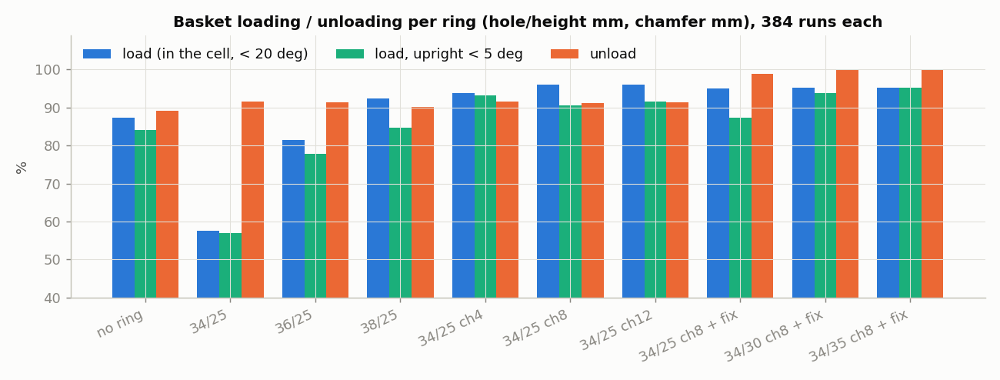
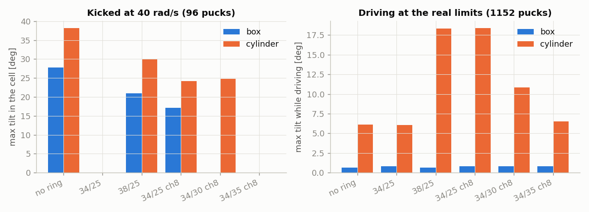
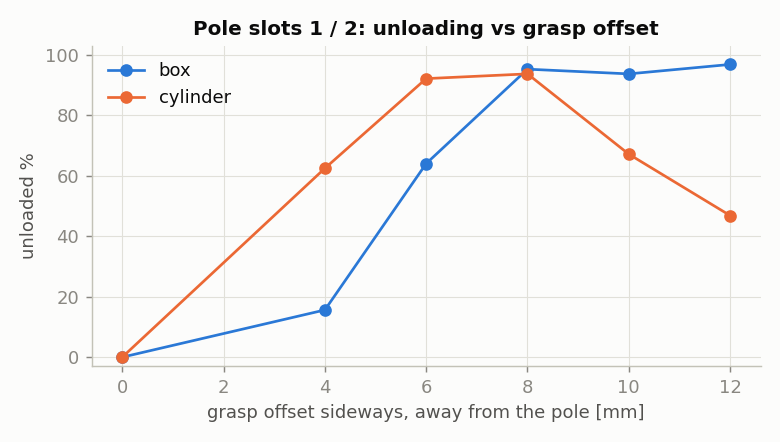
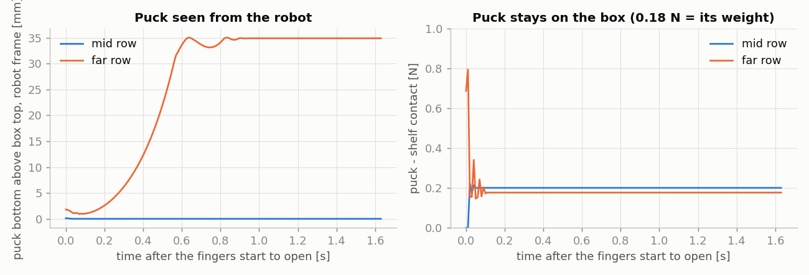

# 2026-10-30 바구니 칸 링(storage_support) 시험

**무엇을 왜 했나.** 바구니 칸 안쪽이 45 mm라 30 mm 퍽에 비해 너무 넓다. 그래서 퍽이 칸 안에서 기울고, 기운 퍽은 꺼내서 주사위 칸에 세우기 어렵다. 칸 12개에 출력한 링(storage_support)을 끼워 칸을 좁히고, 넣기·꺼내기·주행·주사위 놓기를 시뮬에서 다시 쟀다. 링 규격(구멍, 높이, 모따기)을 바꿔 가며 넣기 성공률과 넘어짐 방지를 둘 다 잡는 규격을 찾았다.

**조건.** Isaac Lab 6.1, PhysX, 100 Hz, 실물 지연 적용, 그립 8.3 N, 손가락 40 mm 열기. 넣기·꺼내기는 `cycle_sm.py`로 env 96개 × seed 2개 × 좌우 칸(−y 칸 0·1·4·5·8·9, +y 칸 2·3·6·7·10·11)이다. 링마다 384회이고, 칸·모양 한 칸당 n = 16이다. 손목은 10-29 보고서의 선택 규칙(+y 손목 반대)이고, 직육면체 면은 모든 줄에서 벽에 맞춘다(`--box_wall all`). 링이 없는 기준은 10-29 보고서의 선택 규칙(`--box_wall no_pole`) 데이터다(`../20261029_wrist_boxwall/data`). 링은 로봇 USD에 충돌체로 넣었다(벽 하나 = 볼록 조각 하나, 칸마다 4개).

링 표기는 `구멍/높이`(mm), `chN`은 위쪽 N mm 모따기(입구 42 mm)다. 시험은 모두 바깥 44.7 mm 링으로 했다. 최종 출력 규격은 칸 공차 때문에 바깥만 44.5 mm로 줄였다(퍽이 닿는 면은 같다).

## 요약

| 링 | 넣기 % (직육면체 / 원통) | 똑바로 넣기 % (5° 이하) | 꺼내기 % (직육면체 / 원통) |
|---|---|---|---|
| 없음 | 87.2 (80.7 / 93.8) | 84.1 | 89.1 (80.2 / 97.9) |
| 34/25 (처음 받은 STL) | 57.6 (40.1 / 75.0) | 57.0 | 91.7 (83.3 / 100) |
| 38/25 | 92.4 (86.5 / 98.4) | 84.6 | 90.1 (82.8 / 97.4) |
| 34/25 ch8 | 96.1 (93.2 / 99.0) | 90.6 | 91.1 (83.3 / 99.0) |
| **34/35 ch8 + 기둥 칸 보정** | **95.3 (92.7 / 97.9)** | **95.3** | **100 (100 / 100)** |

- **최종 규격은 34/35 ch8이다.** 바깥 44.5 × 44.5 mm, 높이 35 mm, 구멍 34 × 34 mm(바닥에서 27 mm까지 곧게), 27~35 mm 구간을 입구 42 × 42 mm로 모따기한다. 출력용 STL은 `storage_support_44.5x35_hole34_ch8.stl`이다.
- 이 링에서는 퍽이 칸 안에서 기울지 않는다. 40 rad/s로 쳐도 0°, 실물 한계 속도로 주행해도 원통 6.5°까지다(2장).
- 기둥 옆 칸 1·2의 꺼내기는 손을 기둥 반대쪽 옆으로 8 mm 옮겨 잡아 0 → 94~95 %가 됐다(4장).
- 주사위 놓기는 가까운·가운데 줄 93.5 %다. 먼 줄은 모든 조건에서 0 %이고, 원인은 로봇이 앞으로 넘어가는 것이다(6장).

---

## 1. 링 규격별 넣기·꺼내기

### 결과



| 링 | 넣기 % | 똑바로 넣기 % | 꺼내기 % | 가장 낮은 칸 (넣기 / 꺼내기) |
|---|---|---|---|---|
| 없음 | 87.2 | 84.1 | 89.1 | 칸 3 직육면체 62 / 칸 2 직육면체 25 |
| 34/25 | 57.6 | 57.0 | 91.7 | 칸 4 직육면체 6 / 칸 1 직육면체 0 |
| 36/25 | 81.5 | 77.9 | 91.4 | 칸 10 직육면체 38 / 칸 1 직육면체 0 |
| 38/25 | 92.4 | 84.6 | 90.1 | 칸 2 직육면체 56 / 칸 1 직육면체 0 |
| 34/25 ch4 | 93.8 | 93.2 | 91.7 | 칸 1 직육면체 69 / 칸 1 직육면체 0 |
| 34/25 ch8 | 96.1 | 90.6 | 91.1 | 칸 0 직육면체 88 / 칸 1 직육면체 0 |
| 34/25 ch12 | 96.1 | 91.7 | 91.4 | 칸 0 직육면체 88 / 칸 1 직육면체 0 |
| 34/25 ch8 + 보정 | 95.1 | 87.2 | 99.0 | 칸 1 원통 75 / 칸 1 직육면체 94 |
| 34/30 ch8 + 보정 | 95.3 | 93.8 | 100 | 칸 0 직육면체 88 / 칸 0 직육면체 100 |
| 34/35 ch8 + 보정 | 95.3 | 95.3 | 100 | 칸 1 원통 81 / 칸 0 직육면체 100 |

"넣기"는 칸 안에 기울기 20° 미만으로 들어간 경우, "똑바로 넣기"는 그중 5° 이하인 경우다. "보정"은 4장의 기둥 칸 보정이다.

### 분석

- **34 mm 구멍은 넣을 때 여유가 한쪽 2 mm뿐이다.** 내려놓는 위치가 조금만 어긋나도 퍽이 링 모서리에 걸려 기운다. 넣기가 87.2 → 57.6 %로 떨어지고 직육면체가 가장 크게 떨어진다(80.7 → 40.1 %). 대신 들어간 퍽은 똑바로 서서 꺼내기는 89.1 → 91.7 %로 오른다.
- **구멍을 넓히면 넣기는 돌아오지만 링을 넣는 의미가 줄어든다.** 38/25는 넣기 92.4 %지만 퍽이 30°까지 기운다(2장). 40 mm 이상이면 기울기 한계가 링이 없을 때와 비슷해진다.
- **모따기가 두 가지를 같이 해결한다.** 입구 42 mm는 놓는 오차를 받아 주고, 아래쪽 34 mm는 퍽을 세운다. 34/25 ch8 넣기는 96.1 %다. ch8과 ch12는 결과가 같다.
- **높이 25 mm에서는 경사면에 걸친 채 멈추는 퍽이 남는다.** 34/25 ch8은 넣기 96.1 %지만 똑바로 넣기는 90.6 %다. 직육면체가 경사면에 16~17° 기댄 채 멈춘다. 높이를 35 mm로 올리면(곧은 부분 17 → 27 mm) 두 값이 95.3 %로 같아진다. 기운 채 들어간 퍽이 없다.
- 34/30과 34/35의 넣기 성공 수가 같은 것은 우연이다(결과 파일은 다르다).
- 36/25는 38/25보다 넣기가 낮다(81.5 vs 92.4 %). 36/25만 벽 조각 메시로 만든 링이고 38/25는 박스 충돌체였다. 이 차이가 원인인지는 확인하지 않았다.

## 2. 칸 안에서 퍽이 기우는 정도

### 결과



칸마다 퍽 하나를 앉히고 수평축으로 회전 속도를 줘서 친 뒤 3초 뒤 기울기다(`tip_test.py`, 96회, seed 1). 직육면체는 벽 방향 ±3°, 위치는 링 구멍 여유 안에서 무작위로 놓았다.

| 링 | 20 rad/s 최대 기울기 (직육면체 / 원통) | 40 rad/s: 20° 넘게 기운 퍽 | 40 rad/s 최대 (직육면체 / 원통) |
|---|---|---|---|
| 없음 | 0 / 12° | 66 | 28 / 38° |
| 34/25 | 0 / 3° | 0 | 0 / 0° |
| 36/25 | 0 / 4° | 13 | 16 / 24° |
| 38/25 | 0 / 6° | 36 | 21 / 30° |
| 34/25 ch8 | 0 / 8° | 11 | 17 / 24° |
| 34/30 ch8 | 0 / 0° | 2 | 0 / 25° |
| **34/35 ch8** | **0 / 0°** | **0** | **0 / 0°** |

34/35 ch8은 60 rad/s에서도 0°다. 80·120 rad/s에서는 퍽 3·8개가 링 위로 튀어 올라 걸치고, 구멍 안에 남은 퍽은 최대 4°다.

주행 시험(`drive_test.py`)은 12칸을 모두 채우고 직진·제자리 회전·곡선·지그재그와 급정지·급반전을 돌렸다. 실물 한계는 0.26 m/s, 1.82 rad/s, 가속 2.5 m/s², 3.2 rad/s²(nav2_params)이다. 퍽 1152개다.

| 링 | 주행 뒤 똑바로 선 퍽 | 주행 중 최대 기울기 (직육면체 / 원통) |
|---|---|---|
| 없음 | 1152 / 1152 | 0.6 / 6.1° |
| 34/25 | 1152 / 1152 | 0.8 / 6.1° |
| 38/25 | 1152 / 1152 | 0.7 / 18.3° |
| 34/25 ch8 | 1150 / 1152 | 0.8 / 18.4° |
| 34/30 ch8 | 1152 / 1152 | 0.8 / 10.9° |
| 34/35 ch8 | 1152 / 1152 | 0.8 / 6.5° |

### 분석

- **기우는 정도는 `여유 ÷ 곧은 부분 높이`로 정해진다.** 원통은 정사각형 칸의 대각선(모서리) 쪽으로 기울어 더 많이 기울고, 직육면체는 면을 벽에 맞춰 넣으므로 벽 쪽으로 기운다. 구멍 모서리를 둥글게 하면 원통의 대각선 여유는 9 → 6.6 mm로만 줄고, 직육면체 여유는 1.2 → 0.3 mm로 거의 없어진다(반지름 6 mm, 계산값). 그래서 모서리는 직각으로 두고 높이를 올렸다.
- **주행으로는 어떤 링에서도 퍽이 넘어지지 않는다.** 가장 크게 기우는 것은 급회전 때 원통이다. 34/25 ch8은 원통 2개가 경사면에 기댄 채 6~7°로 남았다. 34/35 ch8은 6.5°까지 기울었다가 다시 선다.
- 급정지 때 차체는 최대 8.2° 앞뒤로 끄덕인다. 앞쪽에 받침이 없어 몸체 앞 모서리가 바닥에 닿을 때까지 숙여진다(6장과 같은 원인).
- 명령을 ×1.5, ×2로 키운 주행은 실제 속도가 0.39 m/s, 1.8 rad/s 근처에서 멈춰서 결과에 넣지 않았다. 시뮬 바퀴 드라이브 힘 한계(maxForce 3) 때문으로 보인다.

## 3. 기운 퍽을 꺼내 주사위 칸에 세우기

꺼낸 퍽을 상자 위 3 × 3 주사위 칸에 놓고 기울기 5° 미만, 칸 중심 10 mm 이내면 성공으로 셌다(`cycle_sm.py --place`). 칸 안 퍽을 회전으로 기울인 뒤 2초 안정시키고 꺼냈다(`--unload_kick`). 먼 줄은 모든 조건에서 0 %라(6장) 가까운·가운데 줄 6칸만 셌다.

| 링 / 방법 | 시작 기울기 5° 미만 | 5~20° | 20~26° | 26° 이상 |
|---|---|---|---|---|
| 없음 | 68.3 % (445) | 59.1 % (22) | 33.3 % (96) | 20.1 % (229) |
| 34/25 ch8 | 90.2 % (122) | 67.6 % (37) | 42.6 % (61) | 15.9 % (44) |
| 34/25 ch8 + 기울기 보정 | 93.4 % (122) | 56.8 % (37) | 47.5 % (61) | 18.2 % (44) |
| 34/35 ch8 | **93.5 % (520)** | 1회 | 1회 | 0 % (6) |

괄호는 횟수다. 링이 없을 때는 칸 안에서 38°까지 기울고, 34/25 ch8은 24°까지 기운다. 그 이상은 세게 쳐서 링 위로 튀어 오른 경우다.

### 분석

- **기운 퍽은 잡기부터 실패한다.** 꺼내는 동작은 퍽이 똑바로 서 있다고 보고 칸 중심을 수직으로 잡는다. 34/25 ch8에서 20~26°로 기운 퍽은 잡기가 74 %다. 잡더라도 손 안에서 비스듬히 매달려 놓을 때 기울어 선다.
- **손 안 기울기 보정은 효과가 작다.** 손 안 퍽 축을 측정(±3° 오차 가정)해서 퍽이 수직으로 서도록 손목 자세를 기울였다(`--place_tilt_fix`). 5축 팔이라 옆으로는 못 기울이므로 손목 회전 후보 중 가장 똑바로 세우는 것을 골랐다. 20~26°에서 42.6 → 47.5 %다. 잡는 순간 손가락이 퍽을 상당 부분 세워 줘서 손 안 기울기가 대부분 0~10°라 보정할 몫이 적다. 못 잡은 26 %는 보정으로 고칠 수 없다.
- **그래서 칸 안에서 기울지 않게 하는 쪽을 택했다.** 34/35 ch8에서는 528회 중 520회가 5° 미만으로 시작하고, 이 퍽은 93.5 % 세운다. 기울이지 않은 퍽(같은 링, 칠 때 0)과 같은 수준이다.

## 4. 기둥 옆 칸 1·2 꺼내기

### 결과



34/25 ch8, 칸 1·2만 꺼냈다.

| 잡는 방법 | 직육면체 % | 원통 % | 횟수 |
|---|---|---|---|
| 칸 중심, 넣을 때 손목 그대로 | 0 | 93.8 | 64 |
| 손목 반대 (카메라가 기둥 쪽) | 0 | 0 | 128 |
| 그리퍼 몸체를 y축과 나란히 (두 종류 모두) | 0 | 0 | 64 |
| 팔 쪽(+x)으로 2~8 mm | 0 | 0 | 각 64 |
| 기둥 반대쪽 옆으로 4 mm | 15.6 | 62.5 | 64 |
| 6 mm | 64.1 | 92.2 | 128 |
| **8 mm** | **95.3** | **93.8** | 128 |
| 10 mm | 93.8 | 67.2 | 128 |
| 12 mm | 96.9 | 46.9 | 64 |

### 분석

- **실패 원인은 벌린 기둥 쪽 손가락이 프로파일에 닿는 것이다.** 직육면체는 면을 벽에 맞추려고 손목을 원통보다 약 8.5° 더 돌려서, 그리퍼 몸체가 y축과 정확히 나란해진다. 이 자세에서는 손가락이 x 방향(기둥 ↔ 팔)으로 벌어지고, 폭이 약 58 mm인 손가락이 y 방향으로 프로파일 영역에 4~7 mm 걸친다(충돌 메시 외곽 상자 기준). 손가락이 프로파일에 옆으로 눌려 25~40 N 안쪽으로 밀리고, 퍽 윗면에 걸려 손이 약 20 mm 위에서 멈춘다.
- 카메라는 원래도 기둥 반대쪽을 본다. 손목을 반대로 돌리면 카메라가 기둥 정면 약 34 mm 앞까지 와서 닿는다(34~42 N).
- **기둥 반대쪽 옆(1번 칸 −y, 2번 칸 +y)으로 8 mm 옮겨 잡으면 해결된다.** 손가락이 x로 벌어지므로 y로 옮기면 퍽을 밀지 않고 손가락 패드의 다른 부분으로 잡는다. 6 mm 이하는 손가락이 아직 걸리고, 10 mm 이상은 원통을 손가락 가장자리로 잡아 미끄러진다. 여유는 앞뒤로 약 2 mm다.
- 보정 설정: `--wall_all_slots 1,2 --unload_away_mm 8 --unload_dx_slots 1,2`. 이 설정을 넣으면 넣기에서 칸 1 원통이 94 → 75 %로 떨어졌다(34/25 ch8). `--wall_all_slots`가 넣을 때도 원통 손목을 ±90°로 돌리기 때문으로 보인다. 34/35 ch8에서는 81 %다.

## 5. 넣기·꺼내기 기구학 정리

34/35 ch8 + 보정에서 12칸 모두 직육면체·원통이 넣기·꺼내기에 성공한다. 가장 낮은 칸도 넣기 81 %(칸 1 원통)다. 팔이 닿고, 자세가 나오고, 기둥·바구니·링에 부딪히지 않는 경로가 있다. 남은 실패(넣기 약 5 %)는 링 모서리에 걸리거나 손가락에 끼는 접촉 문제다. 칸 1·2 꺼내기는 위치 여유가 약 2 mm라 실물에서 확인이 필요하다.

## 6. 주사위 먼 줄 — 로봇이 앞으로 넘어간다

### 결과



| 줄 (칸 x) | 성공 (34/25 ch8, seed 1) | 손 안 퍽 바닥 위치, 운반 → 칸 위 → 내린 뒤 → 연 뒤 (mm) | 내린 뒤 차체 기울기 |
|---|---|---|---|
| 가까운 줄 (0.1225 m) | 28 / 33 | 61.0 → 59.1 → 59.0 → 60.8 | 0.00° |
| 가운데 줄 (0.1825 m) | 33 / 33 | 61.0 → 61.0 → 60.9 → 61.1 | 0.00° |
| 먼 줄 (0.2425 m) | 0 / 30 | 61.0 → 60.2 → 59.8 → **40.4** | −0.33° |

놓는 자세에서 로봇 + 퍽(3.42 kg) 무게중심의 x 위치다(`com_check.py`, 바퀴 축 = 0, + = 앞).

| 자세 | 무게중심 x |
|---|---|
| 홈 자세 | −20.7 mm |
| 가까운 줄 | −14.2 mm |
| 가운데 줄 | −1.9 mm |
| 먼 줄 | **+10.2 mm** |

### 분석

- **먼 줄에 놓을 때는 무게중심이 바퀴 축보다 앞에 있다.** 캐스터는 뒤쪽(x −177 mm)에만 있다. 퍽을 상자에 누르는 동안은 상자가 팔을 받쳐 차체가 0.33°만 숙여진다. 손가락을 여는 순간 받침이 사라지고 몸체 앞 모서리가 바닥에 닿을 때까지 숙여진다.
- 숙여지면 손이 퍽 위로 내려와 감싸고, 손을 올릴 때 퍽이 끌려 올라간다. 퍽은 그동안 상자에 그대로 닿아 있다(접촉 0.18 N = 퍽 무게). 로봇 기준으로 보면 퍽이 35 mm 떠오른 것처럼 보이지만, 실제로는 로봇이 움직인 것이다.
- 손가락을 50 mm까지 넓혀 열거나(36 → 40 / 44 / 50 mm), 상자 위 5~20 mm에서 놓아도 먼 줄은 0 %다. 관절 공간 경로에서도 퍽이 상자보다 낮아지는 구간은 없다(계산).
- 몸체 무게중심은 10-28에 실물 균형 자세로 맞춘 값이라 실물도 같을 가능성이 높다. 가운데 줄도 여유가 −1.9 mm뿐이다.
- 로봇 앞면(x 0.069 m)과 상자 앞면(0.080 m)은 11 mm 떨어져 있어서, 로봇을 더 붙여 먼 줄을 가깝게 만들 수는 없다. 10-28 보고서 7장의 "정차 위치를 앞으로" 제안은 이 간격 때문에 쓸 수 없다.

## 다음 할 일

1. 먼 줄: 몸체 앞쪽 아래(x 약 +60 mm)에 받침(볼 캐스터나 미끄럼판)을 달거나, 뒤쪽에 무게를 단다(뒤 캐스터 위치에 0.2 kg이면 먼 줄 무게중심이 바퀴 축, 0.41 kg이면 −10 mm). 또는 상자의 다른 쪽에서 놓는다. 시뮬로 확인한다.
2. 실물 확인: 칸 1·2에서 벌린 기둥 쪽 손가락과 프로파일 간격, 원통을 패드 중심에서 8 mm 벗어나 잡을 때 미끄러지는지.
3. 출력 확인: 44.5 mm 링이 칸에 들어가는지(한쪽 0.25 mm), 윗모서리 벽 1.25 mm가 버티는지. 약하면 입구를 41 mm로 줄인다(1.75 mm).
4. 최종 44.5 mm 모델로 시험을 한 번 다시 돌린다(시험은 44.7 mm로 했다).

## 재현

```bash
# 링 모델 만들기 (링이 없는 beebot.urdf / base.usda에서): 구멍 높이 모따기깊이 입구 [mm]
cd lv2_module6/urdf/beebot_mesh/scripts
<IsaacLab>/.venv/bin/python make_storage_support.py ../beebot.urdf ../../../isaac/sim/usda/beebot/payloads/base.usda ../meshes 34 35 8 42
python3 make_xacro.py
# 출력용 STL: 바깥 구멍 높이 모따기깊이 입구
python3 print_storage_support.py storage_support_44.5x35_hole34_ch8.stl 44.5 34 35 8 42

cd lv2_module6/isaac/lab/scripts
X="--latency --box_wall all --wall_all_slots 1,2 --unload_away_mm 8 --unload_dx_slots 1,2"
isaaclab.sh -p cycle_sm.py --num_envs 96 --seed 1 $X --slots 0,1,4,5,8,9                                        # 넣기, -y 칸
isaaclab.sh -p cycle_sm.py --num_envs 96 --seed 1 $X --mirror_wrist --mirror_side 1 --slots 2,3,6,7,10,11 --unload  # 꺼내기, +y 칸
isaaclab.sh -p cycle_sm.py --num_envs 96 --seed 1 $X --slots 0,1,4,5,8,9 --place --unload_kick 80             # 꺼내서 주사위 칸
isaaclab.sh -p tip_test.py --mode push --spin 40 --hole_mm 34                                                  # 칸 안에서 치기
isaaclab.sh -p drive_test.py --hole_mm 34                                                                      # 주행

# 표와 그림
cd lv2_module6/isaac/sim/R2S/report/20261030_storage_support
<IsaacLab>/.venv/bin/python make_figs.py
<IsaacLab>/.venv/bin/python com_check.py
```
