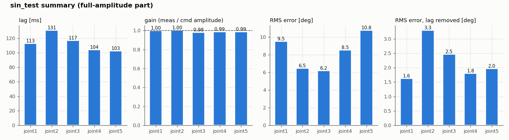
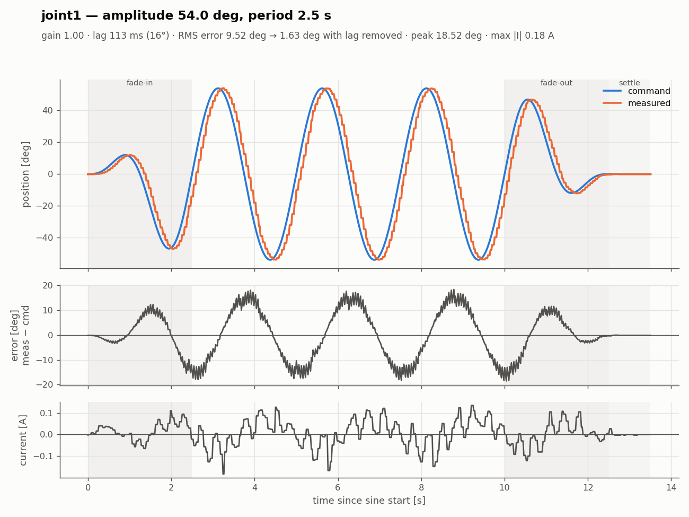
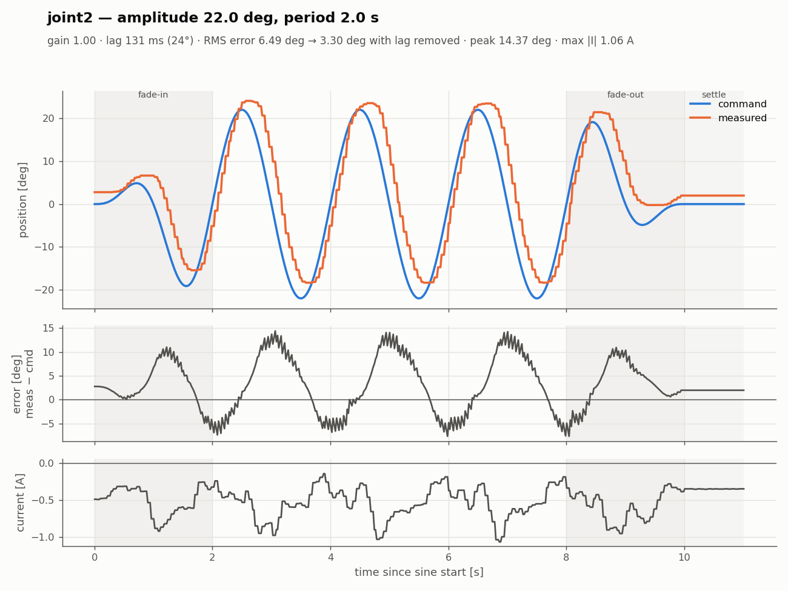
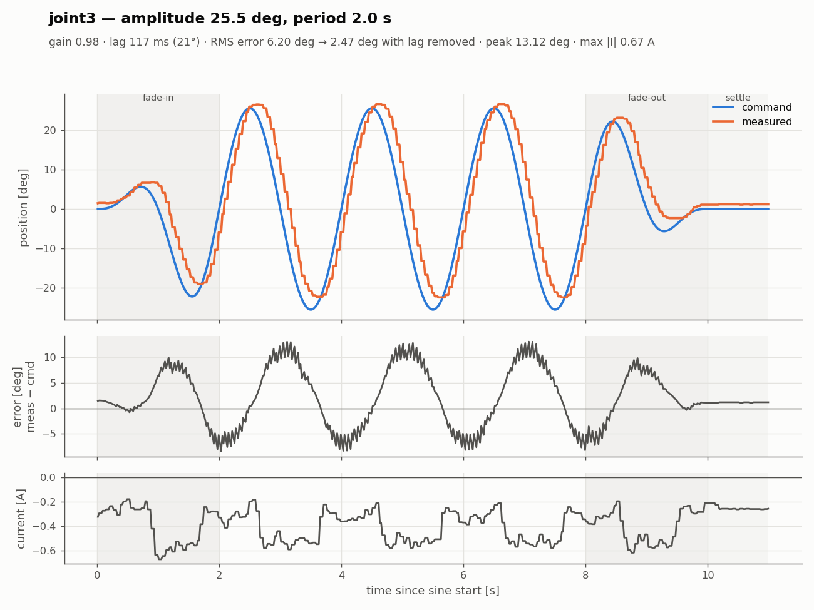
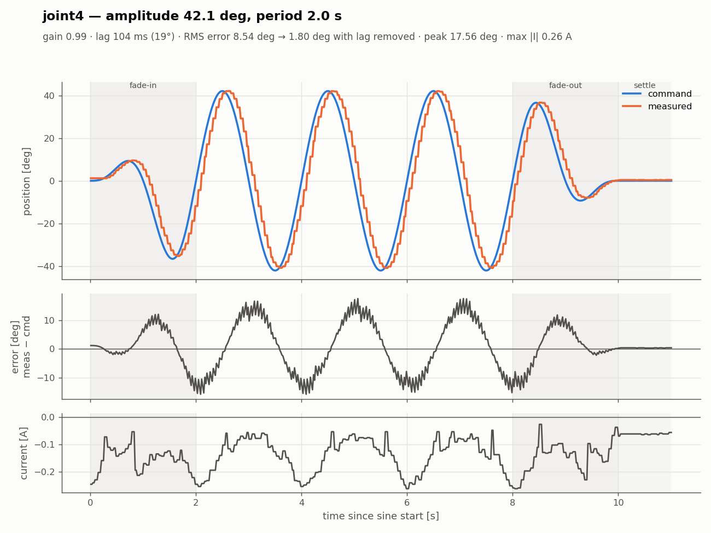
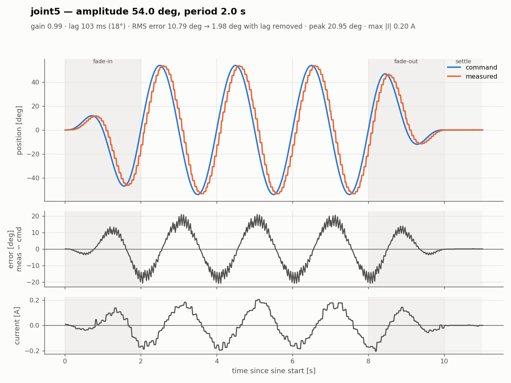
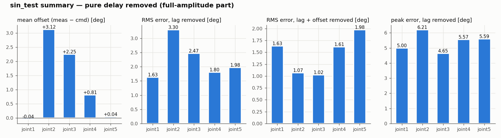
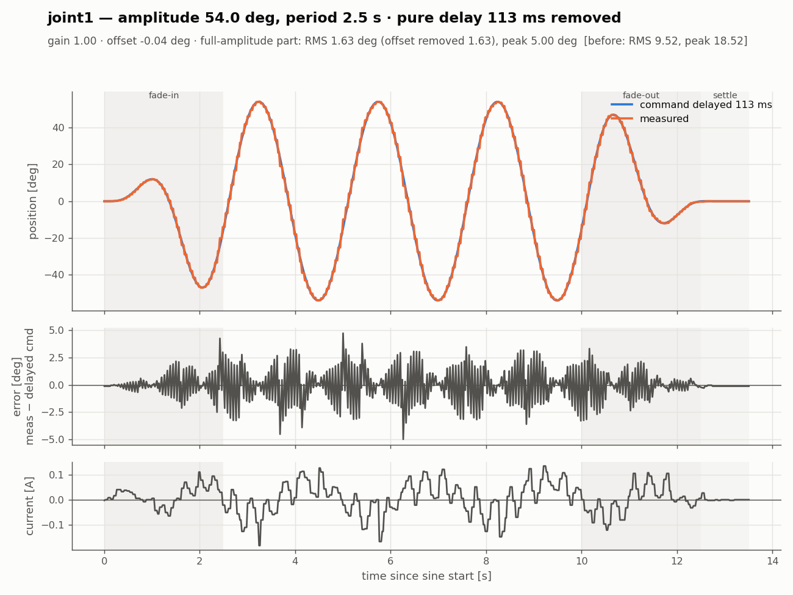
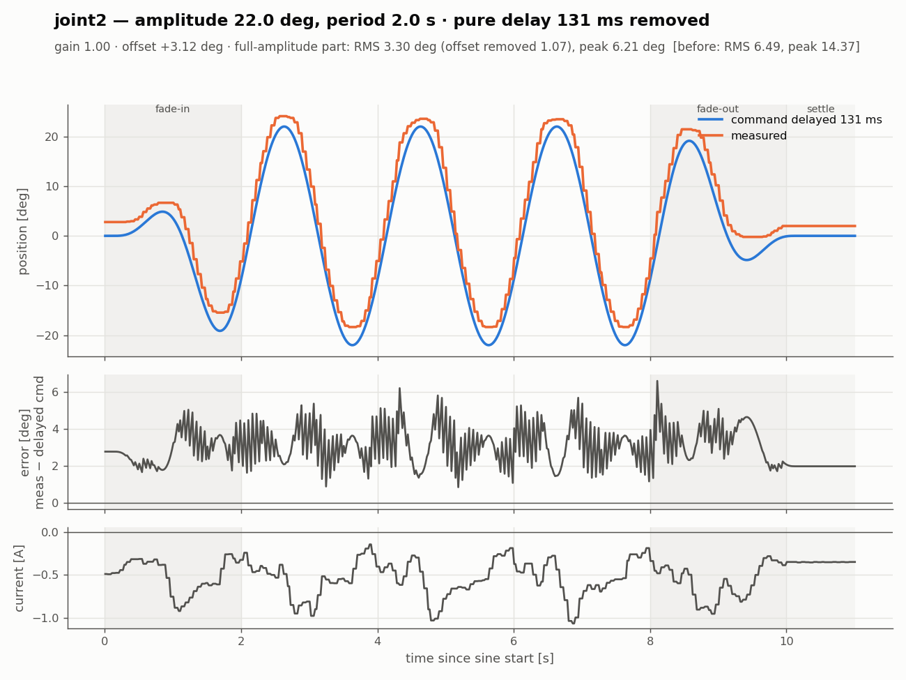

# 2026-10-24 작업 기록 — 실기 관절 사인파 응답 시험 (real_test)

실제 beebot 팔(joint1~5)에 사인파 위치 명령을 주고, 명령값과 측정값(`/joint_states`)을 기록했다.
목적은 Isaac Sim Gain Tuner 결과와 비교해서 시뮬레이션 drive(stiffness·damping)를 실기에 맞추는 것이다.
오늘은 시험 도구를 새 구조로 바꾸고, 실기 연결에서 생긴 문제를 하나씩 해결한 뒤 joint1~5를 측정했다.

- 작업 범위: `isaac/` 안의 파일만 수정했다. 메인 ws(`ros2_ws/src/control`, `ros_system`), `firmware/`, `urdf/`는 읽기만 했다.
- 메인 bringup(`ros_system`)은 시험하는 동안 쓰지 않는다. 하드웨어는 `real_test`의 `hw.launch.py`로만 띄운다.

---

## 1. 시험 도구 구조 변경

### 1-1. 변경 전
`sine_test.launch.py` 하나로 하드웨어, 컨트롤러, 테스트 노드(`sine_test_node`)를 한 번에 띄웠다.
`sine.yaml`에서 `test: true`인 관절을 차례로 시험하고, 끝나면 launch가 스스로 종료하는 일괄 실행 방식이었다.

### 1-2. 변경 후: 3개로 분리
```
터미널 1  ros2 launch sine_test hw.launch.py           # 하드웨어 + 컨트롤러만, 계속 유지
터미널 2  ros2 run sine_test set_center                # joint5 → joint1 순서로 0° 로
          ros2 run sine_test set_center joint3         # joint3 만 0° 로
          ros2 run sine_test sin_test joint3           # joint3 사인 시험 (설정은 config/sine.yaml)
```

| 구성 | 통신 | 동작 |
|---|---|---|
| `hw.launch.py` | – | rsp, ros2_control(inactive로 시작 → 2초 뒤 active), JSB·JTC spawn. 테스트 노드와 자동 종료는 없음 |
| `set_center` | **topic** `/arm_controller/joint_trajectory` | 인자가 없으면 joint5 → joint1 순서로 한 관절씩 0°(서보 수직, 2048)로 이동한다. 관절 이름을 주면 그 관절만 이동한다. 그리퍼는 개도를 유지한다 |
| `sin_test <joint>` | **action** `follow_joint_trajectory` | yaml의 `joints.<joint>` 설정으로 center 이동 → 사인(fade-in/out) → center에서 settle → **그 자리에 정지**한다. 로그를 저장하고 종료한다 |

공통 동작:
- **`q`** 또는 Ctrl+C를 누르면 그 자리에서 정지하고 정상 종료한다. `sin_test`는 그때까지의 로그를 저장하고 `interrupted: true`를 기록한다.
- 키 입력을 받아야 하므로 launch가 아니라 터미널에서 `ros2 run`으로 실행한다.
- 관절 이름이 잘못되면 로그만 남기고 아무것도 움직이지 않는다. `sin_test`는 yaml에 없는 이름, `set_center`는 joint1~5가 아닌 이름이 해당한다.

### 1-3. 설계에서 정한 것
- **center 정의:** 팔 관절은 **0°(서보 수직)**를 기준으로 한다. 원래 Isaac Gain Tuner처럼 URDF 범위의 가운데로 잡았는데 사용자 요청으로 바꿨다. 그리퍼는 범위 가운데(13.25 mm)를 그대로 쓴다.
  - Gain Tuner는 팔도 범위 가운데가 중심이다(joint3 −5°, joint4 +7.7°). Isaac과 비교하려면 Gain Tuner에도 같은 중심을 줘야 한다.
- **움직이지 않는 관절의 자세 유지 기준:** 측정값이 아니라 **JTC가 지금 명령하고 있는 값**(`/arm_controller/controller_state`의 `reference`)을 다시 보낸다.
  - 실기는 팔 무게 때문에 명령보다 조금 처진다. 측정값을 새 명령으로 보내면 시험을 반복할 때마다 자세가 조금씩 내려간다.
  - 이 값을 받아야 노드가 시작하므로 `arm_controller`가 active가 아니면 두 노드 모두 시작하지 않는다.
- **일괄 실행 방식(`sine_test_node.py`, `sine_test.launch.py`)은 삭제했다.** yaml의 `test`, `pre_center` 항목도 없앴다.

### 1-4. 바뀐 파일 (`isaac/sim/real_test/` 아래, 커밋 전)
| 파일 | 내용 |
|---|---|
| `ros2_ws/src/sine_test/sine_test/common.py` | 새 파일. 공통 코드(URDF 한계, `SineTest`, center 계산, `q` 키 감시, `ArmNode`) |
| `ros2_ws/src/sine_test/sine_test/set_center_node.py` | 새 파일 |
| `ros2_ws/src/sine_test/sine_test/sin_test_node.py` | 새 파일 |
| `ros2_ws/src/sine_test/launch/hw.launch.py` | 새 파일. `mesh_uri` 인자 포함 |
| `ros2_ws/src/sine_test/config/sine.yaml` | 관절별 설정만 남기고 설명 주석을 고침 |
| `ros2_ws/src/sine_test/config/controllers.yaml` | `update_rate` 100 → **50** (3장 참고) |
| `ros2_ws/src/sine_test/setup.py` | 실행 명령 `set_center`, `sin_test` 등록 |
| `README.md` | 새 구조에 맞춰 다시 씀 |
| `plot_logs.py` | 새 파일. 로그 분석과 그래프(보정 전/지연 보정, 요약, 관절별 한 장) |
| 삭제 | `sine_test_node.py`, `sine_test.launch.py` |

---

## 2. 시작 순서와 "0 명령" 문제 (참고)

`BeebotSystemHardware::on_activate()`(`ros2_ws/src/control/src/beebot_system_hardware.cpp:64`)는 현재 state를 명령으로 복사한다.
그런데 `on_configure()`가 state를 0으로 초기화하기 때문에, 첫 시리얼 읽기 전에 active가 되면 **팔 전체에 0 rad(서보 중앙) 명령이 나간다.**

- `hw.launch.py`는 하드웨어를 inactive로 띄워 2초 동안 실제 자세를 읽은 뒤 active로 바꾼다. 그래서 이 문제가 생기지 않는다.
- 메인 bringup(`ros_system.launch.py`)에는 이 문제가 그대로 있다. 시험 중에는 메인 bringup을 쓰지 않으므로 영향은 없고, `isaac/` 밖이라 수정하지 않았다.

---

## 3. 실기 연결 중 생긴 문제와 해결

### 3-1. 토픽이 하나도 안 보임 → `ROS_DISCOVERY_SERVER` 잔여 설정
- **증상:** hw.launch를 실행해도 `ros2 topic list`가 비어 있었다.
- **원인:** launch를 실행한 터미널에 `ROS_DISCOVERY_SERVER=127.0.0.1:11811`이 남아 있었는데, discovery server는 떠 있지 않았다.
  - 노드끼리 서로를 찾지 못해서 `set_hardware_component_state ... active`가 2분 넘게 멈춰 있었고, 그래서 spawner와 컨트롤러가 뜨지 않았다.
  - `~/.bashrc`에서는 주석 처리돼 있었지만 그 터미널에는 예전에 export한 값이 그대로 남아 있었다. `source ~/.bashrc`는 이미 설정된 변수를 지우지 않는다.
- **해결:** 각 터미널에서 `unset ROS_DISCOVERY_SERVER` 하거나 새 터미널을 열고, `ros2 daemon stop`. `ROS_DOMAIN_ID`는 8 → **88**로 바꿨다(사용자 변경).
- **참고:** hw.launch의 activate 단계에는 timeout이 없다. discovery가 안 되면 에러 없이 멈춰 있는다.

### 3-2. active 이후 OpenCR 상태(S) 수신 끊김 → C 명령이 밀림
- **증상:** `OpenCR 상태(S) 수신 없음 0.5초 넘음` 경고가 반복됐다.
- **진단:** `/diagnostics`의 하드웨어 카운터를 봤다.

  | 시점 | 마지막 S | 보낸 C | 받은 S |
  |---|---|---|---|
  | active 상태 (100 Hz) | 296 s 전 | 29645 (계속 증가) | **126** (멈춤) |
  | inactive로 바꾼 뒤 약 6초 | 0.016 s 전 | 29858 (멈춤) | **503** → 이후 1380 (계속 증가) |

  - S 126줄은 inactive였던 3초 정도 분량이다. **SBC가 C를 100 Hz로 보내기 시작한 순간 S가 끊겼다.**
  - C 송신을 멈추면(inactive) 즉시 S가 다시 들어왔다. 펌웨어가 멈춘 것이 아니라 C 처리에 밀려 S를 보낼 차례가 오지 않은 것이다.
- **원인 (펌웨어 구조, 5장 참고):** `loop()`가 USB로 들어온 C 줄을 전부 처리한 뒤에 S를 보낸다. C 한 줄마다 DXL 쓰기가 8번, S 한 번마다 읽기가 22번 들어간다.
- **해결:** real_test의 `controllers.yaml`에서 `update_rate`를 100 → 25로 낮춰 S가 들어오는 것을 확인했다. 현재는 **50 Hz**로 쓰고 있다.
- **주의:** `ros2 launch`는 `src/`가 아니라 `install/`에 복사된 yaml을 읽는다. 처음 25로 고쳤을 때는 다시 빌드하지 않아서 여전히 100 Hz로 돌았다. yaml을 바꾸면 `colcon build`를 다시 하거나, `--symlink-install`로 빌드해 둔다.

### 3-3. `arm_controller`가 시작하자마자 꺼짐 → URDF 한계 밖 자세
- **증상:** `arm_controller`가 `unconfigured` 상태였다.
  ```
  Joint position is out of bounds for the joint : 'joint2' actual position: -2.08029 limits: [-1.919862, 1.919862]
  Deactivating controllers : [ arm_controller ]
  ```
- **원인:** 팔이 접힌 자세였다. joint2 **−119.2°**(한계 ±110°), joint4 **+123.1°**(한계 −97.4° ~ +112.9°). ros2_control은 한계 밖 state를 받으면 컨트롤러를 바로 끈다.
- **해결:** 토크가 꺼진 상태(3-4)에서 손으로 팔을 한계 안으로 옮기고 다시 시작했다. 이후 joint2 −47°, joint4 +52.8° 등으로 범위 안에 들어왔다.

### 3-4. OpenCR 전원을 껐다 켜도 재부팅되지 않음 → USB 전원
- **구성:** Jetson과 OpenCR이 USB로 연결되어 있다. OpenCR의 MCU는 USB 5V로도 켜진다.
- **현상:** OpenCR 전원 스위치는 12V(모터 전원)만 끊는다.
  - MCU는 계속 켜져 있었다(USB 장치 번호 `004` 그대로, S가 38 Hz로 계속 나옴).
  - 모터는 12V가 다시 들어오면 **토크가 꺼진 상태**로 시작한다. 펌웨어는 부팅할 때 `setup()`에서만 토크를 켜므로 다시 켜지지 않는다.
- **토크를 다시 켜는 방법 (USB를 뽑지 않고):**
  1. OpenCR **RESET 버튼**
  2. 펌웨어 재업로드(`firmware/upload.sh`)를 하면 watchdog 리셋 → 부트로더 → 같은 펌웨어 실행 순서로 재부팅된다.
  - launch에서 토크를 켜는 방법은 없다. 프로토콜에 토크 명령이 없고, 추가하려면 펌웨어를 고쳐야 한다(isaac 밖).
- 이 상태를 활용해서 토크가 꺼진 동안 팔을 손으로 한계 안으로 옮겼다(3-3).

### 3-5. joint5 모터를 뺐을 때 그리퍼도 같이 끊김 (참고)
- joint5와 그리퍼가 모두 **서보 0°**로 읽혔다. 펌웨어는 읽기에 실패하면 0을 반환한다.
- 그리퍼(ID 16)가 joint5(ID 15) 뒤에 데이지 체인으로 연결돼 있어서 같이 끊긴 것으로 보인다.
- 그리퍼 값(−52 mm)이 한계 밖이라 `arm_controller`가 다시 꺼졌다. 이후 모터를 다시 연결해 정상으로 돌아왔다.
- 이때 joint4 전류가 +5.41 A로 계속 같은 값이었다(XM430 전류 한계보다 큼). 읽기 이상인지 실제 부하인지는 확인하지 못했다.
- 모터 일부를 뺀 채 시험하려고 `hw.launch joints:=`(연결된 관절만 제어)로 수정하던 중이었는데, 사용자 요청으로 중단했다. **반영된 변경은 없다.**

### 3-6. RViz에서 메시가 안 보임 → `mesh_uri`
- **증상:** PC의 RViz에서 `Could not load resource [package://ros_system/urdf/meshes/wheel_left_link.stl]`
- **원인:**
  - hw.launch가 xacro에 `mesh_uri`를 넘기지 않아 기본값 `package://ros_system/urdf/meshes`가 들어갔다. 실제 설치 경로는 `.../urdf/beebot_mesh/meshes`다.
  - `package://`는 **RViz를 띄운 PC에서** 찾으므로 PC에도 `ros_system` 패키지가 있어야 한다.
- **해결:** `hw.launch.py`에 `mesh_uri` 인자를 추가했다. 기본값은 메인 launch와 같은 `package://ros_system/urdf/beebot_mesh/meshes`다.

### 3-7. RViz에서만 팔이 떨림 → PC와 Jetson 시계 차이
- **진단:** PC에서 `ros2 topic delay /joint_states`를 실행했다.

  | | average delay | 표준편차 |
  |---|---|---|
  | 수정 전 | **−0.411 s** | 0.9 ms |
  | PC NTP 동기화 후 | **+0.023 s** | 2 ms |
  | 이후 | +0.006 s | 1 ms |

  - 음수는 PC 시계가 Jetson보다 늦다는 뜻이다. RViz가 PC 시각으로 TF를 조회하는데 메시지에는 0.4초 미래 시각이 찍혀 있어서 프레임마다 다른 TF를 썼다.
  - Jetson은 `systemd-timesyncd`로 `1.pool.ntp.org`에 동기화되어 있었다.
- **해결:** PC에서 `sudo timedatectl set-ntp true`
- **참고 1:** ssh로 `date`를 비교한 결과(1.8 s)는 비밀번호 입력 시간(왕복 2.8 s)이 섞여서 쓸 수 없었다.
- **참고 2:** 남은 미세한 떨림은 엔코더 **1 tick(0.088°)** 떨림이다. 위치를 유지하는 서보가 이웃한 두 값 사이를 오가는 정상 동작이고, joint3·joint4가 5초에 32~40번 바뀐다. 팔 끝 기준 0.5 mm 미만이라 실제로는 보이지 않는다. `/joint_states`와 `/tf`의 publisher는 각각 하나뿐임을 확인했다.

---

## 4. 시험 결과 (joint1~5)

조건: `update_rate` 50 Hz, `sample_hz` 50, `ramp_cycles` 1, `settle_s` 1, 관절별로 center 0°.
**아래 표와 그래프는 관절별 최신 측정 기준이다.** joint1·joint2·joint3은 14:41~14:42에 재측정한 값, joint4·joint5는 14:16~14:17 첫 측정 값이다.

| 관절 | 사용한 측정 | 다른 측정 |
|---|---|---|
| joint1 | `20261024_144242_joint1` | `20261024_141537_joint1`, `20261024_144222_joint1` |
| joint2 | `20261024_144140_joint2` | `20261024_141602_joint2` |
| joint3 | `20261024_144204_joint3` | `20261024_141622_joint3` |
| joint4 | `20261024_141643_joint4` | – |
| joint5 | `20261024_141703_joint5` | – |



### 4-1. 요약 (진폭이 일정한 구간, fade-in/out 제외)
| 관절 | 진폭 / 주기 | gain | 지연 | 위상 | RMS 오차 | 지연을 빼면 | peak 오차 | 평균 오프셋 | 최대 전류 |
|---|---|---|---|---|---|---|---|---|---|
| joint1 | ±54.0° / 2.5 s | 1.00 | 113 ms | 16.3° | 9.52° | **1.63°** | 18.52° | −0.04° | 0.18 A |
| joint2 | ±22.0° / 2.0 s | 1.00 | 131 ms | 23.6° | 6.49° | **3.30°** | 14.37° | **+3.12°** | 1.07 A |
| joint3 | ±25.5° / 2.0 s | 0.98 | 117 ms | 21.1° | 6.20° | **2.47°** | 13.12° | **+2.25°** | 0.67 A |
| joint4 | ±42.1° / 2.0 s | 0.99 | 104 ms | 18.8° | 8.54° | **1.80°** | 17.56° | +0.81° | 0.26 A |
| joint5 | ±54.0° / 2.0 s | 0.99 | 103 ms | 18.5° | 10.79° | **1.98°** | 20.95° | +0.04° | 0.20 A |

- **gain:** 측정 진폭 ÷ 명령 진폭. 진폭이 일정한 구간에서 시험 주파수의 사인을 최소제곱으로 맞춰 구했다.
- **지연:** 같은 사인 맞춤의 위상차를 시간으로 바꾼 값이다.
- **지연을 빼면:** 명령을 지연만큼 늦춰서 비교했을 때 남는 RMS 오차.
- 측정별 결과는 각 폴더의 `analysis.yaml`에 있다.

### 4-2. 재현성 (같은 관절 반복 측정)
| 관절 | 측정 | gain | 지연 | 평균 오프셋 | RMS (지연 보정) | RMS (지연 + 오프셋 보정) | 최대 전류 |
|---|---|---|---|---|---|---|---|
| joint1 | 14:15:37 | 1.00 | 114.9 ms | −0.01° | 1.61° | 1.61° | 0.24 A |
| joint1 | 14:42:22 | 1.00 | 113.6 ms | +0.01° | 1.59° | 1.59° | 0.14 A |
| joint1 | 14:42:42 | 1.00 | 112.9 ms | −0.04° | 1.63° | 1.63° | 0.18 A |
| joint2 | 14:16:02 | 1.00 | 127.8 ms | +2.76° | 2.92° | 0.96° | 0.99 A |
| joint2 | 14:41:40 | 1.00 | 131.2 ms | +3.12° | 3.30° | 1.07° | 1.07 A |
| joint3 | 14:16:22 | 0.98 | 115.3 ms | +2.11° | 2.35° | 1.05° | 0.65 A |
| joint3 | 14:42:04 | 0.98 | 117.2 ms | +2.25° | 2.47° | 1.02° | 0.67 A |

- 지연은 ±3.4 ms, 오프셋은 ±0.4°, 오프셋까지 뺀 RMS는 ±0.1° 안에서 같게 나왔다. **결과가 잘 재현된다.**
- joint2·joint3의 오프셋(중력 처짐)은 재측정에서 조금 커졌다(+0.36°, +0.14°). 시작 자세나 모터 온도에 따른 차이로 보이지만 확인하지는 않았다.

### 4-3. 해석
1. **진폭은 거의 그대로 따라간다(gain 0.98~1.00).** 대신 **103~131 ms 늦다.** `summary.yaml`의 큰 peak·RMS 오차는 대부분 이 지연 때문이다. 주기가 짧고 진폭이 큰 joint5·joint1의 오차가 가장 크다.
2. **joint2와 joint3은 중력 때문에 2~3° 처진다.** 사인 전과 settle 구간에서도 같은 만큼 떨어져 있다. 팔 무게를 받는 joint2의 전류가 최대 1.07 A로 가장 크다.
3. **측정값이 계단 모양이다.** 움직이는 동안 측정이 **60 ms마다(약 17 Hz)**만 갱신된다. `/joint_states`는 50 Hz지만 값은 60 ms마다 바뀐다.
   - 가만히 있을 때는 S가 40 Hz였다. C를 50 Hz로 받으면서 S 주기가 느려진 것이다(3-2와 같은 원인).
   - 오차 그래프의 톱니 모양과 평균 약 30 ms의 추가 측정 지연이 여기서 나온다.

### 4-4. Isaac Gain Tuner와 비교할 때 주의
- 103~131 ms 지연에는 서보가 실제로 늦게 따라가는 것 말고도 **통신·측정 경로의 지연**이 섞여 있다(4-6 참고).
- 이 지연을 전부 stiffness·damping으로 맞추면 시뮬레이션 drive가 실제보다 무르게 맞춰진다.
- 이번 로그에서 그대로 쓸 수 있는 것은 **gain(약 1)과 중력 오프셋(joint2·joint3)**이다. **지연은 상한값**으로 본다.
- 관절 부호·영점·그리퍼 변환은 아직 실측 전이다(펌웨어 `config.h` TODO).

### 4-5. 관절별 그래프 (보정 전)
각 그래프의 위쪽은 명령과 측정, 가운데는 오차(측정 − 명령), 아래쪽은 서보 전류다. 회색 구간은 fade-in, fade-out, settle이다.

| | |
|---|---|
|  |  |
|  |  |
|  | |

### 4-6. 순수 지연을 보정한 결과
진폭은 거의 그대로이고(gain 0.98~1.00) 위상만 16~24° 늦다. 일반적인 1차 지연이라면 위상이 20° 늦을 때 gain이 cos20° ≈ 0.94로 줄어야 한다.
그래서 지연 대부분을 **순수 지연**(통신·측정 경로)으로 보고, 명령을 관절별로 맞춘 지연만큼 늦춰서 다시 비교했다.
남는 오차가 서보 자체의 추종 오차다.

지연 103~131 ms의 구성 (추정):

| 구간 | 내용 |
|---|---|
| ① 명령 전달 | JTC 50 Hz → `C` 송신 → USB → OpenCR이 `send_state()`(읽기 22번) 하는 동안 대기 → `setGoalPosition` |
| ② 서보 추종 | XM430 위치 제어. gain이 약 1이라 작은 것으로 본다 |
| ③ 측정 전달 | 60 ms마다 `S` → SBC가 다음 주기에 읽음 → 그 시각이 stamp로 찍힘 |

①과 ③은 지금 데이터로는 나눌 수 없다. 나누려면 주기를 바꿔 시험하거나(1 s / 2 s / 4 s에서 지연이 ms 단위로 일정한지 확인), 펌웨어 `S`에 측정 시각을 넣어야 한다.

**한 장으로 보기 (관절별 최신 측정):** 왼쪽은 지연만큼 늦춘 명령과 측정, 오른쪽은 남은 오차(측정 − 늦춘 명령)다.




| 관절 | 보정한 지연 | 평균 오프셋 | RMS (지연 보정) | RMS (지연 + 오프셋 보정) | peak (지연 보정) | 보정 전 RMS / peak |
|---|---|---|---|---|---|---|
| joint1 | 113 ms | −0.04° | 1.63° | 1.63° | 5.00° | 9.52° / 18.52° |
| joint2 | 131 ms | **+3.12°** | 3.30° | **1.07°** | 6.21° | 6.49° / 14.37° |
| joint3 | 117 ms | **+2.25°** | 2.47° | **1.02°** | 4.65° | 6.20° / 13.12° |
| joint4 | 104 ms | +0.81° | 1.80° | 1.61° | 5.57° | 8.54° / 17.56° |
| joint5 | 103 ms | +0.04° | 1.98° | 1.98° | 5.59° | 10.79° / 20.95° |

해석:
1. **지연을 보정하면 RMS 오차가 1.6~3.3°로 줄어든다.** 오프셋까지 빼면 1.0~2.0°다. 남은 오차의 대부분은 아래 두 가지로 설명된다.
2. **joint2·joint3은 오프셋(중력 처짐)이 남은 오차의 대부분이다.** 오프셋을 빼면 RMS가 3.30° → 1.07°, 2.47° → 1.02°로 줄어든다.
3. **peak 약 5°는 측정 계단(60 ms 갱신) 때문이다.** 지연을 보정해도 계단 하나 안에서 생기는 톱니 오차 ±v·Δt/2는 남는다(v = 최고 속도, Δt = 60 ms).

   | 관절 | 최고 속도 | 계단 오차 ±v·0.03 s | + 오프셋 | 측정 peak |
   |---|---|---|---|---|
   | joint1 | 136 °/s | ±4.1° | 4.1° | 5.00° |
   | joint2 | 69 °/s | ±2.1° | 5.2° | 6.21° |
   | joint3 | 80 °/s | ±2.4° | 4.6° | 4.65° |
   | joint4 | 132 °/s | ±4.0° | 4.8° | 5.57° |
   | joint5 | 170 °/s | ±5.1° | 5.1° | 5.59° |

   계산값과 측정 peak가 대체로 맞는다(차이 0.0~1.0°). 이 부분은 서보가 아니라 측정 갱신 주기에서 생긴 오차다.
4. **Isaac과 비교할 때 쓸 값:** gain(약 1), 중력 오프셋(joint2 +2.8~3.1°, joint3 +2.1~2.3°), 지연 + 오프셋을 보정한 RMS 1~2°. peak 오차는 측정 주기의 영향이 커서 비교하는 데 쓰지 않는다.

| | |
|---|---|
|  |  |
|  |  |
|  | |

### 4-7. joint1 재측정 중 실제 팔 떨림 (관찰)
- joint1을 재측정할 때 팔이 눈에 띄게 떨렸다. 로그상으로는 지연을 보정한 측정이 명령과 거의 겹치고(RMS 1.6°), 전류도 ±0.15 A로 작다. 오차의 톱니는 측정 계단 때문이라 로그만으로는 실제 떨림과 구분되지 않는다.
- 추정 원인: **서보 목표 위치도 계단처럼 들어간다.** OpenCR이 S를 읽는 동안 C가 쌓이고, 끝나면 몰아서 처리하므로 목표가 약 60 ms마다 점프한다.
  - joint1은 최고 속도가 136 °/s로 빨라서 한 번에 약 8°씩 튄다.
  - 서보 Profile Velocity가 설정되어 있지 않아 목표가 튀면 바로 쫓아간다.
  - 직접 측정한 것은 아니다.
- 확인 방법: joint1 `period`를 2.5 → 5.0 s로 늘려 시험한다. 추정이 맞다면 한 번에 튀는 각도가 약 4°로 줄어 떨림이 줄어야 한다. 지연(ms)이 비슷하게 나오면 순수 지연이라는 것도 같이 확인된다.
- 근본 해결은 펌웨어 쪽이다: SyncWrite/SyncRead, 또는 서보 Profile Velocity/Acceleration 설정. Profile을 설정하면 응답이 느려지므로 Isaac에도 반영해야 한다.

다시 그리려면 (`plot.png`, `plot_lag_removed.png`, `analysis.yaml`은 측정마다, `summary*.png`, `joints_lag_removed.png`는 관절별 최신 측정으로 만든다):
```bash
cd isaac/sim/real_test
python3 plot_logs.py                              # logs/ 아래 전부
python3 plot_logs.py logs/20261024_144140_joint2  # 일부만
```

---

## 5. 현재 펌웨어 구조 (`firmware/beebot_opencr`, 읽기만 함)

- OpenCR 코어 1.5.3, **Dynamixel2Arduino 0.8.2**, DXL Protocol 2.0, 1 Mbps, XM430-W350 모터 8개.

  | 모터 | ID | 모드 |
  |---|---|---|
  | 바퀴 L/R | 1, 2 | Velocity |
  | joint1~5 | 11~15 | Position |
  | 그리퍼 | 16 | Current-based Position |

- SBC와 OpenCR 사이 USB 시리얼 ASCII 프로토콜:
  - `C,<바퀴L>,<바퀴R>,<j1..j5 rad>,<그리퍼 m>`: SBC → OpenCR, 제어 주기마다(active일 때만)
  - `S,<바퀴 pos,vel ×2>,<관절 pos,vel,A ×6>,<IMU 10>`: OpenCR → SBC, 목표 25 ms(40 Hz)
- **모터와의 통신이 모두 모터별 개별 패킷이다.**
  - C 한 줄마다 쓰기 8번(`setGoalVelocity`/`setGoalPosition`)
  - S 한 번마다 읽기 22번(`getPresentPosition/Velocity/Current`)과 IMU 갱신
- `loop()`는 들어온 C를 전부 처리한 뒤에 S를 보내므로 C가 많을수록 S가 밀린다.

  | C 수신 주기 | S |
  |---|---|
  | 없음 | 40 Hz |
  | 50 Hz | 움직이는 동안 약 17 Hz (60 ms) |
  | 100 Hz | 끊김 |

- 펌웨어 TODO: `SyncRead/SyncWrite로 바꿔 주기 올리기, 관절 부호·영점·그리퍼 변환 실측, 전류 한계 설정`
  - SyncWrite는 모터 8개의 목표값을 패킷 1번에, SyncRead는 연속 레지스터를 1번의 요청으로 처리한다. 통신 횟수가 크게 줄어 C 100 Hz와 S 40 Hz 이상을 함께 처리할 여유가 생길 것으로 예상한다(측정은 안 함).
  - 이 작업은 `isaac/` 밖이라 펌웨어 담당 쪽에 전달해야 한다.

---

## 6. IMU 관련 메모

- URDF의 `imu_link`는 `base_link` 기준 `xyz="-0.064 0 0.068"`, `rpy="0 0 0"`이다. RViz에 표시되는 위치가 실제 OpenCR 위치와 다르다.
- **real_test에는 영향이 없다.** IMU broadcaster가 없고 `/imu`를 쓰지 않는다.
- **메인 시스템에서도 위치는 영향이 없다.** EKF(`ros_system/config/ekf.yaml`)는 **yaw 회전속도(자이로 z)만** 쓰고, 강체의 회전속도는 위치와 무관하다.
- **방향은 중요하다.**
  - S 가속도 `[0.69, 0.02, 10.48]`에서 z가 +g이므로 보드가 뒤집혀 있지 않다. 약 4° 기울어 있는데, yaw 회전속도 오차는 0.2% 정도라 무시할 수 있다.
  - 로봇을 왼쪽(반시계)으로 돌렸을 때 `angular_velocity.z`가 +인지 메인 시스템에서 확인이 필요하다.
- IMU를 꼭 중앙에 둘 필요는 없다. 가속도계까지 쓴다면 회전 중심(바퀴 축 가운데) 근처가 유리하다. 지금 위치에서 생기는 구심가속도는 1 rad/s일 때 0.064 m/s²로 작다.
- 위치보다 **단단한 고정, 축 정렬, 진동원과의 거리**가 중요하다.
- TF 위치를 실측값으로 맞추려면 `urdf/`(isaac 밖)를 고쳐야 한다. URDF 담당 쪽에 전달한다.

---

## 7. 남은 일

- [ ] 변경 사항 커밋 (1-4의 파일들, `logs/`, `plot_logs.py`)
- [ ] joint1을 `period` 5.0 s로 다시 시험해서 떨림과 지연 확인 (4-7)
- [ ] README에 실기 주의 추가: S 끊김과 `update_rate` 50 Hz 이유, yaml 수정 후 재빌드, PC 시계 동기화, USB 전원 때문에 12V를 껐다 켜도 재부팅되지 않는 점
- [ ] Isaac Gain Tuner를 같은 조건(center 0°, 같은 진폭·주기)으로 돌려 gain과 중력 오프셋 비교
- [ ] (펌웨어 담당) SyncRead/SyncWrite로 바꿔 측정 갱신 주기 올리기, 관절 부호·영점·그리퍼 변환 실측
- [ ] (메인 시스템) `BeebotSystemHardware::on_activate`가 시작할 때 0 명령을 보내는 문제, IMU yaw 부호 확인, `imu_link` 실측 위치
- [ ] (선택) 모터 일부를 뺀 상태로 시험해야 하면 `hw.launch joints:=`와 노드 수정을 다시 진행
- [ ] (선택) hw.launch activate 단계에 timeout과 원인 로그 추가
